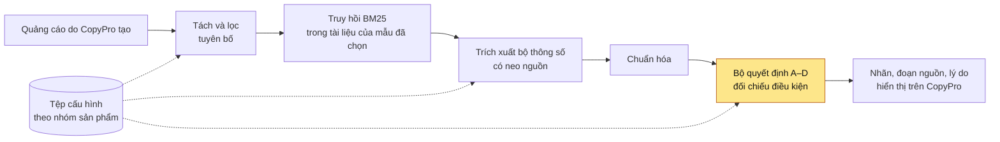
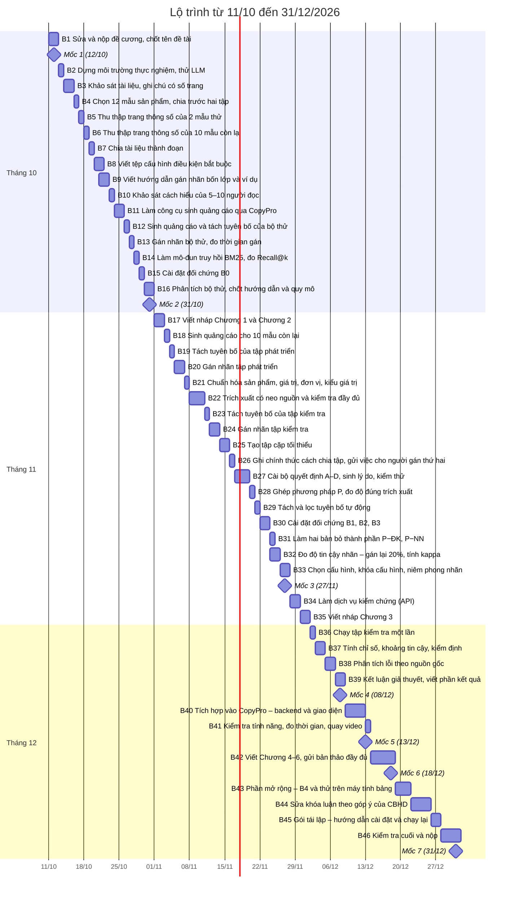
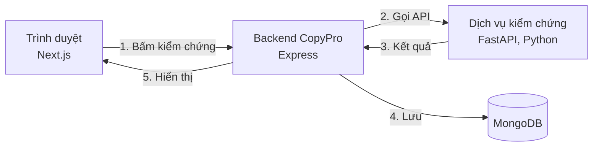

# Chi tiết tuyến tính của khóa luận

**Đề tài:** Phương pháp kiểm chứng tuyên bố về thông số kỹ thuật có điều kiện ràng buộc trong quảng cáo  
**Sinh viên:** Bùi Lê Huy Phước (23521228) · **CBHD** (cán bộ hướng dẫn): ThS Trần Hồng Nghi · **Hạn nộp:** 31/12/2026  
Kế hoạch bám theo [đề cương bản cuối](de_cuong/23521228_BuiLeHuyPhuoc_DeCuongKLTN.pdf) ngày 11/10/2026. Cập nhật lần cuối: 20/10/2026.

> **Cách dùng file này**
>
> 1. Đọc từ trên xuống, làm lần lượt **Bước 1 → Bước 47**. Xong bước trước mới sang bước sau. Hôm nay (11/10/2026) **bắt đầu ở [Bước 1](#b01)**.
> 2. Mỗi bước ghi ngày làm, việc cần làm, tệp phải làm ra và khi nào là xong. Làm xong việc nào thì sửa `- [ ]` thành `- [x]` ở việc đó; xong cả bước thì đánh dấu bước đó trong danh sách ngay dưới đây.
> 3. 🏁 là mốc phải gửi kết quả cho CBHD. ⭐ là phần mở rộng, chỉ làm khi đúng tiến độ.
> 4. Các đường dẫn bắt đầu bằng chữ T (ví dụ T4.3, T10) trỏ tới [phần Tra cứu](#tra-cuu) ở cuối file: định nghĩa nhãn, đặc tả phương pháp, cách đánh giá, rủi ro, chữ viết tắt. Chỉ mở khi bước đang làm nhắc tới.
> 5. Chậm hơn ngày ghi ở bước đang làm quá 2 ngày thì áp dụng ngay thứ tự rút gọn ở [T9.2](#t9-2), không dồn việc sang tuần sau.

## Danh sách việc từ đầu đến cuối

**Tháng 10/2026**

- [ ] [Bước 1](#b01) · 11/10 – 12/10 · Sửa và nộp đề cương, chốt tên đề tài
- 🏁 [**Mốc 1** · 12/10 · Chốt đề cương](#m1)
- [ ] [Bước 2](#b02) · 13/10 · Dựng môi trường thực nghiệm, thử LLM
- [x] [Bước 3](#b03) · 14/10 – 15/10 · Khảo sát tài liệu, ghi chú có số trang
- [x] [Bước 4](#b04) · 16/10 · Chọn 12 mẫu sản phẩm, chia trước hai tập
- [ ] [Bước 5](#b05) · 17/10 · Thu thập trang thông số của 2 mẫu thử
- [ ] [Bước 6](#b06) · 18/10 · Thu thập trang thông số của 10 mẫu còn lại
- [ ] [Bước 7](#b07) · 19/10 · Chia tài liệu thành đoạn
- [ ] [Bước 8](#b08) · 20/10 – 21/10 · Viết tệp cấu hình điều kiện bắt buộc
- [ ] [Bước 9](#b09) · 21/10 – 22/10 · Viết hướng dẫn gán nhãn bốn lớp và ví dụ
- [ ] [Bước 10](#b10) · 23/10 · Khảo sát cách hiểu của 5–10 người đọc
- [ ] [Bước 11](#b11) · 24/10 – 25/10 · Làm công cụ sinh quảng cáo qua CopyPro
- [ ] [Bước 12](#b12) · 26/10 · Sinh quảng cáo và tách tuyên bố của bộ thử
- [x] [Bước 13](#b13) · 27/10 · Gán nhãn bộ thử, đo thời gian gán
- [x] [Bước 14](#b14) · 28/10 · Làm mô-đun truy hồi BM25, đo Recall@k
- [x] [Bước 15](#b15) · 29/10 · Cài đặt đối chứng B0
- [ ] [Bước 16](#b16) · 30/10 – 31/10 · Phân tích bộ thử, chốt hướng dẫn và quy mô
- 🏁 [**Mốc 2** · 31/10 · Xong bộ thử](#m2)

**Tháng 11/2026**

- [x] [Bước 17](#b17) · 01/11 – 02/11 · Viết nháp Chương 1 và Chương 2
- [x] [Bước 18](#b18) · 03/11 · Sinh quảng cáo cho 10 mẫu còn lại
- [ ] [Bước 19](#b19) · 04/11 · Tách tuyên bố của tập phát triển
- [ ] [Bước 20](#b20) · 05/11 – 06/11 · Gán nhãn tập phát triển
- [x] [Bước 21](#b21) · 07/11 · Chuẩn hóa sản phẩm, giá trị, đơn vị, kiểu giá trị
- [ ] [Bước 22](#b22) · 08/11 – 10/11 · Trích xuất có neo nguồn và kiểm tra đầy đủ
- [ ] [Bước 23](#b23) · 11/11 · Tách tuyên bố của tập kiểm tra
- [ ] [Bước 24](#b24) · 12/11 – 13/11 · Gán nhãn tập kiểm tra
- [ ] [Bước 25](#b25) · 14/11 – 15/11 · Tạo tập cặp tối thiểu
- [ ] [Bước 26](#b26) · 16/11 · Ghi chính thức cách chia tập, gửi việc cho người gán thứ hai
- [x] [Bước 27](#b27) · 17/11 – 19/11 · Cài bộ quyết định A–D, sinh lý do, kiểm thử
- [ ] [Bước 28](#b28) · 20/11 · Ghép phương pháp P, đo độ đúng trích xuất
- [ ] [Bước 29](#b29) · 21/11 · Tách và lọc tuyên bố tự động
- [ ] [Bước 30](#b30) · 22/11 – 23/11 · Cài đặt đối chứng B1, B2, B3
- [ ] [Bước 31](#b31) · 24/11 · Làm hai bản bỏ thành phần P−ĐK, P−NN
- [ ] [Bước 32](#b32) · 24/11 – 25/11 · Đo độ tin cậy nhãn: gán lại 20%, tính kappa
- [ ] [Bước 33](#b33) · 26/11 – 27/11 · Chọn cấu hình, khóa cấu hình, niêm phong nhãn
- 🏁 [**Mốc 3** · 27/11 · Khóa cấu hình](#m3)
- [ ] [Bước 34](#b34) · 28/11 – 29/11 · Làm dịch vụ kiểm chứng (API)
- [ ] [Bước 35](#b35) · 30/11 – 01/12 · Viết nháp Chương 3

**Tháng 12/2026**

- [ ] [Bước 36](#b36) · 02/12 · Chạy tập kiểm tra một lần
- [ ] [Bước 37](#b37) · 03/12 – 04/12 · Tính chỉ số, khoảng tin cậy, kiểm định
- [ ] [Bước 38](#b38) · 05/12 – 06/12 · Phân tích lỗi theo nguồn gốc
- [ ] [Bước 39](#b39) · 07/12 – 08/12 · Kết luận giả thuyết, viết phần kết quả
- 🏁 [**Mốc 4** · 08/12 · Có kết quả tập kiểm tra](#m4)
- [ ] [Bước 40](#b40) · 09/12 – 12/12 · Tích hợp vào CopyPro: backend và giao diện
- [ ] [Bước 41](#b41) · 13/12 · Kiểm tra tính năng, đo thời gian, quay video
- 🏁 [**Mốc 5** · 13/12 · Tính năng chạy trên CopyPro](#m5)
- [ ] [Bước 42](#b42) · 14/12 – 18/12 · Viết Chương 4–6, gửi bản thảo đầy đủ
- 🏁 [**Mốc 6** · 18/12 · Bản thảo đầy đủ](#m6)
- [ ] [Bước 43](#b43) · 19/12 – 21/12 · Phần mở rộng: B4 và thử trên máy tính bảng ⭐ *(chỉ làm khi đúng tiến độ)*
- [ ] [Bước 44](#b44) · 22/12 – 25/12 · Sửa khóa luận theo góp ý của CBHD
- [ ] [Bước 45](#b45) · 26/12 – 27/12 · Gói tái lập: hướng dẫn cài đặt và chạy lại
- [ ] [Bước 46](#b46) · 28/12 – 31/12 · Kiểm tra cuối và nộp
- 🏁 [**Mốc 7** · 31/12 · Nộp](#m7)

**Sau khi nộp**

- [ ] [Bước 47](#b47) · theo lịch của Khoa · Chuẩn bị bảo vệ

---

<a id="thang-10"></a>

## Tháng 10/2026 · Chốt đề cương, chuẩn bị, làm thử trên 2 mẫu

> **Cuối tháng phải có:** bộ thử khoảng 60 tuyên bố của 2 mẫu thử đã gán nhãn; BM25 và B0 chạy được trên bộ thử; hướng dẫn gán nhãn bản 2; quy mô dữ liệu đã chốt ([Mốc 2](#m2), 31/10).

<a id="b01"></a>

### Bước 1 · Sửa và nộp đề cương, chốt tên đề tài

**Ngày:** Chủ nhật 11/10 – Thứ Hai 12/10 · **Thời lượng:** khoảng 2 giờ · **Thuộc:** Việc chung · **Kết thúc bằng:** [Mốc 1](#m1)

**Để làm gì.** Chốt đề cương và tên đề tài với CBHD đúng hạn 12/10. Đề cương bản cuối là chuẩn cho mọi bước sau.

> Bản gửi CBHD là `de_cuong/23521228_BuiLeHuyPhuoc_DeCuongKLTN.pdf`, xuất từ `de_cuong/23521228_BuiLeHuyPhuoc_DeCuongKLTN_ban_cuoi.docx`: bản Google Docs ngày 11/10/2026 tải về dạng .docx, đã sửa các chỗ dưới đây. File Google Docs vẫn là nội dung cũ, nên nếu còn sửa đề cương thì sửa trên tệp `_ban_cuoi.docx` này (hoặc mở nó bằng Google Docs) rồi xuất lại PDF. Hai tệp `23521228_BuiLeHuyPhuoc_DeCuongKLTN.docx` và `..._chu_do.docx` là bản dựng bằng script trước khi chuyển sang Google Docs, đã cũ, không sửa.

**Việc cần làm**

- [x] Sửa bốn chỗ còn sót trong bản ngày 11/10/2026:
  - **Trích dẫn MeasEval (đã sửa).** Ba mục cuối của danh mục xếp lại thành [14] MeasEval, [15] VitaminC, [16] BM25, đúng thứ tự xuất hiện trong bài theo chuẩn IEEE. Trong bài: "MeasEval [14]" (mục Tính mới), "VitaminC [15]" (mục Đóng góp), "theo mức độ liên quan [16]" (Nội dung 2).
  - **Bảy trường (đã sửa).** Nội dung 2 ghi "điền bảy trường thông số (sản phẩm, phiên bản, bộ phận, thông số, giá trị, đơn vị, điều kiện áp dụng cùng kiểu giá trị)" thay cho "nêu ở mục 3".
  - **Hình 1 (đã sửa).** Chỉ khối "Bộ quyết định" có nền xanh; khối "Trích xuất bộ thông số có neo nguồn" để nền trắng, khớp chú thích "khối nền xanh là bước chứa điểm mới của đề tài".
  - **Phân công công việc (đã thêm).** Mục "3. Phân công công việc" ngay trước "Tài liệu tham khảo": "Sinh viên Bùi Lê Huy Phước thực hiện toàn bộ công việc của đề tài. Người gán nhãn thứ hai chỉ gán độc lập khoảng 60 tuyên bố theo cùng hướng dẫn để tính hệ số kappa của Cohen."
- [x] Sửa các lỗi nhỏ: mục Đóng góp ghi tên nhãn tiếng Việt "(Đúng, Sai, Lệch điều kiện, Chưa đủ thông tin)"; thêm dấu chấm cuối rủi ro thứ năm; thống nhất thuật ngữ "tuyên bố" ở ba chỗ còn ghi "phát biểu" (Nội dung 1: "từng tuyên bố nhỏ của FactLens"; Thời gian biểu tháng 09/2026: "kiểm chứng tuyên bố chứa số liệu", "để tuyên bố không thay đổi ý nghĩa"), giữ "phát biểu chính trị" khi nói về dữ liệu của Tang và cộng sự.
- [x] Sửa định dạng: bản tải từ Google Docs không ghi phông mặc định và cấm nhiều hàng của khung bảng ngắt trang, nên mở ở chỗ khác bị đổi phông và có chỗ trống đến nửa trang. Bản cuối đặt Times New Roman làm phông mặc định, cho các hàng ngắt trang bình thường, chỉ giữ trọn hàng khi cần để tiêu đề không nằm một mình cuối trang (19 trang).
- [x] Xuất lại PDF, thay tệp `de_cuong/23521228_BuiLeHuyPhuoc_DeCuongKLTN.pdf` trong repo và commit.
- [ ] Gửi đề cương cho CBHD và nộp theo lịch của Khoa.
- [ ] Cập nhật tên đề tài trên hệ thống đăng ký; so từng ký tự với đề cương, cả tên tiếng Anh.
- [ ] Hỏi CBHD có đồng ý nhờ một bạn làm người gán nhãn thứ hai cho khoảng 60 tuyên bố không. Người này nhận việc vào 16/11 ([Bước 26](#b26)).

**Làm ra:** đề cương bản nộp; tên đề tài trên hệ thống khớp với đề cương.

**Xong khi:** CBHD xác nhận đề cương và tên đề tài.

**Tra cứu:** [T1](#t1) (đề tài trong một trang), [T14](#t14) (đối chiếu kế hoạch với đề cương).

<a id="m1"></a>

### 🏁 Mốc 1 · Thứ Hai 12/10 · Chốt đề cương

- **Phải có:** Đề cương và tên đề tài được CBHD xác nhận.
- **Gửi CBHD:** Đề cương bản cuối (PDF).
- **Trước khi gửi:** mọi bước trước mốc đã đánh dấu xong; tự kiểm theo [T15](#t15).

<a id="b02"></a>

### Bước 2 · Dựng môi trường thực nghiệm, thử LLM

**Ngày:** Thứ Ba 13/10 · **Thời lượng:** khoảng 5 giờ · **Thuộc:** Việc chung

> Bước này gồm cả việc tháng 9 của đề cương: cấu trúc lưu dữ liệu, kiểm tra tài nguyên máy, thử các LLM mã nguồn mở. Phần nào đã làm thì chỉ kiểm tra lại rồi đánh dấu xong.

**Để làm gì.** Có chỗ chứa dữ liệu, mã nguồn, kết quả và nháp khóa luận trước khi thu dữ liệu; biết máy và các API miễn phí chạy được LLM nào.

**Việc cần làm**

- [ ] Tạo các thư mục `data/`, `src/kiemchung/`, `tests/`, `scripts/`, `ket_qua/`, `luan_van/` theo [T3.1](#t3-1). Tạo `luan_van/nhat_ky.md` và ghi dòng nhật ký đầu tiên ([T3.5](#t3-5)).
- [ ] Tạo `requirements.txt`: Python ≥ 3.10, `rank-bm25`, `pyvi` hoặc `underthesea`, `pydantic`, `pyyaml`, `google-genai`, `groq`, `fastapi`, `uvicorn`, `pytest`, `scikit-learn`, `statsmodels`, `pandas`, `matplotlib`, `playwright`.
- [ ] Tạo `.env.example` chỉ chứa tên biến (`GEMINI_API_KEY`, `GROQ_API_KEY`); khóa thật chỉ để trong `.env` trên máy.
- [ ] Lịch sử Git của repo từng chứa tệp `.env`. Nếu khóa trong đó chưa thu hồi thì thu hồi ở trang của nhà cung cấp và tạo khóa mới.
- [ ] Viết `src/kiemchung/llm.py`: một hàm gọi LLM duy nhất, **có bộ nhớ đệm** theo mã băm của (mô hình, câu lệnh, tham số) và ghi nhật ký mọi lần gọi.
- [ ] Ghi cấu hình máy (CPU, RAM, GPU nếu có), dung lượng ổ đĩa còn trống, hạn mức gọi API miễn phí của Google AI Studio và Groq.
- [ ] Thử vài LLM (mã nguồn mở chạy trên máy, hoặc qua API như Groq) với 5–10 câu trích xuất mẫu lấy từ các ví dụ ở [T4.6](#t4-6); ghi thời gian và chất lượng sơ bộ.

**Làm ra:** cây thư mục, `requirements.txt`, `.env.example`, `src/kiemchung/llm.py`, `ket_qua/thu_llm.md`.

**Xong khi:** `pytest` chạy được; lệnh `git check-ignore .env` in ra `.env`; gọi cùng một câu lệnh hai lần thì lần hai lấy từ bộ nhớ đệm; có danh sách LLM ứng viên.

**Tra cứu:** [T3.1](#t3-1) (cấu trúc thư mục), [T3.5](#t3-5) (quy tắc làm việc).

<a id="b03"></a>

### Bước 3 · Khảo sát tài liệu, ghi chú có số trang

**Ngày:** Thứ Tư 14/10 – Thứ Năm 15/10 · **Thời lượng:** khoảng 8 giờ · **Thuộc:** Việc chung

> Bước này gồm việc tháng 9 (khảo sát nghiên cứu về kiểm chứng thông tin, truy hồi bằng chứng, tuyên bố chứa số liệu, suy luận có điều kiện) và việc khảo sát bổ sung tháng 10 của đề cương. Phần nào đã làm thì chỉ kiểm tra lại rồi đánh dấu xong.

**Để làm gì.** Nắm các hướng kiểm chứng đã có, để viết Chương 2 và trả lời được câu "đề tài khác gì các bài trước".

**Việc cần làm**

- [x] Gom đủ bài gốc. Từ 14/10, thư mục `báo/` đã có đủ 16 PDF đánh số theo đề cương hiện tại; tên bài, phiên bản và mã băm nằm trong `báo/README.md` và `báo/danh_muc.json`. Bộ sáu bài cũ đã được thay. Bài bổ sung lưu theo tên tại `báo/bo_sung/`, không đổi số của đề cương.
- [x] Đọc các nhóm nghiên cứu trong đề cương: kiểm chứng tự động (FEVER [2], AVeriTeC [3]); tuyên bố nửa sự thật (Tang và cộng sự [4]); kiểm chứng tiếng Việt (ViFactCheck [5], ViNumFCR [6], SemViQA [7]); tuyên bố số liệu (NumPert [8], VeriFin [9]); văn bản do LLM tạo (FactLens [10], MiniCheck [11]); kiểm chứng quảng cáo và mô tả sản phẩm (Nguyen và cộng sự [12], Jiang và cộng sự [1]); truy hồi bằng chứng (Fathom [13], BM25 [16]); thông tin đi kèm số đo (MeasEval [14]); cặp tương phản (VitaminC [15]).
- [x] Khảo sát bổ sung theo đề cương tháng 10: ảo giác của LLM, tuyên bố nửa sự thật, kiểm chứng kết hợp ký hiệu, kiểm chứng tiếng Việt. Đã ghi FActScore, Beyond Binary, ProgramFC, ViWikiFC; kiểm thêm báo cáo FTC được nhắc trong bối cảnh.
- [x] Mỗi bài ghi: bài toán, dữ liệu, cách gán nhãn, kết quả chính, hạn chế so với đề tài, và **số trang** của từng ý sẽ trích.
- [x] Đối chiếu các con số đề cương đã trích với bài gốc. Fathom F1 = 0 được xác nhận trên dev; NumPert cần phân biệt điểm phần trăm và không coi 62 là mức giảm tối đa chung; MiniCheck cần nêu thiết lập BAcc/chi phí. Chi tiết và các chỗ cần diễn đạt lại nằm trong ghi chú.

**Làm ra:** `luan_van/ghi_chu_tai_lieu.md`.

**Đã đối chiếu ngày 15/10/2026:** [ghi chú và bảng kiểm trích dẫn](luan_van/ghi_chu_tai_lieu.md). Hoàn thành khảo sát/kiểm nguồn; các nhận định cần thu hẹp hoặc sửa cách trích được đánh dấu để dùng khi viết Chương 2, chưa sửa PDF/DOCX đề cương đã nộp.

**Xong khi:** mỗi câu nói về bài khác trong đề cương có số trang trong bài gốc.

**Tra cứu:** [T1.5](#t1-5) (tính mới và đóng góp), [T8.1](#t8-1) (dàn ý Chương 2), [T11](#t11) (câu hỏi phản biện).

<a id="b04"></a>

### Bước 4 · Chọn 12 mẫu sản phẩm, chia trước hai tập

**Ngày:** Thứ Sáu 16/10 · **Thời lượng:** khoảng 3 giờ · **Thuộc:** Nội dung 1 (dữ liệu)

> Bước này gồm việc tháng 9 "xây dựng tiêu chí chọn nguồn" của đề cương.

**Để làm gì.** Chọn đúng 12 mẫu và chia trước tập phát triển và tập kiểm tra, để thông tin của tập kiểm tra không lọt vào lúc phát triển phương pháp.

**Việc cần làm**

- [x] Ghi tiêu chí chọn nguồn vào `data/THE_DU_LIEU.md` (mục "Nguồn"; thẻ dữ liệu được hoàn thiện ở Bước 45): trang thông số chính thức tiếng Việt của hãng; có con số kèm chú thích điều kiện; ghi được đường dẫn và ngày truy cập.
- [x] Mở trang thông số tiếng Việt của các ứng viên; chỉ giữ mẫu có ít nhất 3 thông số kèm điều kiện:
  - điện thoại: iPhone 17, Xiaomi 15T, OPPO Find X8, một mẫu Galaxy S, một mẫu khác;
  - tai nghe: Galaxy Buds3 Pro, AirPods Pro 3, AirPods 4, một mẫu Xiaomi hoặc OPPO;
  - đồng hồ: Apple Watch SE 3, một mẫu Galaxy Watch, một mẫu Xiaomi.
- [x] Ghi `data/mau_san_pham.csv`: mã mẫu (theo [T3.2](#t3-2)), nhóm, hãng, tên, URL, tập.
- [x] Chia trước (đề xuất):
  - **tập phát triển, 4 mẫu:** iPhone 17 và Galaxy Buds3 Pro (2 mẫu thử), Apple Watch SE 3, Xiaomi 15T;
  - **tập kiểm tra, 8 mẫu còn lại:** nhóm nào và hãng nào cũng có mẫu.
- [x] Không đặt hai mẫu cùng dòng (ví dụ Xiaomi 15T và 15T Pro) vào hai tập khác nhau.
- [x] Ghi vào nhật ký: từ hôm nay, mọi lựa chọn thiết kế (tệp cấu hình, ví dụ trong hướng dẫn, câu lệnh, tham số) chỉ dựa trên tập phát triển ([T3.5](#t3-5), quy tắc 4).

**Làm ra:** `data/mau_san_pham.csv`, `data/THE_DU_LIEU.md` (bản đầu).

**Xong khi:** đủ 3 nhóm và ít nhất 3 hãng; tập phát triển có đủ 3 nhóm; tập kiểm tra có đủ nhóm và đủ hãng.

**Đã thực hiện ngày 15/10/2026:** [danh sách 12 mẫu](data/mau_san_pham.csv) và [thẻ dữ liệu bản đầu](data/THE_DU_LIEU.md). Đã kiểm lại từng giá trị/điều kiện theo T4.1/T4.5 trong [hồ sơ kiểm nguồn](data/kiem_tra_nguon_buoc4.json), sửa các căn cứ chưa đúng phạm vi và bổ sung chú thích; giữ nguyên 4 mẫu phát triển/8 mẫu kiểm tra; cả hai tập có đủ ba nhóm, tập kiểm tra có đủ bốn hãng. Chưa thực hiện thu thập bằng chứng của Bước 5–6.

**Tra cứu:** [T1.6](#t1-6) (phạm vi), [T3.2](#t3-2) (mã định danh), [T6.3](#t6-3) (chia tập).

<a id="b05"></a>

### Bước 5 · Thu thập trang thông số của 2 mẫu thử

**Ngày:** Thứ Bảy 17/10 · **Thời lượng:** khoảng 3 giờ · **Thuộc:** Nội dung 1 (dữ liệu)

**Để làm gì.** Có bằng chứng chính hãng truy vết được: người khác mở lại được đúng trang đã dùng, đúng thời điểm đã dùng. Làm 2 mẫu thử trước để sửa script cho chắc, rồi mới chạy cho 10 mẫu còn lại.

**Việc cần làm**

- [x] Viết script Playwright: mở URL, chờ tải xong, mở các mục "Xem thêm" và chú thích, rồi lưu `page.html`, `page.txt` (chữ hiển thị), `full.png` (ảnh chụp toàn trang) và `meta.json` (URL, thời điểm truy cập, mã băm SHA-256, tức "dấu vân tay" của tệp: đổi một ký tự là đổi mã). Có thể lấy lại `scripts/capture_evidence.mjs` từ commit `ba88a48`. Đã viết lại bằng Python: `scripts/chup_nguon.py`, test ở `tests/test_chup_nguon.py`.
- [x] Chạy cho iPhone 17 và Galaxy Buds3 Pro. Đặt `page.txt` cạnh trang trên trình duyệt: mọi chú thích điều kiện (dấu *, số mũ, "kết quả có thể thay đổi") phải có trong `page.txt`.
- [x] Kiểm chỗ nghi vấn thấy khi xem trang ngày 09/10/2026: chú thích chế độ chống ồn cho tổng thời gian kèm hộp sạc trên trang Galaxy Buds3 Pro. Vẫn còn: khối thông số ghi "Đến 7/30 giờ" khi tắt ANC và "Đến 6/26 giờ" khi bật ANC, nhưng chú thích ghi "với tính năng bật/tắt ANC … tối đa 30 giờ". Giữ nguyên quyết định ở mục 5 của `data/THE_DU_LIEU.md`: không dùng tổng 26/30 giờ làm căn cứ.
- [x] Kiểm lại trên bản chụp các con số dùng trong ví dụ 1–12 và 18 của hướng dẫn gán nhãn ([T4.6](#t4-6)). Các con số đều khớp. Trang Samsung gọi chế độ xuyên âm là "Ambient", nên ví dụ 18 cần tệp cấu hình biết cả hai cách gọi.
- [x] Sao lưu ảnh chụp ra ngoài máy, ví dụ lên Google Drive.

**Làm ra:** script chụp trang trong `scripts/`; `data/nguon/dt-apple-iphone17/` và `data/nguon/tn-samsung-buds3pro/`, mỗi thư mục 4 tệp.

**Xong khi:** hai mẫu có đủ 4 tệp; mọi chú thích điều kiện có trong `page.txt`; các con số của ví dụ đã được kiểm.

**Đã thực hiện ngày 19/10/2026:** [iPhone 17](data/nguon/dt-apple-iphone17/meta.json) và [Galaxy Buds3 Pro](data/nguon/tn-samsung-buds3pro/meta.json) đều HTTP 200, đủ 4 tệp, mã băm khớp. `page.txt` có đủ chú thích điều kiện đã ghi ở Bước 4; không có chú thích thông số nào bị ẩn. `.gitattributes` giữ nguyên từng byte của `data/nguon/` để mã băm không đổi khi checkout trên Windows. Đã sao lưu `data/nguon/` lên Google Drive ngày 25/10/2026.

**Tra cứu:** [T3.1](#t3-1), [T3.2](#t3-2), [T4.6](#t4-6).

<a id="b06"></a>

### Bước 6 · Thu thập trang thông số của 10 mẫu còn lại

**Ngày:** Chủ nhật 18/10 · **Thời lượng:** khoảng 3 giờ · **Thuộc:** Nội dung 1 (dữ liệu)

**Để làm gì.** Có bằng chứng cho đủ 12 mẫu, bằng script đã kiểm ở Bước 5.

**Việc cần làm**

- [x] Chạy script của Bước 5 cho 10 mẫu còn lại. 4 mẫu Xiaomi bị www.mi.com chặn (HTTP 403) nên lưu `page.html`/`page.txt` từ Chrome thật và nhập bằng `scripts/nhap_nguon_thu_cong.py`; `full.png` của các trang này dựng lại từ `page.html`.
- [x] Mỗi mẫu: kiểm `page.txt` có đủ chú thích điều kiện. Thiếu thì chụp lại sau khi trang hiển thị xong; vẫn thiếu thì ghi vào nhật ký (rủi ro thứ hai ở [T9.1](#t9-1)).
- [x] Kiểm chỗ nghi vấn trên trang OPPO Find X8: giá trị "định mức" lớn hơn giá trị "tiêu chuẩn". Vẫn còn: trang thông số ghi định mức 5630mAh, tiêu chuẩn 5490mAh; chú thích trang giới thiệu ghi ngược lại.
- [x] Kiểm lại trên bản chụp các con số của ví dụ 13–17 ở [T4.6](#t4-6) (Apple Watch SE 3, Xiaomi 15T). Đều khớp.
- [x] Với 8 mẫu của tập kiểm tra, chỉ kiểm tệp có đủ chú thích; không lấy ý tưởng cho tệp cấu hình hay ví dụ hướng dẫn từ các trang này.
- [x] Sao lưu ảnh chụp ra ngoài máy.

**Làm ra:** `data/nguon/<ma_mau>/` của 10 mẫu còn lại.

**Xong khi:** đủ 12 mẫu, mỗi mẫu 4 tệp; mọi chú thích điều kiện có mặt trong `page.txt`.

**Đã thực hiện ngày 20/10/2026:** đủ 12 mẫu trong `data/nguon/`, trang chính của mỗi mẫu có 4 tệp, mã băm khớp. `scripts/chup_nguon.py` thêm nhánh PDF (hướng dẫn Galaxy Watch8 lưu thành `bo_sung/tai_lieu.pdf` và `page.txt`). 4 mẫu Xiaomi lưu thủ công từ Chrome, ghi rõ trong `meta.json` và `data/nguon/thu_cong_20261020.json`; 4 trang `bo_sung` của Xiaomi chưa có `full.png`. Đã sao lưu `data/nguon/` lên Google Drive ngày 25/10/2026. Chi tiết trong [nhật ký](luan_van/nhat_ky.md).

**Tra cứu:** [T9.1](#t9-1) (rủi ro trang thiếu chú thích).

<a id="b07"></a>

### Bước 7 · Chia tài liệu thành đoạn

**Ngày:** Thứ Hai 19/10 · **Thời lượng:** khoảng 4 giờ · **Thuộc:** Nội dung 1 (dữ liệu)

**Để làm gì.** Chia tài liệu thành đoạn để BM25 tìm được, nhưng không tách con số khỏi điều kiện của nó.

**Việc cần làm**

- [x] Viết hàm chia đoạn đọc `page.txt`: mỗi dòng hoặc mục thông số là một đoạn.
- [x] Nối chú thích (dấu *, số mũ, "kết quả có thể thay đổi") vào đoạn mang ký hiệu tương ứng.
- [x] Đặt tên mục ("Pin", "Màn hình") ở đầu mỗi đoạn để giữ ngữ cảnh.
- [x] Đặt mã đoạn theo dạng `<ma_mau>#<số>` ([T3.2](#t3-2)).
- [x] Chạy cho 12 mẫu; lấy ngẫu nhiên 20 đoạn để kiểm bằng mắt.

**Làm ra:** `data/nguon/<ma_mau>/doan.jsonl` của 12 mẫu.

**Xong khi:** trong 20 đoạn kiểm ngẫu nhiên, không đoạn nào mất điều kiện đi kèm con số.

**Đã thực hiện ngày 25/10/2026:** `src/kiemchung/chia_doan.py` (luật tách ghi ở docstring), `scripts/chia_doan.py`, `tests/test_chia_doan.py`; 12 mẫu có `doan.jsonl`, tổng 1.245 đoạn (PDF Watch8 trích lại bằng `pdftotext`, xem nhật ký). Luật tách thiết kế trên 4 mẫu phát triển; với tập kiểm tra chỉ sửa phần đọc định dạng. Lần kiểm 1 ([kiem_doan_buoc7.md](data/kiem_doan_buoc7.md)) không đạt: 2/20 đoạn mất chú thích, kèm lỗi lệch số chú thích Samsung. Sau khi sửa, lần kiểm 2 với 20 đoạn mới ([kiem_doan_buoc7_lan2.md](data/kiem_doan_buoc7_lan2.md)) đạt 20/20. Chú thích không được đoạn nào dẫn tới: 0 ở 11 mẫu, 3 ở Xiaomi 15T (trang không có ký hiệu). Chi tiết và rủi ro cho Bước 8 trong [nhật ký](luan_van/nhat_ky.md).

**Sửa ngày 31/10/2026 (trong Bước 13):** `noi_dung` bỏ ký hiệu chú thích của trang hãng ("Thấp8", "20 phút6", "IP68**"), văn bản cũ giữ ở trường mới `noi_dung_goc`; mã đoạn, `chu_thich` và số đoạn không đổi, 190/1.245 đoạn đổi chữ. Ký hiệu `chia_doan` không tự nhận ra thì bỏ bằng bảng ghi tay `KY_HIEU_BO_THEM` (21 mục). Danh sách từng chỗ xóa: [kiem_bo_so_chu_thich.md](data/kiem_bo_so_chu_thich.md).

**Tra cứu:** [T3.2](#t3-2) (mã đoạn).

<a id="b08"></a>

### Bước 8 · Viết tệp cấu hình điều kiện bắt buộc

**Ngày:** Thứ Ba 20/10 – Thứ Tư 21/10 · **Thời lượng:** khoảng 5 giờ · **Thuộc:** Nội dung 1 (dữ liệu)

**Để làm gì.** Ghi ra trước khi gán nhãn: thuộc tính nào có điều kiện, điều kiện nào là bắt buộc, và người đọc hiểu thế nào khi quảng cáo không nêu điều kiện. Quy tắc A–D chỉ đọc tệp này, nên thêm nhóm sản phẩm chỉ cần thêm tệp.

**Việc cần làm**

- [x] Viết 3 tệp `dien_thoai.yaml`, `tai_nghe.yaml`, `dong_ho.yaml` theo mẫu ở [T5.7](#t5-7), dựa vào bảng cách hiểu thông thường ở [T4.5](#t4-5).
- [x] Mỗi thuộc tính có: đơn vị; hướng thuận lợi (cao hơn tốt hơn hay thấp hơn tốt hơn); kiểu giá trị mặc định; các điều kiện bắt buộc và loại của từng điều kiện (một trong sáu loại); cách hiểu thông thường; các cách diễn đạt của từng điều kiện. Mỗi tệp có thêm bảng bí danh tên sản phẩm và phiên bản ([T5.4](#t5-4)).
- [x] Ghi danh sách từ khẳng định chắc chắn ("luôn", "đảm bảo", "ít nhất", "mọi lúc").
- [x] **Chỉ dùng trang của tập phát triển** khi viết.
- [x] Lập `data/cau_hinh/bao_phu_dieu_kien.md` từ bốn mẫu phát triển: thuộc tính → điều kiện → loại điều kiện → phạm vi áp dụng → nguồn/chú thích → cách xử lý khi không nêu. Giữ nguyên 12 mẫu và cách chia tập; tiêu chí ba thông số có điều kiện ở Bước 4 chưa đảm bảo cấu hình bao phủ đủ.
- [x] Chốt điều kiện tham gia quyết định nhãn và điều kiện chỉ lưu làm ngữ cảnh thử nghiệm, kèm lý do. Không mặc nhiên coi mọi chú thích là điều kiện bắt buộc. Kiểm tra dữ liệu Bước 5–7 giữ được liên kết giữa con số và chú thích.
- [x] Quy định phạm vi áp dụng của từng điều kiện theo T5.7; phân biệt không áp dụng, không nêu và chưa xác định. Không ép mọi sản phẩm trong nhóm có cùng điều kiện, không đổi trường trống thành "tắt" hoặc "không có".
- [x] Không bổ sung quy tắc/bí danh điều kiện từ tám mẫu kiểm tra để xử lý riêng các mẫu đó. Điều kiện chưa hỗ trợ xử lý theo T5.3 và ghi nhận khi đánh giá; xem nguồn để chọn mẫu không có nghĩa được dùng nguồn đó để thiết kế cấu hình.
- [x] Chốt điểm 2, 3, 4, 11 và 12 ở [T10](#t10); ghi kết quả vào nhật ký.

**Làm ra:** `data/cau_hinh/dien_thoai.yaml`, `data/cau_hinh/tai_nghe.yaml`, `data/cau_hinh/dong_ho.yaml`, `data/cau_hinh/bao_phu_dieu_kien.md`.

**Xong khi:** mọi thuộc tính trong sáu nhóm thông số có đủ các khóa như mẫu ở T5.7; mỗi điều kiện dạng số (công suất bộ tiếp hợp, độ sâu và thời gian ngâm, mốc phần trăm, số phút sạc, phần diện tích đo) có đơn vị và quan hệ so sánh với giá trị trong tài liệu (thêm 27/10: mẫu T5.7 chỉ có điều kiện dạng chữ, nên tiêu chí cũ cho qua chỗ thiếu này); có luật cho điều kiện lạ trong tài liệu; có bảng bao phủ từ tập phát triển, phạm vi áp dụng, quy tắc xử lý ba trạng thái và phần chưa hỗ trợ; `scripts/kiem_cau_hinh.py` báo 0 lỗi. Không yêu cầu bao phủ trước mọi điều kiện của tập kiểm tra.

**Đã thực hiện ngày 26/10/2026:** [bao_phu_dieu_kien.md](data/cau_hinh/bao_phu_dieu_kien.md) lập từ việc đọc trọn trang của 4 mẫu phát triển; mỗi điều kiện có loại, phạm vi áp dụng, cách hiểu khi không nêu, vai trò (quyết định nhãn hay chỉ ngữ cảnh), căn cứ và mã đoạn nguồn. Kế hoạch ghi "sáu nhóm thông số" nhưng không liệt kê; cấu hình dùng 16 thuộc tính (điện thoại 8, gồm công suất sạc mới thêm; tai nghe 4; đồng hồ 4). Cấu hình gồm `chung.yaml` (chuẩn hóa, kiểu giá trị, từ khẳng định, cách chọn con số khi quảng cáo không nêu điều kiện) và 3 tệp nhóm có bảng bí danh 12 mẫu. `scripts/kiem_cau_hinh.py` kiểm đủ khóa, sáu loại điều kiện, căn cứ chỉ từ tập phát triển, mỗi cụm "tu_tai_lieu" có trong tài liệu tập phát triển: 0 lỗi; 115 test đạt. Đã chốt điểm 2, 3, 4, 11, 12 ở T10 (điểm 11, 12 đổi so với đề xuất; điểm 2 giữ như đề xuất sau khi đọc báo cáo gốc FTC 2012) và tạm chốt cách hiểu ở điểm 1; thêm điểm 15 (luật chặn điều kiện lạ trong tài liệu, phân tích ở `luan_van/phan_tich_dieu_kien_ngoai_cau_hinh.md`); thêm khảo sát 20–30 người ở Bước 10, điểm dừng cho nhãn Lệch ở Bước 16 và phân tích độ nhạy, độ bao phủ ở Bước 37. Ngày 27/10 bổ sung điều kiện dạng số: 6 điều kiện có đơn vị và quan hệ so sánh (`dieu_kien_so`), kháng nước tách thành độ sâu và thời gian ngâm; kiểm cấu hình 0 lỗi, 15 test cấu hình đạt. Chưa làm: thử độ bao phủ trên 3 sản phẩm ngoài 12 mẫu (làm trước Bước 9, là một tiêu chí của điểm dừng Bước 16). Chi tiết trong [nhật ký](luan_van/nhat_ky.md).

**Tra cứu:** [T5.7](#t5-7) (mẫu tệp cấu hình), [T4.5](#t4-5) (cách hiểu thông thường), [T10](#t10) (điểm cần chốt).

<a id="b09"></a>

### Bước 9 · Viết hướng dẫn gán nhãn bốn lớp và ví dụ

**Ngày:** Thứ Tư 21/10 – Thứ Năm 22/10 · **Thời lượng:** khoảng 6 giờ · **Thuộc:** Nội dung 1 (dữ liệu)

> Bước này gồm việc tháng 9 "hướng dẫn gán nhãn, ít nhất 20 ví dụ, giữ ngữ cảnh khi tách" và việc tháng 10 "hướng dẫn gán nhãn bốn lớp, bổ sung ví dụ điện thoại và đồng hồ" của đề cương. Phần nào đã làm thì chỉ kiểm tra lại rồi đánh dấu xong.

**Để làm gì.** Có hướng dẫn gán nhãn bốn lớp dùng chung cho người gán nhãn và cho hệ thống. P cài đúng các quy tắc trong hướng dẫn, nên hai bên phải luôn khớp nhau.

**Việc cần làm**

- [x] Viết `data/huong_dan_gan_nhan.md` bản 1 theo [T4](#t4): quy tắc tách tuyên bố giữ ngữ cảnh ([T4.1](#t4-1)), định nghĩa bốn nhãn ([T4.2](#t4-2)), thứ tự quyết định D1–D6 ([T4.3](#t4-3)), cách ghi bằng chứng và lý do ([T4.4](#t4-4)), cách hiểu thông thường lấy từ tệp cấu hình của Bước 8 ([T4.5](#t4-5)).
- [x] Viết **ít nhất 24 ví dụ** bốn nhãn, bắt đầu từ 18 ví dụ ở [T4.6](#t4-6), chỉ dùng mẫu của tập phát triển (iPhone 17, Galaxy Buds3 Pro, Apple Watch SE 3, Xiaomi 15T). Mỗi nhãn và mỗi loại biến đổi có ít nhất 2 ví dụ; có đủ các trường hợp đề cương nêu: đúng, sai đối tượng, sai điều kiện, thiếu bằng chứng, xung đột bằng chứng.
- [x] Không dùng lại bộ 23 ví dụ soạn tháng 9 cho đề tài cũ (commit `ba88a48`, tệp `evidence/2026-10-08/examples.json`): bộ đó toàn AirPods (AirPods Pro 3 và AirPods 4 thuộc tập kiểm tra dự kiến), dùng ba nhãn và có thông số ngoài phạm vi. Dùng lại sẽ làm lộ tập kiểm tra vào hướng dẫn và vào câu lệnh của B2.

**Làm ra:** `data/huong_dan_gan_nhan.md` (bản 1).

**Xong khi:** có ít nhất 24 ví dụ, mỗi ví dụ có nhãn, dòng quyết định và lý do; mọi cách hiểu thông thường trong hướng dẫn trùng với tệp cấu hình. Hướng dẫn phân biệt ba trạng thái ở T5.7: không nêu điều kiện không tự động mang nhãn Lệch; nhãn chuẩn dựa trên bằng chứng và hướng dẫn, không đổi thành Chưa đủ thông tin chỉ vì hệ thống chưa hỗ trợ điều kiện. Các cách hiểu mặc định ảnh hưởng đến nhãn được kiểm tra ở Bước 10.

**Đã thực hiện ngày 27/10/2026:** [huong_dan_gan_nhan.md](data/huong_dan_gan_nhan.md) bản 1, viết theo bộ luật Bước 8 ở commit `ab6146c`. 48 ví dụ, chỉ từ 4 mẫu phát triển: Đúng 15, Sai 5, Lệch 23, Chưa đủ thông tin 5; mỗi loại biến đổi có ít nhất 2 ví dụ (đổi phiên bản chỉ có ví dụ Đúng, vì tập phát triển không có trang tách giá trị theo phiên bản); đủ năm trường hợp của đề cương, cộng điều kiện dạng số, điều kiện cấu hình chưa biết (ghi `ngoai_cau_hinh`), bỏ "lên đến". Script kiểm: 74 câu trích đều là chuỗi con của `doan.jsonl`; bảng cách hiểu mặc định (41 cặp) và bảng hướng thuận lợi, kiểu giá trị (16 thuộc tính) trùng YAML; không có tên mẫu tập kiểm tra. So với T4.6: ví dụ 18 đổi nhãn (5 giờ trùng thời gian đàm thoại khi tắt chống ồn nên ra Lệch ở D4), ví dụ 16 đổi nhãn thành Lệch, chốt 27/10 (trang Xiaomi 15T chỉ có một con số độ sáng nên "cực đại" là kiểu giá trị, tuyên bố bỏ chế độ tự tăng sáng; mục 11.1 của hướng dẫn). Thêm quy ước ghi chú `mac_dinh`, `ngoai_cau_hinh`, `ngoai_sau_loai` và quy tắc chọn loại biến đổi khi khác nhiều điều kiện (tạm chốt, chốt ở Bước 27). Phát hiện cấu hình thiếu 5 cụm có ngay trong tập phát triển (mục 11.3 của hướng dẫn). Phiên thử độ bao phủ chưa xong; nếu phiên đó thêm luật thì đối chiếu lại mục 5, 6. Chi tiết trong [nhật ký](luan_van/nhat_ky.md).

**Tra cứu:** [T4](#t4) (toàn bộ hướng dẫn gán nhãn), [T3.4](#t3-4) (định dạng nhãn).

<a id="b10"></a>

### Bước 10 · Khảo sát cách hiểu của 20–30 người đọc

**Ngày:** Thứ Sáu 23/10 · **Thời lượng:** khoảng 2 giờ · **Thuộc:** Nội dung 1 (dữ liệu)

**Để làm gì.** Kiểm tra "cách hiểu thông thường" trong tệp cấu hình bằng người đọc thật, để cách hiểu này không chỉ là ý của người làm đề tài.

**Việc cần làm**

- [x] Soạn phiếu (ví dụ bằng Google Forms) khoảng 8 tuyên bố không nêu điều kiện, chỉ lấy mẫu của tập phát triển, ví dụ "Apple Watch SE 3 pin 32 giờ", "iPhone 17 sạc 50% trong 20 phút", "Galaxy Buds3 Pro pin 7 giờ". Với mỗi tuyên bố, hỏi người đọc hiểu là trong điều kiện nào (chọn một phương án hoặc tự ghi).
- [x] Gửi cho 20–30 người (sửa 26/10, trước là 5–10: quá ít để nói "đa số người mua hiểu là..."), ưu tiên người không học công nghệ thông tin vì gần với người mua thông thường. *(Thu được 10 phiếu, 8 người học công nghệ thông tin; đạt mức 5–10 của đề cương, chưa đạt 20–30. Người thực hiện chốt không khảo sát thêm.)*
- [x] Phiếu phải có các câu kiểm cách hiểu đã tạm chốt ở Bước 8: "Galaxy Buds3 Pro pin 6 giờ" (nghe nhạc hay đàm thoại, bật hay tắt chống ồn), "Apple Watch SE 3 pin 18 giờ" (sử dụng bình thường hay tập luyện), và một câu bỏ "lên đến" (người đọc hiểu là thường đạt hay tối đa; đối chiếu với kết quả FTC 2012, nơi bỏ "up to" không làm cách hiểu khác đi có ý nghĩa thống kê).
- [x] Ghi tỷ lệ người hiểu giống cách hiểu thông thường trong tệp cấu hình. Câu nào quá nửa số người hiểu khác thì sửa tệp cấu hình, hướng dẫn gán nhãn và nhãn của các ví dụ liên quan (ví dụ 8, 9, 14 ở [T4.6](#t4-6)).
- [x] Chốt điểm 1 ở [T10](#t10).
- [x] Nếu trong ngày chưa đủ 20 câu trả lời (sửa 27/10, trước là 5, chưa đổi theo mục tiêu 20–30) thì vẫn sang Bước 11; tổng hợp khi đủ, nhưng phải xong trước Bước 13 (gán nhãn bộ thử). *(Không áp dụng: đã tổng hợp với 10 phiếu.)*

**Làm ra:** `ket_qua/khao_sat_cach_hieu.md` (câu hỏi, số người, tỷ lệ đồng ý từng câu, các chỗ đã sửa).

**Xong khi:** có kết quả khảo sát; tệp cấu hình và hướng dẫn đã sửa theo khảo sát.

**Đã thực hiện ngày 27–28/10/2026:** [khao_sat_cach_hieu.md](ket_qua/khao_sat_cach_hieu.md). Phiếu 15 câu dùng câu quảng cáo do CopyPro tạo (18 bài Gemini 2.5 Flash, `ket_qua/khao_sat_quang_cao_goc.jsonl`), tạo form bằng `ket_qua/tao_google_form.gs`, cách chấm viết trước khi gửi. 10 phiếu, chấm bằng `scripts/tong_hop_khao_sat.py`. Sửa theo khảo sát: "xem video" không rõ loại coi như chưa nêu hoạt động (9/10; V03 thành Lệch); độ sáng điện thoại không có cách hiểu mặc định (7/10; V25, V26, V43 thành Chưa đủ thông tin). Giữ chế độ nguồn đồng hồ và zoom dù 6/10 hiểu khác, lệch khỏi tiêu chí đặt trước vì Q06 trái với Q11 trên cùng người trả lời, mẫu lệch về người học công nghệ thông tin và đổi thì tăng FAR; Bước 37 tính lại với mặc định thay thế. Quy tắc bỏ "lên đến" được ủng hộ (1/10). Ghi nhận cho Bước 11: 13/18 bài CopyPro bị cắt vì token suy luận tính vào giới hạn 1.800 token (mục 9 của tệp kết quả). Chi tiết trong [nhật ký](luan_van/nhat_ky.md).

**Tra cứu:** [T4.5](#t4-5), [T10](#t10) (điểm 1).

<a id="b11"></a>

### Bước 11 · Làm công cụ sinh quảng cáo qua CopyPro

**Ngày:** Thứ Bảy 24/10 – Chủ nhật 25/10 · **Thời lượng:** khoảng 6 giờ · **Thuộc:** Nội dung 1 (dữ liệu)

> Repo CopyPro vẫn đang được sửa trên `main` (commit `a62c31f` ngày 13/10/2026 đổi cách lưu bài). Tạo nhánh `kiem-chung-thong-so` từ `main` mới nhất và đối chiếu lại các đường dẫn ở [T7.3](#t7-3) trước khi sửa.

**Để làm gì.** Sinh quảng cáo đúng như CopyPro sinh, và ghi lại mọi thứ để chạy lại được.

**Việc cần làm**

- [x] Thêm hai mô hình vào CopyPro (repo `NT114.Q21-Web-Copy-Writing`, nhánh `kiem-chung-thong-so`, các tệp ở [T7.3](#t7-3)):
  - GPT-OSS 120B qua Groq: mã trong CopyPro `groq-gpt-oss-120b`, ánh xạ sang `openai/gpt-oss-120b`. Mã phải bắt đầu bằng `groq-` thì backend mới gửi sang Groq;
  - Gemini 3.6 Flash: mã trong CopyPro `gemini-3-6-flash`, ánh xạ sang `gemini-3.6-flash`. Trang mô hình của Google ngày 11/10/2026 ghi đây là bản ổn định thế hệ trước, nên phải lưu tên và phiên bản mô hình ở mọi lần gọi (rủi ro ngừng phục vụ ở [T9.1](#t9-1));
  - khai báo ở 5 tệp: `backend/src/config/generatorModels.js`, `backend/src/services/aiService.js` (`GEMINI_MODEL_MAP`, `GROQ_MODEL_MAP`), `backend/src/utils/modelDisplayName.js`, `frontend/src/lib/generatorConfig.ts` (danh sách mô hình trên giao diện) và `frontend/src/lib/modelDisplayName.ts`;
  - thêm hai mã mới vào gói Pro ở trang quản trị: gói lưu sẵn danh sách mô hình trong CSDL nên không tự cập nhật, thiếu bước này API trả lỗi 403;
  - để trống `GROQ_MODEL` ở cả `.env` lẫn trang cài đặt của quản trị: nếu có giá trị thì mọi lần gọi Groq đều dùng mô hình đó, bất kể chọn mô hình nào.
- [x] Viết `src/kiemchung/sinh_quang_cao.py` **gọi chính CopyPro**: chạy backend CopyPro trên máy, đăng nhập qua `POST /api/auth/user/login` bằng tài khoản gói Pro (ví dụ tài khoản demo `customer@copypro.vn` do `yarn seed` của backend tạo trên CSDL ở máy; gói Free chỉ cho 30 bài mỗi tháng và chỉ dùng `gemini-flash-lite`), rồi gọi `POST /api/contents/generate`. API này nhận câu lệnh đã ghép sẵn ở giao diện chứ không nhận từng ô nhập, nên script ghép câu lệnh y như hàm `buildPrompt()` trong `frontend/src/app/generate/Generator.tsx` và gửi kèm các trường giao diện gửi (`type`, `industry`, `tone`, `language`, `model`, `length`, `variations`, `maxOutputTokens`). Nhờ vậy quảng cáo đúng là "do CopyPro tạo": đi qua câu lệnh của giao diện, câu lệnh hệ thống và tham số mà backend tự thêm (nhiệt độ 0,75, top-p 0,9 khi gọi Gemini và Groq). Mỗi lần sinh, CopyPro tự lưu bài vào thư viện của tài khoản; lưu lại mã bài (`item.id`) mà API trả về.
- [x] Phương án dự phòng nếu không chạy được backend: chép thêm `getProviderPrompt()`, câu lệnh hệ thống và tham số của backend (`backend/src/services/aiService.js`) sang Python rồi gọi thẳng API của Google và Groq; kiểm thử so khớp từng ký tự; ghi trong khóa luận là "sinh bằng câu lệnh và tham số của CopyPro qua script". *(Không cần: backend chạy được ở máy.)*
- [x] Dùng thiết lập ở [T3.3](#t3-3); chốt điểm 7 và 13 ở [T10](#t10).
- [x] Mỗi lần gọi lưu đầu vào, đầu ra, mô hình, tham số, thời điểm và mã bài trên CopyPro. Sinh thử 2–3 bài bằng giao diện CopyPro với cùng đầu vào: trường `prompt` CopyPro lưu cho mỗi bài phải trùng từng ký tự với câu lệnh script ghép. Thử vài bài với GPT-OSS 120B xem có bị cụt không (mô hình này suy luận trước khi viết, còn CopyPro giới hạn 1.800 token cho độ dài vừa); nếu bị cụt thì ghi vào nhật ký và chốt cách xử lý trước Bước 12. *(28/10: thay bước sinh bằng giao diện bằng cách chạy chính `buildPrompt()` và `getCopyTypeFormatPrompt()` trích từ `Generator.tsx` bằng node, so với script ở 36 tổ hợp, không lệch; trường `prompt` CopyPro lưu trùng câu lệnh script ở cả 24 bài đã sinh. GPT-OSS 120B không bị cụt ở 2 bài thử, sau khi sửa giới hạn token ở CopyPro.)*

**Làm ra:** `src/kiemchung/sinh_quang_cao.py`; hai mô hình mới trong CopyPro (nhánh `kiem-chung-thong-so`).

**Xong khi:** gọi được cả hai mô hình qua CopyPro; câu lệnh script ghép trùng từng ký tự với câu lệnh CopyPro lưu; mỗi lần gọi được lưu đủ thông tin.

**Đã thực hiện ngày 28/10/2026:** nhánh `kiem-chung-thong-so` của CopyPro (worktree `E:/baitap/NT114/NT114-Git/NT114.Q21-Web-Copy-Writing-kiem-chung`, commit `a338a65`, chưa push, không theo dõi `origin/main`) thêm `gemini-3-6-flash` và `groq-gpt-oss-120b` ở 5 tệp, và cộng 8.192 token dành cho suy luận vào giới hạn gửi sang nhà cung cấp (lần sinh bằng Gemini 2.5 Flash ở Bước 10 có 13/18 bài bị cắt vì token suy luận tính vào giới hạn 1.800). Gói Pro thêm hai mã qua API quản trị; trang cài đặt quản trị không có ô mô hình Groq. `src/kiemchung/sinh_quang_cao.py` gọi API CopyPro, ghi `data/quang_cao/<ma_qc>.json`, có tên mô hình của nhà cung cấp; 50 test mới, tổng 170 test đạt. Sinh thử 4 bài ở `ket_qua/thu_sinh_buoc11/`: cả hai mô hình chạy, không bài nào bị cắt, câu lệnh lưu trùng câu lệnh ghép. Kết nối từ máy tới MongoDB của CopyPro chập chờn (2/6 lần thử hỏng giữa chừng): Bước 12 cần chạy lại bài lỗi. Chi tiết trong [nhật ký](luan_van/nhat_ky.md).

**Tra cứu:** [T3.3](#t3-3) (thiết lập sinh quảng cáo), [T7](#t7) (CopyPro), [T10](#t10).

<a id="b12"></a>

### Bước 12 · Sinh quảng cáo và tách tuyên bố của bộ thử

**Ngày:** Thứ Hai 26/10 · **Thời lượng:** khoảng 5 giờ · **Thuộc:** Nội dung 1 (dữ liệu)

**Để làm gì.** Có bộ dữ liệu thử ban đầu khoảng 60 tuyên bố để chốt hướng dẫn, tệp cấu hình và quy mô dữ liệu.

**Việc cần làm**

- [x] Sinh quảng cáo cho 2 mẫu thử: 2 mẫu × 2 LLM × 3 loại bài × 2 chế độ = **24 bài**. Mỗi tệp lưu câu lệnh, mô hình, tham số, đầu ra và thời điểm. *(28/10: 24 bài ở `data/quang_cao/`, sinh bằng `scripts/sinh_bo_thu.py` qua CopyPro `a338a65`; câu lệnh lưu trùng câu lệnh ghép ở cả 24 bài, không bài nào fallback hay bị cắt. Lỗi tạm thời (mất kết nối MongoDB, Gemini quá tải) được thử lại tự động.)*
- [x] Tách tuyên bố **hoàn toàn bằng tay** theo [T4.1](#t4-1), không nhờ LLM gợi ý, vì tuyên bố tách tay là chuẩn để đánh giá bước tách tự động ở Bước 29. Lọc theo tệp cấu hình; gộp tuyên bố trùng trong cùng bài. *(30/10: người thực hiện tách tay 62 tuyên bố; chuyển sang mỗi tuyên bố một dòng, câu gốc dò bằng script so con số và đơn vị rồi kiểm tay; sửa 11 chỗ theo quy tắc với sự đồng ý của người thực hiện: tách 5 dòng có 2 con số, gộp 1 dòng trùng hệt, đổi 1 thuộc tính, bỏ phần không phải thông số ở 1 dòng, 2 lỗi chính tả; chuẩn hóa tên sản phẩm. Một chỗ gộp khác do AI tự phán đoán đã trả lại theo người tách. Còn 66 tuyên bố.)*
- [x] Mỗi tuyên bố ghi đường dẫn đến nguồn chính thức của đúng sản phẩm và phiên bản được quảng cáo. *(Trường `url_nguon` lấy từ `mau_san_pham.csv` theo mã mẫu.)*

**Làm ra:** `data/quang_cao/*.json`, `data/tuyen_bo/thu.jsonl`.

**Xong khi:** có khoảng 60 tuyên bố có điều kiện ràng buộc, mỗi tuyên bố đủ ngữ cảnh.

**Đã thực hiện ngày 28–30/10/2026:** 24 bài ở `data/quang_cao/`, 66 tuyên bố ở `data/tuyen_bo/thu.jsonl` (iPhone 17: 35, Galaxy Buds3 Pro: 31; Gemini 3.6 Flash: 31, GPT-OSS 120B: 35). Chế độ `ten` chỉ có 15 tuyên bố so với 51 của `ten_thong_so`, và 4/12 bài chế độ `ten` không có tuyên bố nào: tín hiệu cho điểm 13 ở [T10](#t10), xét ở Bước 16. Thuộc tính: thời lượng pin 27, kháng nước 11, sạc nhanh 8, tần số quét 7, độ sáng 5, dung lượng pin 4, công suất sạc 2, zoom 2. Chi tiết trong [nhật ký](luan_van/nhat_ky.md).

**Tra cứu:** [T3.2](#t3-2) (mã bài, mã tuyên bố), [T3.4](#t3-4) (định dạng), [T4.1](#t4-1) (tách tuyên bố).

<a id="b13"></a>

### Bước 13 · Gán nhãn bộ thử, đo thời gian gán

**Ngày:** Thứ Ba 27/10 · **Thời lượng:** khoảng 5 giờ · **Thuộc:** Nội dung 1 (dữ liệu)

**Để làm gì.** Thử hướng dẫn trên dữ liệu thật và đo thời gian gán để chốt quy mô.

**Việc cần làm**

- [x] Kiểm khảo sát ở Bước 10 đã tổng hợp xong và tệp cấu hình đã sửa theo khảo sát. *(30/10: đã tổng hợp và sửa ngày 28/10, commit `0cf63c0`; `ket_qua/khao_sat_cach_hieu.md` mục 7–8.)*
- [x] Gán nhãn từng tuyên bố theo hướng dẫn: nhãn, mã đoạn bằng chứng, câu trích, lý do, loại biến đổi (nếu là Lệch điều kiện), **số giây đã gán**. *(01/11: 66/66 nhãn ở `data/nhan/thu.jsonl` (lượt 1, người thực hiện gán trên `data/nhan/cong_cu_gan_nhan.html`); `scripts/kiem_nhan.py` không lỗi, 1 nhắc. 24 Đúng, 15 Lệch, 4 Sai, 23 Chưa đủ thông tin. Thời gian: tổng 4 giờ 47 phút, trung bình 261 giây, trung vị 110 giây; phần iPhone (gán trước) trung bình 369 giây, phần Buds3 Pro 140 giây. Hai tuyên bố cùng 2.118 giây, nghi đồng hồ chạy khi rời máy; bỏ hai tuyên bố này thì trung bình 203 giây. Trung bình vượt ngưỡng 3 phút ở bảng rủi ro; chốt quy mô ở Bước 16. Giữ nguyên nhãn lượt 1 làm kết quả thử hướng dẫn bản 1, không sửa theo nhận xét của Claude; Bước 16 gán lại theo bản 2.)*
- [x] Chỗ nào hướng dẫn chưa rõ thì ghi vào danh sách "câu hỏi nhãn" để giải quyết ở Bước 16. *(01/11: `data/nhan/cau_hoi_nhan.md`, 22 câu hỏi, 11 chỗ nhãn khác quy tắc rõ của hướng dẫn, 3 nhóm vấn đề. Theo yêu cầu của người thực hiện, Claude đọc 66 nhãn và soạn từ lý do của người gán; chỉ nêu chỗ chưa rõ và điều đã tạm chọn, không nêu nhãn đúng.)*
- [x] Điều kiện không xếp được vào sáu loại thì ghi vào trường `ghi_chu` (điểm 10 ở [T10](#t10)). *(Không nhãn nào dùng `ngoai_sau_loai`; các cụm chưa có cách đọc nằm ở câu hỏi nhãn, phần C nhóm 3.)*

**Làm ra:** `data/nhan/thu.jsonl`, danh sách "câu hỏi nhãn".

**Xong khi:** mọi tuyên bố của bộ thử có nhãn, bằng chứng, lý do và thời gian.

**Tra cứu:** [T4](#t4) (hướng dẫn gán nhãn), [T3.4](#t3-4) (định dạng nhãn).

<a id="b14"></a>

### Bước 14 · Làm mô-đun truy hồi BM25, đo Recall@k

**Ngày:** Thứ Tư 28/10 · **Thời lượng:** khoảng 5 giờ · **Thuộc:** Nội dung 2 (phương pháp P)

**Để làm gì.** Có bước truy hồi chung cho P và mọi đối chứng, và đo được chất lượng của nó.

**Việc cần làm**

- [x] Cài BM25 theo [T5.2](#t5-2), chỉ tìm trong `doan.jsonl` của mẫu được chọn. *(01/11: `src/kiemchung/truy_hoi.py`, BM25Okapi của `rank-bm25` với tham số mặc định; văn bản mỗi đoạn là `noi_dung` cộng `chu_thich`; đọc vào hay trả ra đoạn không thuộc mẫu thì báo lỗi.)*
- [x] Thử hai cách tách từ: theo âm tiết, và theo từ (`pyvi` hoặc `underthesea`). *(Âm tiết và `pyvi`; cả hai tách chữ số khỏi chữ cái (`515mAh` → `515`, `mah`) vì quảng cáo viết liền còn tài liệu viết tách.)*
- [x] Đo Recall@k với k ∈ {1, 3, 5, 8} trên bộ thử, lấy đoạn bằng chứng đã gán ở Bước 13 làm chuẩn. *(`scripts/do_recall.py` → `ket_qua/recall_buoc14.md`. Mẫu số 56: 8 nhãn D1 không có bằng chứng, loại `tb-00009`, `tb-00010` vì bằng chứng lưu lệch. k = 1/3/5/8: âm tiết 83,9/98,2/100/100%, từ 87,5/98,2/100/100%. Số tạm, tính lại sau khi gán lại ở Bước 16.)*
- [x] Viết kiểm thử: không bao giờ trả về đoạn của mẫu khác. *(`tests/test_truy_hoi.py`; toàn bộ 420 test đạt.)*

**Làm ra:** `src/kiemchung/truy_hoi.py`, bảng Recall@k trên bộ thử.

**Xong khi:** có bảng Recall@k cho hai cách tách từ; kiểm thử đạt.

**Tra cứu:** [T5.2](#t5-2) (truy hồi BM25), [T6.4](#t6-4) (Recall@k).

<a id="b15"></a>

### Bước 15 · Cài đặt đối chứng B0

**Ngày:** Thứ Năm 29/10 · **Thời lượng:** khoảng 4 giờ · **Thuộc:** Nội dung 3 (thực nghiệm)

**Để làm gì.** Có đối chứng đầu tiên, để thấy sớm cách kiểm chứng ba nhãn sai ở đâu.

**Việc cần làm**

- [x] Cài B0 theo khung câu lệnh T12.1 ở [T12](#t12): LLM đọc tuyên bố và top-k đoạn, gán Supported, Refuted hoặc NEI. *(01/11: `src/kiemchung/doi_chung/b0.py`, câu lệnh đúng nguyên văn T12.1, top-5 đoạn BM25 tách âm tiết (lựa chọn tạm), chế độ JSON; FAR và Recall nhãn Đúng ở `src/kiemchung/danh_gia.py`; chạy bằng `scripts/chay_b0.py`.)*
- [x] Ánh xạ nhãn: Supported → Đúng, Refuted → Sai, NEI → Chưa đủ thông tin. *(Nhãn không đọc được ghi `LOI`, không đoán.)*
- [x] Chạy hết bộ thử với nhiệt độ 0, qua bộ nhớ đệm của `llm.py`. *(GPT-OSS 120B qua Groq: 66/66 tuyên bố, 0 LOI. Trên 64 tuyên bố (loại `tb-00009`, `tb-00010` vì nhãn lượt 1 lưu lệch): FAR 80,5% (33/41), Recall nhãn Đúng 95,7% (22/23); Lệch bị gán Đúng 13/14. Kết quả ở `ket_qua/b0_buoc15.md`, `ket_qua/b0_thu/`. Gemini 3.6 Flash dừng ở 21/66 vì chạm hạn mức: log có 51 lỗi 429 và 11 lỗi 503 qua 19 lần chạy (sửa 02/11; bản đầu ghi nhầm là lỗi 503); phần đã gọi nằm trong bộ nhớ đệm. Số sơ bộ: nhãn lượt 1, mô hình và k tạm.)*

**Làm ra:** `src/kiemchung/doi_chung/b0.py`, đầu ra của B0 trên bộ thử.

**Xong khi:** B0 chạy hết bộ thử; có FAR sơ bộ của B0 trên bộ thử.

**Tra cứu:** [T6.1](#t6-1) (các đối chứng), [T6.4](#t6-4) (FAR), [T12](#t12) (khung câu lệnh).

<a id="b16"></a>

### Bước 16 · Phân tích bộ thử, chốt hướng dẫn và quy mô

**Ngày:** Thứ Sáu 30/10 – Thứ Bảy 31/10 · **Thời lượng:** khoảng 5 giờ · **Thuộc:** Nội dung 1 (dữ liệu) · **Kết thúc bằng:** [Mốc 2](#m2)

**Để làm gì.** Chốt hướng dẫn nhãn, cấu trúc dữ liệu và quy mô dữ liệu bằng số đo thật, rồi báo cáo CBHD ở Mốc 2.

**Việc cần làm**

- [x] Tính phân bố nhãn, số tuyên bố có điều kiện trên mỗi bài, số phút gán mỗi tuyên bố. *(02/11: `ket_qua/bo_thu/thong_ke.md`, `scripts/thong_ke_bo_thu.py`. Trung bình 2,75 tuyên bố mỗi bài (chế độ `ten` 1,25, có 4/12 bài không có tuyên bố; `ten_thong_so` 4,25); mọi tuyên bố đều thuộc thuộc tính có điều kiện bắt buộc. Lượt 2: Đúng 34, Lệch 18, Sai 6, Chưa đủ 8; 16/18 Lệch ở chế độ `ten_thong_so`. Thời gian gán lượt 1: trung vị 110 giây.)*
- [x] Xem B0 sai ở đâu, nhất là bao nhiêu tuyên bố Lệch điều kiện bị B0 gán Supported. *(02/11: theo nhãn lượt 2, `ket_qua/b0_luot2.md`: FAR 75,0% (24/32), Recall nhãn Đúng 97,1% (33/34); Lệch bị gán Supported 15/18, Chưa đủ 5/8, Sai 4/6. Hai ca Sai bị gán Supported vì B0 đọc số 8,5 giờ của Buds FE trong bảng so sánh không ghi tên mẫu (`tb-00055`, `tb-00062`). Số sơ bộ: mô hình, k, cách tách tạm.)*
- [x] Giải quyết các "câu hỏi nhãn" của Bước 13; sửa thành hướng dẫn bản 2; gán lại bộ thử theo bản 2. *(01–02/11: hướng dẫn bản 2 theo QĐ1–QĐ8, rà soát rồi QĐ9–QĐ15 (`luan_van/buoc16_de_xuat_huong_dan_ban2.md`, nhật ký). Lượt 2: theo lựa chọn của người thực hiện, Claude gán trước (`data/nhan/thu_luot2_claude.jsonl`), người thực hiện duyệt (`data/nhan/thu_luot2.jsonl`); khóa luận phải ghi nhãn chuẩn của bộ thử là "Claude gán, người duyệt". Lượt 2: Đúng 34, Lệch 18, Sai 6, Chưa đủ 8.)*
- [x] Chốt quy mô: số bài cần sinh cho mỗi mẫu để tổng đạt 250–300 tuyên bố, tính cả bộ thử. Nếu trung bình dưới 2 tuyên bố có điều kiện mỗi bài thì áp dụng phương án ở [T9.1](#t9-1): tăng số bài; nếu vẫn thiếu thì điền tên các nhóm thông số (không kèm con số) vào ô từ khóa cho **mọi** bài và sinh lại 24 bài của bộ thử, để bộ thử và bộ chính cùng thiết lập (điểm 13 ở [T10](#t10)). *(02/11: trung bình 2,75 ≥ 2 nên không áp T9.1. Người thực hiện chốt **8 bài mỗi mẫu** cho 10 mẫu còn lại: 4 bài `ten`, 4 bài `ten_thong_so`, chia đều 2 LLM, xoay vòng loại bài giữa các mẫu để toàn bộ dữ liệu cân bằng; 80 bài mới, dự kiến khoảng 286 tuyên bố tính cả bộ thử (272–300), khoảng 78 Lệch. Phương án 12 bài mỗi mẫu bị loại vì dự kiến khoảng 396 tuyên bố, vượt mục tiêu 300.)*
- [x] Bổ sung danh sách từ khẳng định từ bộ thử (điểm 4 ở T10). *(01/11: hướng dẫn bản 2 mục 6.2 thêm nhóm mức sàn "hơn / trên / không dưới / trở lên + số" (QĐ4), `chung.yaml` có `tu_khang_dinh.tu_muc_san`.)*
- [ ] **Điểm dừng cho nhãn Lệch điều kiện** (thêm 26/10, xem `luan_van/phan_tich_dieu_kien_ngoai_cau_hinh.md` mục 7). Đạt cả ba thì giữ bốn nhãn:
  - bộ thử có ít nhất 10 tuyên bố Lệch không thuộc loại "lên đến"; không đủ thì tăng bài sinh theo [T9.1](#t9-1), vẫn thiếu thì đánh giá nhãn Lệch chủ yếu trên tập cặp tối thiểu và ghi rõ giới hạn;
  - nhờ một người thứ hai gán độc lập ít nhất 30 tuyên bố của bộ thử, gồm mọi tuyên bố Lệch; kappa của riêng nhãn Lệch đạt ít nhất 0,6; không đạt thì sửa hướng dẫn rồi gán lại;
  - bước thử độ bao phủ trên 3 sản phẩm ngoài 12 mẫu (làm trước Bước 9) nhận ra ít nhất 80% cụm điều kiện quyết định; không đạt thì bổ sung luật từ chính 3 trang đó.
- [ ] Nếu sau khi sửa vẫn không đạt: dùng **phương án lùi**: ba nhãn Đúng, Sai, Chưa đủ thông tin cộng cờ "thiếu hoặc đổi điều kiện" kèm loại điều kiện. Giả thuyết 1 (FAR) và câu hỏi 3 giữ nguyên; giả thuyết 2 đo F1 của cờ thay cho F1 nhãn Lệch. Ghi quyết định vào nhật ký và báo CBHD.
- [ ] Viết báo cáo 1–2 trang và gửi CBHD.

**Làm ra:** `ket_qua/bo_thu/bao_cao.md`, hướng dẫn gán nhãn bản 2.

**Xong khi:** quy mô đã chốt và báo cáo đã gửi CBHD.

**Tra cứu:** [T9.1](#t9-1) (rủi ro ít tuyên bố), [T10](#t10).

<a id="m2"></a>

### 🏁 Mốc 2 · Thứ Bảy 31/10 · Xong bộ thử

- **Phải có:** Khoảng 60 tuyên bố có nhãn; BM25 và B0 chạy trên bộ thử; hướng dẫn nhãn bản 2; quy mô dữ liệu đã chốt.
- **Gửi CBHD:** Báo cáo bộ thử 1–2 trang.
- **Trước khi gửi:** mọi bước trước mốc đã đánh dấu xong; tự kiểm theo [T15](#t15).

<a id="thang-11"></a>

## Tháng 11/2026 · Dữ liệu chính, phương pháp P, đối chứng, khóa cấu hình

> **Cuối tháng phải có:** đủ dữ liệu (250–300 tuyên bố và 100–120 biến thể cặp tối thiểu) có nhãn và có số đo độ tin cậy nhãn; P, B0–B3, P−ĐK, P−NN chạy trên tập phát triển; cấu hình đã khóa trước khi chạy tập kiểm tra ([Mốc 3](#m3), 27/11).

<a id="b17"></a>

### Bước 17 · Viết nháp Chương 1 và Chương 2

**Ngày:** Chủ nhật 01/11 – Thứ Hai 02/11 · **Thời lượng:** khoảng 8 giờ · **Thuộc:** Việc chung

**Để làm gì.** Viết sớm phần tổng quan khi ghi chú tài liệu còn mới, để tháng 12 chỉ còn phần kết quả.

**Việc cần làm**

- [x] Viết nháp Chương 1 (Tổng quan) theo dàn ý ở [T8.1](#t8-1), lấy nội dung từ mục 1–4 của đề cương. *(05/11, Opus viết lại: `luan_van/chuong_1.md`, đổi tên thành Mở đầu theo Phụ lục 2 của Khoa, mục 1.1–1.9, khoảng 4.000 chữ. Có FTC [21] và Luật Quảng cáo [22]; [22] còn phải kiểm trên Công báo. Ví dụ Bảng 1.1 đúng với cả hai cách chốt quy tắc "lên đến".)*
- [x] Viết nháp Chương 2 (Cơ sở lý thuyết và nghiên cứu liên quan) từ ghi chú của Bước 3. *(05/11, Opus viết lại: `luan_van/chuong_2.md`, mục 2.1–2.10, khoảng 5.300 chữ; thêm công thức BM25 và mục độ đo. Mọi số liệu đã đối chiếu với trang PDF. Danh mục ở `luan_van/tai_lieu_tham_khao.md`, [1]–[25].)*
- [x] Lập bảng "hạn chế của nghiên cứu → cách đề tài xử lý", mở rộng từ Bảng 1 của đề cương. *(Bảng 2.1 ở mục 2.9: 11 dòng, 4 cột Nghiên cứu, Hạn chế, Cách đề tài xử lý, Nơi đo.)*

**Làm ra:** `luan_van/chuong_1.md`, `luan_van/chuong_2.md`.

**Xong khi:** hai chương đủ mục theo dàn ý; mọi câu nói về bài khác có số trang.

**Tra cứu:** [T8.1](#t8-1) (dàn ý), [T8.2](#t8-2) (quy tắc viết).

<a id="b18"></a>

### Bước 18 · Sinh quảng cáo cho 10 mẫu còn lại

**Ngày:** Thứ Ba 03/11 · **Thời lượng:** khoảng 3 giờ · **Thuộc:** Nội dung 1 (dữ liệu)

**Để làm gì.** Có đủ quảng cáo cho bộ dữ liệu chính.

**Việc cần làm**

- [x] Sinh cho 10 mẫu còn lại theo thiết lập của Bước 11: 10 × 2 × 3 × 2 = **120 bài**, điều chỉnh theo quy mô đã chốt ở Bước 16. *(03/11: `scripts/sinh_chinh.py` sinh **80 bài**, 8 bài mỗi mẫu theo quy mô Bước 16. Mỗi cặp LLM × chế độ bỏ loại bài `LOAI_BAI[(i + 2m + d) % 3]`, nên mỗi mẫu có 8/12 tổ hợp, cả 10 mẫu gộp lại đủ 12 tổ hợp, mỗi loại bài 26–27 bài. Thông số cho `ten_thong_so` ghi ở `data/quang_cao/thong_so/`: mẫu tập phát triển lấy theo căn cứ trong cấu hình, mẫu tập kiểm tra theo `chon_doan_kiemtra.json`; tối đa 5.000 ký tự, dài nhất là Xiaomi 15T với 4.961 ký tự.)*
- [x] Không đổi câu lệnh và thiết lập so với bộ thử. Nếu cần thêm tuyên bố thì tăng số lần sinh, không sửa câu lệnh. *(Gọi lại `sinh_quang_cao` của Bước 11, không sửa câu lệnh. Kiểm 80/80 bài: prompt CopyPro lưu trùng prompt gửi, đúng mô hình, không dùng mô hình dự phòng, không bài nào bị cắt.)*

**Làm ra:** `data/quang_cao/*.json`.

**Xong khi:** đủ mọi tổ hợp mẫu × LLM × loại bài × chế độ.

**Tra cứu:** [T3.3](#t3-3) (thiết lập sinh quảng cáo).

<a id="b19"></a>

### Bước 19 · Tách tuyên bố của tập phát triển

**Ngày:** Thứ Tư 04/11 · **Thời lượng:** khoảng 2 giờ · **Thuộc:** Nội dung 1 (dữ liệu)

**Để làm gì.** Có tuyên bố của tập phát triển trước, để kịp gán nhãn và dùng cho việc cài đặt P từ Bước 21.

**Việc cần làm**

- [ ] Tách hoàn toàn bằng tay như Bước 12 cho 2 mẫu còn lại của tập phát triển (Apple Watch SE 3, Xiaomi 15T); lọc theo tệp cấu hình; gộp tuyên bố trùng trong cùng bài. *(08/11: đã chuẩn bị, chờ người thực hiện tách tay. `data/tuyen_bo/doc_phat_trien.md` in nguyên văn 16 bài (8 bài mỗi mẫu), `data/tuyen_bo/chinh_nhap.csv` chỉ có dòng tiêu đề; hướng dẫn tách tay thêm cột đồng hồ. `scripts/chuyen_tuyen_bo.py ... --tiep-sau data/tuyen_bo/thu.jsonl` đánh mã từ `tb-00067` và chặn bài của mẫu bộ thử; `scripts/ra_tach.py` nhận tệp tuyên bố làm đối số, có `--ma-mau`.)*
- [ ] Nếu nhiều hơn quy mô đã chốt thì lấy mẫu phân tầng theo nhóm sản phẩm × LLM × chế độ.

**Làm ra:** `data/tuyen_bo/chinh.jsonl` (phần tập phát triển).

**Xong khi:** tập phát triển (bộ thử cộng 2 mẫu mới) có đủ số tuyên bố theo quy mô đã chốt ở Bước 16.

**Tra cứu:** [T4.1](#t4-1) (tách tuyên bố), [T3.4](#t3-4) (định dạng).

<a id="b20"></a>

### Bước 20 · Gán nhãn tập phát triển

**Ngày:** Thứ Năm 05/11 – Thứ Sáu 06/11 · **Thời lượng:** khoảng 5 giờ · **Thuộc:** Nội dung 1 (dữ liệu)

**Để làm gì.** Có nhãn chuẩn của tập phát triển để phát triển P và chọn cấu hình cho P và các đối chứng.

**Việc cần làm**

- [ ] Gán nhãn theo hướng dẫn bản 2, như Bước 13: nhãn, mã đoạn, câu trích, lý do, loại biến đổi, số giây.
- [ ] Mỗi buổi gán tối đa 60 phút liên tục để tránh mỏi.
- [ ] Đặt cờ `tai_lieu_mau_thuan` khi tài liệu ghi mâu thuẫn; ghi `ghi_chu` cho điều kiện ngoài sáu loại.

**Làm ra:** `data/nhan/chinh.jsonl` (phần tập phát triển).

**Xong khi:** mọi tuyên bố của tập phát triển có nhãn, bằng chứng, lý do và thời gian.

**Tra cứu:** [T4](#t4) (hướng dẫn gán nhãn), [T3.4](#t3-4) (định dạng nhãn).

<a id="b21"></a>

### Bước 21 · Chuẩn hóa sản phẩm, giá trị, đơn vị, kiểu giá trị

**Ngày:** Thứ Bảy 07/11 · **Thời lượng:** khoảng 5 giờ · **Thuộc:** Nội dung 2 (phương pháp P)

**Để làm gì.** So sánh được các giá trị viết khác nhau, ví dụ "6 tiếng" và "6 giờ", "3.000 nit" và "3000 nits".

**Việc cần làm**

- [x] Cài chuẩn hóa theo [T5.4](#t5-4): đơn vị, số, chuẩn IP, kiểu giá trị, tên sản phẩm và phiên bản (bảng bí danh trong tệp cấu hình). *(08/11: `src/kiemchung/chuan_hoa.py`: `doc_so`, `chuan_don_vi`, `quy_doi`, `tim_gia_tri`, `tach_ip`, `so_ip` theo nhánh IEC 60529, `doc_iso_22810`, `bang_nhau`, `so_huong`, `tim_kieu_gia_tri` (cụm đứng liền con số của chính giá trị), `tim_san_pham` (khớp dài nhất, chặn `khong_nham_voi`), `tim_phien_ban`. Mọi cụm đọc từ YAML.)*
- [x] Viết ít nhất 20 kiểm thử, lấy cách viết thật từ quảng cáo và trang thông số của tập phát triển. *(225 ca trong `tests/test_chuan_hoa.py`; 43 chuỗi thật ghi nguồn và có test kiểm là chuỗi con của nguồn, chỉ mở 4 mẫu phát triển. Còn để Bước 22: dạng "Đến 6 / 26 giờ" một đơn vị cho hai số, con số không kèm đơn vị trong dòng bảng, tên tính năng "Luôn Bật" chưa bị loại khỏi từ khẳng định.)*

**Làm ra:** `src/kiemchung/chuan_hoa.py`, `tests/test_chuan_hoa.py`.

**Xong khi:** ít nhất 20 kiểm thử đạt.

**Tra cứu:** [T5.4](#t5-4) (quy tắc chuẩn hóa).

<a id="b22"></a>

### Bước 22 · Trích xuất có neo nguồn và kiểm tra đầy đủ

**Bổ sung theo hướng dẫn bản 2:** thêm các cụm của tập phát triển còn thiếu vào cấu hình theo mục 11.3. Sau khi đổi cấu hình, sinh lại phụ lục mục 13 bằng `scripts/sinh_phu_luc_cum.py` và kiểm khớp; không gõ tay phụ lục.

**Ngày:** Chủ nhật 08/11 – Thứ Ba 10/11 · **Thời lượng:** khoảng 12 giờ · **Thuộc:** Nội dung 2 (phương pháp P)

**Để làm gì.** Chuyển tuyên bố và bằng chứng thành bộ thông số có căn cứ, loại bỏ giá trị và điều kiện do LLM bịa ra.

**Việc cần làm**

- [x] Viết câu lệnh trích xuất từ khung T12.4 ở [T12](#t12), theo lược đồ bảy trường ở [T5.1](#t5-1). *(08/11, Opus: `luan_van/buoc22_thiet_ke_trich_xuat.md` mục 3, lần thử 1; hai ví dụ dùng sản phẩm tự đặt. Bước 22 trước đó bổ sung cấu hình theo mục 11.3 của hướng dẫn.)*
- [x] Cài kiểm tra neo nguồn, khâu (b) ở [T5.3](#t5-3): câu trích phải có trong văn bản; con số phải khớp giá trị đã điền; trường không đạt bị bỏ, không đoán. *(`src/kiemchung/neo_nguon.py`.)*
- [x] Cài kiểm tra đầy đủ, khâu (c) ở T5.3: dò các cụm từ điều kiện trong tệp cấu hình để bổ sung điều kiện LLM bỏ sót; vẫn không xác định được điều kiện thì đánh dấu để bộ quyết định kết luận Chưa đủ thông tin (dòng D1a). *(`src/kiemchung/trich_xuat.py`: chỉ dò trong dòng chứa giá trị; thêm luật điều kiện dạng số nhận theo đơn vị và luật cặp số "a / b giờ" của tai nghe.)*
- [x] Trích xuất điều kiện theo kiểu mở (thêm 26/10, điểm 15 ở [T10](#t10)): với mỗi giá trị trong tài liệu, ghi **mọi** cụm điều kiện gắn với nó, kèm loại (một trong sáu) và câu trích; cụm không khớp cách diễn đạt nào trong tệp cấu hình ghi vào `dieu_kien_khac`, không được bỏ. Câu rào chung trong `ngu_canh_khong_quyet_dinh` không tính. Kiểm thử: giá trị có cụm điều kiện lạ phải còn `dieu_kien_khac` sau khi qua kiểm tra neo nguồn.
- [x] Viết kiểm thử cho neo nguồn và kiểm tra đầy đủ: câu trích không có trong nguồn, con số sai, điều kiện bịa, điều kiện bị bỏ sót. *(`tests/test_neo_nguon.py`, `tests/test_trich_xuat.py`, kể cả cụm lạ còn `dieu_kien_khac` sau neo nguồn.)*
- [ ] Chạy trên tập phát triển; đếm số trường bị loại và số điều kiện được bổ sung (khâu (d) ở T5.3). *(08/11: `scripts/chay_trich_xuat.py` ghi `ket_qua/trich_xuat/` kèm thống kê; đang chạy trên 66 tuyên bố bộ thử. Phần 16 bài của Apple Watch SE 3, Xiaomi 15T chờ người thực hiện tách tay ở Bước 19.)*

**Làm ra:** `src/kiemchung/trich_xuat.py`, `src/kiemchung/neo_nguon.py`, kiểm thử.

**Xong khi:** kiểm thử đạt; chạy hết tập phát triển; có thống kê trường bị loại và điều kiện được bổ sung.

**Tra cứu:** [T5.1](#t5-1) (bộ thông số bảy trường), [T5.3](#t5-3) (neo nguồn, kiểm tra đầy đủ), [T12](#t12) (khung câu lệnh).

<a id="b23"></a>

### Bước 23 · Tách tuyên bố của tập kiểm tra

**Ngày:** Thứ Tư 11/11 · **Thời lượng:** khoảng 5 giờ · **Thuộc:** Nội dung 1 (dữ liệu)

**Để làm gì.** Tách tuyên bố của tập kiểm tra bằng tay, cùng cách như tập phát triển, trước khi chạy bất kỳ hệ thống nào trên tập này.

**Việc cần làm**

- [ ] Tách hoàn toàn bằng tay như Bước 12 cho 8 mẫu của tập kiểm tra; lọc theo tệp cấu hình; gộp tuyên bố trùng trong cùng bài. *(08/11: đã in `data/tuyen_bo/doc_kiem_tra.md`, 64 bài, 8 bài mỗi mẫu; tách tiếp vào cuối `data/tuyen_bo/chinh_nhap.csv` sau phần tập phát triển. Chờ người thực hiện, sau Bước 20.)*
- [ ] Nếu nhiều hơn quy mô đã chốt thì lấy mẫu phân tầng theo nhóm sản phẩm × LLM × chế độ.
- [ ] Gặp trường hợp lạ thì ghi vào nhật ký để báo trong phần giới hạn; không sửa tệp cấu hình hay hướng dẫn vì trường hợp của tập kiểm tra.

**Làm ra:** `data/tuyen_bo/chinh.jsonl` (thêm phần tập kiểm tra).

**Xong khi:** tính cả bộ thử, toàn bộ dữ liệu có 250–300 tuyên bố; nhóm nào và hãng nào trong tập kiểm tra cũng có tuyên bố.

**Tra cứu:** [T4.1](#t4-1) (tách tuyên bố), [T3.5](#t3-5) (quy tắc 4: bảo vệ tập kiểm tra).

<a id="b24"></a>

### Bước 24 · Gán nhãn tập kiểm tra

**Ngày:** Thứ Năm 12/11 – Thứ Sáu 13/11 · **Thời lượng:** khoảng 10 giờ · **Thuộc:** Nội dung 1 (dữ liệu)

**Để làm gì.** Có nhãn chuẩn của tập kiểm tra, gán theo hướng dẫn bản 2 trước khi chạy bất kỳ hệ thống nào trên tập này.

**Việc cần làm**

- [ ] Gán nhãn như Bước 20, cùng hướng dẫn bản 2; mỗi buổi tối đa 60 phút liên tục.
- [ ] Đặt cờ `tai_lieu_mau_thuan` và ghi `ghi_chu` như Bước 20.
- [ ] Không sửa hướng dẫn hay tệp cấu hình vì trường hợp gặp ở tập kiểm tra; ghi vào `ghi_chu` và nhật ký.
- [ ] Từ đây, nhãn tập kiểm tra chỉ được mở lại để gán lại mù ở Bước 32.

**Làm ra:** `data/nhan/chinh.jsonl` (thêm phần tập kiểm tra).

**Xong khi:** mọi tuyên bố có nhãn, bằng chứng, lý do và thời gian.

**Tra cứu:** [T4](#t4) (hướng dẫn gán nhãn), [T3.5](#t3-5) (bảo vệ tập kiểm tra).

<a id="b25"></a>

### Bước 25 · Tạo tập cặp tối thiểu

**Ngày:** Thứ Bảy 14/11 – Chủ nhật 15/11 · **Thời lượng:** khoảng 6 giờ · **Thuộc:** Nội dung 1 (dữ liệu)

**Để làm gì.** Có đủ mẫu cho từng loại lệch điều kiện để đo riêng từng loại, theo ý tưởng cặp tương phản của VitaminC.

**Việc cần làm**

- [ ] Từ các tuyên bố Đúng của cả hai tập, tạo 6 loại biến thể theo [T4.7](#t4-7): bỏ điều kiện, đổi điều kiện, đổi bộ phận, đổi kiểu giá trị (biến mức "lên đến" thành mức chắc chắn đạt), đổi giá trị, đổi phiên bản.
- [ ] Mỗi biến thể chỉ khác tuyên bố gốc ở một chỗ. Với các loại đổi điều kiện, bộ phận, phiên bản: giữ con số và đổi sang chỗ có giá trị kém hơn; đổi theo chiều ngược lại thì con số thành kém thuận lợi hơn, vẫn khớp và ra Đúng.
- [ ] **Kiểm tra lại nhãn của từng biến thể bằng tay.**
- [ ] Đặt mã theo dạng `ct-<số của tuyên bố gốc>-<loại>` ([T3.2](#t3-2)); biến thể thuộc tập của tuyên bố gốc.

**Làm ra:** `data/cap_toi_thieu.jsonl`.

**Xong khi:** có 100–120 biến thể; mỗi loại ít nhất 15 (riêng loại đổi phiên bản tùy dữ liệu).

**Tra cứu:** [T4.7](#t4-7) (các loại biến thể), [T3.2](#t3-2) (mã biến thể).

<a id="b26"></a>

### Bước 26 · Ghi chính thức cách chia tập, gửi việc cho người gán thứ hai

**Ngày:** Thứ Hai 16/11 · **Thời lượng:** khoảng 2 giờ · **Thuộc:** Nội dung 1 (dữ liệu)

**Để làm gì.** Ghi chính thức ranh giới hai tập đã chia trước ở Bước 4, và giao việc sớm cho người gán thứ hai để kịp tính kappa ở Bước 32.

**Việc cần làm**

- [x] Ghi `data/chia_tap.json` theo cách chia ở Bước 4; biến thể cặp tối thiểu đi theo tập của tuyên bố gốc. *(08/11: 4 mẫu phát triển, 8 mẫu kiểm tra (đủ ba nhóm, bốn hãng), kèm mã băm `mau_san_pham.csv` và quy tắc; `tests/test_chia_tap.py` kiểm khớp. Danh sách mã tuyên bố theo tập thêm khi tách xong hai tập.)*
- [ ] Chọn ngẫu nhiên, phân tầng theo nhóm sản phẩm và theo tập: 20% số tuyên bố để tự gán lại ở Bước 32, và khoảng 60 tuyên bố cho người gán thứ hai. Lưu danh sách mã tuyên bố vào `data/nhan/danh_sach_mau.json`, không mở nhãn.
- [ ] Gửi người gán thứ hai: hướng dẫn bản 2; 10 ví dụ của tập phát triển để gán thử có phản hồi; bảng khoảng 60 tuyên bố (không trùng 10 ví dụ gán thử) kèm đoạn nguồn nhưng **không kèm nhãn**. Hẹn trả kết quả trước 23/11.
- [ ] Nếu không tìm được người gán thứ hai thì ghi vào nhật ký và theo phương án ở [T9.1](#t9-1).
- [ ] Commit và đẩy lên GitHub.

**Làm ra:** `data/chia_tap.json`, `data/nhan/danh_sach_mau.json`.

**Xong khi:** đã commit; người gán thứ hai đã nhận việc, hoặc đã ghi rõ không có người thứ hai.

**Tra cứu:** [T6.3](#t6-3) (chia tập), [T6.5](#t6-5) (độ tin cậy nhãn), [T9.1](#t9-1).

<a id="b27"></a>

### Bước 27 · Cài bộ quyết định A–D, sinh lý do, kiểm thử

**Bổ sung theo hướng dẫn bản 2:** thêm V49–V51 vào kiểm thử hồi quy; kiểm thử điều kiện không đổi khi chỉ đổi con số của tuyên bố; kiểm thử luật chép đúng nhãn trước mặc định (khớp đủ chữ, thiếu chữ điều kiện, số bằng, thấp hơn và cao hơn); kiểm thử ngoại lệ D1b khớp cả hai giá trị (QĐ13). Với D4, giữ ngưỡng QĐ8: xét lại nếu số ca trùng khác hoạt động quá 1/4 số ca Lệch ở D4. Theo phạm vi QĐ9, tử số chỉ gồm ca tuyên bố nêu rõ hoạt động nhưng trùng giá trị của hoạt động khác (kiểu V42), không gồm ca không nêu hoạt động (kiểu V24). Đếm sau gán lại lượt 2 bộ thử; nếu vượt ngưỡng thì xét lại trên toàn tập phát triển ở bước này. Phương án xét lại: D4 chỉ tính cùng hoạt động, trùng khác hoạt động dò tiếp D5–D6. Không đổi ngưỡng sau khi thấy số đếm.

**Bổ sung kiểm thử điều kiện:** kiểm tra riêng không áp dụng, không nêu, chưa xác định và điều kiện chưa hỗ trợ theo T5.7. Ca kiểm thử lấy từ tập phát triển hoặc tình huống tổng hợp theo quy tắc đã chốt, không lấy mẫu kiểm tra. Khi tạo cặp tối thiểu ở Bước 25, chỉ dùng phép đổi điều kiện có ý nghĩa trong phạm vi áp dụng của tuyên bố gốc.

**Ngày:** Thứ Ba 17/11 – Thứ Năm 19/11 · **Thời lượng:** khoảng 12 giờ · **Thuộc:** Nội dung 2 (phương pháp P)

**Để làm gì.** Cài phần chứa điểm mới: kết luận nhãn bằng phép đối chiếu điều kiện, có kiểm thử cho từng quy tắc.

**Việc cần làm**

- [x] Cài bốn bước A–D theo mã giả ở [T5.5](#t5-5), đúng thứ tự trong đề cương; các dòng D1–D6 ở [T4.3](#t4-3). *(08/11: `src/kiemchung/quyet_dinh.py` theo đặc tả `luan_van/buoc27_thiet_ke_quyet_dinh.md` của Opus; các luật cài thêm ghi dấu [luật cài]: dạng của sạc nhanh đồng hồ, điều kiện áp dụng, mục tài liệu không ghi điều kiện, lan điều kiện giữa các đoạn cùng con số (V23, V27), QĐ15 không lấy điều kiện bộ sạc bán riêng)*
- [x] Sinh lý do từ dấu vết theo mẫu câu ở [T5.6](#t5-6). *(`src/kiemchung/ly_do.py`, tám mẫu câu)*
- [x] Viết kiểm thử theo [T5.8](#t5-8): mỗi dòng D1–D6 (kể cả D1a, D1b) ít nhất 3 kiểm thử (khớp, không khớp, trường hợp biên); mọi ví dụ trong hướng dẫn gán nhãn thành kiểm thử hồi quy. *(155 test trong `tests/test_quyet_dinh.py`; 51/51 ví dụ V01–V51 ra đúng nhãn, dòng D, loại của hướng dẫn, dựng tay ở `tests/du_lieu/vi_du_huong_dan.json` với câu trích thật)*
- [x] Cài luật chặn điều kiện lạ (thêm 26/10, điểm 15 ở [T10](#t10), `chung.yaml` mục `dieu_kien_la`): giá trị có `dieu_kien_khac` không bao giờ dẫn tới Đúng; quảng cáo khớp giá trị này ra D1a với nguyên nhân `dieu_kien_la`. "So thẳng" chỉ khi giá trị không kèm cụm điều kiện nào. Kiểm thử ba tình huống ở mục 4 của `luan_van/phan_tich_dieu_kien_ngoai_cau_hinh.md`. Cài luật chung cho nhiều giá trị khác nhau ở cùng điều kiện lạ thành công tắc, mặc định tắt, chọn ở Bước 33. *(có công tắc luật chung, mặc định tắt)*
- [x] Chốt điểm 5, 6 và 14 ở [T10](#t10). *(cài theo hướng dẫn bản 2 đã duyệt: D2 áp cho mức không cao hơn mức "lên đến"; D1b sau D1a, trước D2, có ngoại lệ QĐ13; không xác định được điều kiện thì D1a ngay. Người thực hiện có thể đổi trước Bước 33)*

**Làm ra:** `src/kiemchung/quyet_dinh.py`, `tests/test_quyet_dinh.py`.

**Xong khi:** mọi dòng có đủ 3 kiểm thử, mọi ví dụ trong hướng dẫn đều là kiểm thử, và tất cả đạt.

**Tra cứu:** [T4.3](#t4-3) (thứ tự quyết định), [T5.5](#t5-5) (mã giả), [T5.6](#t5-6) (sinh lý do), [T5.8](#t5-8) (kiểm thử).

<a id="b28"></a>

### Bước 28 · Ghép phương pháp P, đo độ đúng trích xuất

**Ngày:** Thứ Sáu 20/11 · **Thời lượng:** khoảng 6 giờ · **Thuộc:** Nội dung 2 (phương pháp P)

**Để làm gì.** Ghép các khối thành P chạy từ tuyên bố đến nhãn, và đo chất lượng trích xuất.

**Việc cần làm**

- [x] Ghép `p.py`: BM25 → trích xuất có neo nguồn → chuẩn hóa → A–D → lý do. *(08/11: `src/kiemchung/p.py` (`kiem_chung`, `kiem_chung_ban_ghi`), `scripts/chay_p.py` chạy P trên tệp kết quả trích xuất, không đọc nhãn; 10 test.)*
- [ ] Chạy hết tập phát triển, cả tuyên bố thường và biến thể cặp tối thiểu.
- [ ] Gán tay giá trị đúng của từng trường cho **50 tuyên bố** tập phát triển; tính độ đúng của từng trường.
- [ ] Xem lỗi của P trên tập phát triển. Lỗi do mã cài sai so với hướng dẫn thì sửa mã. Không sửa hướng dẫn gán nhãn nữa vì tập kiểm tra đã gán theo bản 2; tệp cấu hình chỉ được bổ sung cách diễn đạt thấy trong tập phát triển, trước khi khóa ở Bước 33.

**Làm ra:** `src/kiemchung/p.py`, bảng độ đúng trích xuất trên tập phát triển.

**Xong khi:** P chạy hết tập phát triển; có bảng độ đúng từng trường.

**Tra cứu:** [T1.3](#t1-3) (sơ đồ P), [T6.4](#t6-4) (độ đúng trích xuất).

<a id="b29"></a>

### Bước 29 · Tách và lọc tuyên bố tự động

**Ngày:** Thứ Bảy 21/11 · **Thời lượng:** khoảng 5 giờ · **Thuộc:** Nội dung 2 (phương pháp P)

**Để làm gì.** Có bước tách tuyên bố tự động cho tính năng trên CopyPro. Thực nghiệm chính vẫn dùng tuyên bố tách thủ công.

**Việc cần làm**

- [x] Viết câu lệnh tách từ khung T12.5 ở [T12](#t12); Python giữ tuyên bố có thuộc tính trong tệp cấu hình. *(08/11: câu lệnh lần thử 1 của Opus ở `luan_van/buoc29_30_thiet_ke_cau_lenh.md` mục 5; Codex cài `src/kiemchung/tach_tuyen_bo.py`, `scripts/chay_tach_tu_dong.py`, Opus chạy test.)*
- [ ] So với tuyên bố tách thủ công của tập phát triển: hai tuyên bố được coi là trùng khi cùng thuộc tính và cùng giá trị sau chuẩn hóa. Tính Precision và Recall.

**Làm ra:** `src/kiemchung/tach_tuyen_bo.py`.

**Xong khi:** có Precision và Recall trên tập phát triển.

**Tra cứu:** [T5.8](#t5-8) (tách tự động), [T12](#t12) (khung câu lệnh).

<a id="b30"></a>

### Bước 30 · Cài đặt đối chứng B1, B2, B3

**Ngày:** Chủ nhật 22/11 – Thứ Hai 23/11 · **Thời lượng:** khoảng 9 giờ · **Thuộc:** Nội dung 3 (thực nghiệm)

**Để làm gì.** Có các đối chứng đại diện cho cách kiểm chứng hiện có, chạy trên cùng tuyên bố và cùng bằng chứng với P.

**Việc cần làm**

- [ ] **B1:** LLM nhận đúng bộ thông số đã trích của P (của tuyên bố và của bằng chứng) cùng hướng dẫn gán nhãn, rồi tự gán bốn nhãn (khung câu lệnh T12.2).
- [ ] **B2:** LLM đọc tuyên bố và top-k đoạn, gán bốn nhãn theo hướng dẫn có định nghĩa và ví dụ nhãn Lệch điều kiện (khung T12.3).
- [ ] **B3:** cài gói `semviqa`; chạy các mô hình ba nhãn đã huấn luyện của SemViQA [7] trên cặp tuyên bố và bằng chứng. Trên Hugging Face có bốn mô hình ba nhãn: `SemViQA/tc-xlmr-viwikifc`, `tc-xlmr-isedsc01`, `tc-infoxlm-viwikifc`, `tc-infoxlm-isedsc01` (tra ngày 11/10/2026). Chọn một mô hình trên tập phát triển; kiểm tra thứ tự nhãn và độ dài tối đa trong thẻ mô hình.
- [ ] Chạy lại B0 của Bước 15 trên toàn tập phát triển.
- [ ] B0–B2 dùng cùng LLM, cùng cấu hình với P; số lần thử câu lệnh bằng số lần thử dành cho câu lệnh trích xuất của P ([T6.2](#t6-2)).

**Làm ra:** `src/kiemchung/doi_chung/b1.py`, `b2.py`, `b3.py`; đầu ra của B0–B3 trên tập phát triển.

**Xong khi:** B0–B3 chạy hết tập phát triển; ánh xạ nhãn của B3 đã kiểm tra.

**Tra cứu:** [T6.1](#t6-1) (các đối chứng), [T6.2](#t6-2) (quy tắc công bằng), [T12](#t12) (khung câu lệnh).

<a id="b31"></a>

### Bước 31 · Làm hai bản bỏ thành phần P−ĐK, P−NN

**Ngày:** Thứ Ba 24/11 · **Thời lượng:** khoảng 3 giờ · **Thuộc:** Nội dung 3 (thực nghiệm)

**Để làm gì.** Đo đóng góp của từng thành phần (câu hỏi CH3).

**Việc cần làm**

- [x] **P−ĐK:** bỏ bước B; mọi thông số cùng sản phẩm và thuộc tính coi như cùng điều kiện, nên chỉ so giá trị. Bản này phải **tắt cả D1a và D1b**: nếu không, các giá trị khác nhau ở những điều kiện khác nhau (6 và 7 giờ) bị coi là "tài liệu mâu thuẫn" và mọi tuyên bố ra Chưa đủ thông tin ([T5.9](#t5-9)). *(cài bằng `quyet_dinh(doi_chieu=False)`: không D1a (trừ trích xuất thất bại), không D1b, không D4)*
- [x] **P−NN:** bỏ khâu (b) neo nguồn và khâu (c) kiểm tra đầy đủ ở [T5.3](#t5-3); dùng nguyên đầu ra của LLM. *(cài bằng `trich_xuat(neo_nguon=False, kiem_day_du=False)`; khâu hiểu điều kiện vẫn chạy để bộ quyết định có mã điều kiện)*
- [x] Hai bản là hai cờ cấu hình trong `p.py`, không sao chép mã. *(cờ `bo_doi_chieu`, `bo_neo_nguon`; `scripts/chay_p.py --bo-doi-chieu`; P−NN dùng tệp trích xuất chạy với `--khong-neo-nguon --khong-kiem-day-du`, cùng bộ nhớ đệm LLM.)*
- [x] Thêm kiểm thử: với P−ĐK, tuyên bố "Galaxy Buds3 Pro nghe nhạc 7 giờ khi bật chống ồn" phải ra Đúng (vì 7 giờ có trong tài liệu). Đây đúng là lỗi mà P khắc phục. *(`tests/test_quyet_dinh.py`, `tests/test_p.py`, ví dụ V31.)*
- [ ] Chạy hai bản trên tập phát triển.

**Làm ra:** cờ `--bo-doi-chieu` và `--bo-neo-nguon` trong `p.py`; đầu ra của hai bản trên tập phát triển.

**Xong khi:** hai bản chạy hết tập phát triển; kiểm thử P−ĐK đạt.

**Tra cứu:** [T5.9](#t5-9) (hai bản bỏ thành phần), [T5.5](#t5-5) (tham số `doi_chieu` trong mã giả).

<a id="b32"></a>

### Bước 32 · Đo độ tin cậy nhãn: gán lại 20%, tính kappa

**Ngày:** Thứ Ba 24/11 – Thứ Tư 25/11 · **Thời lượng:** khoảng 6 giờ · **Thuộc:** Nội dung 1 (dữ liệu)

**Để làm gì.** Chứng minh nhãn chuẩn đáng tin, vì người gán chính cũng là tác giả.

**Việc cần làm**

- [ ] **Gán lại mù** 20% số tuyên bố đã chọn ở Bước 26, ẩn nhãn cũ. Lần gán đầu xong muộn nhất ngày 13/11 (tập kiểm tra), nên từ 24/11 mọi tuyên bố đã cách lần gán đầu ít nhất 10 ngày.
- [ ] Nhận kết quả của người gán thứ hai.
- [ ] Tính kappa của Cohen (mức đồng thuận giữa hai lần gán, đã trừ phần trùng do ngẫu nhiên) trong một người và giữa hai người, **trước** khi thảo luận thống nhất.
- [ ] Nhãn chuẩn sai rõ ràng thì sửa và ghi vào `ket_qua/sua_nhan.md`. Mọi lần sửa phải xong ở bước này, trước khi niêm phong, và không dựa trên đầu ra của bất kỳ hệ thống nào.

**Làm ra:** `ket_qua/do_tin_cay_nhan.md`, `data/nhan/gan_lai.jsonl`, `data/nhan/nguoi_2.jsonl`.

**Xong khi:** có hai hệ số kappa, hoặc ghi rõ không có người thứ hai (phương án dự phòng trong đề cương).

**Tra cứu:** [T6.5](#t6-5) (độ tin cậy nhãn), [T9.1](#t9-1).

<a id="b33"></a>

### Bước 33 · Chọn cấu hình, khóa cấu hình, niêm phong nhãn

**Ngày:** Thứ Năm 26/11 – Thứ Sáu 27/11 · **Thời lượng:** khoảng 6 giờ · **Thuộc:** Nội dung 3 (thực nghiệm) · **Kết thúc bằng:** [Mốc 3](#m3)

**Để làm gì.** Chọn mọi tham số chỉ trên tập phát triển rồi khóa lại, để kết quả trên tập kiểm tra không thể bị chỉnh cho đẹp.

**Việc cần làm**

- [ ] Chọn trên tập phát triển: LLM dùng cho P và B0–B2, câu lệnh (kể cả câu lệnh tách tuyên bố tự động của Bước 29), k, cách tách từ, ngưỡng sai số làm tròn, mô hình của B3 (điểm 8 và 9 ở [T10](#t10)).
- [ ] Xin CBHD duyệt tiêu chí kết luận giả thuyết ở [T6.6](#t6-6) (điểm 16 ở T10).
- [ ] Ghi `ket_qua/khoa_cau_hinh.md`: tên và phiên bản LLM, mã băm của từng câu lệnh, k, cách tách từ, ngưỡng, phiên bản tệp cấu hình, mô hình B3, ngày giờ.
- [ ] Tính mã băm của tệp nhãn tập kiểm tra (đã sửa xong ở Bước 32) và ghi vào cùng tệp. Đây là bước "niêm phong": sau này ai cũng kiểm tra được nhãn không bị sửa.
- [ ] Commit, gắn tag Git `khoa-cau-hinh` và đẩy lên GitHub **trước** lần chạy tập kiểm tra đầu tiên.
- [ ] Gửi CBHD tệp khóa cấu hình và bảng kết quả trên tập phát triển.

**Làm ra:** `ket_qua/khoa_cau_hinh.md`, tag `khoa-cau-hinh`, bảng kết quả trên tập phát triển.

**Xong khi:** tag đã có trên GitHub và đã gửi CBHD.

**Tra cứu:** [T6.3](#t6-3) (khóa cấu hình, niêm phong), [T6.6](#t6-6) (tiêu chí kết luận), [T10](#t10).

<a id="m3"></a>

### 🏁 Mốc 3 · Thứ Sáu 27/11 · Khóa cấu hình

- **Phải có:** Dữ liệu và độ tin cậy nhãn xong; P và các đối chứng chạy trên tập phát triển; cấu hình đã khóa trước khi chạy tập kiểm tra.
- **Gửi CBHD:** Tệp khóa cấu hình, bảng kết quả tập phát triển.
- **Trước khi gửi:** mọi bước trước mốc đã đánh dấu xong; tự kiểm theo [T15](#t15).

<a id="b34"></a>

### Bước 34 · Làm dịch vụ kiểm chứng (API)

**Ngày:** Thứ Bảy 28/11 – Chủ nhật 29/11 · **Thời lượng:** khoảng 8 giờ · **Thuộc:** Nội dung 4 (CopyPro)

**Để làm gì.** Đưa P thành dịch vụ để CopyPro gọi được, tức bắt đầu tích hợp như đề cương ghi cho tháng 11.

**Việc cần làm**

- [x] Cài API theo [T7.2](#t7-2) bằng FastAPI: `GET /mau-san-pham` và `POST /kiem-chung` (tách tuyên bố tự động rồi chạy P với cấu hình đã khóa). *(08/11: `src/kiemchung/api.py` (`tao_app`), 22 test với LLM giả, gồm test kết quả API trùng với gọi `tach_bai` rồi `p.kiem_chung` trực tiếp; cài `fastapi==0.143.0`, `uvicorn==0.54.0` theo `requirements.txt`. Cấu hình hiện hành, chưa khóa (Bước 33).)*
- [ ] Viết `Dockerfile`; chạy trên máy; thử với 3 quảng cáo của tập phát triển. *(08/11: đã viết `Dockerfile`, `.dockerignore` (không đưa `.env`, `data/nhan`, `ket_qua` vào ảnh); máy chưa có Docker nên chưa build; chưa thử với 3 quảng cáo thật vì Gemini hết hạn mức ngày.)*

**Làm ra:** `src/kiemchung/api.py`, `Dockerfile`.

**Xong khi:** kết quả API trả về trùng với khi chạy tách tự động rồi `p.py` trực tiếp.

**Tra cứu:** [T7.1](#t7-1) (kiến trúc), [T7.2](#t7-2) (API).

<a id="b35"></a>

### Bước 35 · Viết nháp Chương 3

**Ngày:** Thứ Hai 30/11 – Thứ Ba 01/12 · **Thời lượng:** khoảng 10 giờ · **Thuộc:** Việc chung

**Để làm gì.** Viết phần phương pháp khi mã nguồn còn mới trong đầu.

**Việc cần làm**

- [ ] Viết Chương 3 theo [T8.1](#t8-1): phát biểu bài toán, định nghĩa nhãn, bộ thông số, trích xuất có neo nguồn, chuẩn hóa, bộ quyết định A–D kèm mã giả, tệp cấu hình, sinh lý do, ví dụ xuyên suốt. *(08/11, Opus viết nháp sớm `luan_van/chuong_3.md`, mục 3.1–3.12, 6 bảng và Thuật toán 3.1, theo mã đã cài; chưa đưa lên Google Doc, chưa có Hình 3.1. Sửa lại nếu Bước 28–33 đổi luật.)*
- [ ] Vẽ lại Hình 1 của đề cương ở độ phân giải cao, mũi tên thẳng, chỉ tô khối chứa điểm mới.

**Làm ra:** `luan_van/chuong_3.md`, hình quy trình.

**Xong khi:** đủ mục theo dàn ý.

**Tra cứu:** [T5](#t5) (đặc tả P), [T8](#t8) (viết khóa luận).

<a id="thang-12"></a>

## Tháng 12/2026 · Chạy tập kiểm tra, tích hợp CopyPro, viết và nộp khóa luận

> **Cuối tháng phải có:** kết quả trên tập kiểm tra ([Mốc 4](#m4), 08/12), tính năng chạy trên CopyPro ([Mốc 5](#m5), 13/12), bản thảo đầy đủ ([Mốc 6](#m6), 18/12) và bản nộp cuối ([Mốc 7](#m7), 31/12).

<a id="b36"></a>

### Bước 36 · Chạy tập kiểm tra một lần

**Ngày:** Thứ Tư 02/12 · **Thời lượng:** khoảng 4 giờ · **Thuộc:** Nội dung 3 (thực nghiệm)

**Để làm gì.** Có kết quả trên tập kiểm tra, chạy đúng một lần với cấu hình đã khóa.

**Việc cần làm**

- [ ] Kiểm tag `khoa-cau-hinh` đã có trên GitHub và mã băm nhãn tập kiểm tra khớp với `khoa_cau_hinh.md`.
- [ ] Chạy P, B0–B3, P−ĐK, P−NN trên tuyên bố thường và tập cặp tối thiểu của tập kiểm tra.
- [ ] Chạy thêm một lượt **đầu–cuối** (tách tuyên bố tự động rồi kiểm chứng) trên quảng cáo của tập kiểm tra.
- [ ] Ghi `manifest.json`: tag khóa, mã băm cấu hình, thời điểm chạy, số tuyên bố.
- [ ] Nếu chương trình lỗi giữa chừng thì chạy lại phần lỗi với đúng cấu hình đã khóa và ghi vào nhật ký.

**Làm ra:** `ket_qua/kiem_tra/*.jsonl`, `ket_qua/kiem_tra/manifest.json`.

**Xong khi:** đủ đầu ra của 7 hệ thống và lượt đầu–cuối.

**Tra cứu:** [T6.3](#t6-3) (khóa cấu hình), [T3.2](#t3-2) (mã lần chạy).

<a id="b37"></a>

### Bước 37 · Tính chỉ số, khoảng tin cậy, kiểm định

**Bổ sung theo hướng dẫn bản 2:** phép đổi mọi nhãn có `mac_dinh` thành Chưa đủ thông tin là **cận trên**, vì QĐ5 ghi cả khóa không làm đổi nhãn. Với bản ghi nhãn, đọc mã `mac_dinh` trong `ghi_chu` theo T3.4. Tính lại riêng nhóm `mac_dinh=ngoai_bang` thành Chưa đủ thông tin (QĐ10), và nhóm `chep_nhan` theo mặc định của người đọc ở mục 5 (QĐ15). Theo mục 11.4, báo số ca dừng ở D1b và số ca `mau_thuan_khop_ca_hai`; tính FAR và Recall nhãn Đúng của mọi hệ thống cả khi có và khi bỏ hai nhóm này.

**Bổ sung về độ bao phủ:** ngoài chỉ số chính trên toàn tập, báo số lượng và kết quả theo loại điều kiện khi đủ mẫu; ghi mẫu số, một tuyên bố có thể thuộc nhiều loại. Báo số/tỷ lệ đầu ra Chưa đủ thông tin do điều kiện chưa hỗ trợ hoặc chưa xác định phạm vi áp dụng. Không loại các ca này khỏi chỉ số chính; phân tích nhóm chỉ mang tính mô tả khi ít mẫu.

**Ngày:** Thứ Năm 03/12 – Thứ Sáu 04/12 · **Thời lượng:** khoảng 8 giờ · **Thuộc:** Nội dung 3 (thực nghiệm)

**Để làm gì.** Tính mọi chỉ số đề cương đã nêu, kèm mức độ chắc chắn của từng con số.

**Việc cần làm**

- [ ] Viết `danh_gia.py` theo [T6.4](#t6-4) và [T6.5](#t6-5): FAR, Precision, Recall, F1 từng nhãn, Macro-F1; Recall@k của BM25; Precision và Recall của tách tự động; thời gian và chi phí gọi LLM. Độ đúng trích xuất trên tập kiểm tra tính ở Bước 38, sau khi gán tay.
- [ ] Tính KTC bằng bootstrap theo cụm quảng cáo; kiểm định McNemar có hiệu chỉnh Holm cho chênh lệch FAR giữa P và từng đối chứng.
- [ ] Báo riêng theo [T6.7](#t6-7): tuyên bố thường và tập cặp tối thiểu; từng loại biến đổi, nhóm sản phẩm, hãng, LLM sinh quảng cáo, chế độ sinh.
- [ ] Phân tích độ nhạy (thêm 26/10): tính lại chỉ số khi mọi tuyên bố có nhãn phụ thuộc cách hiểu mặc định (trường `mac_dinh` khác rỗng) được đổi thành Chưa đủ thông tin. Báo số nhãn thay đổi và P còn hơn các đối chứng hay không, để kết luận không chỉ dựa vào giả định của tệp cấu hình. Thêm 28/10 (khảo sát Bước 10): tính lại riêng với hai mặc định thay thế mà khảo sát nghiêng về nhưng không được áp, chế độ nguồn đồng hồ là nguồn điện thấp và zoom là kỹ thuật số (`ket_qua/khao_sat_cach_hieu.md` mục 8).
- [ ] Báo độ bao phủ của cấu hình (thêm 26/10): tỷ lệ giá trị trong bằng chứng có `dieu_kien_khac`, tỷ lệ tuyên bố ra Chưa đủ thông tin vì `dieu_kien_la`, chia theo hãng và nhóm; đối chiếu với dự đoán ghi trước ở `bao_phu_dieu_kien.md` mục 7. Báo riêng F1 nhãn Lệch theo loại (`bo_dieu_kien`, `doi_dieu_kien`, `doi_bo_phan`, `doi_kieu_gia_tri`...) và riêng cho tập cặp tối thiểu, vì tập này chỉ chứa các biến đổi cấu hình đã biết.
- [ ] Xuất bảng ra CSV và vẽ hình theo [T6.9](#t6-9).

**Làm ra:** `src/kiemchung/danh_gia.py`, `ket_qua/kiem_tra/bang/*.csv`, `ket_qua/kiem_tra/hinh/*.png`.

**Xong khi:** đủ các bảng và hình ở T6.9, trừ phân loại lỗi (Bước 38) và phần mở rộng (Bước 43).

**Tra cứu:** [T6.4](#t6-4) (chỉ số), [T6.5](#t6-5) (thống kê), [T6.7](#t6-7) (cách báo kết quả), [T6.9](#t6-9) (bảng và hình).

<a id="b38"></a>

### Bước 38 · Phân tích lỗi theo nguồn gốc

**Bổ sung theo hướng dẫn bản 2:** thống kê riêng `nham_vai=<cụm>`: tuyên bố lấy con số chỉ làm điều kiện trong tài liệu để làm giá trị thuộc tính (mục 6.9).

**Ngày:** Thứ Bảy 05/12 – Chủ nhật 06/12 · **Thời lượng:** khoảng 8 giờ · **Thuộc:** Nội dung 3 (thực nghiệm)

**Để làm gì.** Hiểu P sai ở đâu và vì sao, để thảo luận trung thực.

**Việc cần làm**

- [ ] Với mỗi lỗi của P (tối đa 60, lấy ngẫu nhiên nếu nhiều hơn), xác định nguồn gốc: tách tuyên bố, truy hồi, trích xuất, quyết định, hay nhãn chuẩn.
- [ ] Lỗi do nhãn chuẩn thì không sửa nhãn; ghi vào mục mối đe dọa đến tính hợp lệ ([T6.3](#t6-3)).
- [ ] Phân loại theo kiểu lỗi: sai sản phẩm, sai phiên bản, sai điều kiện, thiếu bằng chứng.
- [ ] Với lỗi điều kiện, ghi thêm nguyên nhân: cấu hình chưa bao phủ/sai phạm vi áp dụng; truy hồi thiếu chú thích; trích xuất bỏ sót/sai; quyết định sai dù trường đầu vào đúng. Không sửa cấu hình theo tập kiểm tra sau khi khóa ở Bước 33.
- [ ] Gán tay giá trị đúng của từng trường cho 30 tuyên bố tập kiểm tra rồi tính độ đúng trích xuất trên tập kiểm tra.
- [ ] Chọn 3–5 trường hợp điển hình để đưa vào khóa luận.

**Làm ra:** `ket_qua/phan_tich_loi.md`.

**Xong khi:** mọi lỗi được xếp nguồn gốc; có các trường hợp điển hình.

**Tra cứu:** [T6.7](#t6-7), [T6.9](#t6-9) (bảng 12).

<a id="b39"></a>

### Bước 39 · Kết luận giả thuyết, viết phần kết quả

**Ngày:** Thứ Hai 07/12 – Thứ Ba 08/12 · **Thời lượng:** khoảng 8 giờ · **Thuộc:** Nội dung 3 (thực nghiệm) · **Kết thúc bằng:** [Mốc 4](#m4)

**Để làm gì.** Trả lời ba câu hỏi nghiên cứu bằng số liệu, và viết ngay phần kết quả khi số liệu còn mới.

**Việc cần làm**

- [ ] Kết luận H1, H2, H3 theo đúng tiêu chí đã ghi trước ở [T6.6](#t6-6), ở cả hai mức: đạt theo phát biểu của đề cương, và có ý nghĩa thống kê.
- [ ] Thống kê tỷ lệ tuyên bố Lệch điều kiện và Sai theo hai chế độ sinh (có và không có đoạn thông số), theo LLM và theo loại bài, để biết LLM bỏ, đổi điều kiện hoặc sai con số thường đến mức nào.
- [ ] Viết mục Kết quả và Thảo luận của Chương 4: mỗi bảng có một đoạn "con số này nói gì"; giải thích bằng phân tích lỗi, kể cả khi không đạt giả thuyết.
- [ ] Gửi CBHD bảng kết quả chính.

**Làm ra:** `luan_van/chuong_4.md` (mục Kết quả và Thảo luận), bảng kết quả chính.

**Xong khi:** mỗi giả thuyết có kết luận kèm số liệu; đã gửi CBHD.

**Tra cứu:** [T1.4](#t1-4) (câu hỏi và giả thuyết), [T6.6](#t6-6) (tiêu chí kết luận), [T8.2](#t8-2) (quy tắc viết).

<a id="m4"></a>

### 🏁 Mốc 4 · Thứ Ba 08/12 · Có kết quả tập kiểm tra

- **Phải có:** Chỉ số, khoảng tin cậy, kiểm định, phân tích lỗi, kết luận H1–H3.
- **Gửi CBHD:** Bảng kết quả chính.
- **Trước khi gửi:** mọi bước trước mốc đã đánh dấu xong; tự kiểm theo [T15](#t15).

<a id="b40"></a>

### Bước 40 · Tích hợp vào CopyPro: backend và giao diện

**Ngày:** Thứ Tư 09/12 – Thứ Bảy 12/12 · **Thời lượng:** khoảng 16 giờ · **Thuộc:** Nội dung 4 (CopyPro)

> Trước khi bắt đầu, gộp `main` mới nhất của CopyPro vào nhánh `kiem-chung-thong-so`, vì `main` vẫn đang được sửa ở chính các tệp bước này đụng tới (`Generator.tsx`, `GeneratorResults.tsx`, `ContentDetail.tsx`).

**Để làm gì.** Đưa tính năng "Kiểm chứng thông số" vào CopyPro (Nội dung 4).

**Việc cần làm**

- [ ] Backend theo [T7.3](#t7-3): thêm tuyến `POST /api/contents/:id/verify-specs`; dịch vụ `specVerificationService.js` đổi nội dung bài (lưu dạng HTML) sang chữ thường, gọi API kiểm chứng của Bước 34 với giới hạn thời gian 60 giây, rồi lưu kết quả vào `Content.specVerification`; thêm trường này vào hàm `serializeContent` trong `backend/src/services/contentService.js`, nếu không giao diện không nhận được kết quả.
- [ ] Giao diện theo [T7.4](#t7-4): nút "Kiểm chứng thông số" và ô chọn mẫu sản phẩm đặt trong `GeneratorResults.tsx`, cạnh điểm chất lượng và tỷ lệ đạo văn; bảng kết quả tô màu theo nhãn, luôn có chữ tên nhãn; mỗi tuyên bố xem được đoạn nguồn và lý do. Chỉ kiểm phiên bản đang chọn: nếu phiên bản này chưa được lưu thành bài riêng thì lưu trước bằng `persistGeneratedContent()` rồi gọi `verify-specs` với mã bài đó; không kiểm "bản gộp gốc" mà CopyPro tự lưu khi sinh, vì bản này chứa mọi phiên bản.
- [ ] Trang chi tiết nội dung hiển thị kết quả đã lưu. Thêm kiểm thử cho nút kiểm chứng và chạy `yarn test` ở `frontend/`: repo đã có kiểm thử tích hợp cho trang tạo bài, trang chi tiết và việc lưu bài, các kiểm thử này phải vẫn qua.

**Làm ra:** nhánh `kiem-chung-thong-so` trong repo CopyPro.

**Xong khi:** chạy được trên máy: tạo quảng cáo → chọn mẫu → kiểm chứng → xem và lưu kết quả; `yarn test` ở frontend qua hết.

**Tra cứu:** [T7](#t7) (tích hợp vào CopyPro).

<a id="b41"></a>

### Bước 41 · Kiểm tra tính năng, đo thời gian, quay video

**Ngày:** Chủ nhật 13/12 · **Thời lượng:** khoảng 4 giờ · **Thuộc:** Nội dung 4 (CopyPro) · **Kết thúc bằng:** [Mốc 5](#m5)

**Để làm gì.** Chứng minh tính năng chạy trên dữ liệu thật và đủ nhanh.

**Việc cần làm**

- [ ] Chạy tính năng trên khoảng 10 quảng cáo thuộc tập kiểm tra; kết quả trên giao diện phải trùng kết quả gọi dịch vụ trực tiếp.
- [ ] Đo thời gian kiểm chứng một bài, từ lúc bấm đến lúc có kết quả; ghi trung vị và p90 (90% số lần nhanh hơn mức này).
- [ ] Chụp ảnh giao diện; quay video 2–3 phút: tạo quảng cáo → kiểm chứng → sửa tuyên bố lệch → kiểm chứng lại.
- [ ] Gửi CBHD video.

**Làm ra:** ảnh chụp, video, bảng thời gian.

**Xong khi:** đủ ba đầu ra trên và đã gửi CBHD.

**Tra cứu:** [T7.5](#t7-5) (kiểm tra tính năng).

<a id="m5"></a>

### 🏁 Mốc 5 · Chủ nhật 13/12 · Tính năng chạy trên CopyPro

- **Phải có:** Tính năng “Kiểm chứng thông số” chạy được, có video.
- **Gửi CBHD:** Video 2–3 phút.
- **Trước khi gửi:** mọi bước trước mốc đã đánh dấu xong; tự kiểm theo [T15](#t15).

<a id="b42"></a>

### Bước 42 · Viết Chương 4–6, gửi bản thảo đầy đủ

**Ngày:** Thứ Hai 14/12 – Thứ Sáu 18/12 · **Thời lượng:** khoảng 18 giờ · **Thuộc:** Việc chung · **Kết thúc bằng:** [Mốc 6](#m6)

**Để làm gì.** Có bản thảo khóa luận đầy đủ gửi CBHD.

**Việc cần làm**

- [ ] Chương 4 (Dữ liệu và thực nghiệm): thêm các mục xây dựng dữ liệu, hướng dẫn nhãn, độ tin cậy nhãn, thiết lập, đối chứng vào trước phần Kết quả và Thảo luận đã viết ở Bước 39; viết mục mối đe dọa đến tính hợp lệ ([T8.1](#t8-1)).
- [ ] Chương 5 (Tích hợp vào CopyPro): kiến trúc, API, giao diện, thời gian, kết quả đầu–cuối.
- [ ] Chương 6 (Kết luận): kết quả theo MT1–MT4, giới hạn, hướng phát triển.
- [ ] Ghép Chương 1–3 đã nháp; chuyển sang mẫu Word của Khoa; tự kiểm theo [T13](#t13).
- [ ] Gửi CBHD toàn văn ngày 18/12.

**Làm ra:** khóa luận bản thảo đầy đủ.

**Xong khi:** đã gửi CBHD ngày 18/12.

**Tra cứu:** [T8](#t8) (dàn ý, quy tắc viết), [T13](#t13) (danh sách kiểm tra).

<a id="m6"></a>

### 🏁 Mốc 6 · Thứ Sáu 18/12 · Bản thảo đầy đủ

- **Phải có:** Khóa luận đủ 6 chương.
- **Gửi CBHD:** Toàn văn khóa luận.
- **Trước khi gửi:** mọi bước trước mốc đã đánh dấu xong; tự kiểm theo [T15](#t15).

<a id="b43"></a>

### Bước 43 · Phần mở rộng: B4 và thử trên máy tính bảng ⭐

**Ngày:** Thứ Bảy 19/12 – Thứ Hai 21/12 · **Thời lượng:** khoảng 10 giờ · **Thuộc:** Nội dung 3 (thực nghiệm)

> ⭐ Phần mở rộng: chỉ làm khi Mốc 4 và Mốc 5 đạt đúng hạn. Chậm tiến độ thì bỏ qua bước này.

**Để làm gì.** Thêm mốc tham chiếu với LLM mạnh hơn, và thử khả năng mở rộng sang nhóm sản phẩm mới.

**Việc cần làm**

- [ ] **B4:** như B2 nhưng dùng LLM mạnh hơn có chế độ suy luận; chạy trên tập kiểm tra; chỉ báo như mốc tham chiếu, không kiểm định giả thuyết.
- [ ] **Máy tính bảng:** chọn 2 mẫu, thu thập trang, sinh quảng cáo, gán khoảng 30 tuyên bố; **chỉ viết thêm tệp cấu hình** `may_tinh_bang.yaml`, giữ nguyên quy tắc A–D đã khóa; so FAR và F1 với ba nhóm chính.
- [ ] Đưa kết quả vào Chương 4 khi sửa ở Bước 44.

**Làm ra:** `ket_qua/mo_rong/`.

**Xong khi:** có bảng kết quả của B4 và của máy tính bảng, hoặc ghi rõ lý do bỏ.

**Tra cứu:** [T6.8](#t6-8) (phần mở rộng).

<a id="b44"></a>

### Bước 44 · Sửa khóa luận theo góp ý của CBHD

**Ngày:** Thứ Ba 22/12 – Thứ Sáu 25/12 · **Thời lượng:** khoảng 14 giờ · **Thuộc:** Việc chung

**Để làm gì.** Sửa hết góp ý trước hạn nộp.

**Việc cần làm**

- [ ] Lập bảng "góp ý → cách sửa → trạng thái".
- [ ] Sửa trong 22–25/12; nếu đã làm Bước 43 thì thêm kết quả phần mở rộng vào Chương 4.
- [ ] Gửi lại CBHD phần đã sửa.

**Làm ra:** khóa luận bản sửa, bảng góp ý.

**Xong khi:** mọi góp ý có trạng thái "đã sửa" hoặc có lý do không sửa.

**Tra cứu:** [T8.2](#t8-2) (quy tắc viết), [T13](#t13) (danh sách kiểm tra).

<a id="b45"></a>

### Bước 45 · Gói tái lập: hướng dẫn cài đặt và chạy lại

**Ngày:** Thứ Bảy 26/12 – Chủ nhật 27/12 · **Thời lượng:** khoảng 6 giờ · **Thuộc:** Việc chung

**Để làm gì.** Người khác và hội đồng chạy lại được kết quả, đúng cam kết "hướng dẫn cài đặt và hướng dẫn chạy lại" trong đề cương.

**Việc cần làm**

- [ ] Cập nhật `README.md`: cài đặt, cấu trúc thư mục, cách chạy từng bước.
- [ ] Viết `scripts/chay_lai.sh`: từ đầu ra đã lưu, dựng lại toàn bộ bảng kết quả mà không gọi lại LLM (nhờ bộ nhớ đệm).
- [ ] Hoàn thiện thẻ dữ liệu `data/THE_DU_LIEU.md` (bắt đầu từ Bước 4): nguồn, cách thu thập, cách gán nhãn, độ tin cậy nhãn, giới hạn, bản quyền (trang thông số thuộc bản quyền của hãng; chỉ chia sẻ trích đoạn ngắn và đường dẫn).
- [ ] Thử chạy lại trong một thư mục sạch.

**Làm ra:** `README.md`, `scripts/chay_lai.sh`, `data/THE_DU_LIEU.md`.

**Xong khi:** chạy lại ra đúng bảng kết quả chính.

**Tra cứu:** [T3.1](#t3-1) (cấu trúc thư mục).

<a id="b46"></a>

### Bước 46 · Kiểm tra cuối và nộp

**Ngày:** Thứ Hai 28/12 – Thứ Năm 31/12 · **Thời lượng:** khoảng 6 giờ · **Thuộc:** Việc chung · **Kết thúc bằng:** [Mốc 7](#m7)

**Để làm gì.** Nộp đúng hạn, không sót lỗi hình thức.

**Việc cần làm**

- [ ] Kiểm tra toàn bộ mã nguồn và dữ liệu (đề cương ghi "trước ngày 31/12/2026").
- [ ] Đi hết danh sách ở [T13](#t13).
- [ ] Gắn tag `v1.0`; nộp khóa luận, mã nguồn, dữ liệu theo hướng dẫn của Khoa.
- [ ] Cố làm xong trong 28–29/12; giữ 30–31/12 làm thời gian dự phòng.

**Làm ra:** bản nộp, tag `v1.0`.

**Xong khi:** đã nộp.

**Tra cứu:** [T13](#t13) (danh sách kiểm tra trước khi nộp), [T15](#t15) (tiêu chí tự kiểm).

<a id="m7"></a>

### 🏁 Mốc 7 · Thứ Năm 31/12 · Nộp

- **Phải có:** Đã kiểm tra toàn bộ mã nguồn, dữ liệu và nộp.
- **Gửi CBHD:** Bản nộp cuối.
- **Trước khi gửi:** mọi bước trước mốc đã đánh dấu xong; tự kiểm theo [T15](#t15).

<a id="thang-1"></a>

## Sau khi nộp · Bảo vệ

> Bảo vệ theo lịch của Khoa.

<a id="b47"></a>

### Bước 47 · Chuẩn bị bảo vệ

**Ngày:** theo lịch của Khoa · **Thời lượng:** khoảng 15 giờ · **Thuộc:** Việc chung

**Để làm gì.** Bảo vệ rõ ràng, đúng giờ, demo chạy được.

**Việc cần làm**

- [ ] Slide 15–20 trang cho khoảng 15 phút, theo thứ tự: vấn đề → ví dụ xuyên suốt → hạn chế của các bài trước → phương pháp → dữ liệu → kết quả → demo → kết luận.
- [ ] Video demo dự phòng.
- [ ] Tập dượt 3 lần, bấm giờ.
- [ ] Ôn câu trả lời ở [T11](#t11).

**Làm ra:** slide, video demo.

**Xong khi:** tập dượt đúng giờ; trả lời được các câu ở T11.

**Tra cứu:** [T1.7](#t1-7) (ví dụ xuyên suốt), [T11](#t11) (câu hỏi phản biện).

---

<a id="tra-cuu"></a>

## Tra cứu

Phần này không phải việc cần làm. Các bước ở trên dẫn tới đây khi cần.

| Mục | Nội dung | Dùng ở bước |
|---|---|---|
| [T1](#t1) | Đề tài trong một trang: vấn đề, bài toán, phương pháp P, câu hỏi nghiên cứu, tính mới, phạm vi, ví dụ xuyên suốt | 1, 3, 17, 47 |
| [T2](#t2) | Lịch tổng thể: các mốc, biểu đồ thời gian, công sức theo tuần | trước mỗi mốc |
| [T3](#t3) | Quy ước dự án: thư mục, mã định danh, thiết lập sinh quảng cáo, định dạng dữ liệu, quy tắc làm việc | 2, 4, 7, 11, 12 |
| [T4](#t4) | Hướng dẫn gán nhãn: tách tuyên bố, bốn nhãn, thứ tự quyết định, cách hiểu thông thường, ví dụ, cặp tối thiểu | 8–10, 13, 20, 24, 25, 27 |
| [T5](#t5) | Đặc tả phương pháp P: bộ thông số, BM25, neo nguồn, chuẩn hóa, bộ quyết định A–D, lý do, tệp cấu hình, kiểm thử | 8, 14, 21, 22, 27–31 |
| [T6](#t6) | Thực nghiệm và đánh giá: đối chứng, công bằng, khóa cấu hình, chỉ số, thống kê, giả thuyết | 26, 30, 32, 33, 36–39 |
| [T7](#t7) | Tích hợp vào CopyPro: kiến trúc, API, tệp cần sửa, giao diện, kiểm tra | 11, 34, 40, 41 |
| [T8](#t8) | Viết khóa luận: dàn ý, quy tắc viết | 17, 35, 39, 42, 44 |
| [T9](#t9) | Rủi ro và phương án dự phòng | khi chậm hoặc gặp sự cố |
| [T10](#t10) | Các điểm cần chốt khi làm thử | 8, 10, 11, 16, 27, 33 |
| [T11](#t11) | Câu hỏi phản biện dự kiến | 3, 47 |
| [T12](#t12) | Khung câu lệnh của B0–B2, trích xuất, tách tuyên bố | 15, 22, 29, 30 |
| [T13](#t13) | Danh sách kiểm tra trước khi nộp | 42, 44, 46 |
| [T14](#t14) | Đối chiếu kế hoạch với đề cương | khi cần chứng minh kế hoạch khớp đề cương |
| [T15](#t15) | Tiêu chí tự kiểm trước mỗi mốc | trước mỗi mốc |
| [T16](#t16) | Ký hiệu và chữ viết tắt | bất cứ lúc nào |

<a id="t1"></a>

### T1. Đề tài trong một trang

| | |
|---|---|
| **Tên đề tài** | Phương pháp kiểm chứng tuyên bố về thông số kỹ thuật có điều kiện ràng buộc trong quảng cáo |
| **Tên tiếng Anh** | A method for condition-aware verification of technical specification claims in advertising |
| **Sinh viên** | Bùi Lê Huy Phước – 23521228 – MMTT2023.2 |
| **Cán bộ hướng dẫn (CBHD)** | ThS Trần Hồng Nghi |
| **Thời gian** | 15/09/2026 – 31/12/2026; bảo vệ theo lịch của Khoa |
| **Tình trạng (11/10/2026)** | Đã có đề cương bản cuối. Chưa có dữ liệu thực nghiệm và mã nguồn của phương pháp. |

<a id="t1-1"></a>

#### T1.1 Vấn đề

LLM viết quảng cáo có thể giữ đúng con số nhưng bỏ hoặc đổi điều kiện đi kèm. Trang thông số iPhone 17 ghi điện thoại "sạc lên đến 50% trong 20 phút với bộ tiếp hợp 40W trở lên". Quảng cáo viết "sạc 50% chỉ trong 20 phút" vẫn đúng con số nhưng bỏ điều kiện bộ tiếp hợp, khiến người mua hiểu sai. Cách kiểm chứng ba nhãn (Supported, Refuted, NEI) thấy con số có trong tài liệu nên dễ chấp nhận tuyên bố này.

Đề tài xây dựng một tính năng mới cho CopyPro, website tạo quảng cáo bằng LLM của đồ án chuyên ngành: kiểm chứng các tuyên bố thông số có điều kiện ràng buộc trong quảng cáo vừa tạo, dựa trên tài liệu chính hãng.

<a id="t1-2"></a>

#### T1.2 Bài toán

| | |
|---|---|
| **Đầu vào** | Quảng cáo q do LLM tạo; mẫu sản phẩm s do người dùng chọn; kho tài liệu chính hãng D(s) của mẫu đó |
| **Đối tượng kiểm chứng** | Tuyên bố có điều kiện ràng buộc: tuyên bố nêu giá trị của một thuộc tính nằm trong danh sách thuộc tính có điều kiện ràng buộc của nhóm sản phẩm (ghi trong tệp cấu hình) |
| **Đầu ra** | Với mỗi tuyên bố c: nhãn y(c), đoạn nguồn e(c) trích từ D(s), lý do r(c) |

Bốn nhãn (định nghĩa đầy đủ ở [T4.2](#t4-2)):

| Nhãn | Ý nghĩa ngắn |
|---|---|
| **Đúng** (Supported) | Cùng sản phẩm, thuộc tính và điều kiện; giá trị khớp; kiểu giá trị không bị đổi |
| **Sai** (Refuted) | Giá trị mâu thuẫn với giá trị công bố ở điều kiện của tuyên bố, hoặc thuận lợi hơn mọi giá trị công bố |
| **Lệch điều kiện** (Misleading) | Con số trùng giá trị công bố ở một điều kiện khác, hoặc mức "lên đến" bị viết thành mức chắc chắn đạt |
| **Chưa đủ thông tin** (NEI) | Tài liệu không có thông số tương ứng, không công bố giá trị ở điều kiện của tuyên bố, hoặc ghi mâu thuẫn |

<a id="t1-3"></a>

#### T1.3 Phương pháp P



| Khối | Làm gì | Đặc tả |
|---|---|---|
| Tách và lọc tuyên bố | LLM tách bài quảng cáo thành tuyên bố; Python giữ tuyên bố có thuộc tính trong tệp cấu hình | [T5.8](#t5-8) |
| Truy hồi BM25 | Xếp hạng các đoạn trong tài liệu của đúng mẫu người dùng chọn, lấy k đoạn đầu (top-k) | [T5.2](#t5-2) |
| Trích xuất có neo nguồn | LLM điền bộ bảy trường thông số, mỗi trường kèm câu gốc làm căn cứ; Python kiểm tra câu gốc có trong văn bản và con số khớp, trường không đạt bị bỏ (neo nguồn); Python dò cụm từ điều kiện để bổ sung điều kiện LLM bỏ sót (kiểm tra đầy đủ) | [T5.1](#t5-1), [T5.3](#t5-3) |
| Chuẩn hóa | Đưa tên sản phẩm, phiên bản, giá trị, đơn vị và kiểu giá trị về cùng một dạng | [T5.4](#t5-4) |
| **Bộ quyết định A–D** | A tìm thông số cùng sản phẩm và thuộc tính; B đối chiếu điều kiện theo sáu loại; C so giá trị; D tổng hợp nhãn theo thứ tự cố định. **Đây là bước chứa điểm mới** (tô màu trong sơ đồ) | [T5.5](#t5-5) |
| Sinh lý do | Ghép lý do từ dấu vết của bộ quyết định, không để LLM viết tự do | [T5.6](#t5-6) |

**Sáu loại điều kiện ràng buộc:** chế độ hoạt động (bật hoặc tắt chống ồn, chế độ tiết kiệm pin), bộ phận (tai nghe hay hộp sạc), phụ kiện (bộ sạc có công suất nhất định), điều kiện đo (độ sâu và thời gian ngâm nước, phần diện tích màn hình được đo), phiên bản sản phẩm, kiểu giá trị ("lên đến", "tối đa", "điển hình", "định mức").

<a id="t1-4"></a>

#### T1.4 Câu hỏi nghiên cứu và cách trả lời

| Câu hỏi | Giả thuyết | So sánh | Chỉ số chính |
|---|---|---|---|
| **CH1.** Đối chiếu tường minh điều kiện có làm giảm tỷ lệ tuyên bố sai hoặc lệch điều kiện bị chấp nhận là Đúng so với các cách kiểm chứng hiện có, mà không bỏ sót nhiều tuyên bố đúng? | **H1.** FAR của P thấp hơn B0–B3, và Recall của nhãn Đúng không thấp hơn quá 5 điểm phần trăm so với đối chứng tốt nhất | P với B0, B1, B2, B3 | FAR, Recall nhãn Đúng |
| **CH2.** Quyết định nhãn bằng quy tắc tường minh trên dữ liệu đã neo nguồn có phát hiện tuyên bố Lệch điều kiện tốt hơn cách để LLM tự gán nhãn? | **H2.** F1 của nhãn Lệch điều kiện của P cao hơn B1 và B2 | P với B1, B2 | F1 nhãn Lệch điều kiện |
| **CH3.** Neo nguồn và đối chiếu điều kiện đóng góp thế nào vào kết quả? | **H3.** P tốt hơn P−NN về FAR và F1 nhãn Lệch điều kiện | P với P−NN; P với P−ĐK | FAR, F1 nhãn Lệch điều kiện |

Tiêu chí kết luận "đạt" hay "không đạt" được ghi trước ở [T6.6](#t6-6). Kết quả được báo cáo cả khi không đạt giả thuyết.

<a id="t1-5"></a>

#### T1.5 Tính mới, đóng góp và bằng chứng sẽ có

| Ý trong đề cương | Bằng chứng trong khóa luận | Bước tạo ra |
|---|---|---|
| **Tính mới 1.** Xét riêng loại tuyên bố thông số có điều kiện ràng buộc trong quảng cáo tiếng Việt do LLM tạo, loại tuyên bố mà các nghiên cứu đã khảo sát chưa xét riêng | Bảng so sánh với các nghiên cứu trước (Chương 2); bộ dữ liệu và hướng dẫn gán nhãn bốn lớp cho riêng loại tuyên bố này; kappa giữa hai người gán | [3](#b03), [9](#b09), [17](#b17), [32](#b32) |
| **Tính mới 2.** Kết luận bằng phép đối chiếu điều kiện: Lệch điều kiện khi con số trùng giá trị công bố ở điều kiện khác, hoặc khi mức "lên đến" bị viết thành mức chắc chắn | F1 Lệch của P so với B1 (cùng bộ thông số, LLM tự gán) và B2 (cùng bốn nhãn, LLM tự gán); P so với P−ĐK | [27](#b27), [28](#b28), [30](#b30), [31](#b31), [37](#b37) |
| **Tính mới 3.** Sáu loại điều kiện làm danh mục để so từng loại (cụ thể hóa lược đồ MeasEval cho thông số sản phẩm) | Tệp cấu hình ba nhóm sản phẩm; kết quả theo từng loại biến đổi trên tập cặp tối thiểu | [8](#b08), [25](#b25), [37](#b37) |
| **Đóng góp 1.** Phương pháp P gồm trích xuất có neo nguồn và bộ quyết định bốn nhãn, cài thành mã nguồn có kiểm thử cho từng quy tắc | Mã nguồn `src/kiemchung/`, `tests/` | [21](#b21), [22](#b22), [27](#b27)–[29](#b29) |
| **Đóng góp 2.** Bộ dữ liệu tiếng Việt bốn nhãn, kèm đoạn nguồn, lý do và tập cặp tối thiểu | Thư mục `data/`, thẻ dữ liệu, bảng thống kê dữ liệu | [4](#b04)–[13](#b13), [18](#b18)–[20](#b20), [23](#b23)–[26](#b26), [32](#b32) |
| **Đóng góp 3.** Số liệu cho biết LLM bỏ hoặc đổi điều kiện thường đến mức nào, theo hai chế độ sinh | Tỷ lệ Lệch điều kiện và Sai theo chế độ có hoặc không có đoạn thông số | [39](#b39) |
| **Đóng góp 4.** Đánh giá có đối chứng với bốn cách kiểm chứng hiện có và hai bản bỏ thành phần | Bảng kết quả chính có KTC và kiểm định | [36](#b36)–[39](#b39) |
| **Đóng góp 5.** Tính năng "Kiểm chứng thông số" trong CopyPro | Tính năng chạy được, video, bảng thời gian | [34](#b34), [40](#b40), [41](#b41) |

**Câu trả lời ngắn khi bị hỏi về tính mới:** "Các cách hiện có để LLM tự đọc bằng chứng rồi phán đoán, hoặc phải tự đoán phần ngữ cảnh bị bỏ. Em liệt kê sáu loại điều kiện mà hãng công bố, rồi kết luận Lệch điều kiện bằng phép đối chiếu tường minh: con số trùng giá trị ở điều kiện khác thì là Lệch. Bước tách điều kiện chỉ chuẩn bị đầu vào. Điểm mới nằm ở bước kết luận. So với B1, dùng cùng bộ thông số đã trích nhưng để LLM gán nhãn, cho thấy riêng tác dụng của bước kết luận; so với B2, dùng cùng bốn nhãn nhưng để LLM đọc bằng chứng rồi gán, cho thấy chỉ sửa câu lệnh là chưa đủ."

<a id="t1-6"></a>

#### T1.6 Phạm vi tóm tắt

| Mục | Trong phạm vi |
|---|---|
| Nhóm sản phẩm | Điện thoại thông minh, tai nghe không dây, đồng hồ thông minh |
| Nhóm thông số | Thời lượng pin, dung lượng pin, sạc nhanh, kháng nước và bụi, màn hình (độ sáng, tần số quét), zoom camera |
| Mẫu sản phẩm | Khoảng 12 mẫu (khoảng 5 điện thoại, 4 tai nghe, 3 đồng hồ) của ít nhất ba hãng (dự kiến Apple, Samsung, Xiaomi, OPPO), đang bán chính hãng tại Việt Nam |
| Bằng chứng | Chỉ tài liệu văn bản chính hãng của đúng mẫu sản phẩm |
| Quảng cáo | Do CopyPro tạo ở ngành Công nghệ; 2 LLM thuộc hai họ mô hình (dự kiến Gemini 3.6 Flash và GPT-OSS 120B qua Groq); 3 loại bài (mô tả sản phẩm, bài đăng mạng xã hội, landing page); 2 chế độ (chỉ nhập tên sản phẩm; nhập thêm đoạn thông số chính hãng vào ô thông tin bổ sung) |
| Quy mô dữ liệu | Khoảng 250–300 tuyên bố và 100–120 biến thể cặp tối thiểu |
| Ngoài phạm vi | Thông số không kèm điều kiện (khối lượng, kích thước, phiên bản Bluetooth); tuyên bố cảm tính; so sánh với sản phẩm khác; giá và khuyến mãi; đo hiệu năng thực tế; kết luận pháp lý; quảng cáo do người viết; tự nhận diện sản phẩm. Máy tính xách tay, tivi, đồ gia dụng không thuộc phạm vi thực nghiệm; khả năng mở rộng chỉ thử trên máy tính bảng (phần mở rộng) |

<a id="t1-7"></a>

#### T1.7 Ví dụ xuyên suốt

Trang thông số Galaxy Buds3 Pro ghi thời lượng phát nhạc lên đến 6 giờ khi bật chống ồn và 7 giờ khi tắt chống ồn (ví dụ trong đề cương).

| Tuyên bố | Nhãn | Vì sao |
|---|---|---|
| "Nghe nhạc 6 giờ khi bật chống ồn" | Đúng | Cùng điều kiện, giá trị khớp |
| "Nghe nhạc 7 giờ khi bật chống ồn" | **Lệch điều kiện** | 7 giờ chỉ đạt khi tắt chống ồn |
| "Nghe nhạc 8 giờ" | Sai | Thuận lợi hơn mọi giá trị công bố cho tai nghe |
| Thời lượng pin ở một chế độ mà trang không công bố | Chưa đủ thông tin | Tài liệu không có giá trị ở điều kiện đó |

Phép so khớp chỉ dựa trên con số dễ chấp nhận tuyên bố thứ hai, vì con số 7 giờ có trong tài liệu. Đây là lỗi mà đề tài khắc phục.

---

<a id="t2"></a>

### T2. Lịch tổng thể

Bốn giai đoạn theo đề cương: tháng 9 khảo sát tài liệu, hướng dẫn gán nhãn, chuẩn bị môi trường (gộp vào Bước 2, 3, 4, 9); tháng 10 làm thử trên 2 mẫu; tháng 11 hoàn thiện dữ liệu, cài đặt P và các đối chứng, khóa cấu hình; tháng 12 chạy tập kiểm tra, tích hợp CopyPro, hoàn thiện khóa luận. Phần lõi bắt buộc làm trước; phần mở rộng (Bước 43) chỉ làm khi đúng tiến độ.

<a id="t2-1"></a>

#### T2.1 Các mốc kiểm tra với CBHD

| Mốc | Ngày | Phải có | Gửi CBHD | Sau bước |
|---|---|---|---|---|
| [**Mốc 1**](#m1) | Thứ Hai 12/10 | Đề cương và tên đề tài được CBHD xác nhận | Đề cương bản cuối (PDF) | [1](#b01) |
| [**Mốc 2**](#m2) | Thứ Bảy 31/10 | Khoảng 60 tuyên bố có nhãn; BM25 và B0 chạy trên bộ thử; hướng dẫn nhãn bản 2; quy mô dữ liệu đã chốt | Báo cáo bộ thử 1–2 trang | [16](#b16) |
| [**Mốc 3**](#m3) | Thứ Sáu 27/11 | Dữ liệu và độ tin cậy nhãn xong; P và các đối chứng chạy trên tập phát triển; cấu hình đã khóa trước khi chạy tập kiểm tra | Tệp khóa cấu hình, bảng kết quả tập phát triển | [33](#b33) |
| [**Mốc 4**](#m4) | Thứ Ba 08/12 | Chỉ số, khoảng tin cậy, kiểm định, phân tích lỗi, kết luận H1–H3 | Bảng kết quả chính | [39](#b39) |
| [**Mốc 5**](#m5) | Chủ nhật 13/12 | Tính năng “Kiểm chứng thông số” chạy được, có video | Video 2–3 phút | [41](#b41) |
| [**Mốc 6**](#m6) | Thứ Sáu 18/12 | Khóa luận đủ 6 chương | Toàn văn khóa luận | [42](#b42) |
| [**Mốc 7**](#m7) | Thứ Năm 31/12 | Đã kiểm tra toàn bộ mã nguồn, dữ liệu và nộp | Bản nộp cuối | [46](#b46) |

<a id="t2-2"></a>

#### T2.2 Biểu đồ thời gian



> Biểu đồ dựng từ cùng dữ liệu với danh sách việc ở đầu file. Nếu biểu đồ không hiện (ví dụ khi xem tệp ngoài GitHub), dùng danh sách việc.

<a id="t2-3"></a>

#### T2.3 Công sức theo tuần

Tổng thời lượng ước tính của Bước 1–46 là **khoảng 296 giờ** (gồm 10 giờ của phần mở rộng ở Bước 43), tức trung bình khoảng 25 giờ mỗi tuần từ 11/10 đến 31/12. Chuẩn bị bảo vệ (Bước 47) thêm khoảng 15 giờ.

| Tuần | Từ – đến | Các bước | Giờ | Mức tải |
|---|---|---|---|---|
| 1 | 11/10 – 18/10 | 1, 2, 3, 4, 5, 6 | 24 | `████████████████` |
| 2 | 19/10 – 25/10 | 7, 8, 9, 10, 11 | 23 | `███████████████` |
| 3 | 26/10 – 01/11 | 12, 13, 14, 15, 16, 17 | 28 | `███████████████████` |
| 4 | 02/11 – 08/11 | 17, 18, 19, 20, 21, 22 | 23 | `███████████████` |
| 5 | 09/11 – 15/11 | 22, 23, 24, 25 | 29 | `███████████████████` |
| 6 | 16/11 – 22/11 | 26, 27, 28, 29, 30 | 30 | `████████████████████` |
| 7 | 23/11 – 29/11 | 30, 31, 32, 33, 34 | 28 | `██████████████████` |
| 8 | 30/11 – 06/12 | 35, 36, 37, 38 | 30 | `████████████████████` |
| 9 | 07/12 – 13/12 | 39, 40, 41 | 28 | `███████████████████` |
| 10 | 14/12 – 20/12 | 42, 43 | 25 | `████████████████` |
| 11 | 21/12 – 27/12 | 43, 44, 45 | 23 | `████████████████` |
| 12 | 28/12 – 31/12 | 46 | 6 | `████` |

Mỗi tuần khoảng 23–30 giờ, tức trung bình 3–4 giờ mỗi ngày. Hai tuần nặng nhất, khoảng 30 giờ, là tuần 6 (16–22/11: cài bộ quyết định, ghép P, tách tự động, cài đối chứng) và tuần 8 (30/11–06/12: viết Chương 3, chạy tập kiểm tra, tính chỉ số, phân tích lỗi). Tuần 12 (28–31/12) chỉ khoảng 6 giờ vì là thời gian dự phòng trước hạn nộp. Tuần 1 tính từ Chủ nhật 11/10.

---

<a id="t3"></a>

### T3. Quy ước dự án

<a id="t3-1"></a>

#### T3.1 Cấu trúc thư mục

```text
KLTN/
├── CHI_TIET_TUYEN_TINH_KHOA_LUAN.md     # tài liệu này
├── README.md
├── de_cuong/                            # đề cương: bản cuối (PDF), bản làm việc, mã dựng
├── báo/, dịch/                          # bài báo gốc và bản dịch để đọc
├── data/
│   ├── mau_san_pham.csv                 # 12 mẫu: mã, nhóm, hãng, URL, tập
│   ├── nguon/<ma_mau>/                  # page.html, page.txt, full.png, meta.json, doan.jsonl
│   ├── cau_hinh/<nhom>.yaml             # thuộc tính có điều kiện, điều kiện bắt buộc, cách hiểu thông thường
│   ├── huong_dan_gan_nhan.md
│   ├── quang_cao/<ma_qc>.json           # câu lệnh, mô hình, tham số, đầu ra, thời điểm
│   ├── tuyen_bo/{thu,chinh}.jsonl
│   ├── nhan/{thu,chinh,gan_lai,nguoi_2}.jsonl
│   ├── cap_toi_thieu.jsonl
│   ├── chia_tap.json
│   └── THE_DU_LIEU.md
├── src/kiemchung/
│   ├── llm.py                           # gọi LLM, bộ nhớ đệm, nhật ký
│   ├── sinh_quang_cao.py, tach_tuyen_bo.py, truy_hoi.py
│   ├── trich_xuat.py, neo_nguon.py, chuan_hoa.py, quyet_dinh.py, p.py
│   ├── danh_gia.py, api.py
│   └── doi_chung/                       # b0.py, b1.py, b2.py, b3.py, b4.py
├── tests/
├── scripts/chay_lai.sh
├── ket_qua/                             # mỗi lần chạy một thư mục con, kèm manifest.json
└── luan_van/                            # nhật ký, ghi chú tài liệu, nháp chương, hình
```

Tên thư mục và tệp mã nguồn viết không dấu để tránh lỗi trên các hệ điều hành.

<a id="t3-2"></a>

#### T3.2 Mã định danh

| Đối tượng | Mẫu mã | Ví dụ |
|---|---|---|
| Mẫu sản phẩm | `<nhóm>-<hãng>-<tên>` | `tn-samsung-buds3pro`, `dt-apple-iphone17`, `dh-apple-watchse3` |
| Đoạn tài liệu | `<ma_mau>#<số>` | `tn-samsung-buds3pro#014` |
| Bài quảng cáo | `qc-<ma_mau>-<llm>-<loai_bai>-<che_do>-<lần>` | `qc-tn-samsung-buds3pro-gemini-social-ten-1` |
| Tuyên bố | `tb-<5 chữ số>` | `tb-00042` |
| Biến thể cặp tối thiểu | `ct-<số của tuyên bố gốc>-<loại>` | `ct-00042-doi_bo_phan` |
| Lần chạy | `run-<ngày>-<hệ thống>-<tập>` | `run-20261201-P-kiemtra` |

<a id="t3-3"></a>

#### T3.3 Thiết lập sinh quảng cáo

| Tham số | Giá trị | Nguồn |
|---|---|---|
| Ngành | `technology` (Công nghệ) | Đề cương; mã lấy từ CopyPro |
| LLM sinh | `gemini-3.6-flash` (Google); `openai/gpt-oss-120b` (Groq) | Đề cương ghi "dự kiến"; mã mô hình tra ngày 11/10/2026 |
| Loại bài | `description` (Mô tả sản phẩm), `social` (bài đăng mạng xã hội), `landing` (Landing page) | Đề cương; mã lấy từ CopyPro |
| Chế độ | `ten`: chỉ nhập tên sản phẩm; `ten_thong_so`: nhập thêm đoạn thông số chính hãng vào ô "Thông tin bổ sung" | Đề cương |
| Đoạn thông số (chế độ `ten_thong_so`) | Các đoạn trong `doan.jsonl` chứa giá trị của 16 thuộc tính, chép nguyên văn `noi_dung` như người dùng sao chép bảng thông số, nối bằng xuống dòng, không gồm chú thích. Với mẫu tập phát triển, đó là các đoạn tệp cấu hình dẫn làm căn cứ (`can_cu`); lưu ở `data/quang_cao/thong_so/<ma_mau>.txt` và danh sách mã đoạn ở `.json`. Mẫu tập kiểm tra chọn theo cùng quy tắc, ghi danh sách mã đoạn trước khi sinh | Chốt 28/10 (Bước 12); kế hoạch cũ không nêu |
| Từ khóa | Để trống, để chế độ `ten` đúng là "chỉ nhập tên sản phẩm". Chỉ khi Bước 16 thấy quá ít tuyên bố mới điền tên các nhóm thông số, không kèm con số, cho mọi bài | Đề xuất; phương án rủi ro trong đề cương; điểm 13 ở [T10](#t10) |
| Giọng văn, độ dài | `professional` (Chuyên nghiệp), `medium` | Chốt 28/10 (Bước 11) |
| Các ô khác trên giao diện | Đối tượng mục tiêu để trống; thanh nhiệt độ giữ 0,7; giới hạn đầu ra 1.800 token (mặc định của độ dài vừa). Các giá trị này được ghi thẳng vào câu lệnh nên script phải dùng đúng như vậy | Mã nguồn CopyPro (`buildPrompt()` trong `Generator.tsx`) |
| Nhiệt độ và tham số khác | Giữ nguyên tham số backend CopyPro tự đặt: nhiệt độ 0,75 và top-p 0,9 khi gọi Gemini và Groq (không đổi từ commit `09a35a5` đến `4489632`) | Mã nguồn CopyPro |
| Cách gọi | API `POST /api/contents/generate` của backend CopyPro, đăng nhập bằng tài khoản gói Pro; câu lệnh ghép như `buildPrompt()` của giao diện | Bước 11 |
| Số phiên bản mỗi lần gọi | 1, để mỗi lần gọi là một bài | Chốt 28/10, điểm 7 ở [T10](#t10) |
| Giới hạn token gửi sang nhà cung cấp | Độ dài vừa: 1.800 token cho bài; mô hình suy luận (Gemini 2.5 trở lên, GPT-OSS) cộng thêm 8.192 token cho suy luận. Câu lệnh vẫn ghi "Giới hạn output tối đa: 1800 tokens." như giao diện | CopyPro nhánh `kiem-chung-thong-so`, commit `a338a65` (Bước 11) |

<a id="t3-4"></a>

#### T3.4 Định dạng dữ liệu

Tuyên bố (`data/tuyen_bo/*.jsonl`, mỗi dòng một tuyên bố):

```json
{"id": "vd-V31", "ma_qc": "vd-qc-V31", "ma_mau": "tn-samsung-buds3pro",
 "cau_goc": "Galaxy Buds3 Pro nghe nhạc liền 7 tiếng ngay cả khi bật chống ồn",
 "tuyen_bo": "Galaxy Buds3 Pro nghe nhạc 7 giờ khi bật chống ồn",
 "thuoc_tinh": "thoi_luong_pin", "ghi_chu": "", "llm_sinh": "gemini-3.6-flash", "che_do": "ten", "loai_bai": "social"}
```

Mã `vd-V31` là mã giả. Khi rà tách theo mục 2 của hướng dẫn bản 2, nếu sửa tuyên bố thì ghi `tach_sua=<sửa gì>` vào `ghi_chu` của tuyên bố.

Nhãn (`data/nhan/*.jsonl`), theo mục 8 của [hướng dẫn bản 2](data/huong_dan_gan_nhan.md):

```json
{"id": "vd-V31", "nhan": "LECH", "dong_d": "D4", "loai": "doi_dieu_kien",
 "bang_chung": ["tn-samsung-buds3pro#038", "tn-samsung-buds3pro#042", "tn-samsung-buds3pro#044"],
 "trich": "Tắt Tính năng ANC Đến 7 / 30 giờ | Đến 7,0/30 giờ (Tính năng ANC Tắt) | Thời gian phát nhạc (Giờ, tắt ANC) Lên đến 7",
 "ly_do": "Giá trị 7 giờ chỉ đạt khi tắt chống ồn; tuyên bố nêu bật chống ồn. Nguồn: “Thời gian phát nhạc (Giờ, tắt ANC) Lên đến 7”.",
 "nguoi_gan": "phuoc", "luot": 2, "giay": 95, "giay_nghi": 0, "tai_lieu_mau_thuan": false, "ghi_chu": "mac_dinh=bo_phan"}
```

- **Mã nhãn:** `DUNG`, `SAI`, `LECH`, `CHUA_DU`.
- **Dòng quyết định** (`dong_d`, thêm ngày 31/10/2026 ở Bước 13): dòng D người gán dừng lại ([T4](#t4), D1–D6); nhãn phải khớp dòng (D1, D1a, D1b, D6: Chưa đủ thông tin; D2, D4: Lệch; D3: Đúng; D5: Sai). Trang gán nhãn suy nhãn từ dòng D, `scripts/kiem_nhan.py` kiểm khớp.
- **Mã loại biến đổi** (dùng chung cho nhãn Lệch điều kiện và cho tập cặp tối thiểu): `bo_dieu_kien`, `doi_dieu_kien`, `doi_bo_phan`, `doi_phien_ban`, `doi_kieu_gia_tri`, `doi_gia_tri` (loại cuối thường cho nhãn Sai).

**Lượt gán:** gán lại theo hướng dẫn mới là lượt mới. Bộ thử dùng lượt 2 cho bản 2. Gán lại toàn bộ, lưu riêng, giữ lượt cũ; người gán không mở nhãn hay ghi chép của lượt trước.

**Thời gian:** `giay` tính từ lúc đọc đến lúc ghi xong. Trang gán nhãn dừng đếm khi không có thao tác quá 3 phút; `giay_nghi` ghi số giây bị bỏ, không tính vào `giay`.

**Ghi chú** (`ghi_chu`): nhiều mục cách nhau bằng "; ". Các số mục trong bảng trỏ tới hướng dẫn bản 2.

| Mã | Khi nào ghi | Dùng ở |
|---|---|---|
| `mac_dinh=<điều kiện>` | Ghi mọi khóa ở bảng mục 5 của nhóm và thuộc tính mà tuyên bố không nêu, ở mọi dòng từ D1a tới D6; các khóa cách nhau bằng dấu phẩy. Gồm cả khóa "Không có mặc định" khi dừng ở D1a vì khóa đó. Không cần xét nhãn có đổi theo cách hiểu hay không. Không ghi: khóa có giá trị `nhu_hang_cong_bo`; khóa không áp dụng (mục 4, ví dụ cách sạc khi máy không có sạc không dây); khóa tuyên bố đã nêu rõ (mục 8, loại biến đổi); mọi khóa khi dừng ở D1, vì D1 dừng trước khi xét điều kiện. Khóa đặc biệt `ngoai_bang`: nhãn dựa vào nguyên tắc chung của mục 6.7 ý 4 cho điều kiện không có trong bảng mục 5 (chưa khảo sát; QĐ10); ghi kèm `ngoai_cau_hinh=<cụm>` | Phân tích độ nhạy ở Bước 37: tính lại khi mọi nhãn phụ thuộc mặc định đổi thành Chưa đủ thông tin. Vì ghi cả khóa không làm đổi nhãn, phép tính này là cận trên |
| `khang_dinh=<từ>` | Dừng ở D2: từ khẳng định gắn với con số (mục 6.2), chép đúng chữ của tuyên bố | Kiểm D2 trên trang gán nhãn; thống kê từ khẳng định |
| `chua_xac_dinh=<cụm>` | Dừng ở D1a vì chữ của tuyên bố trỏ tới nhiều chế độ, hoặc cụm điều kiện không giải được (mục 6.7, 6.8) | Nguyên nhân của D1a; thống kê ở Bước 37–38 |
| `chep_nhan=<cụm>` | Điều kiện của tuyên bố xác định theo luật chép đúng nhãn của tài liệu (mục 6.8, QĐ15) | Phân tích độ nhạy ở Bước 37: tính lại các nhãn này theo cách hiểu mặc định của người đọc (mục 5) |
| `nham_vai=<cụm>` | Tuyên bố lấy con số tài liệu chỉ dùng làm điều kiện để làm giá trị (mục 6.9) | Thống kê kiểu lỗi ở Bước 38 |
| `mau_thuan_khop_ca_hai=<giá trị 1>/<giá trị 2>` | Tài liệu ghi hai giá trị mâu thuẫn ở điều kiện của tuyên bố, nhưng con số của tuyên bố khớp cả hai nên không dừng ở D1b (mục 7, QĐ13) | Báo riêng các ca tài liệu mâu thuẫn; tính FAR khi có và khi bỏ các ca này (mục 11.4) |
| `ngoai_cau_hinh=<cụm>` | Điều kiện cấu hình chưa biết, người gán tự xác định theo mục 6.7, 6.8 | Thống kê độ bao phủ ở Bước 37–38 |
| `ngoai_sau_loai=<cụm>` | Điều kiện không xếp được vào sáu loại | Phần giới hạn của khóa luận (T10 điểm 10) |


Dừng ở D1a phải ghi nguyên nhân: `mac_dinh=<khóa không có mặc định>` hoặc `chua_xac_dinh=<cụm>`. Khóa có mặc định không phải lý do dừng ở D1a. Bằng chứng nhiều đoạn theo [T4.4](#t4-4).

<a id="t3-5"></a>

#### T3.5 Quy tắc làm việc

1. **Nhật ký.** Mỗi ngày làm việc ghi 3–5 dòng vào `luan_van/nhat_ky.md`: đã làm gì, số liệu gì, vướng gì, đổi gì.
2. **Commit nhỏ, thường xuyên;** đẩy lên GitHub mỗi ngày làm việc. Không bao giờ commit khóa API.
3. **Bộ nhớ đệm LLM.** Mọi lần gọi LLM đi qua `llm.py` và được lưu theo mã băm của (mô hình, câu lệnh, tham số), nên chạy lại không tốn tiền và không đổi kết quả.
4. **Bảo vệ tập kiểm tra.**
   - Từ Bước 4, khi hai tập đã được chia trước, mọi lựa chọn (câu lệnh, k, mô hình, ngưỡng, tệp cấu hình, ví dụ trong hướng dẫn) chỉ dựa trên tập phát triển. Bước 26 chỉ ghi chính thức ranh giới đó.
   - Nhãn tập kiểm tra chỉ được mở lại để gán lại mù ở Bước 32.
   - Tập kiểm tra chỉ chạy một lần, sau khi có tag `khoa-cau-hinh`.
5. **Dùng AI hỗ trợ.** Được dùng để viết mã và sửa câu chữ. Không dùng AI để gán nhãn chuẩn. Luôn kiểm lại trích dẫn trên bài gốc.
6. **Sao lưu.** Ảnh chụp trang thông số lưu thêm một bản ngoài máy, ví dụ trên Google Drive.
7. **Đề cương là chuẩn.** Khi đề cương và kế hoạch khác nhau, sửa kế hoạch cho khớp rồi ghi một dòng vào nhật ký.
8. **Chỉ đánh dấu xong khi đạt "Xong khi".** Một bước chỉ được đánh dấu xong trong danh sách việc khi đạt đủ tiêu chí "Xong khi" của bước đó.

---

<a id="t4"></a>

### T4. Hướng dẫn gán nhãn

Hướng dẫn đã chốt bản 2 ngày 01–02/11/2026 ở Bước 16: [data/huong_dan_gan_nhan.md](data/huong_dan_gan_nhan.md). Các mục dưới tóm tắt bản 2. Nhãn chuẩn theo tài liệu và cách người mua hiểu, không theo khả năng cài đặt của P. Giới hạn bao phủ của P được ghi riêng.

<a id="t4-1"></a>

#### T4.1 Tách tuyên bố

- Mỗi tuyên bố chỉ có **một thuộc tính và một giá trị**. "Pin 6 giờ, sạc đầy trong 1 giờ" tách thành hai tuyên bố.
- **Giữ ngữ cảnh:** tên sản phẩm, phiên bản, bộ phận và điều kiện nằm ở câu trước hoặc câu sau phải đưa vào tuyên bố. Thay "tai nghe này", "máy" bằng tên sản phẩm.
- **Giữ nguyên chữ của quảng cáo** cho điều kiện và kiểu giá trị: không thêm điều kiện quảng cáo không nói, không bỏ "lên đến", "định mức". Từ khẳng định ("luôn", "đảm bảo", "ít nhất", "hơn"...) chỉ giữ khi nó gắn với con số của tuyên bố (mục 6.2); từ ở vế nói việc khác thì không đưa vào tuyên bố.
- **Chỉ giữ tuyên bố có thuộc tính trong cấu hình** (16 thuộc tính):
  - Điện thoại: thời lượng pin, sạc nhanh, công suất sạc, độ sáng, tần số quét, zoom, kháng nước, dung lượng pin.
  - Tai nghe: thời lượng pin, sạc nhanh, kháng nước, dung lượng pin.
  - Đồng hồ: thời lượng pin, sạc nhanh, kháng nước, độ sáng.
- **Bỏ:** khối lượng, kích thước, phiên bản Bluetooth, độ sáng tối thiểu, độ bền pin theo chu kỳ sạc; tuyên bố cảm tính ("pin trâu", "sáng rực"); cụm khen không có con số ("cả ngày", "suốt ngày dài", "không lo hết pin", "siêu bền", "bền bỉ", "vượt trội", "tuyệt đối", "trọn vẹn", "không giới hạn"), kể cả khi cụm đứng cạnh một con số; so sánh với sản phẩm khác hoặc đời trước; giá và khuyến mãi; tuyên bố không có con số hay mã kiểm được, trừ khẳng định có/không ("hộp sạc cũng kháng nước").
- **Gộp tuyên bố trùng** chỉ khi hai lần nhắc cùng con số và cùng điều kiện. Câu nhắc một con số hai lần, một lần kèm điều kiện, một lần không, thì là hai tuyên bố: người đọc lướt có thể chỉ thấy lần không kèm điều kiện.

**Tiêu chí gắn điều kiện.** Điều kiện nào thuộc con số thì đưa vào tuyên bố của con số đó:

1. Điều kiện bổ nghĩa trực tiếp cho con số thì thuộc con số: cùng cụm, trong ngoặc ngay sau con số, hoặc "khi / ở / với / trong / dưới / cùng / kèm …" đi liền con số.
2. Điều kiện cụ thể ở vế nói tác dụng của chính con số thì thuộc con số ("… 2500 nit giúp nhìn rõ dưới nắng"). Nếu con số đã có điều kiện trực tiếp cùng loại thì điều kiện trực tiếp thắng.
3. Điều kiện hay từ khẳng định ở vế nói về tính năng hay việc khác thì không thuộc con số.
4. Câu nhắc một con số hai lần, một lần kèm điều kiện, một lần không, thì tách thành hai tuyên bố (gạch "Gộp tuyên bố trùng" ở trên).

**Rà tách trước khi gán.** Trước khi gán một bộ tuyên bố, người thực hiện rà từng tuyên bố với câu gốc theo bốn tiêu chí trên. Tuyên bố trái tiêu chí thì sửa, ghi `tach_sua=<sửa gì>` vào `ghi_chu` của tuyên bố. Người rà tự quyết từng chỗ, không nhờ AI gợi ý. Khi gán chỉ đọc tuyên bố (mục 1, bước 0).


Các số mục ở trên trỏ tới hướng dẫn bản 2.

<a id="t4-2"></a>

#### T4.2 Định nghĩa bốn nhãn (nguyên văn đề cương)

| Nhãn | Định nghĩa |
|---|---|
| **Đúng** | Tài liệu có thông số cùng sản phẩm, thuộc tính và điều kiện với tuyên bố, giá trị khớp và kiểu giá trị không bị đổi. |
| **Sai** | Tài liệu có thông số cùng sản phẩm và thuộc tính, nhưng giá trị của tuyên bố mâu thuẫn với giá trị công bố ở điều kiện của tuyên bố hoặc thuận lợi hơn mọi giá trị được công bố, đồng thời không trùng giá trị nào ở điều kiện khác. |
| **Lệch điều kiện** | Giá trị trong tuyên bố trùng giá trị được công bố ở một điều kiện khác với điều kiện mà tuyên bố nêu hoặc được hiểu thông thường (bỏ hoặc đổi chế độ, bộ phận, phụ kiện, phiên bản, điều kiện đo), hoặc tuyên bố biến mức tối đa "lên đến" thành mức chắc chắn đạt. |
| **Chưa đủ thông tin** | Kho tài liệu không có thông số cùng sản phẩm và thuộc tính, không công bố giá trị ở điều kiện mà tuyên bố nêu, hoặc ghi mâu thuẫn. |

**Chú thích về "lên đến":** bỏ chữ "lên đến" vẫn khớp. Chỉ từ khẳng định gắn với con số mới có thể dẫn tới D2; từ ở vế nói việc khác, tên tính năng và "tối đa" của điều kiện đo không tính. Xem mục 6.2 của hướng dẫn bản 2.

Hai khái niệm dùng chung:

- **Khớp giá trị:** bằng giá trị công bố sau chuẩn hóa, hoặc **kém thuận lợi hơn** giá trị đó (ví dụ nêu thời lượng pin thấp hơn, thời gian sạc lâu hơn), vì không gây hiểu nhầm có lợi cho người bán. Hướng thuận lợi của từng thuộc tính ghi trong tệp cấu hình. Mã IP so theo mục 6.6 của hướng dẫn: bụi 0–6 thành một thang; nước tách nhánh 0–6 và 7–8, chỉ so trong cùng nhánh; chữ X không xét. Mã khác nhánh không khớp D3: trùng mã ở điều kiện khác thì D4, không trùng thì D5. Chỉ so với giá trị hãng công bố, không tạo giá trị mới bằng phép tính.
- **Điều kiện của tuyên bố:** điều kiện được nêu rõ; điều kiện bắt buộc nào không nêu thì lấy **cách hiểu thông thường** trong tệp cấu hình ([T4.5](#t4-5)).

<a id="t4-3"></a>

#### T4.3 Thứ tự quyết định

Đi từ trên xuống, **dừng ở dòng đầu tiên thỏa**. Xác định điều kiện nêu rõ và mặc định trước khi so con số; giữ nguyên từ D1b tới D6. Không chọn điều kiện theo con số. Các số mục trong bảng trỏ tới [hướng dẫn bản 2](data/huong_dan_gan_nhan.md).

| Dòng | Kiểm tra | Nhãn | Lưu ý cho người gán |
|---|---|---|---|
| D1 | Tài liệu của đúng sản phẩm không có con số nào cho thuộc tính, ở bất kỳ điều kiện, bộ phận hay phiên bản nào | Chưa đủ thông tin | Con số của sản phẩm khác trong cùng trang không tính (V17). Có số nhưng ở điều kiện hay bộ phận khác thì không dừng ở đây: dò tiếp, thường tới D4, D5 hoặc D6. Có số cho thuộc tính nhưng không có ở điều kiện tuyên bố nêu là D6, không phải D1. Con số chỉ dùng làm điều kiện không tính là số của thuộc tính (mục 6.9). Không ghi `mac_dinh` |
| D1a | Không xác định được điều kiện của tuyên bố; hoặc giá trị khớp trong tài liệu kèm điều kiện lạ mà mục 6.7 không giải được | Chưa đủ thông tin | Chỉ có ba lối vào: (1) tuyên bố không nêu một điều kiện mà mục 5 ghi "Không có mặc định" (mốc phần trăm, số phút sạc, chế độ hiển thị của điện thoại); (2) chữ của tuyên bố trỏ tới nhiều chế độ (iPhone "đỉnh", mục 6.5); (3) cụm điều kiện không giải được theo mục 6.7, 6.8. Điều kiện có cách hiểu mặc định không bao giờ là lý do dừng ở đây; con số không khớp ở điều kiện mặc định cũng không. Cấu hình chưa biết một cụm không phải lý do D1a cho nhãn chuẩn. Ghi nguyên nhân: `mac_dinh=<khóa>` cho lối (1), `chua_xac_dinh=<cụm>` cho lối (2) và (3) |
| D1b | Ở điều kiện của tuyên bố (nêu rõ cộng mặc định), tài liệu ghi hai giá trị khác nhau cho cùng sản phẩm và thuộc tính | Chưa đủ thông tin, `tai_lieu_mau_thuan = true` | Áp dụng dù con số của tuyên bố trùng một trong hai giá trị hay khác cả hai. Ngoại lệ (QĐ13): con số khớp cả hai giá trị (bằng hoặc kém thuận lợi hơn cả hai, mục 6.1) thì không dừng ở đây, dò tiếp D2–D3; ghi `mau_thuan_khop_ca_hai=<giá trị 1>/<giá trị 2>`. Mâu thuẫn ở điều kiện khác điều kiện của tuyên bố không tính |
| D2 | Từ khẳng định gắn với con số cho một mức không cao hơn mức "lên đến" ở cùng điều kiện | Lệch (`doi_kieu_gia_tri`) | Mục 6.2. Tuyên bố không có từ khẳng định thì không bao giờ dừng ở đây; chỉ thiếu chữ "lên đến" vẫn khớp ở D3. Từ ở vế nói việc khác và tên tính năng không tính. "hơn", "trên", "không dưới", "trở lên" đứng liền con số của giá trị là từ khẳng định. Ghi `khang_dinh=<từ>` |
| D3 | Ở đúng điều kiện đã xác định (nêu rõ cộng mặc định), có thông số và giá trị khớp | Đúng | Khớp là bằng (trong 1%) hoặc kém thuận lợi hơn. Chỉ so với con số hãng công bố, không với số tự tính ra (mục 6.9) |
| D4 | Giá trị của tuyên bố bằng giá trị công bố ở một điều kiện khác | Lệch | Tính mọi điều kiện khác của cùng sản phẩm và thuộc tính, kể cả hoạt động khác (V42, mục 11.2). Gồm cả khi tuyên bố không nêu điều kiện và cách hiểu mặc định khác điều kiện của con số (`bo_dieu_kien`). Con số của điều kiện (bộ sạc, mốc phần trăm, độ sâu...) không tính là giá trị (mục 6.9) |
| D5 | Giá trị mâu thuẫn với giá trị ở cùng điều kiện, hoặc thuận lợi hơn mọi giá trị công bố cho cùng bộ phận và phiên bản | Sai | "Mọi giá trị" tính theo bộ phận: "nghe nhạc 8 giờ" là Sai vì thuận lợi hơn mọi giá trị của tai nghe, dù tổng kèm hộp sạc lớn hơn 8 giờ. Mã IP khác nhánh không khớp; không trùng mã nào ở điều kiện hay bộ phận khác thì Sai (mục 6.6) |
| D6 | Còn lại: tài liệu có số cho thuộc tính nhưng không công bố giá trị ở điều kiện của tuyên bố; số của tuyên bố không trùng số nào và không thuận lợi hơn mọi số | Chưa đủ thông tin | |


D1a và D1b lấy từ các phần khác của đề cương (điểm 6 và 14 ở [T10](#t10)). D1b có ngoại lệ khớp cả hai giá trị theo QĐ13: ca này được dò tiếp D2–D3. Giới hạn điều kiện lạ của P ghi riêng ở điểm 15 của [T10](#t10), không dùng để đổi nhãn chuẩn.

**Kiểu giá trị.** Tuyên bố không có từ chỉ kiểu giá trị thì lấy kiểu giá trị mặc định của thuộc tính trong tệp cấu hình, thường là kiểu hãng công bố. Vì vậy "nghe nhạc 6 giờ" khớp "lên đến 6 giờ" (ví dụ nhãn Đúng trong đề cương). Từ khẳng định chắc chắn được xét ở D2. Tuyên bố ghi rõ một kiểu giá trị khác tài liệu (ví dụ ghi "định mức" cho con số "điển hình") thì kiểu giá trị bị đổi: không thể là Đúng ở D3, và được xét như khác điều kiện ở D4.

<a id="t4-4"></a>

#### T4.4 Ghi bằng chứng và lý do

**Bằng chứng và câu trích.** Ghi mã đoạn `<ma_mau>#<số>` và chép **nguyên văn** từ `noi_dung` hoặc `chu_thich` của đoạn. Số chú thích của trang hãng đã được bỏ khỏi `noi_dung` (bản gốc ở `noi_dung_goc`), nên câu trích chép theo chữ hiển thị. Hệ thống chỉ chuẩn hóa khoảng trắng và dấu câu khi kiểm câu trích.

- **Ghi mọi đoạn có cùng con số ở cùng điều kiện mà nhãn dựa vào**, không chỉ một đoạn. Cùng một dòng thông số thường lặp ở đoạn giới thiệu, khối nổi bật và bảng thông số (V09, V31). Nhãn Lệch: mọi đoạn chứa giá trị trùng. Nhãn Sai: mọi đoạn chứa giá trị ở cùng điều kiện. Nhãn Đúng: mọi đoạn chứa giá trị khớp. Chưa đủ thông tin ở D1a, D1b, D6: các đoạn chứa những con số mà lý do dựa vào. D1 để trống.
- Đoạn của bảng so sánh nhiều sản phẩm chỉ tính khi cột của đúng sản phẩm có con số đó (mục 4).
- Câu trích lấy từ ít nhất một đoạn bằng chứng. Nhiều phần thì nối bằng " | "; mỗi phần phải là chuỗi con nguyên văn của một đoạn bằng chứng.

- Lý do nêu rõ điều kiện bị bỏ hoặc đổi. Chỗ trống `{câu trích}` trong [T5.6](#t5-6) chứa câu trích nguyên văn trong ngoặc kép, không chứa mã đoạn.
- Tài liệu mâu thuẫn ở điều kiện của tuyên bố: D1b, đặt `tai_lieu_mau_thuan = true`. Nếu con số khớp cả hai giá trị thì dò tiếp D2–D3, ghi `mau_thuan_khop_ca_hai=<giá trị 1>/<giá trị 2>` và báo riêng theo mục 11.4 của hướng dẫn.
- Điều kiện ngoài cấu hình hoặc ngoài sáu loại: ghi các mã tương ứng ở [T3.4](#t3-4).

Các số mục ở trên trỏ tới hướng dẫn bản 2.

<a id="t4-5"></a>

#### T4.5 Cách hiểu thông thường khi tuyên bố không nêu điều kiện

Nguyên tắc của đề cương: hiểu như người mua thông thường, **bộ phận chính, không mua thêm phụ kiện**. Cách hiểu mặc định **dùng ở mọi dòng D**, không chỉ ở D1a: điều kiện có cách hiểu mặc định thì coi như tuyên bố đã nêu điều kiện đó, rồi dò tiếp D1b → D6. Bảng dưới chép đúng `hieu_thong_thuong` trong 3 tệp cấu hình; cột cuối là khóa trong YAML để đối chiếu. Dòng có dấu * đã đối chiếu với khảo sát Bước 10 (mục 5.1).

| Nhóm | Thuộc tính | Điều kiện | Không nêu thì hiểu là | Khóa cấu hình |
|---|---|---|---|---|
| Điện thoại | Thời lượng pin (`thoi_luong_pin`) | Hoạt động* | Hoạt động kém thuận lợi nhất trong các hoạt động hãng công bố (iPhone 17: xem video trực tuyến, 27 giờ). "Xem video" không kèm "tải sẵn" hay "trực tuyến" cũng tính là chưa nêu hoạt động, trừ khi tuyên bố chép đúng nhãn của tài liệu (mục 6.8, luật chép đúng nhãn) | `hoat_dong: kem_thuan_loi_nhat` |
| | | Phiên bản | Phiên bản nêu trong tên sản phẩm | `phien_ban: nhu_hang_cong_bo` |
| Điện thoại | Sạc nhanh (`sac_nhanh`): thời gian sạc tới một mốc phần trăm | Bộ tiếp hợp | Không mua thêm: chỉ có đồ trong hộp. iPhone 17 và Xiaomi 15T chỉ kèm cáp, nên con số cần bộ sạc bán riêng không đạt | `bo_tiep_hop: khong_mua_them` |
| | | Cách sạc | Sạc bằng cáp | `cach_sac: cap` |
| | | Mốc phần trăm | Không có mặc định: không nêu thì D1a | `moc_phan_tram: khong_co_mac_dinh` |
| Điện thoại | Công suất sạc (`cong_suat_sac`) | Bộ tiếp hợp | Không mua thêm | `bo_tiep_hop: khong_mua_them` |
| | | Có dây hay không dây | Có dây | `cach_sac: cap` |
| Điện thoại | Độ sáng (`do_sang`) | Chế độ hiển thị* | Không có mặc định: không nêu chế độ thì D1a | `che_do_hien_thi: khong_co_mac_dinh` |
| | | Phần diện tích đo | Như hãng công bố cho chế độ đó | `dien_tich_do: nhu_hang_cong_bo` |
| Điện thoại | Tần số quét (`tan_so_quet`) | Tối đa hay thích ứng | Mức tối đa: "màn hình 120Hz" khớp "thích ứng lên đến 120Hz" | `kieu_tan_so: toi_da` |
| Điện thoại | Zoom (`zoom`) | Quang học hay kỹ thuật số | Quang học | `loai_zoom: quang_hoc` |
| | | Độ phóng đại hay phạm vi thu phóng | Độ phóng đại | `dai_luong: do_phong_dai` |
| | | Chụp ảnh hay quay video | Chụp ảnh | `che_do_camera: chup_anh` |
| Điện thoại | Kháng nước (`khang_nuoc`) | Độ sâu, thời gian ngâm, loại nước, hoạt động bị cấm | Như hãng công bố | `do_sau: nhu_hang_cong_bo`, `thoi_gian_ngam: nhu_hang_cong_bo`, `loai_nuoc: nhu_hang_cong_bo`, `hoat_dong_bi_cam: nhu_hang_cong_bo` |
| Điện thoại | Dung lượng pin (`dung_luong_pin`) | Điển hình hay định mức | Điển hình | `kieu_dung_luong: dien_hinh` |
| | | Phiên bản | Phiên bản nêu trong tên sản phẩm | `phien_ban: nhu_hang_cong_bo` |
| Tai nghe | Thời lượng pin (`thoi_luong_pin`) | Chống ồn* | Bật. Samsung ghi "ANC được bật theo mặc định" (`tn-samsung-buds3pro#020`) | `che_do_chong_on: bat` |
| | | Bộ phận | Chỉ tai nghe, không tính hộp sạc | `bo_phan: tai_nghe` |
| | | Hoạt động* | Nghe nhạc | `hoat_dong: nghe_nhac` |
| Tai nghe | Sạc nhanh (`sac_nhanh`): số giờ nghe sau một số phút sạc | Số phút sạc | Không có mặc định | `so_phut_sac: khong_co_mac_dinh` |
| | | Bộ phận | Tai nghe | `bo_phan: tai_nghe` |
| Tai nghe | Kháng nước (`khang_nuoc`) | Bộ phận | Tai nghe | `bo_phan: tai_nghe` |
| | | Độ sâu, thời gian ngâm, loại nước, hoạt động bị cấm | Như hãng công bố | `do_sau: nhu_hang_cong_bo`, `thoi_gian_ngam: nhu_hang_cong_bo`, `loai_nuoc: nhu_hang_cong_bo`, `hoat_dong_bi_cam: nhu_hang_cong_bo` |
| Tai nghe | Dung lượng pin (`dung_luong_pin`) | Bộ phận | Tai nghe | `bo_phan: tai_nghe` |
| Đồng hồ | Thời lượng pin (`thoi_luong_pin`) | Chế độ nguồn* | Chế độ thường | `che_do_nguon: thuong` |
| | | Hoạt động* | Sử dụng bình thường | `hoat_dong: su_dung_binh_thuong` |
| | | Phiên bản | Phiên bản nêu trong tên; trang không tách giá trị theo phiên bản thì không áp dụng | `phien_ban: nhu_hang_cong_bo` |
| Đồng hồ | Sạc nhanh (`sac_nhanh`): dạng 1 là thời gian tới mốc phần trăm, dạng 2 là số giờ dùng sau một số phút sạc | Bộ tiếp hợp | Không mua thêm. Bộ 20W của Watch SE 3 chỉ ghi trong chú thích và không có trong hộp | `bo_tiep_hop: khong_mua_them` |
| | | Cáp sạc | Cáp đi kèm | `cap_sac: cap_di_kem` |
| | | Mốc phần trăm (dạng 1) | Không có mặc định | `moc_phan_tram: khong_co_mac_dinh` |
| | | Số phút sạc (dạng 2) | Không có mặc định | `so_phut_sac: khong_co_mac_dinh` |
| | | Hoạt động sau khi sạc (dạng 2) | Sử dụng bình thường | `hoat_dong: su_dung_binh_thuong` |
| Đồng hồ | Kháng nước (`khang_nuoc`) | Chuẩn và độ sâu | Như hãng công bố | `chuan_do_sau: nhu_hang_cong_bo` |
| | | Hoạt động được phép | Như hãng công bố; quảng cáo gợi ý hoạt động bị cấm là đổi điều kiện | `hoat_dong_cho_phep: nhu_hang_cong_bo` |
| Đồng hồ | Độ sáng (`do_sang`) | Chế độ hiển thị | Chế độ thông thường; tài liệu chỉ có một con số không kèm điều kiện thì so thẳng (mục 6.4) | `che_do_hien_thi: thong_thuong` |

Các ý của bảng hay bị hiểu nhầm:

- **Không chọn điều kiện theo con số.** Cách hiểu mặc định không phụ thuộc vào độ lớn con số của tuyên bố. Con số không khớp ở điều kiện mặc định thì dò tiếp D4–D6, không đổi sang điều kiện mà con số khớp (V24, V32).
- **Mặc định không bao giờ là lý do dừng ở D1a.** Điều kiện có cách hiểu mặc định là đã biết; chỉ điều kiện ghi "Không có mặc định" mới dẫn tới D1a khi tuyên bố không nêu (mục 7).
- **Tuyên bố chép đúng nhãn của tài liệu thì xét luật chép đúng nhãn trước bảng này** (mục 6.8). Ví dụ: Apple ghi "Thời gian xem video: Lên đến 30 giờ"; tuyên bố "xem video 30 giờ" chép đúng nhãn đó, nên cùng điều kiện (V03). Chép thiếu chữ điều kiện của nhãn, hoặc không trùng chữ nhãn nào, thì vẫn theo bảng: "pin dùng 30 giờ" là chưa nêu hoạt động (V24).
- **"Kém thuận lợi nhất"** chỉ dùng cho hoạt động của điện thoại: tuyên bố không nêu hoạt động phải đúng ở hoạt động kém nhất hãng công bố. Tai nghe và đồng hồ có mặc định riêng (nghe nhạc, chống ồn bật; sử dụng bình thường, chế độ thường).
- **"Không mua thêm"** nghĩa là chỉ có đồ trong hộp, và chỉ dùng khi tuyên bố không nêu phụ kiện. Con số cần bộ sạc bán riêng mà tuyên bố không nêu bộ sạc thì Lệch, dù tuyên bố chép đúng con số (V21, V23, V34). Tuyên bố nêu bộ sạc hay công suất bộ sạc thì so theo mục 6.3 (V01, V22); tuyên bố không cần nói phụ kiện "được bán riêng".
- **"Không có mặc định"** nghĩa là tuyên bố phải tự nêu điều kiện đó. Không nêu thì người gán cũng không đoán, gán Chưa đủ thông tin ở D1a (V46; độ sáng điện thoại: V25).


**Luật chép đúng nhãn của tài liệu** (QĐ15, 02/11/2026). Xét **trước** cách hiểu mặc định (mục 5) và trước các ý 1–7 dưới đây. Áp khi đủ cả ba điều kiện:

- Tuyên bố gọi điều kiện **bằng đúng cụm chữ** mà tài liệu dùng làm nhãn cho một dòng thông số của cùng sản phẩm và thuộc tính. Nhãn gồm chữ của dòng, chữ trong ngoặc và chú thích gắn với dòng đó.
- Tuyên bố **không thiếu chữ điều kiện nào** của nhãn. Chữ điều kiện là chữ chỉ chế độ, bộ phận, phụ kiện, cách đo, phiên bản ("tổng", "trực tuyến", "tắt ANC", "kèm hộp sạc"…). Động từ chung ("xem", "dùng") và chữ thừa không phải điều kiện ("liên tục") không tính.
- **Khớp bằng chữ, không bằng con số:** tìm dòng có nhãn trùng chữ trước rồi mới so số. Không chọn một dòng vì số của dòng đó trùng số của tuyên bố (mục 5, "Không chọn điều kiện theo con số").

Đủ ba điều kiện thì điều kiện của tuyên bố là điều kiện của dòng đó; dò D3–D5 như thường (bằng hoặc kém thuận lợi hơn: Đúng; thuận lợi hơn: Sai). Ghi `chep_nhan=<cụm>` vào ghi chú; không ghi `mac_dinh` cho điều kiện đã khớp theo nhãn. Thiếu một điều kiện thì không áp, dùng cách hiểu mặc định như cũ.


**Cụm phủ nhiều giá trị.** Cụm "mọi điều kiện X", "mọi chế độ", "bất kể X", "dù A hay B", "cho cả A và B", "mọi hoạt động" gắn với con số nghĩa là tuyên bố phải đúng ở từng giá trị được phủ.

- Điều kiện của tuyên bố là giá trị kém thuận lợi nhất trong các giá trị được phủ mà tài liệu công bố. Đây là điều kiện nêu rõ, nên Lệch thì loại `doi_dieu_kien`.
- Cụm phủ không phải từ khẳng định, trừ khi tuyên bố có thêm từ khẳng định gắn với con số (mục 6.2).
- Kháng nước: "mọi hoạt động" phủ cả hoạt động hãng khuyến cáo không dùng (mục 6.6).
- Điều kiện trực tiếp thắng (QĐ11): tuyên bố đã có điều kiện cùng loại gắn trực tiếp với con số (cùng cụm, trong ngoặc ngay sau con số, hoặc "khi / ở / với / trong / dưới …" đi liền con số), còn cụm phủ nằm ở vế nói tác dụng của con số ("… giúp nhìn rõ dưới mọi điều kiện ánh sáng"), thì điều kiện của tuyên bố là điều kiện trực tiếp; cụm phủ không đổi điều kiện. Như tiêu chí tách 2 ở mục 2. Cụm phủ gắn trực tiếp với con số và tuyên bố không có điều kiện trực tiếp cùng loại thì áp các ý trên.
- Ví dụ tự đặt: tài liệu Tai nghe B ghi "nghe nhạc lên đến 9 giờ; đàm thoại lên đến 6 giờ"; tuyên bố "Tai nghe B dùng 9 giờ dù nghe nhạc hay gọi điện" phải đúng cả khi gọi (6 giờ). 9 giờ là số của nghe nhạc, nên D4 Lệch, `doi_dieu_kien`. Ví dụ thật: V49.


**Đọc cụm theo nghĩa:** "sử dụng", "dùng" đứng riêng và các cụm chỉ sự liên tục coi như chưa nêu hoạt động, ở mọi nhóm (QĐ12). Cụm ngoài phụ lục nhưng tả đúng tên hoặc hoàn cảnh của điều kiện hãng công bố vẫn là nêu điều kiện; ghi `ngoai_cau_hinh`. Cụm phụ lục ứng với cách gọi chế độ trong cấu hình. "Ánh sáng mạnh" đọc theo mục 6.8 ý 2, không còn là cụm của chế độ ngoài trời (QĐ14).

**Điều kiện ngoài bảng:** theo mục 6.7, dùng bộ phận chính, không mua thêm phụ kiện, điều kiện đo như hãng công bố, chế độ mặc định nếu hãng ghi. Với chế độ người dùng tự chọn mà hãng không ghi mặc định, lấy chế độ kém thuận lợi nhất. Nhãn dựa vào nguyên tắc ngoài bảng ghi `mac_dinh=ngoai_bang` kèm `ngoai_cau_hinh=<cụm>`. Quy tắc chế độ ngoài bảng chưa được khảo sát. Không giải được thì D1a, ghi nguyên nhân.

Các số mục ở trên trỏ tới [hướng dẫn bản 2](data/huong_dan_gan_nhan.md). D1 dừng trước khi xét điều kiện nên không ghi `mac_dinh`. Chữ độ sáng phân biệt từ hai giá trị trở lên mới chỉ chế độ; chữ gắn một giá trị duy nhất chỉ kiểu tối đa (mục 6.5; điểm 12 ở [T10](#t10)).

<a id="t4-6"></a>

#### T4.6 Ví dụ (chỉ lấy từ mẫu dự kiến thuộc tập phát triển)

Các con số lấy từ đề cương hoặc từ lần xem trang chính hãng tiếng Việt ngày 09/10/2026. **Kiểm lại từng con số trên bản chụp ở Bước 5 và Bước 6.**

> **Cập nhật 27/10 (Bước 9):** bộ ví dụ chính thức là mục 9 của [huong_dan_gan_nhan.md](data/huong_dan_gan_nhan.md) (51 ví dụ ở bản 2 ngày 01–02/11/2026); bảng dưới giữ làm lịch sử. Đối chiếu từng ví dụ ở mục 12 của hướng dẫn: ví dụ 16 và 18 đổi nhãn thành Lệch; sau khảo sát Bước 10 (28/10), ví dụ 3, 16, 17 thành Chưa đủ thông tin vì độ sáng điện thoại không còn cách hiểu mặc định; lý do của ví dụ 8, 9, 14 đổi theo điểm 1 tạm chốt ở [T10](#t10).

| # | Tuyên bố | Dòng | Nhãn | Lý do |
|---|---|---|---|---|
| 1 | iPhone 17 sạc nhanh lên đến 50% trong 20 phút với bộ sạc 40W trở lên | D3 | Đúng | Khớp cả giá trị và điều kiện bộ tiếp hợp 40W |
| 2 | iPhone 17 sạc 50% chỉ trong 20 phút | D4 | Lệch (`bo_dieu_kien`) | Hiểu là không mua thêm bộ sạc; 50% trong 20 phút chỉ đạt với bộ tiếp hợp 40W trở lên |
| 3 | Màn hình iPhone 17 sáng 3000 nit | D4 | Lệch (`bo_dieu_kien`) | Hiểu là chế độ thông thường (1000 nit); 3000 nit là độ sáng đỉnh ngoài trời |
| 4 | Màn hình iPhone 17 sáng tối đa 1000 nit | D3 | Đúng | Khớp độ sáng tối đa ở chế độ thông thường |
| 5 | Màn hình iPhone 17 đạt 4000 nit ngoài trời | D5 | Sai | Cùng điều kiện ngoài trời, tài liệu ghi 3000 nit; 4000 nit thuận lợi hơn mọi giá trị |
| 6 | Galaxy Buds3 Pro nghe nhạc 6 giờ khi bật chống ồn | D3 | Đúng | Khớp (ví dụ trong đề cương) |
| 7 | Galaxy Buds3 Pro nghe nhạc 7 giờ khi bật chống ồn | D4 | Lệch (`doi_dieu_kien`) | 7 giờ chỉ đạt khi tắt chống ồn (ví dụ trong đề cương) |
| 8 | Galaxy Buds3 Pro pin 7 giờ | D4 | Lệch (`bo_dieu_kien`) | Không nêu chế độ nên phải đúng cả khi bật chống ồn (6 giờ); 7 giờ chỉ đạt khi tắt chống ồn |
| 9 | Galaxy Buds3 Pro nghe nhạc đến 6 giờ | D3 | Đúng | Bằng giá trị ở chế độ kém thuận lợi nhất |
| 10 | Galaxy Buds3 Pro nghe nhạc 8 giờ | D5 | Sai | Thuận lợi hơn mọi giá trị công bố cho tai nghe (ví dụ trong đề cương) |
| 11 | Hộp sạc Galaxy Buds3 Pro cũng chống nước IP57 | D4 | Lệch (`doi_bo_phan`) | IP57 chỉ áp dụng cho tai nghe; hộp sạc không kháng nước |
| 12 | Galaxy Buds3 Pro luôn nghe đủ 6 giờ | D2 | Lệch (`doi_kieu_gia_tri`) | Tài liệu ghi "lên đến 6 giờ" |
| 13 | Apple Watch SE 3 dùng đến 32 giờ ở chế độ nguồn điện thấp | D3 | Đúng | Khớp (ví dụ trong đề cương) |
| 14 | Apple Watch SE 3 pin 32 giờ | D4 | Lệch (`bo_dieu_kien`) | Không nêu chế độ; 32 giờ chỉ đạt ở chế độ nguồn điện thấp, chế độ thường là 18 giờ |
| 15 | Apple Watch SE 3 luôn dùng đủ 18 giờ mỗi ngày | D2 | Lệch (`doi_kieu_gia_tri`) | Tài liệu ghi "lên đến 18 giờ" |
| 16 | Xiaomi 15T có độ sáng cực đại 3200 nit | D3 | Đúng | Cùng chế độ cực đại; phần 25% diện tích được đo ghi vào lý do |
| 17 | Màn hình Xiaomi 15T sáng 3200 nit | D4 | Lệch (`bo_dieu_kien`) | Không nói "cực đại" nên hiểu là chế độ thông thường; 3200 nit là độ sáng cực đại đo trên 25% diện tích |
| 18 | Galaxy Buds3 Pro nghe 5 giờ ở chế độ xuyên âm | D6 | Chưa đủ thông tin | Trang không công bố giá trị cho chế độ xuyên âm. Tệp cấu hình phải biết cụm "xuyên âm"; nếu không, hệ thống dừng ở D1a |

Ví dụ 8, 9 và 14 phụ thuộc cách hiểu "chế độ kém thuận lợi nhất". Nếu khảo sát ở Bước 10 cho kết quả khác thì sửa nhãn của các ví dụ này.

<a id="t4-7"></a>

#### T4.7 Biến thể cặp tối thiểu

| Loại | Cách tạo từ tuyên bố Đúng | Nhãn thường gặp |
|---|---|---|
| `bo_dieu_kien` | Xóa điều kiện khỏi tuyên bố (ví dụ bỏ "với bộ sạc 40W") | Lệch điều kiện nếu con số chỉ đạt ở điều kiện bị bỏ; Đúng nếu con số vẫn đạt theo cách hiểu thông thường |
| `doi_dieu_kien` | Giữ con số, đổi sang một điều kiện khác có trong tài liệu mà ở đó giá trị kém hơn ("7 giờ khi tắt chống ồn" → "7 giờ khi bật chống ồn") | Lệch điều kiện |
| `doi_bo_phan` | Giữ con số, gán cho bộ phận có giá trị kém hơn (IP57 của tai nghe → hộp sạc; tổng thời lượng kèm hộp sạc → chỉ tai nghe) | Lệch điều kiện |
| `doi_kieu_gia_tri` | Thêm từ khẳng định cho mức "lên đến" | Lệch điều kiện |
| `doi_gia_tri` | Thay bằng giá trị thuận lợi hơn, không có ở điều kiện nào | Sai |
| `doi_phien_ban` | Giữ con số, gán cho phiên bản có giá trị kém hơn (chỉ khi trang có nhiều phiên bản) | Lệch điều kiện |

Chiều đổi quan trọng: nếu đổi sang chỗ có giá trị tốt hơn, con số cũ trở thành kém thuận lợi hơn, vẫn khớp và ra Đúng. Nhãn của **từng** biến thể được kiểm tra lại bằng tay, không suy ra tự động từ loại biến đổi.

---

<a id="t5"></a>

### T5. Đặc tả phương pháp P

<a id="t5-1"></a>

#### T5.1 Bộ thông số bảy trường

Mỗi tuyên bố và mỗi thông số trong bằng chứng được biểu diễn bằng cùng một bộ bảy trường, đặt tên theo Thời gian biểu tháng 11 của đề cương. Sáu loại điều kiện nằm trong các trường như sau:

| # | Trường | Ví dụ | Loại điều kiện nằm trong trường |
|---|---|---|---|
| 1 | Sản phẩm | Galaxy Buds3 Pro | – |
| 2 | Phiên bản | Apple Watch SE 3 bản GPS | Phiên bản |
| 3 | Bộ phận | tai nghe, hộp sạc | Bộ phận |
| 4 | Thông số (thuộc tính) | thời lượng pin nghe nhạc | – |
| 5 | Giá trị | 7 | – |
| 6 | Đơn vị | giờ | – |
| 7 | Điều kiện áp dụng cùng kiểu giá trị | bật chống ồn; bộ sạc 40W; ngâm 1 m trong 30 phút; "lên đến" | Chế độ hoạt động, phụ kiện, điều kiện đo, kiểu giá trị |

```json
{
  "san_pham": "Galaxy Buds3 Pro", "phien_ban": null, "bo_phan": "tai_nghe",
  "thuoc_tinh": "thoi_luong_pin_nghe_nhac", "gia_tri": 7, "don_vi": "gio",
  "dieu_kien": {"che_do_chong_on": "bat"}, "kieu_gia_tri": "khong_neu",
  "trich": {"san_pham": "Galaxy Buds3 Pro", "gia_tri": "7 tiếng",
            "dieu_kien.che_do_chong_on": "ngay cả khi bật chống ồn"},
  "mac_dinh": ["bo_phan"]
}
```

Trường `mac_dinh` liệt kê mọi khóa trong bảng mặc định của nhóm và thuộc tính mà tuyên bố không nêu, ở D1a–D6 (QĐ5), kể cả khóa không có mặc định khi dừng ở D1a. Không ghi khóa `nhu_hang_cong_bo`, khóa không áp dụng, khóa đã nêu rõ hoặc đã khớp theo luật chép đúng nhãn. D1 để trống. Nhãn dựa vào nguyên tắc ngoài bảng ghi thêm `ngoai_bang`. Các khóa này không có câu trích; khi ghi nhãn thì chuyển thành `mac_dinh=<khóa>` trong `ghi_chu` theo [T3.4](#t3-4). Ví dụ trên không nêu bộ phận nên hiểu là tai nghe.

<a id="t5-2"></a>

#### T5.2 Truy hồi BM25

- Chỉ tìm trong `doan.jsonl` của mẫu sản phẩm người dùng chọn.
- Truy vấn là văn bản tuyên bố. Cách áp dụng BM25 tham khảo giai đoạn truy hồi đầu của Fathom [13].
- Cách tách từ (âm tiết hay từ) và k ∈ {3, 5, 8} được chọn trên tập phát triển ở Bước 33.
- Mọi hệ thống dùng **cùng** top-k đoạn cho cùng một tuyên bố.

<a id="t5-3"></a>

#### T5.3 Trích xuất có neo nguồn và kiểm tra đầy đủ

Trước khi kiểm tra đầy đủ, xác định phạm vi áp dụng theo T5.7. Chỉ yêu cầu điều kiện áp dụng cho trường hợp đang xét; không xem không áp dụng là trích xuất thiếu. Quảng cáo không nêu điều kiện thì dùng cách hiểu đã chốt và ghi vào trường mặc định; chưa đủ căn cứ xác định phạm vi áp dụng thì hệ thống dừng ở D1a. Điều kiện chưa hỗ trợ được ghi riêng để phân tích ở Bước 37–38. Đây là giới hạn đầu ra hệ thống, không phải căn cứ tự động thay nhãn chuẩn.

**(a) LLM trích:** nhận tuyên bố và top-k đoạn; trả JSON theo lược đồ ở T5.1 cho tuyên bố và cho từng thông số liên quan trong bằng chứng. Mỗi trường kèm `trich`, là câu gốc chép nguyên văn.

**(b) Python kiểm tra neo nguồn** (tất định, tức cùng đầu vào luôn ra cùng kết quả):

- câu trích là chuỗi con của văn bản nguồn, sau khi chuẩn hóa khoảng trắng và dấu câu;
- giá trị nằm trong câu trích của nó: con số xuất hiện; mã như IP57 xuất hiện; giá trị phủ định như "không kháng nước" xuất hiện;
- cách diễn đạt của điều kiện xuất hiện trong câu trích của điều kiện;
- **trường không đạt bị bỏ** (đặt `null`, ghi vào `bi_loai`), không đoán.

**(c) Python kiểm tra đầy đủ:** với mỗi điều kiện bắt buộc của thuộc tính, dò các cách diễn đạt trong tệp cấu hình (ví dụ "bật ANC", "bật chống ồn", "khử tiếng ồn chủ động") trong tuyên bố và trong đoạn nguồn. Tìm thấy mà trường đang trống thì điền vào và ghi vào `bo_sung`. Tuyên bố nêu một điều kiện mà tệp cấu hình không biết, hoặc vẫn không xác định được điều kiện, thì kết luận **Chưa đủ thông tin** (dòng D1a).

**(d) Ghi thống kê:** ghi số trường bị loại và số điều kiện được bổ sung của từng tuyên bố, làm số liệu cho Chương 4.

<a id="t5-4"></a>

#### T5.4 Chuẩn hóa

| Loại | Quy tắc |
|---|---|
| Đơn vị | giờ = tiếng = h; phút = min; nit = nits = cd/m²; W, mAh, Hz, x (zoom) |
| Số | "3.000" = 3000 (dấu chấm ngăn hàng nghìn); "1,5" = 1.5 |
| Chuẩn IP | Tách bụi và nước: IP57 → bụi 5, nước 7 |
| Kiểu giá trị | {lên đến, tối đa, up to} → `toi_da`; {điển hình, typical} → `dien_hinh`; {định mức, rated} → `dinh_muc`; {luôn, đảm bảo, bảo đảm, ít nhất, mọi lúc} gắn với con số → `khang_dinh`; nhóm `tu_muc_san`: {hơn <số>, trên <số>, không dưới <số>, <số> trở lên} chỉ tính khi đứng liền con số của giá trị, không phải con số của điều kiện; không có → `khong_neu` |
| Tên sản phẩm, phiên bản | Bảng bí danh trong tệp cấu hình |

<a id="t5-5"></a>

#### T5.5 Bộ quyết định A–D (mã giả)

Chú thích ở cuối mỗi dòng `return` (D1, D1a, D1b, D2–D6) là tên dòng ở bảng [T4.3](#t4-3). Chỉ so giá trị hãng công bố; con số của điều kiện không dùng ở D1, D3 hay D4. Tuyên bố dùng nhầm số điều kiện làm giá trị thì ghi `nham_vai=<cụm>`. Không suy giá trị riêng của hộp sạc bằng tổng trừ phần tai nghe. D4 vẫn xét mọi điều kiện khác, kể cả hoạt động khác; ngưỡng xét lại theo mục 11.2 của hướng dẫn.

```python
def quyet_dinh(tb, ung_vien, cau_hinh, doi_chieu=True):     # doi_chieu=False là bản P−ĐK
    # A. Tìm thông số cùng sản phẩm và thuộc tính
    cung_tt = [u for u in ung_vien if cung_san_pham(u, tb)
               and u.thuoc_tinh == tb.thuoc_tinh and la_gia_tri_thuoc_tinh(u)]
    # Loại con số chỉ làm điều kiện; không tạo giá trị bằng cộng, trừ hay nhân.
    if not cung_tt:
        return CHUA_DU, vet("khong_co_thong_so")                          # D1

    # B. Điều kiện của tuyên bố (nêu rõ, hoặc cách hiểu thông thường), so theo sáu loại
    if doi_chieu:
        dk = dieu_kien_tuyen_bo(tb, cung_tt, cau_hinh)
        # Khớp nhãn bằng chữ trước mặc định; không chọn điều kiện vì số của tb.
        # dk giữ tập giá trị của cụm phủ và giá trị kém thuận lợi nhất để so.
        if dk is None:
            return CHUA_DU, vet("khong_xac_dinh_duoc_dieu_kien")          # D1a
        cung_dk = [u for u in cung_tt if khop_dieu_kien(dk, u, cau_hinh)]
        if co_gia_tri_khac_nhau(cung_dk):
            if not all(khop_gia_tri(tb, u, cau_hinh) for u in cung_dk):
                return CHUA_DU, vet("tai_lieu_mau_thuan")                 # D1b
            ghi_chu("mau_thuan_khop_ca_hai", cac_gia_tri(cung_dk))         # QĐ13: dò tiếp
    else:                                                # P−ĐK: coi mọi thông số là cùng điều kiện
        dk, cung_dk = None, cung_tt                      # nên không có D1a, D1b
    khac_dk = [u for u in cung_tt if u not in cung_dk]
    cung_bp = cung_bo_phan_va_phien_ban(dk, cung_tt)     # dùng cho vế "thuận lợi hơn mọi giá trị"

    # C. So giá trị theo đơn vị và hướng thuận lợi; D. Tổng hợp theo thứ tự
    if tb.kieu_gia_tri == "khang_dinh" and any(
            u.kieu_gia_tri == "toi_da" and not thuan_loi_hon(tb, u, cau_hinh) for u in cung_dk):
        return LECH, vet("doi_kieu_gia_tri")                              # D2
    for u in cung_dk:
        if khop_gia_tri(tb, u, cau_hinh):                                 # bằng, hoặc kém thuận lợi hơn
            return DUNG, vet("khop", u)                                   # D3
    for u in khac_dk:
        if bang(tb, u):
            return LECH, vet(loai_bien_doi(dk, u), u)                     # D4
    if cung_dk or thuan_loi_hon_moi_gia_tri(tb, cung_bp, cau_hinh):
        return SAI, vet("mau_thuan", cung_dk or cung_bp)                  # D5
    return CHUA_DU, vet("khong_co_gia_tri_o_dieu_kien_nay")               # D6
```

| Hàm | Làm gì |
|---|---|
| `dieu_kien_tuyen_bo` | Xét luật chép đúng nhãn bằng chữ trước mặc định (QĐ15). Đọc điều kiện nêu rõ rồi bổ sung mặc định theo T4.5. Có cụm phủ thì trả cả tập giá trị được phủ và giá trị kém thuận lợi nhất trong các giá trị hãng công bố; giữ cả hoạt động kháng nước bị cấm để xét khác điều kiện. Điều kiện trực tiếp thắng cụm phủ ở vế nói tác dụng (QĐ11). Không dùng con số của tuyên bố để chọn điều kiện; đổi con số không được làm đổi điều kiện. Trả `None` khi P không giải được điều kiện; ghi riêng giới hạn bao phủ của P |
| `khop_dieu_kien` | Với cụm phủ, so tại giá trị kém thuận lợi nhất đã xác định; hoạt động bị cấm là khác điều kiện được phép. So từng loại trong sáu loại, với các điều kiện bắt buộc của thuộc tính. Luôn so kiểu giá trị khi tuyên bố ghi rõ (tối đa, điển hình, định mức); khi tuyên bố không ghi, lấy kiểu mặc định của thuộc tính |
| `cung_bo_phan_va_phien_ban` | Các thông số cùng bộ phận và phiên bản với tuyên bố; với P−ĐK là toàn bộ `cung_tt` |
| `bang` | Bằng nhau sau chuẩn hóa, trong ngưỡng sai số làm tròn chọn ở Bước 33 |
| `khop_gia_tri` | Bằng, hoặc kém thuận lợi hơn theo hướng thuận lợi của thuộc tính; mã IP theo cách chốt ở điểm 11 của [T10](#t10) |
| `loai_bien_doi` | So điều kiện của tuyên bố với điều kiện của thông số để biết loại lệch: bỏ điều kiện, đổi điều kiện, đổi bộ phận, đổi phiên bản, đổi kiểu giá trị. Cụm phủ là nêu rõ, dùng `doi_dieu_kien`. Nhiều giá trị trùng thì chọn giá trị khác ít điều kiện nhất; ưu tiên điều kiện nêu rõ hơn mặc định, rồi bộ phận, phiên bản, kiểu giá trị, các điều kiện còn lại. Lý do ghi đủ các khác biệt |

<a id="t5-6"></a>

#### T5.6 Sinh lý do

Lý do được ghép từ dấu vết `vet` theo mẫu câu cố định, nên luôn khớp với nhãn.

| Dòng | Mẫu câu |
|---|---|
| D1 | "Tài liệu của {sản phẩm} không có thông số {thuộc tính}." |
| D1a | "Chưa xác định được điều kiện của tuyên bố: “{cụm điều kiện}”." |
| D1b | "Tài liệu ghi hai giá trị khác nhau cho {thuộc tính} ở {điều kiện}: “{câu trích 1}” và “{câu trích 2}”." |
| D2 | "Tài liệu ghi mức tối đa: “{câu trích}”; tuyên bố viết thành mức chắc chắn đạt." |
| D3 | "Khớp với tài liệu: “{câu trích}”." |
| D4 | "Giá trị {giá trị} {đơn vị} chỉ đạt khi {điều kiện trong tài liệu}; tuyên bố {nêu hoặc được hiểu là} {điều kiện của tuyên bố}. Nguồn: “{câu trích}”." |
| D5 | "Tài liệu ghi {giá trị trong tài liệu} {đơn vị} ở {điều kiện}; tuyên bố ghi {giá trị}." |
| D6 | "Tài liệu không công bố {thuộc tính} ở {điều kiện của tuyên bố}." |

<a id="t5-7"></a>

#### T5.7 Tệp cấu hình (ví dụ `data/cau_hinh/tai_nghe.yaml`)

Mẫu dưới đây chỉ minh họa, chưa phải cấu hình đầy đủ cho mọi sản phẩm. Ở Bước 8, bổ sung phạm vi áp dụng và căn cứ của từng điều kiện vào bảng `bao_phu_dieu_kien.md`, rồi thể hiện quy tắc trong YAML. Quy tắc dựa trên thuộc tính/khả năng có bằng chứng, không viết ngoại lệ theo tên mẫu kiểm tra. Các điều kiện cùng thuộc loại "chế độ hoạt động" vẫn phải giữ riêng nếu khác nghĩa.

Ba trạng thái phải được biểu diễn tách biệt với giá trị điều kiện:

| Trạng thái | Căn cứ và cách xử lý |
|---|---|
| Không áp dụng | Có bằng chứng cho thấy điều kiện không áp dụng trong trường hợp này; không bắt buộc trích giá trị đó. Không suy từ việc tài liệu im lặng. Nếu tuyên bố khẳng định một tính năng không có, vẫn đối chiếu khẳng định theo D1–D6. |
| Không nêu | Quảng cáo không nói điều kiện; dùng cách hiểu thông thường chốt ở Bước 8–10 và ghi vào `mac_dinh`, không tự động gán Lệch. |
| Chưa xác định | Không đủ căn cứ xác định điều kiện hoặc phạm vi áp dụng; hệ thống trả Chưa đủ thông tin theo D1a và ghi nguyên nhân. |

Điều kiện chưa được hỗ trợ là hạn chế bao phủ, xử lý theo T5.3. Thuộc sáu loại điều kiện không có nghĩa mọi giá trị/cách diễn đạt đều đã được hỗ trợ. Bảng T4.5 theo hướng dẫn bản 2; chỉ áp dụng sau khi xác định phạm vi của điều kiện. Cấu hình và bảng bao phủ được khóa cùng nhau ở Bước 33; thông tin cung cấp cho các đối chứng Bước 30 tuân thủ T6.2.

```yaml
nhom: tai_nghe
thuoc_tinh:
  thoi_luong_pin_nghe_nhac:
    don_vi: gio
    huong_thuan_loi: cao_hon_tot_hon
    kieu_gia_tri_mac_dinh: toi_da           # khi tuyên bố không nêu kiểu giá trị
    dieu_kien_bat_buoc:                      # tên điều kiện: loại điều kiện (một trong sáu loại)
      che_do_chong_on: che_do_hoat_dong
      bo_phan: bo_phan
    hieu_thong_thuong:
      bo_phan: tai_nghe
      che_do_chong_on: bat
  khang_nuoc:
    # So mã IP theo nhánh IEC 60529, mục 6.6 của hướng dẫn bản 2 (điểm 11 ở T10).
    dieu_kien_bat_buoc:
      bo_phan: bo_phan
    hieu_thong_thuong:
      bo_phan: tai_nghe
cach_dien_dat:
  che_do_chong_on:
    bat: ["bật ANC", "bật chống ồn", "khử tiếng ồn chủ động"]
    tat: ["tắt ANC", "tắt chống ồn"]
    xuyen_am: ["chế độ xuyên âm", "xuyên âm"]   # biết cả chế độ hãng không công bố số liệu
  bo_phan:
    hop_sac: ["hộp sạc", "hộp sạc đi kèm"]
    kem_hop_sac: ["kèm hộp sạc", "tổng thời gian sử dụng"]
tu_khang_dinh:
  tu: ["luôn", "đảm bảo", "bảo đảm", "ít nhất", "mọi lúc"]
  tu_muc_san: ["hơn <số>", "trên <số>", "không dưới <số>", "<số> trở lên"]
  bo_qua_khi_co: ["không đảm bảo", "không được đảm bảo", "không bảo đảm", "không phải lúc nào", "không luôn"]
cum_phu:
  mau: ["mọi điều kiện X", "mọi chế độ", "mọi hoạt động", "bất kể X", "dù A hay B", "cho cả A và B"]
```

Từ khẳng định chỉ tính khi gắn với con số của giá trị; nhóm `tu_muc_san` phải đứng liền con số. Cụm phủ không phải từ khẳng định; xử lý theo [T4.5](#t4-5). Mẫu trên chỉ minh họa; cấu trúc đầy đủ và nguồn cụm theo cấu hình hiện hành và phụ lục mục 13 của hướng dẫn.

Tệp cấu hình được viết từ trang của tập phát triển và hiểu biết chung về nhóm sản phẩm, và được đóng băng cùng lúc khóa cấu hình ở Bước 33.

<a id="t5-8"></a>

#### T5.8 Tách tuyên bố tự động và kiểm thử

- **Tách tự động** (Bước 29): LLM tách bài thành tuyên bố theo quy tắc ở T4.1 ([T12.5](#t12)); Python giữ tuyên bố có thuộc tính trong tệp cấu hình. Chỉ dùng cho CopyPro và cho lượt đầu–cuối; thực nghiệm chính dùng tuyên bố tách thủ công.
- **Kiểm thử** (Bước 27):
  - mỗi dòng D1–D6, kể cả D1a và D1b, có ít nhất 3 kiểm thử: khớp, không khớp, trường hợp biên;
  - mọi ví dụ trong hướng dẫn gán nhãn là kiểm thử hồi quy;
  - có kiểm thử cho neo nguồn và kiểm tra đầy đủ: câu trích không có trong nguồn, con số sai, điều kiện bịa, điều kiện bị bỏ sót;
  - có kiểm thử cho P−ĐK: "Galaxy Buds3 Pro nghe nhạc 7 giờ khi bật chống ồn" phải ra Đúng.

<a id="t5-9"></a>

#### T5.9 Hai bản bỏ thành phần

| Bản | Bỏ gì | Kỳ vọng |
|---|---|---|
| **P−ĐK** | Bỏ bước B: mọi thông số cùng sản phẩm và thuộc tính coi như cùng điều kiện, chỉ so giá trị; vì vậy cũng không có D1a, D1b. Tuyên bố khớp bất kỳ giá trị nào được công bố là Đúng | Không bao giờ ra Lệch điều kiện ở D4, nên FAR cao hơn P. Cho thấy vai trò của đối chiếu điều kiện |
| **P−NN** | Bỏ khâu (b) neo nguồn và khâu (c) kiểm tra đầy đủ ở T5.3, đúng như Bảng 2 của đề cương | Nhiều trường bịa hoặc thiếu điều kiện hơn. Vì bỏ cả hai khâu, H3 đo đóng góp chung của neo nguồn và kiểm tra đầy đủ |

---

<a id="t6"></a>

### T6. Thực nghiệm và đánh giá

<a id="t6-1"></a>

#### T6.1 Các phương pháp được so sánh (Bảng 2 của đề cương)

| Ký hiệu | Đầu vào | Ai gán nhãn | Số nhãn | Vai trò |
|---|---|---|---|---|
| B0 | Tuyên bố và top-k đoạn | LLM | 3 | Đại diện kiểm chứng ba nhãn phổ biến [2] |
| B1 | Bộ thông số đã trích của P và hướng dẫn gán nhãn | LLM | 4 | Tách riêng tác động của bộ quyết định |
| B2 | Tuyên bố, top-k đoạn, hướng dẫn có định nghĩa và ví dụ nhãn Lệch điều kiện | LLM | 4 | Khắc phục chỉ bằng câu lệnh, theo cách đặt nhãn của AVeriTeC [3] |
| B3 | Cặp tuyên bố và bằng chứng | Mô hình ba nhãn tiếng Việt đã huấn luyện của SemViQA [7] | 3 | Hệ thống kiểm chứng tiếng Việt sẵn có |
| P−ĐK | Như P | Quy tắc, bỏ đối chiếu điều kiện | 4 | Đo đóng góp của đối chiếu điều kiện |
| P−NN | Như P | Quy tắc, bỏ neo nguồn và kiểm tra đầy đủ | 4 | Đo đóng góp của neo nguồn |
| B4 ⭐ | Như B2 | LLM mạnh hơn, có chế độ suy luận | 4 | Mốc tham chiếu, không kiểm định giả thuyết |
| **P** | Tuyên bố và top-k đoạn | LLM trích xuất có neo nguồn; Python gán nhãn bằng A–D | 4 | Phương pháp đề xuất |

**Ánh xạ nhãn của B0 và B3:** Supported → Đúng, Refuted → Sai, NEI → Chưa đủ thông tin. Hai hệ thống này không bao giờ ra Lệch điều kiện, nên được so sánh chủ yếu bằng FAR và các nhãn chung; F1 Lệch của chúng bằng 0 vì không có nhãn này, và được ghi rõ trong bảng.

<a id="t6-2"></a>

#### T6.2 Quy tắc công bằng

1. Mọi hệ thống dùng **cùng tuyên bố và cùng top-k đoạn bằng chứng**.
2. Các hệ thống dùng LLM, trừ B4, dùng **cùng LLM và cùng cấu hình** (nhiệt độ 0, chung bộ nhớ đệm).
3. Câu lệnh của B0–B2 được tinh chỉnh trên tập phát triển với số lần thử bằng số lần thử dành cho câu lệnh trích xuất của P; số lần thử ghi vào nhật ký.
4. Không dùng ví dụ thuộc tập kiểm tra trong bất kỳ câu lệnh nào.
5. Nếu LLM kiểm chứng cùng họ với một LLM sinh quảng cáo, mọi bảng chính báo thêm kết quả chia theo LLM sinh.

<a id="t6-3"></a>

#### T6.3 Chia tập, khóa cấu hình, niêm phong nhãn

- **Chia theo mẫu sản phẩm** (chia ở Bước 4, ghi chính thức ở Bước 26): tập phát triển khoảng 4 mẫu, gồm 2 mẫu thử, đủ ba nhóm; tập kiểm tra gồm các mẫu còn lại, nhóm và hãng nào cũng có mẫu. Biến thể cặp tối thiểu đi theo tập của tuyên bố gốc.
- **Khóa trước khi chạy tập kiểm tra** (Bước 33): mô hình, câu lệnh, k, ngưỡng và tệp cấu hình được ghi vào `khoa_cau_hinh.md` cùng mã băm nhãn tập kiểm tra; commit và gắn tag `khoa-cau-hinh`.
- Sau tag này không sửa nhãn tập kiểm tra. Lỗi nhãn phát hiện sau đó được ghi vào phần mối đe dọa đến tính hợp lệ, không sửa âm thầm.

<a id="t6-4"></a>

#### T6.4 Chỉ số

| Chỉ số | Công thức | Ý nghĩa |
|---|---|---|
| **FAR** | (số tuyên bố có nhãn chuẩn khác Đúng mà bị gán Đúng) / (số tuyên bố có nhãn chuẩn khác Đúng) | Tỷ lệ chấp nhận nhầm. Chỉ số quan trọng nhất |
| Recall nhãn Đúng | (số tuyên bố Đúng được gán Đúng) / (số tuyên bố Đúng) | Không được thấp hơn đối chứng tốt nhất quá 5 điểm phần trăm |
| Precision, Recall, F1 từng nhãn | Định nghĩa thông thường | Đặc biệt F1 nhãn Lệch điều kiện |
| Macro-F1 | Trung bình F1 của bốn nhãn | Chất lượng chung |
| Recall@k | (số tuyên bố có đoạn bằng chứng chuẩn nằm trong top-k) / (số tuyên bố có bằng chứng) | Chất lượng truy hồi BM25 |
| Độ đúng trích xuất | Tỷ lệ trường trích đúng, gán tay trên 50 tuyên bố tập phát triển và 30 tuyên bố tập kiểm tra | Chất lượng khối trích xuất |
| Precision, Recall của tách tự động | So với tuyên bố tách thủ công | Chất lượng khối tách tuyên bố |
| Kết quả đầu–cuối | FAR và Macro-F1 khi tách tự động rồi kiểm chứng trên quảng cáo tập kiểm tra | Chất lượng khi dùng thật trên CopyPro |
| Thời gian, chi phí | Giây và số token mỗi tuyên bố, mỗi bài | Khả năng dùng trên CopyPro |

<a id="t6-5"></a>

#### T6.5 Thống kê

- **KTC 95% bằng bootstrap:** lấy mẫu lặp có hoàn lại 1000 lần **theo cụm quảng cáo**, vì các tuyên bố trong cùng một bài phụ thuộc nhau. Biến thể cặp tối thiểu được gom vào cụm của bài quảng cáo chứa tuyên bố gốc.
- **Kiểm định McNemar:** so hai hệ thống trên cùng một tập tuyên bố. Ở đây so quyết định "chấp nhận là Đúng hay không" của P với từng đối chứng, trên các tuyên bố có nhãn chuẩn khác Đúng. **Hiệu chỉnh Holm** để kết luận vẫn đúng khi so nhiều cặp cùng lúc.
- **Recall nhãn Đúng:** kiểm tra "không kém hơn" (cách kiểm do kế hoạch đề xuất). Đạt khi cận dưới của KTC của hiệu (P trừ đối chứng có Recall Đúng cao nhất) lớn hơn −5 điểm phần trăm.
- **Bảng theo hãng, nhóm sản phẩm, loại biến đổi** chỉ để mô tả, không kiểm định, vì mỗi ô ít mẫu.
- **Độ tin cậy nhãn:** kappa của Cohen giữa lần gán đầu và lần gán lại (20%, cách ít nhất 10 ngày, ẩn nhãn cũ); kappa giữa hai người trên khoảng 60 tuyên bố, tính trước khi thảo luận thống nhất.

<a id="t6-6"></a>

#### T6.6 Giả thuyết và tiêu chí kết luận (ghi trước khi chạy tập kiểm tra)

Đề cương phát biểu giả thuyết bằng phép so sánh giá trị. Kế hoạch báo **hai mức** cho mỗi giả thuyết: **đạt theo phát biểu của đề cương** (so giá trị trên tập kiểm tra) và **có ý nghĩa thống kê** (theo KTC và McNemar). Cách hiểu này là đề xuất, cần CBHD duyệt trước Mốc 3 (điểm 16 ở [T10](#t10)).

| Giả thuyết | Đạt theo phát biểu của đề cương | Có ý nghĩa thống kê khi |
|---|---|---|
| **H1** (CH1) | FAR(P) thấp hơn FAR của từng đối chứng B0–B3, và Recall Đúng của P không thấp hơn quá 5 điểm phần trăm so với đối chứng có Recall Đúng cao nhất | McNemar sau hiệu chỉnh Holm có p < 0,05 với từng đối chứng, và cận dưới KTC của hiệu Recall Đúng lớn hơn −5 điểm phần trăm |
| **H2** (CH2) | F1 Lệch của P cao hơn F1 Lệch của B1 và của B2 | KTC của hai hiệu F1 Lệch (P trừ B1, P trừ B2) đều nằm hoàn toàn trên 0 |
| **H3** (CH3) | FAR(P) thấp hơn FAR(P−NN) và F1 Lệch của P cao hơn của P−NN | McNemar có p < 0,05 cho FAR, và KTC của hiệu F1 Lệch nằm hoàn toàn trên 0 |

Giả thuyết được kiểm trên tuyên bố từ quảng cáo thông thường của tập kiểm tra (đề xuất); kết quả trên tập cặp tối thiểu được báo riêng. "Đối chứng tốt nhất" trong H1 được hiểu là đối chứng có Recall Đúng cao nhất. P−ĐK không thuộc giả thuyết nào; kết quả của nó dùng để giải thích vai trò của đối chiếu điều kiện. Mọi giả thuyết được báo cáo cả khi không đạt.

<a id="t6-7"></a>

#### T6.7 Cách báo kết quả (theo đề cương)

- Báo riêng cho **tuyên bố từ quảng cáo thông thường** và cho **tập cặp tối thiểu**.
- Chia theo từng loại biến đổi, từng nhóm sản phẩm, từng hãng, từng LLM sinh quảng cáo, từng chế độ sinh quảng cáo.
- Thống kê tỷ lệ tuyên bố Lệch điều kiện và Sai theo hai chế độ, để biết LLM bỏ, đổi điều kiện hoặc sai con số thường đến mức nào khi có và không có thông số trong yêu cầu.
- Kết quả đầu–cuối trên quảng cáo của tập kiểm tra.
- Phân tích lỗi theo nguồn gốc: tách tuyên bố, truy hồi, trích xuất hay quyết định.

<a id="t6-8"></a>

#### T6.8 Phần mở rộng ⭐

| Phần | Cách làm | Báo cáo |
|---|---|---|
| B4 | Như B2 nhưng dùng LLM mạnh hơn có chế độ suy luận; ghi tên và phiên bản mô hình | Mốc tham chiếu, không kiểm định |
| Máy tính bảng | 2 mẫu, khoảng 30 tuyên bố; **chỉ viết thêm tệp cấu hình**, giữ nguyên quy tắc A–D đã khóa | So FAR và F1 với ba nhóm chính |

<a id="t6-9"></a>

#### T6.9 Bảng và hình cho Chương 4

1. Thống kê dữ liệu: số mẫu, số bài quảng cáo, số tuyên bố theo nhóm, nhãn, LLM, chế độ; số biến thể theo loại.
2. Độ tin cậy nhãn: hai hệ số kappa; kết quả khảo sát cách hiểu.
3. **Bảng kết quả chính:** P, B0–B3, P−ĐK, P−NN × (FAR; Precision, Recall và F1 từng nhãn; Macro-F1), kèm KTC và kết quả McNemar.
4. Phân tích thành phần: P, P−ĐK, P−NN.
5. Kết quả theo loại biến đổi trên tập cặp tối thiểu.
6. Kết quả theo nhóm sản phẩm, hãng, LLM sinh, chế độ sinh.
7. Ma trận nhầm lẫn của P và B2.
8. Recall@k; độ đúng trích xuất; Precision và Recall của tách tự động.
9. Kết quả đầu–cuối.
10. Thời gian và chi phí.
11. Tỷ lệ Lệch điều kiện và Sai theo hai chế độ sinh.
12. Phân loại lỗi kèm 3–5 trường hợp điển hình.
13. ⭐ Kết quả B4 và máy tính bảng, nếu làm.

---

<a id="t7"></a>

### T7. Tích hợp vào CopyPro

CopyPro là repo `23521228-BuiLeHuyPhuoc/NT114.Q21-Web-Copy-Writing` (Next.js, Express, MongoDB). Các đường dẫn tệp dưới đây khớp mã nguồn ở commit `4489632` (13/10/2026). So với `09a35a5`, commit `a62c31f` chỉ đổi giao diện: bấm "Lưu" giờ lưu phiên bản đang chọn thành một bài riêng dạng HTML (`persistGeneratedContent.ts`), còn "bản gộp gốc" chứa mọi phiên bản vẫn được tự lưu khi sinh; backend không đổi. Repo vẫn đang được sửa trên `main`, nên đối chiếu lại các đường dẫn này ở Bước 11 và trước Bước 40.

<a id="t7-1"></a>

#### T7.1 Kiến trúc



1. Người dùng chọn mẫu sản phẩm và bấm "Kiểm chứng thông số" cho phiên bản đang chọn. Nếu phiên bản này chưa được lưu thành bài riêng, giao diện lưu trước bằng `persistGeneratedContent()` (bấm "Lưu" cũng chạy hàm này); sau đó trình duyệt gửi `POST /api/contents/:id/verify-specs` với mã bài riêng đó. Không kiểm "bản gộp gốc" mà CopyPro tự lưu khi sinh, vì bản này chứa mọi phiên bản.
2. `specVerificationService.js` của backend đổi nội dung bài (lưu dạng HTML) sang chữ thường rồi gọi dịch vụ Python ở địa chỉ `SPEC_VERIFIER_URL` (`POST /kiem-chung`).
3. Dịch vụ chạy tách tuyên bố → BM25 → trích xuất có neo nguồn → chuẩn hóa → A–D → lý do, rồi trả nhãn, đoạn nguồn và lý do của từng tuyên bố.
4. Backend lưu kết quả vào `Content.specVerification`.
5. Giao diện hiển thị bảng kết quả; trang chi tiết nội dung đọc lại kết quả đã lưu.

<a id="t7-2"></a>

#### T7.2 API của dịch vụ kiểm chứng

| Phương thức | Đường dẫn | Vào | Ra |
|---|---|---|---|
| GET | `/mau-san-pham` | – | Danh sách mẫu có trong kho tài liệu |
| POST | `/kiem-chung` | `{"van_ban": "…", "ma_mau": "tn-samsung-buds3pro"}` | `{"phien_ban_he_thong": "…", "ket_qua": [{"tuyen_bo", "nhan", "doan_nguon", "trich", "ly_do"}], "thoi_gian_ms": …}` |

<a id="t7-3"></a>

#### T7.3 Thay đổi trong repo CopyPro (nhánh `kiem-chung-thong-so`)

Tạo nhánh từ `main` mới nhất khi bắt đầu Bước 11 và gộp `main` vào nhánh thường xuyên, nhất là trước Bước 40, vì `main` vẫn đang được sửa.

| Tệp | Thay đổi | Bước |
|---|---|---|
| `backend/src/config/generatorModels.js`, `backend/src/services/aiService.js` (`GEMINI_MODEL_MAP`, `GROQ_MODEL_MAP`), `backend/src/utils/modelDisplayName.js` | Thêm hai LLM sinh quảng cáo ([T3.3](#t3-3)) với mã `gemini-3-6-flash` và `groq-gpt-oss-120b` | [11](#b11) |
| `backend/src/services/aiService.js` (`getProviderMaxTokens`, `isReasoningProviderModel`) | Cộng `REASONING_TOKEN_HEADROOM` (mặc định 8.192) vào giới hạn token gửi Gemini và GPT-OSS; thời gian chờ Gemini 90 giây cho các mô hình này. Thêm 28/10 vì token suy luận làm bài bị cắt | [11](#b11) |
| `frontend/src/lib/generatorConfig.ts`, `frontend/src/lib/modelDisplayName.ts` | Hiện hai mô hình mới trên trang tạo bài | [11](#b11) |
| Gói Pro (trang quản trị, lưu trong MongoDB); biến `GROQ_MODEL` | Thêm hai mã mô hình vào gói; để trống `GROQ_MODEL` | [11](#b11) |
| `backend/src/models/Content.js` | Thêm `specVerification`: `productId`, `results[]`, `verifiedAt`, `verifierVersion` | [40](#b40) |
| `backend/src/routes/user/contentRoutes.js` | Thêm `router.post('/:id/verify-specs', …)` | [40](#b40) |
| `backend/src/controllers/user/contentController.js` | Thêm `verifySpecs` | [40](#b40) |
| `backend/src/services/contentService.js` | Thêm `specVerification` vào `serializeContent` | [40](#b40) |
| `backend/src/services/specVerificationService.js` (mới) | Gọi dịch vụ Python; xử lý quá thời gian; lưu kết quả | [40](#b40) |
| `backend/src/validations/contentValidation.js` | Lược đồ kiểm tra đầu vào cho `verify-specs` | [40](#b40) |
| `frontend/src/services/contentService.ts`, `frontend/src/hooks/queries/useContents.ts` | Hàm và hook gọi API mới | [40](#b40) |
| `frontend/src/app/components/generator/GeneratorResults.tsx` | Nút "Kiểm chứng thông số" và ô chọn mẫu sản phẩm, cạnh điểm chất lượng và tỷ lệ đạo văn | [40](#b40) |
| `frontend/src/app/generate/Generator.tsx`, `frontend/src/app/generate/persistGeneratedContent.ts` | Trạng thái và hàm xử lý nút; lưu phiên bản đang chọn thành bài riêng trước khi kiểm chứng | [40](#b40) |
| `frontend/src/app/contents/[id]/ContentDetail.tsx` | Hiển thị kết quả đã lưu | [40](#b40) |
| `SpecVerificationPanel.tsx` (mới) | Bảng kết quả kiểm chứng | [40](#b40) |
| Kiểm thử frontend (`*.integration.test.tsx`, chạy `yarn test`) | Thêm kiểm thử cho nút kiểm chứng; các kiểm thử cũ vẫn qua | [40](#b40) |

<a id="t7-4"></a>

#### T7.4 Giao diện

- Mỗi tuyên bố tô màu theo nhãn: **Đúng** xanh lá, **Sai** đỏ, **Lệch điều kiện** cam, **Chưa đủ thông tin** xám; luôn có chữ tên nhãn, không chỉ dựa vào màu.
- Mỗi tuyên bố có nút xem đoạn nguồn chính hãng và lý do.
- Ô chọn mẫu sản phẩm: người dùng chọn mẫu; hệ thống không tự nhận diện sản phẩm, đúng phạm vi đề cương.
- Kết quả được lưu cùng bài riêng của phiên bản đã kiểm và xem lại được ở trang chi tiết của bài đó.

<a id="t7-5"></a>

#### T7.5 Kiểm tra (Bước 41)

- Chạy trên khoảng 10 quảng cáo thuộc tập kiểm tra; kết quả trên giao diện trùng kết quả gọi dịch vụ trực tiếp.
- Đo thời gian kiểm chứng một bài; ghi trung vị và p90.
- Video 2–3 phút: tạo quảng cáo → kiểm chứng → sửa tuyên bố lệch → kiểm chứng lại.

---

<a id="t8"></a>

### T8. Viết khóa luận

<a id="t8-1"></a>

#### T8.1 Dàn ý (theo mẫu của Khoa, khoảng 60–80 trang)

| Chương | Nội dung chính | Ứng với | Số trang | Viết ở bước |
|---|---|---|---|---|
| 1. Mở đầu | Bối cảnh, CopyPro, vấn đề, câu hỏi nghiên cứu, mục tiêu MT1–MT4, phạm vi, đối tượng, tính mới, đóng góp, bố cục | Mục 1–4 của đề cương | 8–10 | [17](#b17) |
| 2. Tổng quan và cơ sở lý thuyết | Kiểm chứng tự động, BM25, tuyên bố số liệu, ảo giác của LLM, kiểm chứng tiếng Việt, kiểm chứng quảng cáo; bảng hạn chế → cách đề tài xử lý | Bảng 1 của đề cương | 12–15 | [17](#b17) |
| 3. Phương pháp đề xuất | Phát biểu bài toán, nhãn, bộ thông số, tách tuyên bố, trích xuất có neo nguồn, chuẩn hóa, A–D, tệp cấu hình, sinh lý do, ví dụ xuyên suốt | ND2, MT2 | 12–15 | [35](#b35) |
| 4. Dữ liệu và thực nghiệm | Xây dựng dữ liệu, hướng dẫn nhãn, độ tin cậy nhãn, thiết lập, đối chứng, kết quả, phân tích thành phần, phân tích lỗi, thảo luận, mối đe dọa đến tính hợp lệ | ND1, ND3, MT1, MT3 | 15–20 | [39](#b39), [42](#b42) |
| 5. Tích hợp vào CopyPro | Kiến trúc, API, giao diện, thời gian, kết quả đầu–cuối | ND4, MT4 | 6–8 | [42](#b42) |
| 6. Kết luận và hướng phát triển | Kết quả theo MT1–MT4, giới hạn, hướng phát triển | – | 2–3 | [42](#b42) |
| Phụ lục | Hướng dẫn gán nhãn, câu lệnh, tệp cấu hình, danh sách kiểm thử | – | – | [42](#b42), [45](#b45) |

**Mối đe dọa đến tính hợp lệ cần viết ở Chương 4:** người gán nhãn chính là tác giả; quảng cáo do LLM sinh chứ không phải quảng cáo thật; B3 được huấn luyện ngoài miền; LLM kiểm chứng có thể cùng họ với LLM sinh; số mẫu của tập kiểm tra nhỏ; các điều kiện ngoài sáu loại (nếu gặp).

<a id="t8-2"></a>

#### T8.2 Quy tắc viết

- Mỗi đoạn mở đầu bằng ý chính.
- Mọi con số có nguồn: bảng kết quả của mình, hoặc tài liệu kèm số trang.
- Thuật ngữ thống nhất trong cả khóa luận: tuyên bố, điều kiện ràng buộc, cách hiểu thông thường, Lệch điều kiện, neo nguồn, bộ quyết định, tập phát triển, tập kiểm tra.
- Dùng thuật ngữ tiếng Việt, ghi tiếng Anh trong ngoặc ở lần xuất hiện đầu.
- Mọi ký hiệu (q, s, D(s), c, y(c), e(c), r(c), k, FAR) được định nghĩa ở lần xuất hiện đầu.
- Hình tự vẽ, mũi tên thẳng; bảng và hình có số, có tiêu đề và được nhắc tới trong bài; chú thích hình khớp với hình.
- Không dùng "...", không viết hoa tùy tiện; tên chế độ của hãng viết thường (ví dụ "chế độ nguồn điện thấp").

---

<a id="t9"></a>

### T9. Rủi ro và phương án dự phòng

<a id="t9-1"></a>

#### T9.1 Bảng rủi ro

Năm rủi ro đầu lấy từ đề cương. Cột "Dấu hiệu sớm" cho biết khi nào phải bật phương án.

| Rủi ro | Dấu hiệu sớm | Phương án |
|---|---|---|
| Quảng cáo do LLM tạo chứa ít tuyên bố có điều kiện ràng buộc | Bước 16: trung bình dưới 2 tuyên bố có điều kiện mỗi bài | Tăng số bài sinh cho mỗi mẫu; đưa thông số nổi bật (pin, sạc, kháng nước) vào ô từ khóa; tập cặp tối thiểu bảo đảm đủ mẫu cho từng loại lệch |
| Trang thông số thiếu chú thích điều kiện, dùng mã động hoặc ghi không nhất quán | Bước 5–6: `page.txt` thiếu chú thích | Ưu tiên hãng có chú thích đầy đủ; chụp lại trang sau khi hiển thị xong; thông số không có hoặc mâu thuẫn gán Chưa đủ thông tin và thống kê riêng |
| Mô hình bị nhà cung cấp ngừng phục vụ hoặc giới hạn lượt gọi | Lỗi 429, hết hạn mức; thông báo ngừng mô hình | Lưu tên, phiên bản, đầu ra của mọi lần gọi; dùng bộ nhớ đệm; nếu mô hình kiểm chứng ngừng trước khi khóa cấu hình thì chuyển sang mô hình kế nhiệm do nhà cung cấp khuyến nghị và chạy lại trên tập phát triển |
| Gán nhãn chậm hoặc không có người gán thứ hai | Bước 13: hơn 3 phút mỗi tuyên bố; đến Bước 26 (16/11) chưa có người thứ hai | Giảm số tuyên bố từ quảng cáo thông thường nhưng giữ tập cặp tối thiểu và đủ hãng trong tập kiểm tra; không có người thứ hai thì chỉ báo độ nhất quán khi gán lại và ghi rõ giới hạn này |
| Thiếu thời gian | Chậm hơn ngày ghi ở bước đang làm quá 2 ngày | Áp dụng thứ tự rút gọn ở T9.2 |
| B3 (SemViQA) không cài được | Lỗi cài gói, thiếu RAM | Chạy trên Google Colab; vẫn lỗi thì ghi rõ và báo CBHD, vì B3 thuộc phần lõi trong đề cương |
| Trễ tích hợp CopyPro | Bước 40 trễ quá 2 ngày | Giao diện tối giản (một bảng danh sách) nhưng vẫn lưu kết quả vào `Content`, giữ cam kết của Nội dung 4 |
| Nhãn Lệch điều kiện không khả thi: quá ít ca thật, người gán không đồng thuận, hoặc cấu hình phủ kém (thêm 26/10) | Bước 16: không đạt điểm dừng | Sửa hướng dẫn, bổ sung luật; vẫn không đạt thì dùng phương án lùi ở Bước 16 (ba nhãn cộng cờ thiếu điều kiện) |
| P không đạt giả thuyết | Bước 39 | Báo trung thực; phân tích lỗi chỉ ra khối gây lỗi; đề xuất cải tiến ở Chương 6 |

<a id="t9-2"></a>

#### T9.2 Thứ tự rút gọn khi chậm tiến độ

Theo rủi ro "Thiếu thời gian" trong đề cương:

1. Bỏ phần mở rộng trước: B4 và phần thử trên máy tính bảng.
2. Nếu vẫn chậm: giảm số mẫu mỗi nhóm, nhưng giữ đủ ba nhóm trong tập kiểm tra.

Riêng khi chậm vì gán nhãn (rủi ro "Gán nhãn chậm" trong đề cương): giảm số tuyên bố từ quảng cáo thông thường, nhưng giữ tập cặp tối thiểu và đủ các hãng trong tập kiểm tra.

**Lõi bắt buộc, không bao giờ bỏ:** bộ dữ liệu; P với đủ A–D, neo nguồn và kiểm tra đầy đủ; B0–B3; P−ĐK, P−NN; khóa cấu hình trước khi chạy tập kiểm tra; tính năng trên CopyPro có lưu kết quả.

---

<a id="t10"></a>

### T10. Các điểm cần chốt khi làm thử

Đề cương nêu nguyên tắc nhưng để lại một số chi tiết cài đặt. Mỗi điểm dưới đây có phương án đề xuất và bước chốt. Chốt xong thì ghi vào hướng dẫn gán nhãn, tệp cấu hình và nhật ký.

| # | Điểm cần chốt | Phương án đề xuất | Chốt ở |
|---|---|---|---|
| 1 | Cách hiểu thông thường khi tuyên bố không nêu chế độ người dùng tự chọn (chống ồn, tiết kiệm pin, hoạt động sử dụng) | Chế độ kém thuận lợi nhất trong các chế độ hãng công bố. **Tạm chốt 26/10 (Bước 8):** chống ồn hiểu là bật (Samsung ghi ANC bật mặc định); chế độ nguồn hiểu là thường; hoạt động: điện thoại lấy hoạt động kém thuận lợi nhất hãng công bố, tai nghe hiểu là nghe nhạc, đồng hồ hiểu là sử dụng bình thường. **Đã chốt 28/10 (Bước 10, 10 phiếu):** giữ tạm chốt 26/10; chế độ nguồn đồng hồ giữ "thường" dù 6/10 người hiểu khác (trái với câu kiểm chéo, xem `ket_qua/khao_sat_cach_hieu.md` mục 8), tính lại ở Bước 37. Thêm hai sửa đổi: "xem video" không kèm "tải sẵn" hay "trực tuyến" coi như chưa nêu hoạt động; độ sáng điện thoại không có cách hiểu mặc định (D1a). **Bản 2, QĐ15:** xét luật chép đúng nhãn trước mặc định; nhãn xác định theo luật này ghi `chep_nhan`, tính lại theo cách hiểu người đọc ở Bước 37 | [Bước 10](#b10), bằng khảo sát |
| 2 | Kiểu giá trị mặc định của từng thuộc tính khi tuyên bố không nêu | Dung lượng pin: điển hình; thời lượng pin, độ sáng: tối đa như hãng công bố. **Đã chốt 26/10:** giữ như đề xuất. Thời lượng pin, thời gian sạc, độ sáng, tần số quét, zoom, công suất sạc: tối đa như hãng công bố; quảng cáo bỏ "lên đến" vẫn khớp, lý do ghi thêm ghi chú. Dung lượng pin: điển hình. Sáng 26/10 từng chốt "bỏ lên đến là Lệch", chiều 26/10 đảo lại sau khi đọc báo cáo gốc FTC 2012: quảng cáo "up to 47%" và "47%" không khác nhau có ý nghĩa thống kê về cách người đọc hiểu (Q4b 48,2% so với 40,9%; Q5 43,0% so với 45,2%), nên chép con số mà bỏ "lên đến" không gây hiểu sai hơn tài liệu; khớp ví dụ đoạn 73 của đề cương. Xem `luan_van/phan_tich_dieu_kien_ngoai_cau_hinh.md` mục 8.1 | [Bước 8](#b08) |
| 3 | Zoom quang học hay kỹ thuật số thuộc loại điều kiện nào (đề cương coi là điều kiện bắt buộc nhưng chưa xếp loại) | Chế độ hoạt động. **Đã chốt 26/10:** chế độ hoạt động; thêm độ phóng đại hay phạm vi thu phóng (điều kiện đo) và chụp ảnh hay quay video (chế độ hoạt động), vì iPhone 17 ghi phạm vi quang học 4x và kỹ thuật số 10x khi chụp, 6x khi quay | [Bước 8](#b08) |
| 4 | Danh sách từ khẳng định chắc chắn cho dòng D2 | **Đã chốt bản 2 ngày 01–02/11/2026:** nhóm chắc chắn gồm "luôn", "đảm bảo", "bảo đảm", "ít nhất", "mọi lúc", chỉ tính khi gắn với con số hoặc động từ có con số. Nhóm mức sàn gồm "hơn <số>", "trên <số>", "không dưới <số>", "<số> trở lên", chỉ tính khi đứng liền con số của giá trị (QĐ4). Con số của điều kiện không tính. Bỏ tên tính năng, từ ở vế nói việc khác, dạng phủ định và cụm khen không có con số. "Tối thiểu" chưa tính. Cụm phủ xử lý theo T4.5, không phải từ khẳng định. D2 ghi `khang_dinh=<từ>` | [Bước 8](#b08), [16](#b16); mục 6.2 của hướng dẫn bản 2 |
| 5 | Dòng D2 có áp dụng khi tuyên bố khẳng định một mức thấp hơn mức "lên đến" không | Có: khẳng định chắc chắn một mức không cao hơn mức "lên đến" ở cùng điều kiện là Lệch điều kiện | [Bước 27](#b27) |
| 6 | Vị trí kiểm tra "tài liệu ghi mâu thuẫn" (có trong định nghĩa nhãn Chưa đủ thông tin, không có trong chuỗi D) | Ngay sau D1a, trước D2 (dòng D1b). Bản 2 đã chốt ngoại lệ QĐ13: con số khớp cả hai giá trị mâu thuẫn ở điều kiện của tuyên bố thì dò tiếp D2–D3, ghi `mau_thuan_khop_ca_hai` | [Bước 27](#b27) |
| 7 | Số phiên bản mỗi lần gọi khi sinh quảng cáo (CopyPro mặc định 3) | 1 phiên bản mỗi lần gọi, để mỗi bài là một lần sinh độc lập; nếu giữ 3 thì gom cụm bootstrap theo lần gọi. **Đã chốt 28/10:** 1 phiên bản mỗi lần gọi | [Bước 11](#b11) |
| 8 | Ngưỡng sai số làm tròn khi so giá trị | 1%, chọn lại trên tập phát triển | [Bước 33](#b33) |
| 9 | LLM dùng cho P và B0–B2; LLM mạnh hơn cho B4 | Chọn trên tập phát triển trong số các LLM đã thử ở Bước 2 | [Bước 33](#b33) |
| 10 | Điều kiện gặp trong dữ liệu mà không xếp được vào sáu loại | Ghi vào `ghi_chu` khi gán nhãn; thống kê và báo trong phần giới hạn | [Bước 13](#b13), [20](#b20), [24](#b24) |
| 11 | So khớp chuẩn IP: đề cương coi giá trị kém thuận lợi hơn là khớp, nhưng các mức chống nước không xếp thành một thang | Mã IP phải bằng đúng, vì theo IEC 60529 mức 7–8 không mặc nhiên bao gồm mức 5–6. **Đã chốt 26/10, đổi so với đề xuất:** so theo nhánh của IEC 60529: chữ số bụi 0–6 xếp thành thang; chữ số nước tách hai nhánh 0–6 (tia nước) và 7–8 (ngâm), mức 8 khắc nghiệt hơn mức 7, chỉ so trong cùng nhánh. Đồng hồ theo ISO 22810: chuẩn hóa 5ATM = 50 m, mức cao hơn là tốt hơn. Cần trích nguyên văn chuẩn khi viết | [Bước 8](#b08) |
| 12 | Cách gọi độ sáng khác nhau giữa các hãng ("tối đa", "cực đại", "đỉnh") | Khai báo cách gọi theo từng mẫu trong tệp cấu hình; với độ sáng, các từ này là chế độ hiển thị, không phải kiểu giá trị. **Đã chốt 26/10, đổi so với đề xuất:** khai báo theo hãng và chỉ từ tập phát triển (khai báo theo từng mẫu buộc phải đọc trang tập kiểm tra): Apple "tối đa" là tiêu chuẩn, "đỉnh" là HDR hoặc ngoài trời; Xiaomi "cực đại" là chế độ tự tăng sáng đo trên 25% diện tích. Chữ trỏ tới nhiều chế độ thì D1a. Tài liệu chỉ có một con số không kèm điều kiện thì so thẳng. **Làm rõ chiều 26/10:** chữ dùng để phân biệt từ hai giá trị trở lên là chế độ; gắn với một giá trị duy nhất (Watch SE 3 "đỉnh 1000 nit") là kiểu giá trị tối đa, áp được cho cả hãng chưa có trong tập phát triển | [Bước 8](#b08) |
| 13 | Ô từ khóa khi sinh quảng cáo | Để trống để chế độ `ten` đúng là "chỉ nhập tên sản phẩm". Nếu Bước 16 thấy quá ít tuyên bố: điền tên các nhóm thông số, không kèm con số, cho mọi bài và sinh lại bộ thử. **Đã chốt 28/10:** để trống. Cần theo dõi ở Bước 16: 9 bài chế độ `ten` bằng Gemini 2.5 Flash (Bước 10) gần như không có con số; 2 bài chế độ `ten` bằng hai mô hình của đề tài có con số, có cả số tự bịa | [Bước 11](#b11), [16](#b16) |
| 14 | Khi không xác định được điều kiện: kết luận ngay (theo câu ở Nội dung 2) hay xét tiếp các dòng sau | Kết luận ngay là Chưa đủ thông tin (dòng D1a) | [Bước 27](#b27) |
| 15 | Điều kiện trong tài liệu mà tệp cấu hình không biết (thêm 26/10). Nếu bước trích xuất chỉ ghi điều kiện có tên trong cấu hình, điều kiện lạ bị bỏ im lặng và giá trị bị coi như không điều kiện, dẫn tới Đúng nhầm, làm hỏng FAR | **Đã chốt 26/10:** phát hiện điều kiện theo kiểu mở (ghi mọi cụm, cụm lạ vào `dieu_kien_khac`), hiểu điều kiện theo kiểu đóng; giá trị kèm điều kiện lạ thì quảng cáo khớp nó ra D1a, không bao giờ ra Đúng. Luật chung cho nhiều giá trị ở cùng điều kiện lạ ("kém thuận lợi nhất") là công tắc, chọn ở Bước 33. Đây là giới hạn của P, không phải quy tắc gán nhãn chuẩn. Bản 2 xử lý nhãn chuẩn theo mục 6.7–6.8; nhãn dựa vào nguyên tắc ngoài bảng ghi `mac_dinh=ngoai_bang` kèm `ngoai_cau_hinh` (QĐ10). Phân tích ở `luan_van/phan_tich_dieu_kien_ngoai_cau_hinh.md` | [Bước 8](#b08), [22](#b22), [27](#b27), [33](#b33) |
| 16 | Tiêu chí kết luận giả thuyết: hai mức (theo phát biểu của đề cương, và có ý nghĩa thống kê), cách hiểu "đối chứng tốt nhất", tập dùng để kiểm | Như [T6.6](#t6-6); xin CBHD duyệt | [Bước 33](#b33), trước Mốc 3 |

---

<a id="t11"></a>

### T11. Câu hỏi phản biện dự kiến

| # | Câu hỏi | Ý chính để trả lời |
|---|---|---|
| 1 | Đề tài khác gì kiểm chứng thông tin thông thường? | Các phương pháp hiện có chủ yếu xét mức khớp nội dung, để LLM tự phán đoán [3] hoặc tự đoán phần bị bỏ [4]. Em đối chiếu tường minh điều kiện và kết luận Lệch bằng quy tắc. Bằng chứng: FAR và F1 Lệch so với B0–B3; ví dụ Galaxy Buds3 Pro |
| 2 | Điểm mới có phải chỉ là thêm nhãn thứ tư? | Không. Nhãn gây hiểu nhầm đã có ở AVeriTeC [3]. Điểm mới là cách kết luận nhãn đó bằng phép đối chiếu điều kiện. So P với B1 (cùng bộ thông số, LLM gán nhãn) tách riêng phần mới; so P với B2 (cùng bốn nhãn, LLM đọc bằng chứng rồi gán) cho thấy chỉ sửa câu lệnh là chưa đủ |
| 3 | LLM tách điều kiện rồi Python kiểm tra thì có gì mới? | Bước đó chỉ chuẩn bị đầu vào; B1 nhận cùng bộ thông số đã trích. Phần mới là bước kết luận, đo bằng cách so P với B1 |
| 4 | Vì sao dùng quy tắc mà không huấn luyện mô hình? | Dữ liệu nhỏ; quy tắc giải thích và kiểm thử được; lý do luôn khớp nhãn. LLM vẫn được dùng ở phần nó làm tốt là tách và trích xuất, có neo nguồn |
| 5 | Vì sao chỉ sáu loại điều kiện? Gặp điều kiện khác thì sao? | Sáu loại bao các điều kiện hãng công bố cho sáu nhóm thông số trong phạm vi. Điều kiện ngoài sáu loại được ghi nhận và thống kê. Lấy điều kiện thẳng từ tài liệu, không cần danh mục, là hướng phát triển; nhưng khi đó phải để LLM ghép điều kiện giữa quảng cáo và tài liệu, khó giữ FAR thấp |
| 6 | Quy tắc có cứng nhắc, khó mở rộng không? | Phần phụ thuộc nhóm sản phẩm nằm trong tệp cấu hình; thêm nhóm là thêm tệp. Phần mở rộng thử đúng điều này trên máy tính bảng với quy tắc A–D đã khóa |
| 7 | Tự gán nhãn rồi tự đánh giá có thiên lệch không? | Hướng dẫn viết trước; B1, B2 nhận cùng hướng dẫn; khóa cấu hình và niêm phong nhãn trước tập kiểm tra; kappa trong một người và giữa hai người; khảo sát cách hiểu |
| 8 | "Cách hiểu thông thường" có chủ quan không? | Ghi trong tệp cấu hình trước khi gán nhãn; có khảo sát 5–10 người đọc; kết quả khảo sát được báo cáo |
| 9 | Quảng cáo do LLM sinh có đại diện cho quảng cáo thật không? | Đúng ngữ cảnh sử dụng của CopyPro; đã nêu trong phạm vi và giới hạn; quảng cáo thật là hướng phát triển |
| 10 | Vì sao chỉ 12 mẫu và 3 nhóm? | Tiêu chí chọn nhóm trong đề cương; khối lượng gán nhãn của một người; tập cặp tối thiểu bù cho số mẫu |
| 11 | LLM trích xuất sai thì sao? | Neo nguồn loại trường bịa; kiểm tra đầy đủ bắt điều kiện bị bỏ sót; P−NN đo tác dụng; có độ đúng trích xuất trên cả hai tập |
| 12 | B3 không có nhãn Lệch, so sánh có công bằng không? | So bằng FAR; giả thuyết về F1 Lệch chỉ so với B1, B2. B3 là đại diện hệ thống tiếng Việt sẵn có, đã nêu là huấn luyện ngoài miền |
| 13 | Nếu P không tốt hơn đối chứng? | Báo trung thực; phân tích lỗi chỉ ra khối gây lỗi; vẫn có đóng góp dữ liệu và tính năng |
| 14 | Vì sao BM25 mà không dùng truy hồi dày đặc? | Kho tài liệu mỗi mẫu nhỏ; đã đo Recall@k; truy hồi không phải trọng tâm |
| 15 | Tài liệu chính hãng sai thì sao? | Không tự sửa tài liệu. Mâu thuẫn ở điều kiện của tuyên bố thì D1b; nếu con số khớp cả hai giá trị thì dò tiếp D2–D3 theo QĐ13. Báo riêng hai nhóm theo mục 11.4 của hướng dẫn; không kết luận pháp lý |
| 16 | Có vi phạm bản quyền khi dùng trang thông số không? | Chỉ dùng để nghiên cứu; chia sẻ trích đoạn ngắn kèm đường dẫn |
| 17 | Vì sao tiếng Việt? | CopyPro phục vụ người Việt; tài nguyên kiểm chứng tiếng Việt còn ít; Luật Quảng cáo sửa đổi năm 2025 yêu cầu người có ảnh hưởng kiểm tra tài liệu sản phẩm |

---

<a id="t12"></a>

### T12. Khung câu lệnh

Đây là điểm bắt đầu. Bản cuối được chốt ở Bước 33 và lưu kèm mã băm.

**T12.1 B0 (ba nhãn).** "Bạn là người kiểm chứng thông tin. Chỉ dựa vào các đoạn tài liệu chính hãng dưới đây, cho biết tuyên bố được tài liệu ủng hộ (Supported), bị bác bỏ (Refuted) hay chưa đủ thông tin (NEI). Trả về JSON {"nhan": …, "doan": […], "ly_do": …}. Tuyên bố: {tuyen_bo}. Tài liệu: {doan_1..k}."

**T12.2 B1 (bốn nhãn, đầu vào có cấu trúc).** "Cho bộ thông số của tuyên bố và các bộ thông số trích từ tài liệu (JSON). Gán một nhãn trong: Đúng, Sai, Lệch điều kiện, Chưa đủ thông tin, theo hướng dẫn sau: {T4.2–T4.5 và tóm tắt tệp cấu hình}. Trả về JSON {"nhan": …, "ly_do": …}."

**T12.3 B2 (bốn nhãn, hướng dẫn và ví dụ).** Gồm hướng dẫn ở T4.2–T4.5, bốn ví dụ từ tập phát triển (mỗi nhãn một ví dụ, có ví dụ Lệch điều kiện), tuyên bố và top-k đoạn. Trả về JSON như T12.2.

**T12.4 Trích xuất của P.** "Trích bộ thông số theo lược đồ JSON cho tuyên bố và cho từng thông số liên quan trong tài liệu. Với MỖI trường, ghi kèm 'trich' là đoạn chép NGUYÊN VĂN từ văn bản tương ứng. Không suy đoán; trường không có trong văn bản thì để null." Kèm lược đồ ở T5.1 và hai ví dụ.

**T12.5 Tách tuyên bố.** "Tách đoạn quảng cáo thành các tuyên bố, mỗi tuyên bố một thuộc tính và một giá trị; giữ tên sản phẩm, phiên bản, bộ phận và điều kiện từ câu xung quanh. Trả về danh sách JSON {"tuyen_bo", "cau_goc", "thuoc_tinh_du_kien"}." Sau đó Python chỉ giữ tuyên bố có thuộc tính trong tệp cấu hình.

<a id="t13"></a>

### T13. Danh sách kiểm tra trước khi nộp

- [ ] Tên đề tài tiếng Việt và tiếng Anh trong khóa luận, đề cương và hệ thống đăng ký trùng từng ký tự.
- [ ] Mọi tài liệu trong danh mục được trích dẫn ít nhất một lần; mọi trích dẫn có trong danh mục; số thứ tự theo lần xuất hiện đầu; định dạng IEEE thống nhất.
- [ ] Mỗi câu nói về bài khác khớp với ghi chú có số trang.
- [ ] Mục tiêu MT1–MT4 tương ứng với Nội dung 1–4 và với các chương.
- [ ] Bảng và hình có số, có tiêu đề, được nhắc tới trong bài; hình tự vẽ, mũi tên thẳng; chú thích hình khớp với màu và nội dung của hình.
- [ ] Không còn "...", chữ đỏ, ghi chú nháp; định dạng gạch đầu dòng thống nhất.
- [ ] Số liệu trong Chương 4 khớp tệp kết quả (chạy `scripts/chay_lai.sh` rồi so).
- [ ] Tag `khoa-cau-hinh` có ngày trước lần chạy tập kiểm tra.
- [ ] Đã kiểm tra trùng lặp văn bản theo quy định của trường.
- [ ] Repo có README và thẻ dữ liệu; không có khóa API.
- [ ] Bản PDF khóa luận và video demo được lưu ở hai nơi.

<a id="t14"></a>

### T14. Đối chiếu kế hoạch với đề cương

Các mục dưới cho thấy mọi việc trong "Thời gian biểu", mọi "Kết quả mong đợi" và phần "Phân công công việc" của đề cương đều có bước tương ứng.

**T14.1 Thời gian biểu**

| Tháng | Việc trong đề cương | Bước |
|---|---|---|
| 09 | Khảo sát các nghiên cứu về kiểm chứng thông tin, truy hồi bằng chứng, kiểm chứng tuyên bố chứa số liệu và suy luận có điều kiện | [3](#b03) |
| 09 | Xây dựng tiêu chí chọn nguồn, cấu trúc lưu dữ liệu và hướng dẫn gán nhãn | [2](#b02) (cấu trúc thư mục), [4](#b04) (tiêu chí nguồn), [9](#b09) (hướng dẫn) |
| 09 | Soạn ít nhất 20 ví dụ gán nhãn minh họa; giữ ngữ cảnh khi tách thông tin quảng cáo | [9](#b09) |
| 09 | Kiểm tra tài nguyên máy, thử các LLM mã nguồn mở | [2](#b02) |
| 10 | Khảo sát bổ sung: ảo giác của LLM, tuyên bố nửa sự thật, kiểm chứng kết hợp ký hiệu, kiểm chứng tiếng Việt | [3](#b03), [17](#b17) |
| 10 | Chọn khoảng 12 mẫu của ít nhất ba hãng; thu thập trang thông số, bản chụp, mã băm (trước hết 2 mẫu thử); chia đoạn giữ điều kiện | [4](#b04)–[7](#b07) |
| 10 | Viết tệp cấu hình điều kiện bắt buộc và hướng dẫn gán nhãn bốn lớp; bổ sung ví dụ điện thoại, đồng hồ; khảo sát 5–10 người đọc | [8](#b08)–[10](#b10) |
| 10 | Bộ dữ liệu thử ban đầu khoảng 60 tuyên bố cho 2 mẫu thử, kèm tài liệu và đường dẫn nguồn | [11](#b11), [12](#b12) |
| 10 | Gán nhãn thủ công, lưu lý do; đo thời gian gán để chốt quy mô | [13](#b13), [16](#b16) |
| 10 | Xây dựng mô-đun truy hồi BM25, chọn top-k | [14](#b14) |
| 10 | Xây dựng B0 | [15](#b15) |
| 10 | Phân tích lỗi trên bộ thử để điều chỉnh hướng dẫn nhãn và cấu trúc dữ liệu | [16](#b16) |
| 10 | Mốc kiểm tra 12/10 và 31/10 | [1](#b01), [16](#b16) |
| 11 | Hoàn thiện bộ dữ liệu chính: sinh quảng cáo cho các mẫu còn lại, tạo tập cặp tối thiểu, gán lại 20%, người thứ hai gán khoảng 60 tuyên bố | [18](#b18)–[20](#b20), [23](#b23)–[26](#b26), [32](#b32) |
| 11 | Chia dữ liệu theo mẫu thành tập phát triển và tập kiểm tra cuối | [4](#b04), [26](#b26) |
| 11 | LLM trích xuất có neo nguồn bảy trường; tách tuyên bố tự động | [22](#b22), [29](#b29) |
| 11 | Chuẩn hóa tên sản phẩm, phiên bản, giá trị và đơn vị | [21](#b21) |
| 11 | Bộ quyết định bốn nhãn (A–D), sinh lý do, kiểm thử từng quy tắc | [27](#b27) |
| 11 | Hoàn thiện P | [28](#b28) |
| 11 | Xây dựng B1, B2, B3 | [30](#b30) |
| 11 | Xây dựng P−ĐK và P−NN | [31](#b31) |
| 11 | Chọn mô hình, k, ngưỡng trên tập phát triển rồi giữ cố định | [33](#b33) |
| 11 | Bắt đầu tích hợp vào CopyPro | [34](#b34) |
| 11 | Mốc kiểm tra 27/11 | [33](#b33) |
| 12 | Chạy P, B0–B3, P−ĐK, P−NN trên tập kiểm tra cuối | [36](#b36) |
| 12 | Tính FAR, Precision, Recall, F1, Macro-F1; F1 nhãn Lệch; bootstrap; McNemar | [37](#b37) |
| 12 | Recall@k của BM25 | [14](#b14), [37](#b37) |
| 12 | Phân tích lỗi theo nguồn gốc truy hồi, trích xuất, quyết định | [38](#b38) |
| 12 | Kiểm tra P có giảm chấp nhận nhầm mà không bỏ sót quá nhiều | [39](#b39) |
| 12 | Tích hợp P vào CopyPro | [40](#b40) |
| 12 | Nếu đúng tiến độ: B4 và thử trên máy tính bảng | [43](#b43) |
| 12 | Hoàn thiện luận văn, biểu đồ, bảng kết quả, hướng dẫn cài đặt và chạy lại | [42](#b42), [44](#b44), [45](#b45) |
| 12 | Mốc kiểm tra 08/12, 13/12, 18/12 | [39](#b39), [41](#b41), [42](#b42) |
| 12 | Kiểm tra toàn bộ mã nguồn, dữ liệu trước 31/12 | [46](#b46) |

**T14.2 Kết quả mong đợi**

| Kết quả mong đợi trong đề cương | Sản phẩm cụ thể | Bước |
|---|---|---|
| Bộ dữ liệu khoảng 250–300 tuyên bố và 100–120 biến thể cặp tối thiểu của khoảng 12 mẫu, kèm tài liệu, nhãn bốn lớp, lý do, hướng dẫn gán nhãn và tệp điều kiện bắt buộc | Thư mục `data/` và thẻ dữ liệu | [4](#b04)–[13](#b13), [16](#b16), [18](#b18)–[20](#b20), [23](#b23)–[26](#b26), [32](#b32), [45](#b45) |
| Hệ thống trả về bốn nhãn kèm đoạn nguồn và lý do | `src/kiemchung/p.py`, `api.py` | [28](#b28), [34](#b34) |
| P, B0–B3 và hai bản bỏ thành phần chạy được trên cùng dữ liệu; mã nguồn P có kiểm thử cho từng quy tắc | `src/kiemchung/`, `tests/` | [15](#b15), [27](#b27)–[31](#b31) |
| Báo cáo thực nghiệm về FAR và nhãn Lệch điều kiện, kể cả khi không cải thiện | Chương 4 | [37](#b37)–[39](#b39), [42](#b42) |
| Website minh họa có tính năng "Kiểm chứng thông số" | Nhánh `kiem-chung-thong-so` của CopyPro | [40](#b40), [41](#b41) |

**T14.3 Phân công công việc**

Mục 3 của Kế hoạch thực hiện trong đề cương: sinh viên làm toàn bộ công việc; người gán nhãn thứ hai chỉ gán độc lập khoảng 60 tuyên bố theo cùng hướng dẫn để tính hệ số kappa của Cohen. Bước tương ứng: [1](#b01) (hỏi CBHD về người gán thứ hai), [26](#b26) (gửi việc cho người gán thứ hai), [32](#b32) (tính kappa).

<a id="t15"></a>

### T15. Tiêu chí tự kiểm trước mỗi mốc

Đây không phải thang điểm chính thức của Khoa. Danh sách gom những điều hội đồng hay hỏi, dùng để tự kiểm trước mỗi mốc.

| Tiêu chí | Đạt khi | Bước liên quan |
|---|---|---|
| Tính mới rõ ràng | Nói được thành phần nào đã có trong nghiên cứu trước, điểm mới nằm ở đâu, và có thí nghiệm đo riêng phần mới (P so với B1, B2) | [17](#b17), [27](#b27)–[31](#b31), [39](#b39) |
| Dữ liệu đáng tin | Hướng dẫn viết trước; khảo sát cách hiểu; kappa trong một người và giữa hai người | [9](#b09), [10](#b10), [32](#b32) |
| Đối chứng công bằng | B1 dùng đúng bộ thông số của P; B2 có hướng dẫn và ví dụ đầy đủ; cùng bằng chứng, cùng LLM | [30](#b30) |
| Thực nghiệm nghiêm túc | Khóa cấu hình và niêm phong nhãn trước tập kiểm tra; KTC; McNemar có hiệu chỉnh; báo cả kết quả không đạt | [33](#b33), [36](#b36)–[39](#b39) |
| Sản phẩm chạy được | Tính năng trên CopyPro có lưu kết quả; video; bảng thời gian; kết quả đầu–cuối | [40](#b40), [41](#b41) |
| Tái lập được | Một lệnh dựng lại bảng kết quả chính | [45](#b45) |
| Hình thức khóa luận | Đúng mẫu Khoa; trích dẫn đúng; thuật ngữ thống nhất | [42](#b42), [46](#b46) |

---

<a id="t16"></a>

### T16. Ký hiệu và chữ viết tắt

| Ký hiệu | Nghĩa |
|---|---|
| `- [ ]`, `- [x]` | Việc chưa làm, việc đã xong |
| 🏁 | Mốc kiểm tra với CBHD |
| ⭐ | Phần mở rộng, chỉ làm khi đúng tiến độ |
| CBHD | Cán bộ hướng dẫn |
| ND1–ND4 | Nội dung 1–4 trong mục "Phương pháp thực hiện" của đề cương |
| MT1–MT4 | Mục tiêu 1–4 của đề cương |
| CH1–CH3, H1–H3 | Câu hỏi nghiên cứu và giả thuyết tương ứng ([T1.4](#t1-4)) |
| P | Phương pháp đề xuất ([T1.3](#t1-3)) |
| B0–B3, B4 | Các phương pháp đối chứng; B4 thuộc phần mở rộng ([T6.1](#t6-1)) |
| P−ĐK, P−NN | P bỏ đối chiếu điều kiện; P bỏ cả neo nguồn lẫn kiểm tra đầy đủ ([T5.9](#t5-9)) |
| Neo nguồn | Mỗi trường LLM trích ra phải kèm câu gốc; Python kiểm tra câu gốc có thật trong văn bản và con số khớp |
| Kiểm tra đầy đủ | Tên gọi trong đề cương cho bước Python dò các cụm từ điều kiện trong tệp cấu hình để bổ sung điều kiện mà LLM bỏ sót |
| D1–D6, D1a, D1b | Các dòng của thứ tự quyết định ([T4.3](#t4-3)) |
| LLM | Mô hình ngôn ngữ lớn |
| BM25 | Cách xếp hạng đoạn văn theo mức liên quan với câu truy vấn, dựa trên tần suất từ |
| top-k | k đoạn được xếp hạng cao nhất |
| FAR | Tỷ lệ chấp nhận nhầm: trong số tuyên bố có nhãn chuẩn khác Đúng, tỷ lệ bị gán Đúng |
| Recall@k | Tỷ lệ tuyên bố có đoạn bằng chứng chuẩn nằm trong top-k |
| KTC | Khoảng tin cậy 95% |
| Kappa của Cohen | Mức đồng thuận giữa hai lần gán nhãn, đã trừ phần trùng do ngẫu nhiên |
| Bộ thử | Khoảng 60 tuyên bố của 2 mẫu thử, làm trong tháng 10 |
| Tập phát triển, tập kiểm tra | Dữ liệu dùng để chọn cấu hình, và dữ liệu chỉ dùng một lần để báo kết quả cuối |
| Cặp tối thiểu | Biến thể chỉ khác tuyên bố gốc ở một chỗ, để đo riêng từng loại lệch ([T4.7](#t4-7)) |
