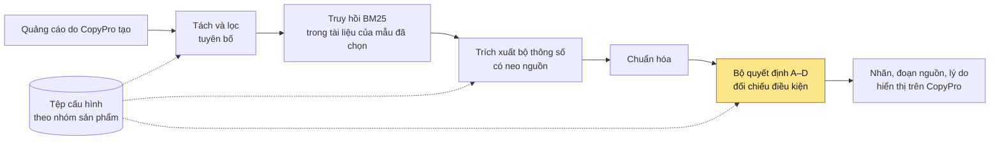
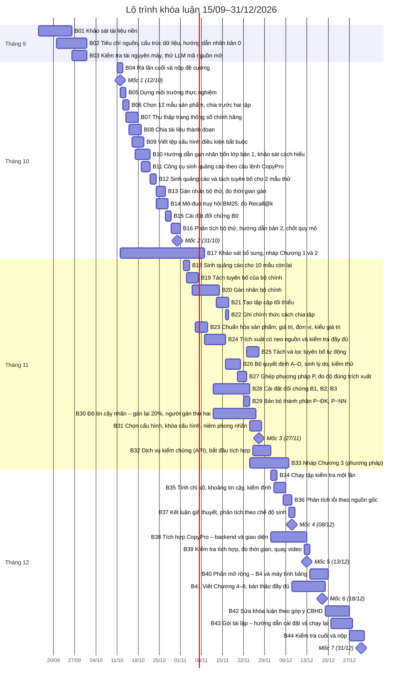
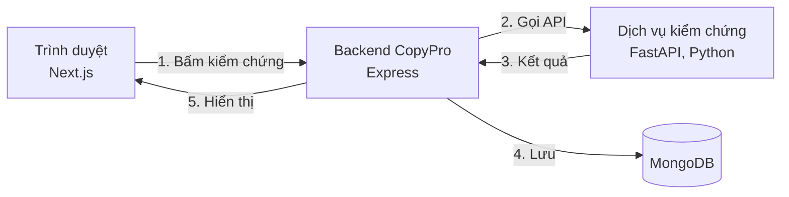

# Chi tiết tuyến tính của khóa luận

> Kế hoạch thực hiện khóa luận từ đầu đến cuối, sắp theo đúng thứ tự làm. Mọi nội dung bám theo [đề cương bản cuối](de_cuong/23521228_DECUONGKHOALUAN_UIT.pdf) ngày 10/10/2026. Cập nhật lần cuối: 11/10/2026.

| | |
|---|---|
| **Tên đề tài** | Phương pháp kiểm chứng tuyên bố về thông số kỹ thuật có điều kiện ràng buộc trong quảng cáo |
| **Tên tiếng Anh** | A method for condition-aware verification of technical specification claims in advertising |
| **Sinh viên** | Bùi Lê Huy Phước – 23521228 – MMTT2023.2 |
| **Cán bộ hướng dẫn (CBHD)** | ThS Trần Hồng Nghi |
| **Thời gian** | 15/09/2026 – 31/12/2026; bảo vệ theo lịch của Khoa |
| **Tình trạng** | Đã có đề cương bản cuối. Chưa có dữ liệu thực nghiệm và mã nguồn của phương pháp. |

## Cách dùng tài liệu này

| Phần | Dùng khi nào |
|---|---|
| [1. Đề tài trong một trang](#p1) | Đọc đầu tiên, để nắm đề tài làm gì và phải chứng minh điều gì |
| [2. Lộ trình tổng thể](#p2) | Xem các mốc, biểu đồ thời gian và bảng tất cả các bước |
| [3. Chi tiết từng bước](#p3) | Dùng hằng ngày: mỗi bước có mục đích, việc cần làm, đầu ra và tiêu chí xong |
| [4–9. Quy chuẩn và đặc tả](#p4) | Chỉ mở khi một bước nhắc tới |
| [10–12. Rủi ro, điểm cần chốt, câu hỏi phản biện](#p10) | Xem lại ở mỗi mốc |
| [Phụ lục A–D](#pla) | Khung câu lệnh, danh sách kiểm tra trước khi nộp, bảng đối chiếu với đề cương, tiêu chí tự kiểm |

**Ba quy tắc khi dùng kế hoạch**

1. Làm theo cột **Thời gian** của bảng ở mục 2.4 (hoặc biểu đồ ở mục 2.3). Số thứ tự gom các bước theo nhóm việc; trong một giai đoạn có vài nhóm việc chạy song song (ví dụ tháng 11 vừa gán nhãn vừa cài đặt phương pháp), nên số thứ tự không phải lúc nào cũng trùng thứ tự ngày bắt đầu. Cột "Cần kết quả của" ghi các bước phải có kết quả (ít nhất một phần dùng được) trước khi bắt đầu.
2. Chỉ đổi trạng thái một bước sang ✅ khi đạt đủ tiêu chí "Xong khi" của bước đó.
3. Khi đề cương và kế hoạch khác nhau, đề cương là chuẩn: sửa kế hoạch cho khớp rồi ghi một dòng vào nhật ký `luan_van/nhat_ky.md`.

**Ký hiệu và chữ viết tắt**

| Ký hiệu | Nghĩa |
|---|---|
| ⬜ 🔄 ✅ | Chưa làm, đang làm, xong |
| ⭐ | Phần mở rộng, chỉ làm khi đúng tiến độ |
| ND1–ND4 | Nội dung 1–4 trong mục "Phương pháp thực hiện" của đề cương |
| MT1–MT4 | Mục tiêu 1–4 của đề cương |
| CH1–CH3, H1–H3 | Câu hỏi nghiên cứu và giả thuyết tương ứng |
| P | Phương pháp đề xuất |
| B0–B3, B4 | Các phương pháp đối chứng (B4 thuộc phần mở rộng) |
| Neo nguồn | Mỗi trường LLM trích ra phải kèm câu gốc; Python kiểm tra câu gốc có thật trong văn bản và con số khớp |
| Kiểm tra đầy đủ | Tên gọi trong đề cương cho bước Python dò các cụm từ điều kiện trong tệp cấu hình để bổ sung điều kiện mà LLM bỏ sót |
| P−ĐK, P−NN | P bỏ đối chiếu điều kiện; P bỏ cả neo nguồn lẫn kiểm tra đầy đủ |
| LLM | Mô hình ngôn ngữ lớn |
| FAR | Tỷ lệ chấp nhận nhầm: trong số tuyên bố có nhãn chuẩn khác Đúng, tỷ lệ bị gán Đúng |
| KTC | Khoảng tin cậy 95% |
| Tập phát triển, tập kiểm tra | Dữ liệu dùng để chọn cấu hình, và dữ liệu chỉ dùng một lần để báo kết quả cuối |

## Mục lục

1. [Đề tài trong một trang](#p1)
2. [Lộ trình tổng thể](#p2)
3. [Chi tiết từng bước](#p3)
4. [Quy ước dự án](#p4)
5. [Hướng dẫn gán nhãn](#p5)
6. [Đặc tả phương pháp P](#p6)
7. [Thực nghiệm và đánh giá](#p7)
8. [Tích hợp vào CopyPro](#p8)
9. [Viết khóa luận](#p9)
10. [Rủi ro và phương án dự phòng](#p10)
11. [Các điểm cần chốt khi làm thử](#p11)
12. [Câu hỏi phản biện dự kiến](#p12)

Phụ lục: [A. Khung câu lệnh](#pla) · [B. Danh sách kiểm tra trước khi nộp](#plb) · [C. Đối chiếu kế hoạch với đề cương](#plc) · [D. Tiêu chí tự kiểm](#pld)

---

<a id="p1"></a>

## 1. Đề tài trong một trang

### 1.1 Vấn đề

LLM viết quảng cáo có thể giữ đúng con số nhưng bỏ hoặc đổi điều kiện đi kèm. Trang thông số iPhone 17 ghi điện thoại "sạc lên đến 50% trong 20 phút với bộ tiếp hợp 40W trở lên". Quảng cáo viết "sạc 50% chỉ trong 20 phút" vẫn đúng con số nhưng bỏ điều kiện bộ tiếp hợp, khiến người mua hiểu sai. Cách kiểm chứng ba nhãn (Supported, Refuted, NEI) thấy con số có trong tài liệu nên dễ chấp nhận tuyên bố này.

Đề tài xây dựng một tính năng mới cho CopyPro, website tạo quảng cáo bằng LLM của đồ án chuyên ngành: kiểm chứng các tuyên bố thông số có điều kiện ràng buộc trong quảng cáo vừa tạo, dựa trên tài liệu chính hãng.

### 1.2 Bài toán

| | |
|---|---|
| **Đầu vào** | Quảng cáo q do LLM tạo; mẫu sản phẩm s do người dùng chọn; kho tài liệu chính hãng D(s) của mẫu đó |
| **Đối tượng kiểm chứng** | Tuyên bố có điều kiện ràng buộc: tuyên bố nêu giá trị của một thuộc tính nằm trong danh sách thuộc tính có điều kiện ràng buộc của nhóm sản phẩm (ghi trong tệp cấu hình) |
| **Đầu ra** | Với mỗi tuyên bố c: nhãn y(c), đoạn nguồn e(c) trích từ D(s), lý do r(c) |

Bốn nhãn (định nghĩa đầy đủ ở [mục 5.2](#p52)):

| Nhãn | Ý nghĩa ngắn |
|---|---|
| **Đúng** (Supported) | Cùng sản phẩm, thuộc tính và điều kiện; giá trị khớp; kiểu giá trị không bị đổi |
| **Sai** (Refuted) | Giá trị mâu thuẫn với giá trị công bố ở điều kiện của tuyên bố, hoặc thuận lợi hơn mọi giá trị công bố |
| **Lệch điều kiện** (Misleading) | Con số trùng giá trị công bố ở một điều kiện khác, hoặc mức "lên đến" bị viết thành mức chắc chắn đạt |
| **Chưa đủ thông tin** (NEI) | Tài liệu không có thông số tương ứng, không công bố giá trị ở điều kiện của tuyên bố, hoặc ghi mâu thuẫn |

### 1.3 Phương pháp P



| Khối | Làm gì | Đặc tả |
|---|---|---|
| Tách và lọc tuyên bố | LLM tách bài quảng cáo thành tuyên bố; Python giữ tuyên bố có thuộc tính trong tệp cấu hình | [6.8](#p68) |
| Truy hồi BM25 | Xếp hạng các đoạn trong tài liệu của đúng mẫu người dùng chọn, lấy k đoạn đầu (top-k) | [6.2](#p62) |
| Trích xuất có neo nguồn | LLM điền bộ bảy trường thông số, mỗi trường kèm câu gốc làm căn cứ; Python kiểm tra câu gốc có trong văn bản và con số khớp, trường không đạt bị bỏ (neo nguồn); Python dò cụm từ điều kiện để bổ sung điều kiện LLM bỏ sót (kiểm tra đầy đủ) | [6.1](#p61), [6.3](#p63) |
| Chuẩn hóa | Đưa tên sản phẩm, phiên bản, giá trị, đơn vị và kiểu giá trị về cùng một dạng | [6.4](#p64) |
| **Bộ quyết định A–D** | A tìm thông số cùng sản phẩm và thuộc tính; B đối chiếu điều kiện theo sáu loại; C so giá trị; D tổng hợp nhãn theo thứ tự cố định. **Đây là bước chứa điểm mới** (tô màu trong sơ đồ) | [6.5](#p65) |
| Sinh lý do | Ghép lý do từ dấu vết của bộ quyết định, không để LLM viết tự do | [6.6](#p66) |

**Sáu loại điều kiện ràng buộc:** chế độ hoạt động (bật hoặc tắt chống ồn, chế độ tiết kiệm pin), bộ phận (tai nghe hay hộp sạc), phụ kiện (bộ sạc có công suất nhất định), điều kiện đo (độ sâu và thời gian ngâm nước, phần diện tích màn hình được đo), phiên bản sản phẩm, kiểu giá trị ("lên đến", "tối đa", "điển hình", "định mức").

### 1.4 Câu hỏi nghiên cứu và cách trả lời

| Câu hỏi | Giả thuyết | So sánh | Chỉ số chính |
|---|---|---|---|
| **CH1.** Đối chiếu tường minh điều kiện có làm giảm tỷ lệ tuyên bố sai hoặc lệch điều kiện bị chấp nhận là Đúng so với các cách kiểm chứng hiện có, mà không bỏ sót nhiều tuyên bố đúng? | **H1.** FAR của P thấp hơn B0–B3, và Recall của nhãn Đúng không thấp hơn quá 5 điểm phần trăm so với đối chứng tốt nhất | P với B0, B1, B2, B3 | FAR, Recall nhãn Đúng |
| **CH2.** Quyết định nhãn bằng quy tắc tường minh trên dữ liệu đã neo nguồn có phát hiện tuyên bố Lệch điều kiện tốt hơn cách để LLM tự gán nhãn? | **H2.** F1 của nhãn Lệch điều kiện của P cao hơn B1 và B2 | P với B1, B2 | F1 nhãn Lệch điều kiện |
| **CH3.** Neo nguồn và đối chiếu điều kiện đóng góp thế nào vào kết quả? | **H3.** P tốt hơn P−NN về FAR và F1 nhãn Lệch điều kiện | P với P−NN; P với P−ĐK | FAR, F1 nhãn Lệch điều kiện |

Tiêu chí kết luận "đạt" hay "không đạt" được ghi trước ở [mục 7.6](#p76). Kết quả được báo cáo cả khi không đạt giả thuyết.

### 1.5 Tính mới, đóng góp và bằng chứng sẽ có

| Ý trong đề cương | Bằng chứng trong khóa luận | Bước tạo ra |
|---|---|---|
| **Tính mới 1.** Xét riêng tuyên bố thông số có điều kiện ràng buộc trong quảng cáo tiếng Việt do LLM tạo; nhãn Lệch điều kiện được định nghĩa bằng quy tắc cụ thể để người gán nhãn và hệ thống dùng cùng tiêu chí | Hướng dẫn gán nhãn công bố kèm khóa luận; quy tắc trong mã trùng với hướng dẫn; kappa giữa hai người gán | [10](#b10), [26](#b26), [30](#b30) |
| **Tính mới 2.** Kết luận bằng phép đối chiếu điều kiện: Lệch điều kiện khi con số trùng giá trị công bố ở điều kiện khác, hoặc khi mức "lên đến" bị viết thành mức chắc chắn | F1 Lệch của P so với B1 (cùng bộ thông số, LLM tự gán) và B2 (cùng bốn nhãn, LLM tự gán); P so với P−ĐK | [26](#b26)–[29](#b29), [35](#b35) |
| **Tính mới 3.** Sáu loại điều kiện làm danh mục để so từng loại (cụ thể hóa lược đồ MeasEval cho thông số sản phẩm) | Tệp cấu hình ba nhóm sản phẩm; kết quả theo từng loại biến đổi trên tập cặp tối thiểu | [09](#b09), [21](#b21), [35](#b35) |
| **Đóng góp 1.** Phương pháp P, có kiểm thử cho từng quy tắc | Mã nguồn `src/kiemchung/`, `tests/` | [23](#b23)–[27](#b27) |
| **Đóng góp 2.** Bộ dữ liệu tiếng Việt bốn nhãn, kèm đoạn nguồn, lý do và tập cặp tối thiểu | Thư mục `data/`, thẻ dữ liệu, bảng thống kê dữ liệu | [12](#b12)–[22](#b22) |
| **Đóng góp 3.** Số liệu cho biết LLM bỏ hoặc đổi điều kiện thường đến mức nào, theo hai chế độ sinh | Tỷ lệ Lệch điều kiện và Sai theo chế độ có hoặc không có đoạn thông số | [37](#b37) |
| **Đóng góp 4.** Đánh giá có đối chứng với bốn cách kiểm chứng hiện có và hai bản bỏ thành phần | Bảng kết quả chính có KTC và kiểm định | [34](#b34)–[37](#b37) |
| **Đóng góp 5.** Tính năng "Kiểm chứng thông số" trong CopyPro | Tính năng chạy được, video, bảng thời gian | [32](#b32), [38](#b38), [39](#b39) |

**Câu trả lời ngắn khi bị hỏi về tính mới:** "Các cách hiện có để LLM tự đọc bằng chứng rồi phán đoán, hoặc phải tự đoán phần ngữ cảnh bị bỏ. Em liệt kê sáu loại điều kiện mà hãng công bố, rồi kết luận Lệch điều kiện bằng phép đối chiếu tường minh: con số trùng giá trị ở điều kiện khác thì là Lệch. Bước tách điều kiện chỉ chuẩn bị đầu vào. Điểm mới nằm ở bước kết luận. So với B1, dùng cùng bộ thông số đã trích nhưng để LLM gán nhãn, cho thấy riêng tác dụng của bước kết luận; so với B2, dùng cùng bốn nhãn nhưng để LLM đọc bằng chứng rồi gán, cho thấy chỉ sửa câu lệnh là chưa đủ."

### 1.6 Phạm vi tóm tắt

| Mục | Trong phạm vi |
|---|---|
| Nhóm sản phẩm | Điện thoại thông minh, tai nghe không dây, đồng hồ thông minh |
| Nhóm thông số | Thời lượng pin, dung lượng pin, sạc nhanh, kháng nước và bụi, màn hình (độ sáng, tần số quét), zoom camera |
| Mẫu sản phẩm | Khoảng 12 mẫu (khoảng 5 điện thoại, 4 tai nghe, 3 đồng hồ) của ít nhất ba hãng (dự kiến Apple, Samsung, Xiaomi, OPPO), đang bán chính hãng tại Việt Nam |
| Bằng chứng | Chỉ tài liệu văn bản chính hãng của đúng mẫu sản phẩm |
| Quảng cáo | Do CopyPro tạo ở ngành Công nghệ; 2 LLM thuộc hai họ mô hình (dự kiến Gemini 3.6 Flash và GPT-OSS 120B qua Groq); 3 loại bài (mô tả sản phẩm, bài đăng mạng xã hội, landing page); 2 chế độ (chỉ nhập tên sản phẩm; nhập thêm đoạn thông số chính hãng vào ô thông tin bổ sung) |
| Quy mô dữ liệu | Khoảng 250–300 tuyên bố và 100–120 biến thể cặp tối thiểu |
| Ngoài phạm vi | Thông số không kèm điều kiện (khối lượng, kích thước, phiên bản Bluetooth); tuyên bố cảm tính; so sánh với sản phẩm khác; giá và khuyến mãi; đo hiệu năng thực tế; kết luận pháp lý; quảng cáo do người viết; tự nhận diện sản phẩm. Máy tính xách tay, tivi, đồ gia dụng không thuộc phạm vi thực nghiệm; khả năng mở rộng chỉ thử trên máy tính bảng (phần mở rộng) |

### 1.7 Ví dụ xuyên suốt

Trang thông số Galaxy Buds3 Pro ghi thời lượng phát nhạc lên đến 6 giờ khi bật chống ồn và 7 giờ khi tắt chống ồn (ví dụ trong đề cương).

| Tuyên bố | Nhãn | Vì sao |
|---|---|---|
| "Nghe nhạc 6 giờ khi bật chống ồn" | Đúng | Cùng điều kiện, giá trị khớp |
| "Nghe nhạc 7 giờ khi bật chống ồn" | **Lệch điều kiện** | 7 giờ chỉ đạt khi tắt chống ồn |
| "Nghe nhạc 8 giờ" | Sai | Thuận lợi hơn mọi giá trị công bố cho tai nghe |
| Thời lượng pin ở một chế độ mà trang không công bố | Chưa đủ thông tin | Tài liệu không có giá trị ở điều kiện đó |

Phép so khớp chỉ dựa trên con số dễ chấp nhận tuyên bố thứ hai, vì con số 7 giờ có trong tài liệu. Đây là lỗi mà đề tài khắc phục.

---

<a id="p2"></a>

## 2. Lộ trình tổng thể

### 2.1 Bốn giai đoạn

| Giai đoạn | Thời gian | Trọng tâm (theo đề cương) | Kết thúc bằng |
|---|---|---|---|
| 1 | Tháng 09/2026 | Khảo sát tài liệu, xây dựng hướng dẫn gán nhãn, chuẩn bị môi trường chạy | – |
| 2 | Tháng 10/2026 | Làm thử trên 2 mẫu sản phẩm để chốt hướng dẫn nhãn, tệp cấu hình và quy mô dữ liệu | Mốc 1 (12/10), Mốc 2 (31/10) |
| 3 | Tháng 11/2026 | Hoàn thiện bộ dữ liệu; cài đặt P và các đối chứng; chọn cấu hình trên tập phát triển rồi khóa | Mốc 3 (27/11) |
| 4 | Tháng 12/2026 | Chạy tập kiểm tra cuối; tích hợp vào CopyPro; hoàn thiện khóa luận | Mốc 4–7 (08/12, 13/12, 18/12, 31/12) |

Phần lõi bắt buộc làm trước. Phần mở rộng (B4 và thử trên máy tính bảng) chỉ làm khi đúng tiến độ.

### 2.2 Các mốc kiểm tra với CBHD

| Mốc | Ngày | Phải có | Gửi CBHD | Bước |
|---|---|---|---|---|
| **Mốc 1** | Thứ Hai 12/10/2026 | Đề cương và tên đề tài được chốt | Đề cương bản cuối (PDF) | [04](#b04) |
| **Mốc 2** | Thứ Bảy 31/10/2026 | Bộ thử khoảng 60 tuyên bố có nhãn; BM25 và B0 chạy trên bộ thử; hướng dẫn nhãn bản 2; quy mô dữ liệu đã chốt | Báo cáo bộ thử 1–2 trang | [16](#b16) |
| **Mốc 3** | Thứ Sáu 27/11/2026 | Dữ liệu và độ tin cậy nhãn hoàn tất; P và các đối chứng chạy trên tập phát triển; cấu hình đã khóa trước khi chạy tập kiểm tra | Tệp khóa cấu hình, bảng kết quả tập phát triển | [31](#b31) |
| **Mốc 4** | Thứ Ba 08/12/2026 | Kết quả trên tập kiểm tra: chỉ số, khoảng tin cậy, kiểm định, phân tích lỗi | Bảng kết quả chính, kết luận H1–H3 | [37](#b37) |
| **Mốc 5** | Chủ nhật 13/12/2026 | Tính năng “Kiểm chứng thông số” chạy trên CopyPro | Video minh họa 2–3 phút | [39](#b39) |
| **Mốc 6** | Thứ Sáu 18/12/2026 | Bản thảo khóa luận đầy đủ | Toàn văn khóa luận | [41](#b41) |
| **Mốc 7** | Thứ Năm 31/12/2026 | Đã kiểm tra toàn bộ mã nguồn, dữ liệu; nộp | Bản nộp cuối | [44](#b44) |

### 2.3 Biểu đồ thời gian



> Biểu đồ và bảng ở mục 2.4 dựng từ cùng một dữ liệu. Nếu biểu đồ không hiện (ví dụ khi xem tệp ngoài GitHub), dùng bảng.

### 2.4 Bảng tuyến tính các bước

**Giai đoạn 1 · Tháng 09/2026 · Chuẩn bị** (khoảng 26 giờ)

| TT | Bước | Việc | Thời gian | Nội dung | Đầu ra chính | Giờ | Mốc |
|---|---|---|---|---|---|---|---|
| ⬜ | [01](#b01) | Khảo sát tài liệu nền | 15/09–25/09 | ND1 | `luan_van/ghi_chu_tai_lieu.md` | 12 |  |
| ⬜ | [02](#b02) | Tiêu chí nguồn, cấu trúc dữ liệu, hướng dẫn nhãn bản 0 | 21/09–30/09 | ND1 | `data/huong_dan_gan_nhan.md` (bản 0), ≥ 20 ví dụ | 10 |  |
| ⬜ | [03](#b03) | Kiểm tra tài nguyên máy, thử LLM mã nguồn mở | 26/09–30/09 | ND2 | `ket_qua/thu_llm.md` | 4 |  |

**Giai đoạn 2 · Tháng 10/2026 · Làm thử trên 2 mẫu** (khoảng 79 giờ)

| TT | Bước | Việc | Thời gian | Nội dung | Đầu ra chính | Giờ | Mốc |
|---|---|---|---|---|---|---|---|
| ⬜ | [04](#b04) | Rà lần cuối và nộp đề cương | 11/10–12/10 | – | Đề cương bản cuối được CBHD xác nhận | 2 | **Mốc 1** |
| ⬜ | [05](#b05) | Dựng môi trường thực nghiệm | 12/10–13/10 | – | Thư mục `data/ src/ tests/ ket_qua/ luan_van/`, `requirements.txt` | 4 |  |
| ⬜ | [06](#b06) | Chọn 12 mẫu sản phẩm, chia trước hai tập | 13/10–14/10 | ND1 | `data/mau_san_pham.csv` | 3 |  |
| ⬜ | [07](#b07) | Thu thập trang thông số chính hãng | 14/10–17/10 | ND1 | `data/nguon/<ma_mau>/` | 6 |  |
| ⬜ | [08](#b08) | Chia tài liệu thành đoạn | 15/10–18/10 | ND1 | `data/nguon/<ma_mau>/doan.jsonl` | 4 |  |
| ⬜ | [09](#b09) | Viết tệp cấu hình điều kiện bắt buộc | 16/10–19/10 | ND1 | `data/cau_hinh/*.yaml` | 5 |  |
| ⬜ | [10](#b10) | Hướng dẫn gán nhãn bốn lớp bản 1, khảo sát cách hiểu | 17/10–21/10 | ND1 | `data/huong_dan_gan_nhan.md` (bản 1), `ket_qua/khao_sat_cach_hieu.md` | 8 |  |
| ⬜ | [11](#b11) | Công cụ sinh quảng cáo theo câu lệnh CopyPro | 19/10–21/10 | ND1 | `src/kiemchung/sinh_quang_cao.py` | 6 |  |
| ⬜ | [12](#b12) | Sinh quảng cáo và tách tuyên bố cho 2 mẫu thử | 22/10–23/10 | ND1 | `data/quang_cao/`, `data/tuyen_bo/thu.jsonl` | 5 |  |
| ⬜ | [13](#b13) | Gán nhãn bộ thử, đo thời gian gán | 24/10–26/10 | ND1 | `data/nhan/thu.jsonl` | 5 |  |
| ⬜ | [14](#b14) | Mô-đun truy hồi BM25, đo Recall@k | 24/10–27/10 | ND2 | `src/kiemchung/truy_hoi.py` | 6 |  |
| ⬜ | [15](#b15) | Cài đặt đối chứng B0 | 27/10–28/10 | ND3 | `src/kiemchung/doi_chung/b0.py` | 4 |  |
| ⬜ | [16](#b16) | Phân tích bộ thử, hướng dẫn bản 2, chốt quy mô | 29/10–31/10 | ND1 | `ket_qua/bo_thu/bao_cao.md` | 5 | **Mốc 2** |
| ⬜ | [17](#b17) | Khảo sát bổ sung, nháp Chương 1 và 2 | 12/10–08/11 | – | `luan_van/chuong_1.md`, `chuong_2.md` | 16 |  |

**Giai đoạn 3 · Tháng 11/2026 · Dữ liệu chính, phương pháp P và đối chứng** (khoảng 126 giờ)

| TT | Bước | Việc | Thời gian | Nội dung | Đầu ra chính | Giờ | Mốc |
|---|---|---|---|---|---|---|---|
| ⬜ | [18](#b18) | Sinh quảng cáo cho 10 mẫu còn lại | 02/11–03/11 | ND1 | `data/quang_cao/` | 4 |  |
| ⬜ | [19](#b19) | Tách tuyên bố của bộ chính | 03/11–06/11 | ND1 | `data/tuyen_bo/chinh.jsonl` | 7 |  |
| ⬜ | [20](#b20) | Gán nhãn bộ chính | 05/11–13/11 | ND1 | `data/nhan/chinh.jsonl` | 15 |  |
| ⬜ | [21](#b21) | Tạo tập cặp tối thiểu | 13/11–16/11 | ND1 | `data/cap_toi_thieu.jsonl` | 6 |  |
| ⬜ | [22](#b22) | Ghi chính thức cách chia tập | 16/11 | ND1 | `data/chia_tap.json` | 1 |  |
| ⬜ | [23](#b23) | Chuẩn hóa sản phẩm, giá trị, đơn vị, kiểu giá trị | 06/11–09/11 | ND2 | `src/kiemchung/chuan_hoa.py` | 6 |  |
| ⬜ | [24](#b24) | Trích xuất có neo nguồn và kiểm tra đầy đủ | 09/11–15/11 | ND2 | `src/kiemchung/trich_xuat.py`, `neo_nguon.py` | 14 |  |
| ⬜ | [25](#b25) | Tách và lọc tuyên bố tự động | 23/11–26/11 | ND2 | `src/kiemchung/tach_tuyen_bo.py` | 6 |  |
| ⬜ | [26](#b26) | Bộ quyết định A–D, sinh lý do, kiểm thử | 16/11–20/11 | ND2 | `src/kiemchung/quyet_dinh.py`, `tests/test_quyet_dinh.py` | 14 |  |
| ⬜ | [27](#b27) | Ghép phương pháp P, đo độ đúng trích xuất | 20/11–22/11 | ND2 | `src/kiemchung/p.py` | 7 |  |
| ⬜ | [28](#b28) | Cài đặt đối chứng B1, B2, B3 | 12/11–23/11 | ND3 | `src/kiemchung/doi_chung/b1.py`, `b2.py`, `b3.py` | 9 |  |
| ⬜ | [29](#b29) | Bản bỏ thành phần P−ĐK, P−NN | 22/11–23/11 | ND3 | Cờ cấu hình trong `p.py` | 3 |  |
| ⬜ | [30](#b30) | Độ tin cậy nhãn: gán lại 20%, người gán thứ hai | 12/11–25/11 | ND1 | `ket_qua/do_tin_cay_nhan.md` | 8 |  |
| ⬜ | [31](#b31) | Chọn cấu hình, khóa cấu hình, niêm phong nhãn | 24/11–27/11 | ND3 | `ket_qua/khoa_cau_hinh.md`, tag `khoa-cau-hinh` | 6 | **Mốc 3** |
| ⬜ | [32](#b32) | Dịch vụ kiểm chứng (API), bắt đầu tích hợp | 25/11–30/11 | ND4 | `src/kiemchung/api.py` | 8 |  |
| ⬜ | [33](#b33) | Nháp Chương 3 (phương pháp) | 24/11–06/12 | – | `luan_van/chuong_3.md` | 12 |  |

**Giai đoạn 4 · Tháng 12/2026 · Thực nghiệm cuối, tích hợp CopyPro, viết khóa luận** (khoảng 106 giờ)

| TT | Bước | Việc | Thời gian | Nội dung | Đầu ra chính | Giờ | Mốc |
|---|---|---|---|---|---|---|---|
| ⬜ | [34](#b34) | Chạy tập kiểm tra một lần | 01/12–02/12 | ND3 | `ket_qua/kiem_tra/` | 5 |  |
| ⬜ | [35](#b35) | Tính chỉ số, khoảng tin cậy, kiểm định | 02/12–05/12 | ND3 | `src/kiemchung/danh_gia.py`, bảng, hình | 8 |  |
| ⬜ | [36](#b36) | Phân tích lỗi theo nguồn gốc | 05/12–07/12 | ND3 | `ket_qua/phan_tich_loi.md` | 8 |  |
| ⬜ | [37](#b37) | Kết luận giả thuyết, phân tích theo chế độ sinh | 07/12–08/12 | ND3 | Mục Thảo luận của Chương 4 | 3 | **Mốc 4** |
| ⬜ | [38](#b38) | Tích hợp CopyPro: backend và giao diện | 01/12–12/12 | ND4 | Nhánh `kiem-chung-thong-so` của repo CopyPro | 16 |  |
| ⬜ | [39](#b39) | Kiểm tra tích hợp, đo thời gian, quay video | 12/12–13/12 | ND4 | Ảnh, video, bảng thời gian | 4 | **Mốc 5** |
| ⬜ | [40](#b40) | Phần mở rộng: B4 và máy tính bảng ⭐ | 14/12–19/12 | ND3 | `ket_qua/mo_rong/` | 10 |  |
| ⬜ | [41](#b41) | Viết Chương 4–6, bản thảo đầy đủ | 08/12–18/12 | – | `luan_van/` (toàn văn) | 26 | **Mốc 6** |
| ⬜ | [42](#b42) | Sửa khóa luận theo góp ý CBHD | 19/12–26/12 | – | Khóa luận bản sửa | 14 |  |
| ⬜ | [43](#b43) | Gói tái lập: hướng dẫn cài đặt và chạy lại | 21/12–27/12 | – | `README.md`, `scripts/chay_lai.sh`, `data/THE_DU_LIEU.md` | 6 |  |
| ⬜ | [44](#b44) | Kiểm tra cuối và nộp | 27/12–31/12 | – | Khóa luận PDF, mã nguồn, dữ liệu, tag `v1.0` | 6 | **Mốc 7** |

**Sau 31/12/2026 · Bảo vệ** (khoảng 15 giờ)

| TT | Bước | Việc | Thời gian | Nội dung | Đầu ra chính | Giờ | Mốc |
|---|---|---|---|---|---|---|---|
| ⬜ | [45](#b45) | Chuẩn bị bảo vệ | Theo lịch Khoa | – | Slide, video demo dự phòng | 15 | **Bảo vệ** |

Tổng công sức ước lượng của Bước 01–44 là **khoảng 337 giờ**, trong đó phần mở rộng (Bước 40) khoảng 10 giờ. Riêng phần còn lại từ 11/10 đến 31/12 (Bước 04–44) là khoảng 311 giờ, tức trung bình khoảng 27 giờ mỗi tuần. Chuẩn bị bảo vệ (Bước 45) thêm khoảng 15 giờ.

### 2.5 Công sức theo tuần

| Tuần | Từ – đến | Các bước | Giờ | Mức tải |
|---|---|---|---|---|
| 1 | 14/09 – 20/09 | 01 | 7 | `████` |
| 2 | 21/09 – 27/09 | 01, 02, 03 | 14 | `████████` |
| 3 | 28/09 – 04/10 | 02, 03 | 5 | `███` |
| 4 | 05/10 – 11/10 | 04 | 1 | `█` |
| 5 | 12/10 – 18/10 | 04, 05, 06, 07, 08, 09, 10, 17 | 29 | `█████████████████` |
| 6 | 19/10 – 25/10 | 09, 10, 11, 12, 13, 14, 17 | 27 | `████████████████` |
| 7 | 26/10 – 01/11 | 13, 14, 15, 16, 17 | 18 | `██████████` |
| 8 | 02/11 – 08/11 | 17, 18, 19, 20, 23 | 26 | `███████████████` |
| 9 | 09/11 – 15/11 | 20, 21, 23, 24, 28, 30 | 34 | `████████████████████` |
| 10 | 16/11 – 22/11 | 21, 22, 26, 27, 28, 29, 30 | 34 | `████████████████████` |
| 11 | 23/11 – 29/11 | 25, 28, 29, 30, 31, 32, 33 | 28 | `████████████████` |
| 12 | 30/11 – 06/12 | 32, 33, 34, 35, 36, 38 | 34 | `████████████████████` |
| 13 | 07/12 – 13/12 | 36, 37, 38, 39, 41 | 32 | `███████████████████` |
| 14 | 14/12 – 20/12 | 40, 41, 42 | 25 | `███████████████` |
| 15 | 21/12 – 27/12 | 42, 43, 44 | 18 | `██████████` |
| 16 | 28/12 – 31/12 | 44 | 5 | `███` |

Các tuần cao điểm, khoảng 32–34 giờ, là tuần 9–10 (giữa tháng 11: vừa gán nhãn vừa cài đặt P và các đối chứng) và tuần 12–13 (đầu tháng 12: chạy tập kiểm tra, tích hợp CopyPro, viết Chương 4). Tuần 4 gần như trống vì theo lịch, các bước tháng 9 đã qua và các bước tháng 10 bắt đầu từ 11/10. **Nếu chậm hơn bảng quá hai ngày ở bất kỳ tuần nào, áp dụng ngay thứ tự rút gọn ở [mục 10.2](#p102), không dồn việc sang tuần sau.**

---

<a id="p3"></a>

## 3. Chi tiết từng bước

Mỗi bước gồm bốn phần: **Mục đích** (vì sao làm), **Việc cần làm** (đánh dấu khi xong), **Đầu ra** (tệp cụ thể) và **Xong khi** (tiêu chí kiểm tra được).

### Giai đoạn 1 · Tháng 09/2026 · Chuẩn bị

> Giai đoạn này đã qua theo lịch. Dùng Bước 01–03 như danh sách kiểm tra: việc nào đã xong thì đánh dấu, việc nào còn thiếu thì làm bù trong tuần 12–18/10.

<a id="b01"></a>

#### Bước 01 · Khảo sát tài liệu nền

| Thời gian | Thuộc | Công sức | Cần kết quả của | Kết thúc bằng |
|---|---|---|---|---|
| T3 15/09 – T6 25/09 | Nội dung 1 | khoảng 12 giờ | – | – |

**Mục đích.** Nắm các hướng kiểm chứng đã có, để viết Chương 2 và trả lời được câu "đề tài khác gì các bài trước".

**Việc cần làm**

- [ ] Đọc các nhóm nghiên cứu trong đề cương: kiểm chứng tự động (FEVER [2], AVeriTeC [3]); tuyên bố nửa sự thật (Tang và cộng sự [4]); kiểm chứng tiếng Việt (ViFactCheck [5], ViNumFCR [6], SemViQA [7]); tuyên bố số liệu (NumPert [8], VeriFin [9]); văn bản do LLM tạo (FactLens [10], MiniCheck [11]); kiểm chứng quảng cáo và mô tả sản phẩm (Nguyen và cộng sự [12], Jiang và cộng sự [1]); truy hồi bằng chứng (Fathom [13], BM25); thông tin đi kèm số đo (MeasEval); cặp tương phản (VitaminC). Ba tài liệu cuối không ghi số vì số thứ tự của chúng có thể đổi khi sửa đề cương (Bước 04).
- [ ] Mỗi bài ghi: bài toán, dữ liệu, cách gán nhãn, kết quả chính, hạn chế so với đề tài, và **số trang** của từng ý sẽ trích.
- [ ] Đối chiếu các con số đề cương đã trích với bài gốc, ví dụ: Fathom đạt F1 bằng 0 ở nhãn Conflicting/Cherry-picking trên tập phát triển AVeriTeC; NumPert giảm độ chính xác đến 62%; MiniCheck rẻ hơn GPT-4 khoảng 400 lần.

**Đầu ra:** `luan_van/ghi_chu_tai_lieu.md`.

**Xong khi:** mỗi câu nói về bài khác trong đề cương có số trang trong bài gốc.

<a id="b02"></a>

#### Bước 02 · Tiêu chí nguồn, cấu trúc dữ liệu, hướng dẫn nhãn bản 0

| Thời gian | Thuộc | Công sức | Cần kết quả của | Kết thúc bằng |
|---|---|---|---|---|
| T2 21/09 – T4 30/09 | Nội dung 1 | khoảng 10 giờ | [01](#b01) | – |

**Mục đích.** Có quy chuẩn trước khi thu dữ liệu: lấy nguồn nào, lưu thế nào, gán nhãn ra sao.

**Việc cần làm**

- [ ] Tiêu chí chọn nguồn: trang thông số chính thức tiếng Việt của hãng; có con số và chú thích điều kiện; ghi được đường dẫn và ngày truy cập.
- [ ] Cấu trúc lưu dữ liệu theo [mục 4](#p4).
- [ ] Hướng dẫn gán nhãn bản 0 với **ít nhất 20 ví dụ** cho các trường hợp: đúng, sai đối tượng, sai điều kiện, thiếu bằng chứng, xung đột bằng chứng.
- [ ] Ghi quy tắc tách tuyên bố: giữ sản phẩm, phiên bản, thuộc tính và điều kiện cần thiết để tuyên bố không đổi nghĩa ([mục 5.1](#p51)).

> Bộ 23 ví dụ soạn tháng 9 cho đề tài cũ (toàn AirPods, ba nhãn, có cả khối lượng và phiên bản Bluetooth) còn trong lịch sử Git: commit `ba88a48`, tệp `evidence/2026-10-08/examples.json`. Bộ này không dùng lại ở Bước 10 (lý do ở Bước 10).

**Đầu ra:** `data/huong_dan_gan_nhan.md` (bản 0).

**Xong khi:** có đủ 20 ví dụ, mỗi ví dụ có nhãn và lý do.

<a id="b03"></a>

#### Bước 03 · Kiểm tra tài nguyên máy, thử LLM mã nguồn mở

| Thời gian | Thuộc | Công sức | Cần kết quả của | Kết thúc bằng |
|---|---|---|---|---|
| T7 26/09 – T4 30/09 | Nội dung 2 | khoảng 4 giờ | – | – |

**Mục đích.** Biết máy chạy được những gì, để chọn LLM cho trích xuất và cho các đối chứng.

**Việc cần làm**

- [ ] Ghi cấu hình máy (CPU, RAM, GPU nếu có) và dung lượng ổ đĩa còn trống.
- [ ] Thử vài LLM mã nguồn mở có kích thước phù hợp (chạy trên máy hoặc qua API như Groq) với 5–10 câu trích xuất mẫu; ghi thời gian và chất lượng sơ bộ.
- [ ] Kiểm tra hạn mức gọi API miễn phí của Google AI Studio và Groq.

**Đầu ra:** `ket_qua/thu_llm.md`.

**Xong khi:** có danh sách LLM ứng viên cho bộ thử ban đầu.

### Giai đoạn 2 · Tháng 10/2026 · Làm thử trên 2 mẫu

<a id="b04"></a>

#### Bước 04 · Rà lần cuối và nộp đề cương

| Thời gian | Thuộc | Công sức | Cần kết quả của | Kết thúc bằng |
|---|---|---|---|---|
| CN 11/10 – T2 12/10 | Chung | khoảng 2 giờ | – | **Mốc 1** |

**Mục đích.** Chốt đề cương và tên đề tài với CBHD đúng hạn 12/10.

**Việc cần làm**

- [ ] Nên sửa bốn chỗ trong bản PDF cuối nếu còn kịp:
  - Mục Tính mới ghi "MeasEval [14]", nhưng [14] trong danh mục là BM25. Cách sửa giữ đúng thứ tự xuất hiện của chuẩn IEEE: sắp lại danh mục thành [14] MeasEval, [15] VitaminC, [16] BM25; trong bài giữ "MeasEval [14]", sửa "VitaminC [16]" (mục Đóng góp) thành [15] và "[14]" sau câu về BM25 (Nội dung 2) thành [16].
  - Nội dung 2 ghi "điền bảy trường thông số nêu ở mục 3", nhưng mục 3 (Phạm vi) không liệt kê bảy trường. Thay bằng đúng danh sách ở Thời gian biểu tháng 11: "điền bảy trường thông số (sản phẩm, phiên bản, bộ phận, thông số, giá trị, đơn vị, điều kiện áp dụng cùng kiểu giá trị)".
  - Chú thích Hình 1 ghi "khối nền xám", nhưng trong hình có hai khối tô màu xanh, gồm cả khối trích xuất, trong khi mục Tính mới nói điểm mới không nằm ở bước tách điều kiện. Nên chỉ tô khối bộ quyết định và sửa chú thích cho khớp màu.
  - Phần Kế hoạch thực hiện không còn mục "3. Phân công công việc", trong khi tiêu đề phần này trong mẫu yêu cầu phân công cho từng sinh viên. Thêm lại: sinh viên thực hiện toàn bộ công việc; người gán nhãn thứ hai chỉ gán độc lập khoảng 60 tuyên bố.
- [ ] Gửi đề cương cho CBHD và nộp theo lịch của Khoa.
- [ ] Cập nhật tên đề tài trên hệ thống đăng ký, so từng ký tự với đề cương, cả tên tiếng Anh.
- [ ] Hỏi CBHD có đồng ý nhờ một bạn làm người gán nhãn thứ hai cho khoảng 60 tuyên bố không.

**Đầu ra:** đề cương bản nộp; tên đề tài trên hệ thống khớp với đề cương.

**Xong khi:** CBHD xác nhận đề cương và tên đề tài.

<a id="b05"></a>

#### Bước 05 · Dựng môi trường thực nghiệm

| Thời gian | Thuộc | Công sức | Cần kết quả của | Kết thúc bằng |
|---|---|---|---|---|
| T2 12/10 – T3 13/10 | Chung | khoảng 4 giờ | – | – |

**Mục đích.** Có chỗ chứa dữ liệu, mã nguồn, kết quả và nháp khóa luận trước khi thu dữ liệu.

**Việc cần làm**

- [ ] Tạo thư mục theo [mục 4.1](#p41).
- [ ] Tạo `requirements.txt`: Python ≥ 3.10, `rank-bm25`, `pyvi` hoặc `underthesea`, `pydantic`, `pyyaml`, `google-genai`, `groq`, `fastapi`, `uvicorn`, `pytest`, `scikit-learn`, `statsmodels`, `pandas`, `matplotlib`, `playwright`.
- [ ] Tạo `.env.example` chỉ chứa tên biến (`GEMINI_API_KEY`, `GROQ_API_KEY`); khóa thật chỉ để trong `.env` trên máy.
- [ ] Lịch sử Git của repo từng chứa tệp `.env`. Nếu khóa trong đó chưa thu hồi thì thu hồi ở trang của nhà cung cấp và tạo khóa mới.
- [ ] Viết `src/kiemchung/llm.py`: một hàm gọi LLM duy nhất, **có bộ nhớ đệm** theo mã băm của (mô hình, câu lệnh, tham số) và ghi nhật ký mọi lần gọi.

**Đầu ra:** cây thư mục, `requirements.txt`, `.env.example`, `src/kiemchung/llm.py`.

**Xong khi:** `pytest` chạy được; lệnh `git check-ignore .env` in ra `.env`; gọi cùng một câu lệnh hai lần thì lần hai lấy từ bộ nhớ đệm.

<a id="b06"></a>

#### Bước 06 · Chọn 12 mẫu sản phẩm, chia trước hai tập

| Thời gian | Thuộc | Công sức | Cần kết quả của | Kết thúc bằng |
|---|---|---|---|---|
| T3 13/10 – T4 14/10 | Nội dung 1 | khoảng 3 giờ | [05](#b05) | – |

**Mục đích.** Chọn đúng 12 mẫu và chia trước tập phát triển và tập kiểm tra, để thông tin của tập kiểm tra không lọt vào lúc phát triển phương pháp.

**Việc cần làm**

- [ ] Mở trang thông số tiếng Việt của các ứng viên; chỉ giữ mẫu có ít nhất 3 thông số kèm điều kiện:
  - điện thoại: iPhone 17, Xiaomi 15T, OPPO Find X8, một mẫu Galaxy S, một mẫu khác;
  - tai nghe: Galaxy Buds3 Pro, AirPods Pro 3, AirPods 4, một mẫu Xiaomi hoặc OPPO;
  - đồng hồ: Apple Watch SE 3, một mẫu Galaxy Watch, một mẫu Xiaomi.
- [ ] Ghi `data/mau_san_pham.csv`: mã mẫu, nhóm, hãng, tên, URL, tập.
- [ ] Chia trước (đề xuất):
  - **tập phát triển, 4 mẫu:** iPhone 17 và Galaxy Buds3 Pro (2 mẫu thử), Apple Watch SE 3, Xiaomi 15T;
  - **tập kiểm tra, 8 mẫu còn lại:** nhóm nào và hãng nào cũng có mẫu.
- [ ] Không đặt hai mẫu cùng dòng (ví dụ Xiaomi 15T và 15T Pro) vào hai tập khác nhau.

**Đầu ra:** `data/mau_san_pham.csv`.

**Xong khi:** đủ 3 nhóm và ít nhất 3 hãng; tập phát triển có đủ 3 nhóm; tập kiểm tra có đủ nhóm và đủ hãng.

<a id="b07"></a>

#### Bước 07 · Thu thập trang thông số chính hãng

| Thời gian | Thuộc | Công sức | Cần kết quả của | Kết thúc bằng |
|---|---|---|---|---|
| T4 14/10 – T7 17/10 | Nội dung 1 | khoảng 6 giờ | [06](#b06) | – |

**Mục đích.** Có bằng chứng chính hãng truy vết được: người khác mở lại được đúng trang đã dùng, đúng thời điểm đã dùng.

**Việc cần làm**

- [ ] Viết script Playwright: mở URL, chờ tải xong, mở các mục "Xem thêm" và chú thích, rồi lưu `page.html`, `page.txt` (chữ hiển thị), `full.png` (ảnh chụp toàn trang) và `meta.json` (URL, thời điểm truy cập, mã băm SHA-256, tức "dấu vân tay" của tệp: đổi một ký tự là đổi mã). Có thể lấy lại `scripts/capture_evidence.mjs` từ commit `ba88a48`.
- [ ] Làm **2 mẫu thử trước** (iPhone 17, Galaxy Buds3 Pro), kiểm tra kỹ, rồi mới làm 10 mẫu còn lại.
- [ ] Kiểm lại trên bản chụp các con số dùng trong ví dụ của hướng dẫn gán nhãn ([mục 5.6](#p56)).
- [ ] Kiểm lại hai chỗ nghi vấn thấy khi xem trang ngày 09/10/2026: chú thích chế độ chống ồn cho tổng thời gian kèm hộp sạc trên trang Galaxy Buds3 Pro; giá trị "định mức" lớn hơn giá trị "tiêu chuẩn" trên trang OPPO Find X8.

**Đầu ra:** `data/nguon/<ma_mau>/`, mỗi mẫu 4 tệp.

**Xong khi:** đủ 12 mẫu; mọi chú thích điều kiện có mặt trong `page.txt`.

<a id="b08"></a>

#### Bước 08 · Chia tài liệu thành đoạn

| Thời gian | Thuộc | Công sức | Cần kết quả của | Kết thúc bằng |
|---|---|---|---|---|
| T5 15/10 – CN 18/10 | Nội dung 1 | khoảng 4 giờ | [07](#b07) | – |

**Mục đích.** Chia tài liệu thành đoạn để BM25 tìm được, nhưng không tách con số khỏi điều kiện của nó.

**Việc cần làm**

- [ ] Mỗi dòng hoặc mục thông số là một đoạn.
- [ ] Chú thích (dấu *, số mũ, "kết quả có thể thay đổi") được nối vào đoạn mang ký hiệu tương ứng.
- [ ] Đầu mỗi đoạn mang tên mục ("Pin", "Màn hình") để giữ ngữ cảnh.
- [ ] Mã đoạn theo dạng `<ma_mau>#<số>` ([mục 4.2](#p42)).

**Đầu ra:** `data/nguon/<ma_mau>/doan.jsonl`.

**Xong khi:** kiểm 20 đoạn ngẫu nhiên, không đoạn nào mất điều kiện đi kèm con số.

<a id="b09"></a>

#### Bước 09 · Viết tệp cấu hình điều kiện bắt buộc

| Thời gian | Thuộc | Công sức | Cần kết quả của | Kết thúc bằng |
|---|---|---|---|---|
| T6 16/10 – T2 19/10 | Nội dung 1 | khoảng 5 giờ | [07](#b07) | – |

**Mục đích.** Ghi ra trước khi gán nhãn: thuộc tính nào có điều kiện, điều kiện nào là bắt buộc, và người đọc hiểu thế nào khi quảng cáo không nêu điều kiện. Quy tắc A–D chỉ đọc tệp này, nên thêm nhóm sản phẩm chỉ cần thêm tệp.

**Việc cần làm**

- [ ] Viết 3 tệp `dien_thoai.yaml`, `tai_nghe.yaml`, `dong_ho.yaml` theo [mục 6.7](#p67), dựa vào bảng ở [mục 5.5](#p55).
- [ ] Mỗi thuộc tính có: đơn vị; hướng thuận lợi (cao hơn tốt hơn hay thấp hơn tốt hơn); kiểu giá trị mặc định; các điều kiện bắt buộc và loại của từng điều kiện (một trong sáu loại); cách hiểu thông thường; các cách diễn đạt của từng điều kiện.
- [ ] Ghi danh sách từ khẳng định chắc chắn ("luôn", "đảm bảo", "ít nhất", "mọi lúc").
- [ ] **Chỉ dùng trang của tập phát triển** khi viết; không mở trang của tập kiểm tra.
- [ ] Chốt điểm 2, 3, 4, 11 và 12 ở [mục 11](#p11).

**Đầu ra:** `data/cau_hinh/*.yaml`.

**Xong khi:** mọi thuộc tính trong 6 nhóm thông số có đủ các khóa ở mục 6.7.

<a id="b10"></a>

#### Bước 10 · Hướng dẫn gán nhãn bốn lớp bản 1, khảo sát cách hiểu

| Thời gian | Thuộc | Công sức | Cần kết quả của | Kết thúc bằng |
|---|---|---|---|---|
| T7 17/10 – T4 21/10 | Nội dung 1 | khoảng 8 giờ | [02](#b02), [09](#b09) | – |

**Mục đích.** Có hướng dẫn gán nhãn bốn lớp dùng chung cho người gán và cho hệ thống, và kiểm tra cách hiểu thông thường bằng người đọc thật.

**Việc cần làm**

- [ ] Viết `huong_dan_gan_nhan.md` bản 1 theo [mục 5](#p5): định nghĩa bốn nhãn, thứ tự quyết định, cách hiểu thông thường, cách ghi bằng chứng và lý do.
- [ ] Viết **ít nhất 24 ví dụ** bốn nhãn, chỉ từ các mẫu của tập phát triển (iPhone 17, Galaxy Buds3 Pro, Apple Watch SE 3, Xiaomi 15T); mỗi nhãn và mỗi loại biến đổi có ít nhất 2 ví dụ. Không dùng lại bộ ví dụ tháng 9: bộ đó toàn AirPods (AirPods Pro 3 và AirPods 4 thuộc tập kiểm tra dự kiến), dùng ba nhãn và có thông số ngoài phạm vi. Dùng lại sẽ làm lộ tập kiểm tra vào hướng dẫn và vào câu lệnh của B2.
- [ ] Khảo sát nhanh **5–10 người đọc**: đưa khoảng 8 tuyên bố không nêu điều kiện (ví dụ "Apple Watch SE 3 pin 32 giờ", "sạc 50% trong 20 phút"), hỏi họ hiểu là trong điều kiện nào. Ghi tỷ lệ người hiểu giống cách hiểu thông thường trong tệp cấu hình; chỗ nào lệch nhiều thì sửa tệp cấu hình.
- [ ] Chốt điểm 1 ở [mục 11](#p11).

**Đầu ra:** `data/huong_dan_gan_nhan.md` (bản 1), `ket_qua/khao_sat_cach_hieu.md`.

**Xong khi:** đủ ví dụ; có kết quả khảo sát; tệp cấu hình đã sửa theo khảo sát.

<a id="b11"></a>

#### Bước 11 · Công cụ sinh quảng cáo theo câu lệnh CopyPro

| Thời gian | Thuộc | Công sức | Cần kết quả của | Kết thúc bằng |
|---|---|---|---|---|
| T2 19/10 – T4 21/10 | Nội dung 1 | khoảng 6 giờ | [05](#b05) | – |

**Mục đích.** Sinh quảng cáo đúng như CopyPro sinh, và ghi lại mọi thứ để chạy lại được.

**Việc cần làm**

- [ ] Thêm hai mô hình vào CopyPro (repo `NT114.Q21-Web-Copy-Writing`), khai báo trong `backend/src/config/generatorModels.js` và bảng ánh xạ trong `backend/src/services/aiService.js`:
  - GPT-OSS 120B qua Groq, mã `openai/gpt-oss-120b`;
  - Gemini 3.6 Flash, mã `gemini-3.6-flash`. Trang mô hình của Google ngày 11/10/2026 ghi đây là bản ổn định thế hệ trước, nên phải lưu tên và phiên bản mô hình ở mọi lần gọi (rủi ro ngừng phục vụ, [mục 10.1](#p10)).
- [ ] Viết `sinh_quang_cao.py` **gọi chính CopyPro**: chạy backend CopyPro trên máy, đăng nhập bằng một tài khoản thử, rồi gọi `POST /api/contents/generate` với các trường như người dùng nhập trên giao diện. Nhờ vậy quảng cáo đúng là "do CopyPro tạo": đi qua câu lệnh của giao diện, câu lệnh hệ thống và tham số mà backend tự thêm (ở commit `09a35a5`, backend thêm câu lệnh hệ thống và đặt nhiệt độ 0,75, top-p 0,9 khi gọi Gemini và Groq).
- [ ] Phương án dự phòng nếu không chạy được backend: chép `buildPrompt()` (giao diện), `getProviderPrompt()`, câu lệnh hệ thống và tham số (backend) sang Python; kiểm thử so khớp từng ký tự; ghi trong khóa luận là "sinh bằng câu lệnh và tham số của CopyPro qua script".
- [ ] Dùng thiết lập ở [mục 4.3](#p43); chốt điểm 7 và 13 ở [mục 11](#p11).
- [ ] Mỗi lần gọi lưu đầu vào, đầu ra, mô hình, tham số và thời điểm; sinh 2–3 bài bằng giao diện CopyPro để đối chiếu.

**Đầu ra:** `src/kiemchung/sinh_quang_cao.py`.

**Xong khi:** gọi được cả hai mô hình qua CopyPro; mỗi lần gọi được lưu đủ thông tin.

<a id="b12"></a>

#### Bước 12 · Sinh quảng cáo và tách tuyên bố cho 2 mẫu thử

| Thời gian | Thuộc | Công sức | Cần kết quả của | Kết thúc bằng |
|---|---|---|---|---|
| T5 22/10 – T6 23/10 | Nội dung 1 | khoảng 5 giờ | [09](#b09), [11](#b11) | – |

**Mục đích.** Có bộ dữ liệu thử ban đầu khoảng 60 tuyên bố để chốt hướng dẫn, tệp cấu hình và quy mô.

**Việc cần làm**

- [ ] Sinh quảng cáo cho 2 mẫu thử: 2 mẫu × 2 LLM × 3 loại bài × 2 chế độ = **24 bài**. Mỗi tệp lưu câu lệnh, mô hình, tham số, đầu ra và thời điểm.
- [ ] Tách tuyên bố **hoàn toàn bằng tay** theo [mục 5.1](#p51), không nhờ LLM gợi ý, vì tuyên bố tách tay là chuẩn để đánh giá bước tách tự động (Bước 25); lọc theo tệp cấu hình; gộp tuyên bố trùng trong cùng bài.
- [ ] Mỗi tuyên bố ghi đường dẫn đến nguồn chính thức của đúng sản phẩm và phiên bản được quảng cáo.

**Đầu ra:** `data/quang_cao/*.json`, `data/tuyen_bo/thu.jsonl`.

**Xong khi:** có khoảng 60 tuyên bố có điều kiện ràng buộc, mỗi tuyên bố đủ ngữ cảnh.

<a id="b13"></a>

#### Bước 13 · Gán nhãn bộ thử, đo thời gian gán

| Thời gian | Thuộc | Công sức | Cần kết quả của | Kết thúc bằng |
|---|---|---|---|---|
| T7 24/10 – T2 26/10 | Nội dung 1 | khoảng 5 giờ | [10](#b10), [12](#b12) | – |

**Mục đích.** Thử hướng dẫn trên dữ liệu thật và đo thời gian để chốt quy mô.

**Việc cần làm**

- [ ] Gán nhãn từng tuyên bố theo [mục 5](#p5): nhãn, mã đoạn bằng chứng, câu trích, lý do, loại biến đổi (nếu là Lệch điều kiện), **số giây đã gán**.
- [ ] Chỗ nào hướng dẫn chưa rõ thì ghi vào danh sách "câu hỏi nhãn" để giải quyết ở Bước 16.
- [ ] Điều kiện không xếp được vào sáu loại thì ghi vào trường `ghi_chu` (điểm 10 ở [mục 11](#p11)).

**Đầu ra:** `data/nhan/thu.jsonl`.

**Xong khi:** mọi tuyên bố của bộ thử có nhãn, bằng chứng, lý do và thời gian.

<a id="b14"></a>

#### Bước 14 · Mô-đun truy hồi BM25, đo Recall@k

| Thời gian | Thuộc | Công sức | Cần kết quả của | Kết thúc bằng |
|---|---|---|---|---|
| T7 24/10 – T3 27/10 | Nội dung 2 | khoảng 6 giờ | [08](#b08), [12](#b12), [13](#b13) | – |

**Mục đích.** Có bước truy hồi chung cho P và mọi đối chứng, và đo được chất lượng của nó.

**Việc cần làm**

- [ ] Cài BM25 theo [mục 6.2](#p62), chỉ tìm trong `doan.jsonl` của mẫu được chọn.
- [ ] Thử hai cách tách từ: theo âm tiết, và theo từ (`pyvi` hoặc `underthesea`).
- [ ] Đo Recall@k với k ∈ {1, 3, 5, 8} trên bộ thử, lấy đoạn bằng chứng đã gán ở Bước 13 làm chuẩn.
- [ ] Viết kiểm thử: không bao giờ trả về đoạn của mẫu khác.

**Đầu ra:** `src/kiemchung/truy_hoi.py`, bảng Recall@k trên bộ thử.

**Xong khi:** có bảng Recall@k cho hai cách tách từ; kiểm thử đạt.

<a id="b15"></a>

#### Bước 15 · Cài đặt đối chứng B0

| Thời gian | Thuộc | Công sức | Cần kết quả của | Kết thúc bằng |
|---|---|---|---|---|
| T3 27/10 – T4 28/10 | Nội dung 3 | khoảng 4 giờ | [13](#b13), [14](#b14) | – |

**Mục đích.** Có đối chứng đầu tiên, để thấy sớm cách kiểm chứng ba nhãn sai ở đâu.

**Việc cần làm**

- [ ] Cài B0 theo câu lệnh ở [Phụ lục A.1](#pla): LLM đọc tuyên bố và top-k đoạn, gán Supported, Refuted hoặc NEI.
- [ ] Ánh xạ nhãn: Supported → Đúng, Refuted → Sai, NEI → Chưa đủ thông tin.
- [ ] Chạy hết bộ thử, nhiệt độ 0, có bộ nhớ đệm.

**Đầu ra:** `src/kiemchung/doi_chung/b0.py`, đầu ra của B0 trên bộ thử.

**Xong khi:** B0 chạy hết bộ thử; có FAR sơ bộ của B0 trên bộ thử.

<a id="b16"></a>

#### Bước 16 · Phân tích bộ thử, hướng dẫn bản 2, chốt quy mô

| Thời gian | Thuộc | Công sức | Cần kết quả của | Kết thúc bằng |
|---|---|---|---|---|
| T5 29/10 – T7 31/10 | Nội dung 1 | khoảng 5 giờ | [13](#b13), [15](#b15) | **Mốc 2** |

**Mục đích.** Chốt hướng dẫn nhãn, cấu trúc dữ liệu và quy mô dữ liệu bằng số đo thật.

**Việc cần làm**

- [ ] Tính phân bố nhãn, số tuyên bố có điều kiện trên mỗi bài, số phút gán mỗi tuyên bố.
- [ ] Xem B0 sai ở đâu, nhất là bao nhiêu tuyên bố Lệch điều kiện bị B0 gán Supported.
- [ ] Giải quyết các "câu hỏi nhãn" ở Bước 13, sửa thành hướng dẫn bản 2, rồi gán lại bộ thử theo bản 2.
- [ ] Chốt quy mô: số bài cần sinh cho mỗi mẫu để tổng đạt 250–300 tuyên bố, tính cả bộ thử. Nếu trung bình dưới 2 tuyên bố có điều kiện mỗi bài thì áp dụng phương án ở [mục 10.1](#p10): tăng số bài; nếu vẫn thiếu thì điền tên các nhóm thông số (không kèm con số) vào ô từ khóa cho **mọi** bài và sinh lại 24 bài của bộ thử, để bộ thử và bộ chính cùng thiết lập (điểm 13 ở [mục 11](#p11)).
- [ ] Bổ sung danh sách từ khẳng định từ bộ thử (điểm 4 ở [mục 11](#p11)).
- [ ] Gửi CBHD báo cáo 1–2 trang.

**Đầu ra:** `ket_qua/bo_thu/bao_cao.md`, hướng dẫn gán nhãn bản 2.

**Xong khi:** quy mô đã chốt và báo cáo đã gửi CBHD.

<a id="b17"></a>

#### Bước 17 · Khảo sát bổ sung, nháp Chương 1 và 2

| Thời gian | Thuộc | Công sức | Cần kết quả của | Kết thúc bằng |
|---|---|---|---|---|
| T2 12/10 – CN 08/11 | Chung | khoảng 16 giờ | [01](#b01) | – |

**Mục đích.** Viết sớm phần tổng quan khi đang đọc tài liệu, để tháng 12 chỉ còn phần kết quả.

**Việc cần làm**

- [ ] Khảo sát bổ sung theo đề cương: ảo giác của LLM, tuyên bố nửa sự thật, kiểm chứng kết hợp ký hiệu, kiểm chứng tiếng Việt.
- [ ] Viết nháp Chương 1 (Tổng quan) và Chương 2 (Cơ sở lý thuyết và nghiên cứu liên quan) theo [mục 9.1](#p91).
- [ ] Lập bảng "hạn chế của nghiên cứu → cách đề tài xử lý", mở rộng từ Bảng 1 của đề cương.

**Đầu ra:** `luan_van/chuong_1.md`, `luan_van/chuong_2.md`.

**Xong khi:** hai chương đủ mục theo dàn ý; mọi câu nói về bài khác có số trang.

### Giai đoạn 3 · Tháng 11/2026 · Dữ liệu chính, phương pháp P và đối chứng

<a id="b18"></a>

#### Bước 18 · Sinh quảng cáo cho 10 mẫu còn lại

| Thời gian | Thuộc | Công sức | Cần kết quả của | Kết thúc bằng |
|---|---|---|---|---|
| T2 02/11 – T3 03/11 | Nội dung 1 | khoảng 4 giờ | [16](#b16) | – |

**Mục đích.** Có đủ quảng cáo cho bộ dữ liệu chính.

**Việc cần làm**

- [ ] Sinh cho 10 mẫu còn lại theo thiết lập của Bước 11: 10 × 2 × 3 × 2 = **120 bài**, điều chỉnh theo quy mô đã chốt ở Bước 16.
- [ ] Không đổi câu lệnh và thiết lập so với bộ thử. Nếu cần thêm tuyên bố thì tăng số lần sinh, không sửa câu lệnh.

**Đầu ra:** `data/quang_cao/*.json`.

**Xong khi:** đủ mọi tổ hợp mẫu × LLM × loại bài × chế độ.

<a id="b19"></a>

#### Bước 19 · Tách tuyên bố của bộ chính

| Thời gian | Thuộc | Công sức | Cần kết quả của | Kết thúc bằng |
|---|---|---|---|---|
| T3 03/11 – T6 06/11 | Nội dung 1 | khoảng 7 giờ | [18](#b18) | – |

**Mục đích.** Có tập tuyên bố chính, phân bố đều theo nhóm sản phẩm, LLM và chế độ sinh.

**Việc cần làm**

- [ ] Tách hoàn toàn bằng tay như Bước 12; lọc theo tệp cấu hình.
- [ ] **Làm các mẫu của tập phát triển trước** để Bước 20 gán nhãn tập phát triển sớm.
- [ ] Nếu nhiều hơn quy mô đã chốt thì lấy mẫu phân tầng theo nhóm sản phẩm × LLM × chế độ.

**Đầu ra:** `data/tuyen_bo/chinh.jsonl`.

**Xong khi:** tính cả bộ thử, có 250–300 tuyên bố.

<a id="b20"></a>

#### Bước 20 · Gán nhãn bộ chính

| Thời gian | Thuộc | Công sức | Cần kết quả của | Kết thúc bằng |
|---|---|---|---|---|
| T5 05/11 – T6 13/11 | Nội dung 1 | khoảng 15 giờ | [16](#b16), [19](#b19) | – |

**Mục đích.** Có nhãn chuẩn cho toàn bộ tuyên bố.

**Việc cần làm**

- [ ] Gán tập phát triển trước (xong trước 08/11) để Bước 23–24 có dữ liệu; gán tập kiểm tra sau (09–13/11).
- [ ] Gán theo hướng dẫn bản 2; mỗi buổi tối đa 60 phút liên tục để tránh mỏi.
- [ ] Đặt cờ `tai_lieu_mau_thuan` khi tài liệu ghi mâu thuẫn; ghi `ghi_chu` cho điều kiện ngoài sáu loại.

**Đầu ra:** `data/nhan/chinh.jsonl`.

**Xong khi:** mọi tuyên bố có nhãn, bằng chứng, lý do và thời gian.

<a id="b21"></a>

#### Bước 21 · Tạo tập cặp tối thiểu

| Thời gian | Thuộc | Công sức | Cần kết quả của | Kết thúc bằng |
|---|---|---|---|---|
| T6 13/11 – T2 16/11 | Nội dung 1 | khoảng 6 giờ | [20](#b20) | – |

**Mục đích.** Có đủ mẫu cho từng loại lệch điều kiện để đo riêng từng loại, theo ý tưởng cặp tương phản của VitaminC.

**Việc cần làm**

- [ ] Từ các tuyên bố Đúng, tạo 6 loại biến thể ([mục 5.7](#p57)): bỏ điều kiện, đổi điều kiện, đổi bộ phận, đổi kiểu giá trị (biến mức "lên đến" thành mức chắc chắn đạt), đổi giá trị, đổi phiên bản.
- [ ] Mỗi biến thể chỉ khác tuyên bố gốc ở một chỗ. Với các loại đổi điều kiện, bộ phận, phiên bản: giữ con số và đổi sang chỗ có giá trị kém hơn; đổi theo chiều ngược lại thì con số thành kém thuận lợi hơn, vẫn khớp và ra Đúng.
- [ ] **Kiểm tra lại nhãn của từng biến thể bằng tay.**

**Đầu ra:** `data/cap_toi_thieu.jsonl`.

**Xong khi:** có 100–120 biến thể; mỗi loại ít nhất 15 (riêng loại đổi phiên bản tùy dữ liệu).

<a id="b22"></a>

#### Bước 22 · Ghi chính thức cách chia tập

| Thời gian | Thuộc | Công sức | Cần kết quả của | Kết thúc bằng |
|---|---|---|---|---|
| T2 16/11 | Nội dung 1 | khoảng 1 giờ | [06](#b06), [21](#b21) | – |

**Mục đích.** Ghi chính thức ranh giới hai tập đã chia trước ở Bước 06, gồm cả các biến thể cặp tối thiểu. Quy tắc chỉ dùng tập phát triển đã có hiệu lực từ Bước 06.

**Việc cần làm**

- [ ] Ghi `data/chia_tap.json` theo cách chia ở Bước 06; biến thể cặp tối thiểu đi theo tập của tuyên bố gốc.
- [ ] Commit và đẩy lên GitHub.

**Đầu ra:** `data/chia_tap.json`.

**Xong khi:** đã commit ([mục 4.5](#p45)).

<a id="b23"></a>

#### Bước 23 · Chuẩn hóa sản phẩm, giá trị, đơn vị, kiểu giá trị

| Thời gian | Thuộc | Công sức | Cần kết quả của | Kết thúc bằng |
|---|---|---|---|---|
| T6 06/11 – T2 09/11 | Nội dung 2 | khoảng 6 giờ | [09](#b09) | – |

**Mục đích.** So sánh được các giá trị viết khác nhau, ví dụ "6 tiếng" và "6 giờ", "3.000 nit" và "3000 nits".

**Việc cần làm**

- [ ] Cài [mục 6.4](#p64): đơn vị, số, kiểu giá trị, tên sản phẩm và phiên bản (bảng bí danh trong tệp cấu hình).
- [ ] Viết ít nhất 20 kiểm thử.

**Đầu ra:** `src/kiemchung/chuan_hoa.py`, `tests/test_chuan_hoa.py`.

**Xong khi:** ít nhất 20 kiểm thử đạt.

<a id="b24"></a>

#### Bước 24 · Trích xuất có neo nguồn và kiểm tra đầy đủ

| Thời gian | Thuộc | Công sức | Cần kết quả của | Kết thúc bằng |
|---|---|---|---|---|
| T2 09/11 – CN 15/11 | Nội dung 2 | khoảng 14 giờ | [14](#b14), [23](#b23) | – |

**Mục đích.** Chuyển tuyên bố và bằng chứng thành bộ thông số có căn cứ, loại bỏ giá trị và điều kiện do LLM bịa ra.

**Việc cần làm**

- [ ] Viết câu lệnh trích xuất ([Phụ lục A.4](#pla)) theo lược đồ bảy trường ([mục 6.1](#p61)).
- [ ] Cài kiểm tra neo nguồn ([mục 6.3](#p63)): câu trích phải có trong văn bản; con số phải khớp giá trị đã điền; trường không đạt bị bỏ, không đoán.
- [ ] Cài kiểm tra đầy đủ: dò các cụm từ điều kiện trong tệp cấu hình để bổ sung điều kiện LLM bỏ sót; vẫn không xác định được điều kiện thì kết luận Chưa đủ thông tin.
- [ ] Chạy trên tập phát triển; đếm số trường bị loại và số điều kiện được bổ sung.

**Đầu ra:** `src/kiemchung/trich_xuat.py`, `src/kiemchung/neo_nguon.py`, kiểm thử.

**Xong khi:** kiểm thử neo nguồn đạt; chạy hết tập phát triển; có thống kê trường bị loại và điều kiện được bổ sung.

<a id="b25"></a>

#### Bước 25 · Tách và lọc tuyên bố tự động

| Thời gian | Thuộc | Công sức | Cần kết quả của | Kết thúc bằng |
|---|---|---|---|---|
| T2 23/11 – T5 26/11 | Nội dung 2 | khoảng 6 giờ | [19](#b19), [23](#b23) | – |

**Mục đích.** Có bước tách tuyên bố tự động cho tính năng trên CopyPro. Thực nghiệm chính vẫn dùng tuyên bố tách thủ công.

**Việc cần làm**

- [ ] Viết câu lệnh tách ([Phụ lục A.5](#pla)); Python giữ tuyên bố có thuộc tính trong tệp cấu hình.
- [ ] So với tuyên bố tách thủ công của tập phát triển: hai tuyên bố được coi là trùng khi cùng thuộc tính và cùng giá trị sau chuẩn hóa. Tính Precision và Recall.

**Đầu ra:** `src/kiemchung/tach_tuyen_bo.py`.

**Xong khi:** có Precision và Recall trên tập phát triển.

<a id="b26"></a>

#### Bước 26 · Bộ quyết định A–D, sinh lý do, kiểm thử

| Thời gian | Thuộc | Công sức | Cần kết quả của | Kết thúc bằng |
|---|---|---|---|---|
| T2 16/11 – T6 20/11 | Nội dung 2 | khoảng 14 giờ | [10](#b10), [23](#b23) | – |

**Mục đích.** Cài phần chứa điểm mới: kết luận nhãn bằng phép đối chiếu điều kiện, có kiểm thử cho từng quy tắc.

**Việc cần làm**

- [ ] Cài bốn bước A–D theo [mục 6.5](#p65), đúng thứ tự trong đề cương.
- [ ] Sinh lý do từ dấu vết theo mẫu câu ở [mục 6.6](#p66).
- [ ] Viết kiểm thử theo [mục 6.8](#p68): mỗi dòng D1–D6 (kể cả D1a, D1b) ít nhất 3 kiểm thử (khớp, không khớp, trường hợp biên); mọi ví dụ trong hướng dẫn gán nhãn thành kiểm thử hồi quy.
- [ ] Chốt điểm 5, 6 và 14 ở [mục 11](#p11).

**Đầu ra:** `src/kiemchung/quyet_dinh.py`, `tests/test_quyet_dinh.py`.

**Xong khi:** ít nhất 30 kiểm thử đạt, gồm mọi ví dụ trong hướng dẫn.

<a id="b27"></a>

#### Bước 27 · Ghép phương pháp P, đo độ đúng trích xuất

| Thời gian | Thuộc | Công sức | Cần kết quả của | Kết thúc bằng |
|---|---|---|---|---|
| T6 20/11 – CN 22/11 | Nội dung 2 | khoảng 7 giờ | [24](#b24), [26](#b26) | – |

**Mục đích.** Ghép các khối thành P chạy từ tuyên bố đến nhãn, và đo chất lượng trích xuất.

**Việc cần làm**

- [ ] Ghép `p.py`: BM25 → trích xuất có neo nguồn → chuẩn hóa → A–D → lý do.
- [ ] Chạy hết tập phát triển.
- [ ] Gán tay giá trị đúng của từng trường cho **50 tuyên bố** tập phát triển; tính độ đúng của từng trường.

**Đầu ra:** `src/kiemchung/p.py`, bảng độ đúng trích xuất trên tập phát triển.

**Xong khi:** P chạy hết tập phát triển; có bảng độ đúng từng trường.

<a id="b28"></a>

#### Bước 28 · Cài đặt đối chứng B1, B2, B3

| Thời gian | Thuộc | Công sức | Cần kết quả của | Kết thúc bằng |
|---|---|---|---|---|
| T5 12/11 – T2 23/11 | Nội dung 3 | khoảng 9 giờ | [15](#b15), [24](#b24) | – |

**Mục đích.** Có các đối chứng đại diện cho cách kiểm chứng hiện có, chạy trên cùng tuyên bố và cùng bằng chứng với P.

**Việc cần làm**

- [ ] **B1:** LLM nhận đúng bộ thông số đã trích của P (của tuyên bố và của bằng chứng) cùng hướng dẫn gán nhãn, rồi tự gán bốn nhãn ([Phụ lục A.2](#pla)).
- [ ] **B2:** LLM đọc tuyên bố và top-k đoạn, gán bốn nhãn theo hướng dẫn có định nghĩa và ví dụ nhãn Lệch điều kiện ([Phụ lục A.3](#pla)).
- [ ] **B3:** cài gói `semviqa`; chạy các mô hình ba nhãn đã huấn luyện của SemViQA [7] trên cặp tuyên bố và bằng chứng. Trên Hugging Face có bốn mô hình ba nhãn: `SemViQA/tc-xlmr-viwikifc`, `tc-xlmr-isedsc01`, `tc-infoxlm-viwikifc`, `tc-infoxlm-isedsc01` (tra ngày 11/10/2026). Chọn một mô hình trên tập phát triển; kiểm tra thứ tự nhãn và độ dài tối đa trong thẻ mô hình.
- [ ] Thứ tự làm: B2 và B3 làm trước vì không cần đầu ra của P; B1 làm sau khi Bước 24 xong.
- [ ] B0–B2 dùng cùng LLM, cùng cấu hình với P ([mục 7.2](#p72)).

**Đầu ra:** `src/kiemchung/doi_chung/b1.py`, `b2.py`, `b3.py`.

**Xong khi:** cả ba chạy hết tập phát triển; ánh xạ nhãn của B3 đã kiểm tra.

<a id="b29"></a>

#### Bước 29 · Bản bỏ thành phần P−ĐK, P−NN

| Thời gian | Thuộc | Công sức | Cần kết quả của | Kết thúc bằng |
|---|---|---|---|---|
| CN 22/11 – T2 23/11 | Nội dung 3 | khoảng 3 giờ | [27](#b27) | – |

**Mục đích.** Đo đóng góp của từng thành phần (CH3).

**Việc cần làm**

- [ ] **P−ĐK:** bỏ bước B; mọi thông số cùng sản phẩm và thuộc tính coi như cùng điều kiện, nên chỉ so giá trị. Bản này phải **tắt cả D1a và D1b**: nếu không, các giá trị khác nhau ở những điều kiện khác nhau (6 và 7 giờ) bị coi là "tài liệu mâu thuẫn" và mọi tuyên bố ra Chưa đủ thông tin ([mục 6.9](#p69)).
- [ ] **P−NN:** bỏ khâu (b) neo nguồn và khâu (c) kiểm tra đầy đủ ở [mục 6.3](#p63); dùng nguyên đầu ra của LLM.
- [ ] Hai bản là hai cờ cấu hình trong `p.py`, không sao chép mã.
- [ ] Thêm kiểm thử: với P−ĐK, tuyên bố "Galaxy Buds3 Pro nghe nhạc 7 giờ khi bật chống ồn" phải ra Đúng (vì 7 giờ có trong tài liệu). Đây đúng là lỗi mà P khắc phục.

**Đầu ra:** cờ `--bo-doi-chieu` và `--bo-neo-nguon` trong `p.py`.

**Xong khi:** hai bản chạy hết tập phát triển.

<a id="b30"></a>

#### Bước 30 · Độ tin cậy nhãn: gán lại 20%, người gán thứ hai

| Thời gian | Thuộc | Công sức | Cần kết quả của | Kết thúc bằng |
|---|---|---|---|---|
| T5 12/11 – T4 25/11 | Nội dung 1 | khoảng 8 giờ | [20](#b20) | – |

**Mục đích.** Chứng minh nhãn chuẩn đáng tin, vì người gán chính cũng là tác giả.

**Việc cần làm**

- [ ] **Gán lại mù 20%** số tuyên bố (phân tầng theo nhóm và theo tập), cách lần gán đầu **ít nhất 10 ngày**, ẩn nhãn cũ. Theo lịch gán lần đầu: phần bộ thử gán lại từ 12/11, phần tập phát triển từ 18/11, phần tập kiểm tra từ 23/11.
- [ ] **Người gán thứ hai** (bắt đầu từ 12/11) đọc hướng dẫn, gán thử 10 ví dụ của tập phát triển có phản hồi, rồi gán độc lập **khoảng 60 tuyên bố** phân tầng.
- [ ] Tính kappa của Cohen (mức đồng thuận giữa hai lần gán, đã trừ phần trùng do ngẫu nhiên) trong một người và giữa hai người, **trước** khi thảo luận thống nhất.
- [ ] Nhãn chuẩn sai rõ ràng thì sửa và ghi vào `ket_qua/sua_nhan.md`. Mọi lần sửa phải xong ở bước này, trước khi niêm phong, và không dựa trên đầu ra của bất kỳ hệ thống nào.

**Đầu ra:** `ket_qua/do_tin_cay_nhan.md`, `data/nhan/gan_lai.jsonl`, `data/nhan/nguoi_2.jsonl`.

**Xong khi:** có hai hệ số kappa, hoặc ghi rõ không có người thứ hai (phương án dự phòng trong đề cương).

<a id="b31"></a>

#### Bước 31 · Chọn cấu hình, khóa cấu hình, niêm phong nhãn

| Thời gian | Thuộc | Công sức | Cần kết quả của | Kết thúc bằng |
|---|---|---|---|---|
| T3 24/11 – T6 27/11 | Nội dung 3 | khoảng 6 giờ | [22](#b22), [25](#b25), [27](#b27), [28](#b28), [29](#b29), [30](#b30) | **Mốc 3** |

**Mục đích.** Chọn mọi tham số chỉ trên tập phát triển rồi khóa lại, để kết quả trên tập kiểm tra không thể bị chỉnh cho đẹp.

**Việc cần làm**

- [ ] Chọn trên tập phát triển: LLM dùng cho P và B0–B2, câu lệnh (kể cả câu lệnh tách tuyên bố tự động của Bước 25), k, cách tách từ, ngưỡng sai số làm tròn, mô hình của B3 (điểm 8 và 9 ở [mục 11](#p11)).
- [ ] Xin CBHD duyệt tiêu chí kết luận giả thuyết ở [mục 7.6](#p76) (điểm 15 ở [mục 11](#p11)).
- [ ] Ghi `ket_qua/khoa_cau_hinh.md`: tên và phiên bản LLM, mã băm của từng câu lệnh, k, cách tách từ, ngưỡng, phiên bản tệp cấu hình, mô hình B3, ngày giờ.
- [ ] Sau khi Bước 30 xong (25/11), tính mã băm của tệp nhãn tập kiểm tra và ghi vào cùng tệp. Đây là bước "niêm phong": sau này ai cũng kiểm tra được nhãn không bị sửa.
- [ ] Commit, gắn tag Git `khoa-cau-hinh` và đẩy lên GitHub **trước** lần chạy tập kiểm tra đầu tiên.
- [ ] Gửi CBHD tệp khóa cấu hình và bảng kết quả trên tập phát triển.

**Đầu ra:** `ket_qua/khoa_cau_hinh.md`, tag `khoa-cau-hinh`.

**Xong khi:** tag đã có trên GitHub.

<a id="b32"></a>

#### Bước 32 · Dịch vụ kiểm chứng (API), bắt đầu tích hợp

| Thời gian | Thuộc | Công sức | Cần kết quả của | Kết thúc bằng |
|---|---|---|---|---|
| T4 25/11 – T2 30/11 | Nội dung 4 | khoảng 8 giờ | [25](#b25), [27](#b27) | – |

**Mục đích.** Đưa P thành dịch vụ để CopyPro gọi được.

**Việc cần làm**

- [ ] Cài API theo [mục 8.2](#p82) bằng FastAPI: tách tuyên bố tự động rồi chạy P.
- [ ] Viết `Dockerfile`; chạy trên máy; thử với 3 quảng cáo của tập phát triển.

**Đầu ra:** `src/kiemchung/api.py`, `Dockerfile`.

**Xong khi:** kết quả API trả về trùng với chạy tách tự động rồi `p.py` trực tiếp.

<a id="b33"></a>

#### Bước 33 · Nháp Chương 3 (phương pháp)

| Thời gian | Thuộc | Công sức | Cần kết quả của | Kết thúc bằng |
|---|---|---|---|---|
| T3 24/11 – CN 06/12 | Chung | khoảng 12 giờ | [26](#b26) | – |

**Mục đích.** Viết phần phương pháp khi mã nguồn còn mới trong đầu.

**Việc cần làm**

- [ ] Viết Chương 3 theo [mục 9.1](#p91): phát biểu bài toán, định nghĩa nhãn, bộ thông số, trích xuất có neo nguồn, chuẩn hóa, bộ quyết định A–D kèm mã giả, tệp cấu hình, sinh lý do, ví dụ xuyên suốt.
- [ ] Vẽ lại Hình 1 của đề cương ở độ phân giải cao, mũi tên thẳng, chỉ tô khối chứa điểm mới.

**Đầu ra:** `luan_van/chuong_3.md`, hình quy trình.

**Xong khi:** đủ mục theo dàn ý.

### Giai đoạn 4 · Tháng 12/2026 · Thực nghiệm cuối, tích hợp CopyPro, viết khóa luận

<a id="b34"></a>

#### Bước 34 · Chạy tập kiểm tra một lần

| Thời gian | Thuộc | Công sức | Cần kết quả của | Kết thúc bằng |
|---|---|---|---|---|
| T3 01/12 – T4 02/12 | Nội dung 3 | khoảng 5 giờ | [31](#b31) | – |

**Mục đích.** Có kết quả trên tập kiểm tra, chạy đúng một lần với cấu hình đã khóa.

**Việc cần làm**

- [ ] Chạy P, B0–B3, P−ĐK, P−NN trên tuyên bố thường và tập cặp tối thiểu của tập kiểm tra.
- [ ] Chạy thêm một lượt **đầu–cuối** (tách tuyên bố tự động rồi kiểm chứng) trên quảng cáo của tập kiểm tra.
- [ ] Ghi `manifest.json`: tag khóa, mã băm cấu hình, thời điểm chạy, số tuyên bố.
- [ ] Nếu chương trình lỗi giữa chừng thì chạy lại phần lỗi với đúng cấu hình đã khóa và ghi vào nhật ký.

**Đầu ra:** `ket_qua/kiem_tra/*.jsonl`, `ket_qua/kiem_tra/manifest.json`.

**Xong khi:** đủ đầu ra của 7 hệ thống và lượt đầu–cuối.

<a id="b35"></a>

#### Bước 35 · Tính chỉ số, khoảng tin cậy, kiểm định

| Thời gian | Thuộc | Công sức | Cần kết quả của | Kết thúc bằng |
|---|---|---|---|---|
| T4 02/12 – T7 05/12 | Nội dung 3 | khoảng 8 giờ | [34](#b34) | – |

**Mục đích.** Tính mọi chỉ số đề cương đã nêu, kèm mức độ chắc chắn của từng con số.

**Việc cần làm**

- [ ] Viết `danh_gia.py` theo [mục 7.4](#p74) và [7.5](#p75): FAR, Precision, Recall, F1 từng nhãn, Macro-F1; Recall@k của BM25; Precision và Recall của tách tự động; thời gian và chi phí gọi LLM. Độ đúng trích xuất trên tập kiểm tra tính ở Bước 36, sau khi gán tay.
- [ ] Tính KTC bằng bootstrap theo cụm quảng cáo; kiểm định McNemar có hiệu chỉnh Holm cho chênh lệch FAR giữa P và từng đối chứng.
- [ ] Báo riêng theo [mục 7.7](#p77): tuyên bố thường và tập cặp tối thiểu; từng loại biến đổi, nhóm sản phẩm, hãng, LLM sinh quảng cáo, chế độ sinh.
- [ ] Xuất bảng ra CSV và vẽ hình theo [mục 7.9](#p79).

**Đầu ra:** `src/kiemchung/danh_gia.py`, `ket_qua/kiem_tra/bang/*.csv`, `ket_qua/kiem_tra/hinh/*.png`.

**Xong khi:** đủ các bảng và hình ở mục 7.9.

<a id="b36"></a>

#### Bước 36 · Phân tích lỗi theo nguồn gốc

| Thời gian | Thuộc | Công sức | Cần kết quả của | Kết thúc bằng |
|---|---|---|---|---|
| T7 05/12 – T2 07/12 | Nội dung 3 | khoảng 8 giờ | [35](#b35) | – |

**Mục đích.** Hiểu P sai ở đâu và vì sao, để thảo luận trung thực.

**Việc cần làm**

- [ ] Với mỗi lỗi của P (tối đa 60, lấy ngẫu nhiên nếu nhiều hơn), xác định nguồn gốc: tách tuyên bố, truy hồi, trích xuất, quyết định, hay nhãn chuẩn.
- [ ] Phân loại theo kiểu lỗi: sai sản phẩm, sai phiên bản, sai điều kiện, thiếu bằng chứng.
- [ ] Gán tay giá trị đúng của từng trường cho 30 tuyên bố tập kiểm tra rồi tính độ đúng trích xuất trên tập kiểm tra.
- [ ] Chọn 3–5 trường hợp điển hình để đưa vào khóa luận.

**Đầu ra:** `ket_qua/phan_tich_loi.md`.

**Xong khi:** mọi lỗi được xếp nguồn gốc; có các trường hợp điển hình.

<a id="b37"></a>

#### Bước 37 · Kết luận giả thuyết, phân tích theo chế độ sinh

| Thời gian | Thuộc | Công sức | Cần kết quả của | Kết thúc bằng |
|---|---|---|---|---|
| T2 07/12 – T3 08/12 | Nội dung 3 | khoảng 3 giờ | [35](#b35), [36](#b36) | **Mốc 4** |

**Mục đích.** Trả lời ba câu hỏi nghiên cứu bằng số liệu.

**Việc cần làm**

- [ ] Kết luận H1, H2, H3 theo đúng tiêu chí đã ghi trước ở [mục 7.6](#p76): đạt, đạt một phần, hoặc không đạt.
- [ ] Thống kê tỷ lệ tuyên bố Lệch điều kiện và Sai theo hai chế độ sinh (có và không có đoạn thông số), theo LLM và theo loại bài, để biết LLM bỏ, đổi điều kiện hoặc sai con số thường đến mức nào.
- [ ] Viết mục Thảo luận: giải thích bằng phân tích lỗi, kể cả khi không đạt giả thuyết.
- [ ] Gửi CBHD bảng kết quả chính.

**Đầu ra:** mục Thảo luận của Chương 4.

**Xong khi:** mỗi giả thuyết có kết luận kèm số liệu.

<a id="b38"></a>

#### Bước 38 · Tích hợp CopyPro: backend và giao diện

| Thời gian | Thuộc | Công sức | Cần kết quả của | Kết thúc bằng |
|---|---|---|---|---|
| T3 01/12 – T7 12/12 | Nội dung 4 | khoảng 16 giờ | [32](#b32) | – |

**Mục đích.** Đưa tính năng "Kiểm chứng thông số" vào CopyPro (Nội dung 4).

**Việc cần làm**

- [ ] Backend theo [mục 8.3](#p83): thêm tuyến API; dịch vụ gọi API kiểm chứng, giới hạn thời gian 60 giây; lưu kết quả vào `Content`.
- [ ] Giao diện theo [mục 8.4](#p84): nút "Kiểm chứng thông số" và ô chọn mẫu sản phẩm, đặt cạnh điểm chất lượng và kết quả kiểm tra đạo văn; bảng kết quả tô màu theo nhãn; mỗi tuyên bố xem được đoạn nguồn và lý do.
- [ ] Trang chi tiết nội dung hiển thị kết quả đã lưu.

**Đầu ra:** nhánh `kiem-chung-thong-so` trong repo CopyPro.

**Xong khi:** chạy được trên máy: tạo quảng cáo → chọn mẫu → kiểm chứng → xem và lưu kết quả.

<a id="b39"></a>

#### Bước 39 · Kiểm tra tích hợp, đo thời gian, quay video

| Thời gian | Thuộc | Công sức | Cần kết quả của | Kết thúc bằng |
|---|---|---|---|---|
| T7 12/12 – CN 13/12 | Nội dung 4 | khoảng 4 giờ | [38](#b38) | **Mốc 5** |

**Mục đích.** Chứng minh tính năng chạy trên dữ liệu thật và đủ nhanh.

**Việc cần làm**

- [ ] Chạy tính năng trên khoảng 10 quảng cáo thuộc tập kiểm tra; kết quả trên giao diện phải trùng kết quả gọi dịch vụ trực tiếp.
- [ ] Đo thời gian kiểm chứng một bài, từ lúc bấm đến lúc có kết quả; ghi trung vị và p90 (90% số lần nhanh hơn mức này).
- [ ] Chụp ảnh giao diện; quay video 2–3 phút: tạo quảng cáo → kiểm chứng → sửa tuyên bố lệch → kiểm chứng lại.

**Đầu ra:** ảnh chụp, video, bảng thời gian.

**Xong khi:** đủ ba đầu ra trên.

<a id="b40"></a>

#### Bước 40 · Phần mở rộng: B4 và máy tính bảng ⭐

| Thời gian | Thuộc | Công sức | Cần kết quả của | Kết thúc bằng |
|---|---|---|---|---|
| T2 14/12 – T7 19/12 | Nội dung 3 | khoảng 10 giờ | [37](#b37) | – |

**Mục đích.** Thêm mốc tham chiếu với LLM mạnh hơn, và thử khả năng mở rộng sang nhóm sản phẩm mới. Chỉ làm khi Mốc 4 đạt đúng hạn.

**Việc cần làm**

- [ ] **B4:** như B2 nhưng dùng LLM mạnh hơn có chế độ suy luận; chạy trên tập kiểm tra; chỉ báo như mốc tham chiếu, không kiểm định giả thuyết.
- [ ] **Máy tính bảng:** chọn 2 mẫu, thu thập trang, sinh quảng cáo, gán khoảng 30 tuyên bố; **chỉ viết thêm tệp cấu hình** `may_tinh_bang.yaml`, giữ nguyên quy tắc A–D đã khóa; so FAR và F1 với ba nhóm chính.

**Đầu ra:** `ket_qua/mo_rong/`.

**Xong khi:** có bảng kết quả của B4 và của máy tính bảng, hoặc ghi rõ lý do bỏ.

<a id="b41"></a>

#### Bước 41 · Viết Chương 4–6, bản thảo đầy đủ

| Thời gian | Thuộc | Công sức | Cần kết quả của | Kết thúc bằng |
|---|---|---|---|---|
| T3 08/12 – T6 18/12 | Chung | khoảng 26 giờ | [37](#b37), [39](#b39) | **Mốc 6** |

**Mục đích.** Có bản thảo khóa luận đầy đủ gửi CBHD.

**Việc cần làm**

- [ ] Chương 4 (Dữ liệu và thực nghiệm): mỗi bảng có một đoạn "con số này nói gì"; có mục mối đe dọa đến tính hợp lệ ([mục 9.1](#p91)).
- [ ] Chương 5 (Tích hợp vào CopyPro): kiến trúc, API, giao diện, thời gian, kết quả đầu–cuối.
- [ ] Chương 6 (Kết luận): kết quả theo MT1–MT4, giới hạn, hướng phát triển.
- [ ] Ghép Chương 1–3 đã nháp; chuyển sang mẫu Word của Khoa; tự kiểm theo [Phụ lục B](#plb).

**Đầu ra:** khóa luận bản thảo đầy đủ.

**Xong khi:** đã gửi CBHD ngày 18/12.

<a id="b42"></a>

#### Bước 42 · Sửa khóa luận theo góp ý CBHD

| Thời gian | Thuộc | Công sức | Cần kết quả của | Kết thúc bằng |
|---|---|---|---|---|
| T7 19/12 – T7 26/12 | Chung | khoảng 14 giờ | [41](#b41) | – |

**Mục đích.** Sửa hết góp ý trước hạn nộp.

**Việc cần làm**

- [ ] Lập bảng "góp ý → cách sửa → trạng thái".
- [ ] Sửa trong 19–26/12; gửi lại CBHD phần đã sửa.

**Đầu ra:** khóa luận bản sửa, bảng góp ý.

**Xong khi:** mọi góp ý có trạng thái "đã sửa" hoặc có lý do không sửa.

<a id="b43"></a>

#### Bước 43 · Gói tái lập: hướng dẫn cài đặt và chạy lại

| Thời gian | Thuộc | Công sức | Cần kết quả của | Kết thúc bằng |
|---|---|---|---|---|
| T2 21/12 – CN 27/12 | Chung | khoảng 6 giờ | [35](#b35) | – |

**Mục đích.** Người khác và hội đồng chạy lại được kết quả, đúng cam kết "hướng dẫn cài đặt và hướng dẫn chạy lại" trong đề cương.

**Việc cần làm**

- [ ] Cập nhật `README.md`: cài đặt, cấu trúc thư mục, cách chạy từng bước.
- [ ] Viết `scripts/chay_lai.sh`: từ đầu ra đã lưu, dựng lại toàn bộ bảng kết quả mà không gọi lại LLM (nhờ bộ nhớ đệm).
- [ ] Viết thẻ dữ liệu `data/THE_DU_LIEU.md`: nguồn, cách thu thập, cách gán nhãn, độ tin cậy nhãn, giới hạn, bản quyền (trang thông số thuộc bản quyền của hãng; chỉ chia sẻ trích đoạn ngắn và đường dẫn).
- [ ] Thử chạy lại trong một thư mục sạch.

**Đầu ra:** `README.md`, `scripts/chay_lai.sh`, `data/THE_DU_LIEU.md`.

**Xong khi:** chạy lại ra đúng bảng kết quả chính.

<a id="b44"></a>

#### Bước 44 · Kiểm tra cuối và nộp

| Thời gian | Thuộc | Công sức | Cần kết quả của | Kết thúc bằng |
|---|---|---|---|---|
| CN 27/12 – T5 31/12 | Chung | khoảng 6 giờ | [42](#b42), [43](#b43) | **Mốc 7** |

**Mục đích.** Nộp đúng hạn, không sót lỗi hình thức.

**Việc cần làm**

- [ ] Kiểm tra toàn bộ mã nguồn và dữ liệu (đề cương ghi "trước ngày 31/12/2026").
- [ ] Đi hết [Phụ lục B](#plb).
- [ ] Gắn tag `v1.0`; nộp khóa luận, mã nguồn, dữ liệu theo hướng dẫn của Khoa.
- [ ] Giữ 27–30/12 làm thời gian dự phòng.

**Đầu ra:** bản nộp, tag `v1.0`.

**Xong khi:** đã nộp.

### Sau 31/12/2026 · Bảo vệ

<a id="b45"></a>

#### Bước 45 · Chuẩn bị bảo vệ

| Thời gian | Thuộc | Công sức | Cần kết quả của | Kết thúc bằng |
|---|---|---|---|---|
| theo lịch Khoa | Chung | khoảng 15 giờ | [44](#b44) | **Bảo vệ** |

**Mục đích.** Bảo vệ rõ ràng, đúng giờ, demo chạy được.

**Việc cần làm**

- [ ] Slide 15–20 trang cho khoảng 15 phút, theo thứ tự: vấn đề → ví dụ xuyên suốt → hạn chế của các bài trước → phương pháp → dữ liệu → kết quả → demo → kết luận.
- [ ] Video demo dự phòng.
- [ ] Tập dượt 3 lần, bấm giờ.
- [ ] Ôn câu trả lời ở [mục 12](#p12).

**Đầu ra:** slide, video.

**Xong khi:** tập dượt đúng giờ; trả lời được các câu ở mục 12.

---

<a id="p4"></a>

## 4. Quy ước dự án

<a id="p41"></a>

### 4.1 Cấu trúc thư mục

```text
KLTN/
├── CHI_TIET_TUYEN_TINH_KHOA_LUAN.md     # tài liệu này
├── README.md
├── de_cuong/                            # đề cương: bản cuối (PDF), bản làm việc, mã dựng
├── báo/, dịch/                          # bài báo gốc và bản dịch để đọc
├── data/
│   ├── mau_san_pham.csv                 # 12 mẫu: mã, nhóm, hãng, URL, tập
│   ├── nguon/<ma_mau>/                  # page.html, page.txt, full.png, meta.json, doan.jsonl
│   ├── cau_hinh/<nhom>.yaml             # thuộc tính có điều kiện, điều kiện bắt buộc, cách hiểu thông thường
│   ├── huong_dan_gan_nhan.md
│   ├── quang_cao/<ma_qc>.json           # câu lệnh, mô hình, tham số, đầu ra, thời điểm
│   ├── tuyen_bo/{thu,chinh}.jsonl
│   ├── nhan/{thu,chinh,gan_lai,nguoi_2}.jsonl
│   ├── cap_toi_thieu.jsonl
│   ├── chia_tap.json
│   └── THE_DU_LIEU.md
├── src/kiemchung/
│   ├── llm.py                           # gọi LLM, bộ nhớ đệm, nhật ký
│   ├── sinh_quang_cao.py, tach_tuyen_bo.py, truy_hoi.py
│   ├── trich_xuat.py, neo_nguon.py, chuan_hoa.py, quyet_dinh.py, p.py
│   ├── danh_gia.py, api.py
│   └── doi_chung/                       # b0.py, b1.py, b2.py, b3.py, b4.py
├── tests/
├── scripts/chay_lai.sh
├── ket_qua/                             # mỗi lần chạy một thư mục con, kèm manifest.json
└── luan_van/                            # nhật ký, ghi chú tài liệu, nháp chương, hình
```

Tên thư mục và tệp mã nguồn viết không dấu để tránh lỗi trên các hệ điều hành.

<a id="p42"></a>

### 4.2 Mã định danh

| Đối tượng | Mẫu mã | Ví dụ |
|---|---|---|
| Mẫu sản phẩm | `<nhóm>-<hãng>-<tên>` | `tn-samsung-buds3pro`, `dt-apple-iphone17`, `dh-apple-watchse3` |
| Đoạn tài liệu | `<ma_mau>#<số>` | `tn-samsung-buds3pro#014` |
| Bài quảng cáo | `qc-<ma_mau>-<llm>-<loai_bai>-<che_do>-<lần>` | `qc-tn-samsung-buds3pro-gemini-social-ten-1` |
| Tuyên bố | `tb-<5 chữ số>` | `tb-00042` |
| Biến thể cặp tối thiểu | `ct-<số của tuyên bố gốc>-<loại>` | `ct-00042-doi_bo_phan` |
| Lần chạy | `run-<ngày>-<hệ thống>-<tập>` | `run-20261201-P-kiemtra` |

<a id="p43"></a>

### 4.3 Thiết lập sinh quảng cáo

| Tham số | Giá trị | Nguồn |
|---|---|---|
| Ngành | `technology` (Công nghệ) | Đề cương; mã lấy từ CopyPro |
| LLM sinh | `gemini-3.6-flash` (Google); `openai/gpt-oss-120b` (Groq) | Đề cương ghi "dự kiến"; mã mô hình tra ngày 11/10/2026 |
| Loại bài | `description` (Mô tả sản phẩm), `social` (bài đăng mạng xã hội), `landing` (Landing page) | Đề cương; mã lấy từ CopyPro |
| Chế độ | `ten`: chỉ nhập tên sản phẩm; `ten_thong_so`: nhập thêm đoạn thông số chính hãng vào ô "Thông tin bổ sung" | Đề cương |
| Từ khóa | Để trống, để chế độ `ten` đúng là "chỉ nhập tên sản phẩm". Chỉ khi Bước 16 thấy quá ít tuyên bố mới điền tên các nhóm thông số, không kèm con số, cho mọi bài | Đề xuất; phương án rủi ro trong đề cương; điểm 13 ở [mục 11](#p11) |
| Giọng văn, độ dài | `professional` (Chuyên nghiệp), `medium` | Đề xuất, chốt ở Bước 11 |
| Nhiệt độ và tham số khác | Giữ nguyên tham số backend CopyPro tự đặt (ở commit `09a35a5`: nhiệt độ 0,75 và top-p 0,9 khi gọi Gemini và Groq) | Mã nguồn CopyPro |
| Cách gọi | API `POST /api/contents/generate` của backend CopyPro | Bước 11 |
| Số phiên bản mỗi lần gọi | 1, để mỗi lần gọi là một bài | Đề xuất, điểm 7 ở [mục 11](#p11) |

<a id="p44"></a>

### 4.4 Định dạng dữ liệu

Tuyên bố (`data/tuyen_bo/*.jsonl`, mỗi dòng một tuyên bố):

```json
{"id": "tb-00042", "ma_qc": "qc-tn-samsung-buds3pro-gemini-social-ten-1", "ma_mau": "tn-samsung-buds3pro",
 "cau_goc": "Galaxy Buds3 Pro nghe nhạc liền 7 tiếng ngay cả khi bật chống ồn",
 "tuyen_bo": "Galaxy Buds3 Pro nghe nhạc 7 giờ khi bật chống ồn",
 "thuoc_tinh": "thoi_luong_pin_nghe_nhac", "llm_sinh": "gemini-3.6-flash", "che_do": "ten", "loai_bai": "social"}
```

Nhãn (`data/nhan/*.jsonl`):

```json
{"id": "tb-00042", "nhan": "LECH", "loai": "doi_dieu_kien",
 "bang_chung": ["tn-samsung-buds3pro#014"], "trich": "Thời gian phát nhạc (Giờ, tắt ANC) Lên đến 7",
 "ly_do": "7 giờ chỉ đạt khi tắt chống ồn; tuyên bố ghi bật chống ồn",
 "nguoi_gan": "phuoc", "luot": 1, "giay": 95, "tai_lieu_mau_thuan": false, "ghi_chu": ""}
```

- **Mã nhãn:** `DUNG`, `SAI`, `LECH`, `CHUA_DU`.
- **Mã loại biến đổi** (dùng chung cho nhãn Lệch điều kiện và cho tập cặp tối thiểu): `bo_dieu_kien`, `doi_dieu_kien`, `doi_bo_phan`, `doi_phien_ban`, `doi_kieu_gia_tri`, `doi_gia_tri` (loại cuối thường cho nhãn Sai).

<a id="p45"></a>

### 4.5 Quy tắc làm việc

1. **Nhật ký.** Mỗi ngày làm việc ghi 3–5 dòng vào `luan_van/nhat_ky.md`: đã làm gì, số liệu gì, vướng gì, đổi gì.
2. **Commit nhỏ, thường xuyên;** đẩy lên GitHub mỗi ngày làm việc. Không bao giờ commit khóa API.
3. **Bộ nhớ đệm LLM.** Mọi lần gọi LLM đi qua `llm.py` và được lưu theo mã băm của (mô hình, câu lệnh, tham số), nên chạy lại không tốn tiền và không đổi kết quả.
4. **Bảo vệ tập kiểm tra.**
   - Từ Bước 06, khi hai tập đã được chia trước, mọi lựa chọn (câu lệnh, k, mô hình, ngưỡng, tệp cấu hình, ví dụ trong hướng dẫn) chỉ dựa trên tập phát triển. Bước 22 chỉ ghi chính thức ranh giới đó.
   - Nhãn tập kiểm tra chỉ được mở lại để gán lại mù ở Bước 30.
   - Tập kiểm tra chỉ chạy một lần, sau khi có tag `khoa-cau-hinh`.
5. **Dùng AI hỗ trợ.** Được dùng để viết mã và sửa câu chữ. Không dùng AI để gán nhãn chuẩn. Luôn kiểm lại trích dẫn trên bài gốc.
6. **Sao lưu.** Ảnh chụp trang thông số lưu thêm một bản ngoài máy, ví dụ trên Google Drive.

---

<a id="p5"></a>

## 5. Hướng dẫn gán nhãn

Đây là khung cho `data/huong_dan_gan_nhan.md` (viết ở Bước 10, chốt bản 2 ở Bước 16). Hệ thống P cài đúng các quy tắc này, nên hướng dẫn và mã nguồn phải luôn khớp nhau.

<a id="p51"></a>

### 5.1 Tách tuyên bố

- Một tuyên bố chỉ có **một thuộc tính và một giá trị**. Câu "pin 6 giờ, sạc đầy trong 1 giờ" tách thành hai tuyên bố.
- **Giữ ngữ cảnh:** tên sản phẩm, phiên bản, bộ phận và điều kiện nằm ở câu trước hoặc câu sau phải được đưa vào tuyên bố, để tuyên bố không đổi nghĩa (hướng của FactLens [10]).
- **Chỉ giữ tuyên bố có điều kiện ràng buộc,** tức có thuộc tính trong tệp cấu hình của nhóm sản phẩm. Bỏ: khối lượng, kích thước, phiên bản Bluetooth; tuyên bố cảm tính; so sánh với sản phẩm khác; giá và khuyến mãi.

<a id="p52"></a>

### 5.2 Định nghĩa bốn nhãn (nguyên văn đề cương)

| Nhãn | Định nghĩa |
|---|---|
| **Đúng** | Tài liệu có thông số cùng sản phẩm, thuộc tính và điều kiện với tuyên bố, giá trị khớp và kiểu giá trị không bị đổi. |
| **Sai** | Tài liệu có thông số cùng sản phẩm và thuộc tính, nhưng giá trị của tuyên bố mâu thuẫn với giá trị công bố ở điều kiện của tuyên bố hoặc thuận lợi hơn mọi giá trị được công bố, đồng thời không trùng giá trị nào ở điều kiện khác. |
| **Lệch điều kiện** | Giá trị trong tuyên bố trùng giá trị được công bố ở một điều kiện khác với điều kiện mà tuyên bố nêu hoặc được hiểu thông thường (bỏ hoặc đổi chế độ, bộ phận, phụ kiện, phiên bản, điều kiện đo), hoặc tuyên bố biến mức tối đa "lên đến" thành mức chắc chắn đạt. |
| **Chưa đủ thông tin** | Kho tài liệu không có thông số cùng sản phẩm và thuộc tính, không công bố giá trị ở điều kiện mà tuyên bố nêu, hoặc ghi mâu thuẫn. |

Hai khái niệm dùng chung:

- **Khớp giá trị:** bằng giá trị công bố sau chuẩn hóa, hoặc **kém thuận lợi hơn** giá trị đó (ví dụ nêu thời lượng pin thấp hơn, thời gian sạc lâu hơn), vì không gây hiểu nhầm có lợi cho người bán. Hướng thuận lợi của từng thuộc tính ghi trong tệp cấu hình. Riêng mã phân loại như chuẩn IP, kế hoạch đề xuất phải bằng đúng, vì các mức chống nước không xếp thành một thang (theo IEC 60529, mức 7–8 không mặc nhiên bao gồm mức 5–6); đây là điểm 11 cần chốt ở [mục 11](#p11).
- **Điều kiện của tuyên bố:** điều kiện được nêu rõ; điều kiện bắt buộc nào không nêu thì lấy **cách hiểu thông thường** trong tệp cấu hình ([mục 5.5](#p55)).

<a id="p53"></a>

### 5.3 Thứ tự quyết định

Đi từ trên xuống, **dừng ở dòng đầu tiên thỏa**. Các dòng D1–D6 theo đúng thứ tự quy tắc D trong đề cương; hai dòng D1a, D1b lấy từ những chỗ khác của đề cương (xem ghi chú dưới bảng).

| Dòng | Kiểm tra | Nhãn |
|---|---|---|
| D1 | Tài liệu không có thông số cùng sản phẩm và thuộc tính | Chưa đủ thông tin |
| D1a | Không xác định được điều kiện của tuyên bố, kể cả sau khi dò cụm từ trong tệp cấu hình (ví dụ tuyên bố nêu một chế độ mà tệp cấu hình không biết) | Chưa đủ thông tin |
| D1b | Tài liệu ghi hai giá trị khác nhau cho cùng sản phẩm, thuộc tính và điều kiện của tuyên bố | Chưa đủ thông tin, đặt cờ `tai_lieu_mau_thuan` |
| D2 | Tuyên bố biến mức "lên đến" thành mức chắc chắn đạt: có từ khẳng định ("luôn", "đảm bảo", "ít nhất", "mọi lúc") cho một mức không cao hơn mức "lên đến" ở cùng điều kiện | Lệch điều kiện (`doi_kieu_gia_tri`) |
| D3 | Có thông số cùng điều kiện và giá trị khớp | Đúng |
| D4 | Giá trị của tuyên bố bằng giá trị được công bố ở một điều kiện khác | Lệch điều kiện |
| D5 | Giá trị mâu thuẫn với giá trị ở cùng điều kiện, hoặc thuận lợi hơn mọi giá trị công bố cho cùng bộ phận và phiên bản | Sai |
| D6 | Còn lại: tài liệu không công bố giá trị ở điều kiện tuyên bố nêu | Chưa đủ thông tin |

> **Về D1a và D1b.** Chuỗi D trong đề cương không có hai trường hợp này, nhưng đề cương có nêu ở chỗ khác: D1a theo câu "nếu vẫn không xác định được điều kiện thì kết luận Chưa đủ thông tin" ở Nội dung 2; D1b theo định nghĩa nhãn Chưa đủ thông tin ("hoặc ghi mâu thuẫn"). Hai dòng được đặt trước D2 để không bao giờ dẫn tới nhãn Đúng. Chốt ở Bước 26 (điểm 6 và 14 ở [mục 11](#p11)).
>
> **Về D5.** "Mọi giá trị công bố" được hiểu là mọi giá trị cho cùng bộ phận và phiên bản, đúng như ví dụ trong đề cương: "nghe nhạc 8 giờ" là Sai "vì thuận lợi hơn mọi giá trị công bố cho tai nghe", dù tổng thời lượng kèm hộp sạc lớn hơn 8 giờ.

**Kiểu giá trị.** Tuyên bố không có từ chỉ kiểu giá trị thì lấy kiểu giá trị mặc định của thuộc tính trong tệp cấu hình, thường là kiểu hãng công bố. Vì vậy "nghe nhạc 6 giờ" khớp "lên đến 6 giờ" (ví dụ nhãn Đúng trong đề cương). Từ khẳng định chắc chắn được xét ở D2. Tuyên bố ghi rõ một kiểu giá trị khác tài liệu (ví dụ ghi "định mức" cho con số "điển hình") thì kiểu giá trị bị đổi: không thể là Đúng ở D3, và được xét như khác điều kiện ở D4.

<a id="p54"></a>

### 5.4 Ghi bằng chứng và lý do

- Ghi mã đoạn và câu trích **nguyên văn** từ tài liệu.
- Lý do viết một câu, nêu rõ điều kiện nào bị bỏ hoặc bị đổi, ví dụ: "7 giờ chỉ đạt khi tắt chống ồn; tuyên bố ghi bật chống ồn."
- **Tài liệu mâu thuẫn hoặc ghi nhầm:** gán Chưa đủ thông tin, đặt `tai_lieu_mau_thuan = true`, thống kê riêng.
- **Điều kiện không xếp được vào sáu loại:** ghi vào trường `ghi_chu` để báo trong phần giới hạn của khóa luận.

<a id="p55"></a>

### 5.5 Cách hiểu thông thường khi tuyên bố không nêu điều kiện (bản đề xuất)

Nguyên tắc chung theo đề cương: hiểu theo cách người mua thông thường hiểu, **bộ phận chính, không mua thêm phụ kiện**. Bảng dưới là bản đề xuất để viết tệp cấu hình ở Bước 09; khảo sát người đọc ở Bước 10 sẽ xác nhận hoặc sửa.

| Nhóm | Thuộc tính | Điều kiện bắt buộc (loại điều kiện) | Cách hiểu khi tuyên bố không nêu |
|---|---|---|---|
| Điện thoại | Thời lượng pin | Hoạt động sử dụng: xem video, xem video trực tuyến, nghe nhạc (chế độ hoạt động); phiên bản | Hoạt động kém thuận lợi nhất trong các hoạt động hãng công bố*; phiên bản nêu trong tên |
| Điện thoại | Sạc nhanh (giá trị: thời gian sạc, thấp hơn là tốt hơn) | Công suất bộ sạc (phụ kiện); mốc phần trăm cần đạt, ví dụ 50% (điều kiện đo) | Không mua thêm bộ sạc |
| Điện thoại | Độ sáng | Chế độ hiển thị: thông thường, HDR, ngoài trời, cực đại (chế độ hoạt động)*; phần diện tích đo (điều kiện đo) | Chế độ thông thường; phần diện tích đo như hãng công bố cho chế độ đó |
| Điện thoại | Tần số quét | Tối đa hay thích ứng (kiểu giá trị) | Mức tối đa như hãng công bố |
| Điện thoại | Zoom | Quang học hay kỹ thuật số (đề xuất xếp vào chế độ hoạt động*) | Quang học |
| Điện thoại | Kháng nước và bụi | Độ sâu, thời gian, loại nước (điều kiện đo) | Điều kiện thử hãng công bố |
| Điện thoại | Dung lượng pin | Điển hình hay định mức (kiểu giá trị); phiên bản | Điển hình*; phiên bản nêu trong tên |
| Tai nghe | Thời lượng pin | Bật hay tắt chống ồn (chế độ hoạt động); chỉ tai nghe hay kèm hộp sạc (bộ phận) | Chỉ tai nghe; chế độ kém thuận lợi nhất* |
| Tai nghe | Sạc nhanh (giá trị: số giờ nghe sau khi sạc) | Số phút sạc (điều kiện đo); bộ phận | Tai nghe |
| Tai nghe | Kháng nước | Tai nghe hay hộp sạc (bộ phận); điều kiện thử (điều kiện đo) | Tai nghe |
| Tai nghe | Dung lượng pin | Tai nghe hay hộp sạc (bộ phận) | Tai nghe |
| Đồng hồ | Thời lượng pin | Chế độ thường hay nguồn điện thấp (chế độ hoạt động); bản GPS hay GPS + di động (phiên bản) | Chế độ kém thuận lợi nhất, tức chế độ thường*; phiên bản nêu trong tên |
| Đồng hồ | Sạc nhanh (giá trị: thời gian sạc, thấp hơn là tốt hơn) | Bộ sạc hoặc cáp (phụ kiện); mốc phần trăm cần đạt (điều kiện đo) | Cáp đi kèm hộp |
| Đồng hồ | Kháng nước | Độ sâu hoặc chuẩn, hoạt động được phép (điều kiện đo) | Điều kiện hãng công bố |
| Đồng hồ | Độ sáng | Chế độ hiển thị (chế độ hoạt động) | Chế độ thông thường |

\* Điểm cần chốt ở [mục 11](#p11). "Kém thuận lợi nhất" nghĩa là tuyên bố không nêu chế độ phải đúng ở mọi chế độ người dùng có thể chọn. Vì vậy tuyên bố dùng con số của chế độ tốt nhất mà không nêu chế độ là Lệch điều kiện. Với độ sáng, các hãng gọi khác nhau ("tối đa", "cực đại", "đỉnh"), nên tệp cấu hình ghi cách gọi theo từng mẫu, và với độ sáng các từ này được hiểu là chế độ hiển thị chứ không phải kiểu giá trị (điểm 12).

<a id="p56"></a>

### 5.6 Ví dụ (chỉ lấy từ mẫu dự kiến thuộc tập phát triển)

Các con số lấy từ đề cương hoặc từ lần xem trang chính hãng tiếng Việt ngày 09/10/2026. **Kiểm lại từng con số trên bản chụp ở Bước 07.**

| # | Tuyên bố | Dòng | Nhãn | Lý do |
|---|---|---|---|---|
| 1 | iPhone 17 sạc nhanh lên đến 50% trong 20 phút với bộ sạc 40W trở lên | D3 | Đúng | Khớp cả giá trị và điều kiện bộ tiếp hợp 40W |
| 2 | iPhone 17 sạc 50% chỉ trong 20 phút | D4 | Lệch (`bo_dieu_kien`) | Hiểu là không mua thêm bộ sạc; 50% trong 20 phút chỉ đạt với bộ tiếp hợp 40W trở lên |
| 3 | Màn hình iPhone 17 sáng 3000 nit | D4 | Lệch (`bo_dieu_kien`) | Hiểu là chế độ thông thường (1000 nit); 3000 nit là độ sáng đỉnh ngoài trời |
| 4 | Màn hình iPhone 17 sáng tối đa 1000 nit | D3 | Đúng | Khớp độ sáng tối đa ở chế độ thông thường |
| 5 | Màn hình iPhone 17 đạt 4000 nit ngoài trời | D5 | Sai | Cùng điều kiện ngoài trời, tài liệu ghi 3000 nit; 4000 nit thuận lợi hơn mọi giá trị |
| 6 | Galaxy Buds3 Pro nghe nhạc 6 giờ khi bật chống ồn | D3 | Đúng | Khớp (ví dụ trong đề cương) |
| 7 | Galaxy Buds3 Pro nghe nhạc 7 giờ khi bật chống ồn | D4 | Lệch (`doi_dieu_kien`) | 7 giờ chỉ đạt khi tắt chống ồn (ví dụ trong đề cương) |
| 8 | Galaxy Buds3 Pro pin 7 giờ | D4 | Lệch (`bo_dieu_kien`) | Không nêu chế độ nên phải đúng cả khi bật chống ồn (6 giờ); 7 giờ chỉ đạt khi tắt chống ồn |
| 9 | Galaxy Buds3 Pro nghe nhạc đến 6 giờ | D3 | Đúng | Bằng giá trị ở chế độ kém thuận lợi nhất |
| 10 | Galaxy Buds3 Pro nghe nhạc 8 giờ | D5 | Sai | Thuận lợi hơn mọi giá trị công bố cho tai nghe (ví dụ trong đề cương) |
| 11 | Hộp sạc Galaxy Buds3 Pro cũng chống nước IP57 | D4 | Lệch (`doi_bo_phan`) | IP57 chỉ áp dụng cho tai nghe; hộp sạc không kháng nước |
| 12 | Galaxy Buds3 Pro luôn nghe đủ 6 giờ | D2 | Lệch (`doi_kieu_gia_tri`) | Tài liệu ghi "lên đến 6 giờ" |
| 13 | Apple Watch SE 3 dùng đến 32 giờ ở chế độ nguồn điện thấp | D3 | Đúng | Khớp (ví dụ trong đề cương) |
| 14 | Apple Watch SE 3 pin 32 giờ | D4 | Lệch (`bo_dieu_kien`) | Không nêu chế độ; 32 giờ chỉ đạt ở chế độ nguồn điện thấp, chế độ thường là 18 giờ |
| 15 | Apple Watch SE 3 luôn dùng đủ 18 giờ mỗi ngày | D2 | Lệch (`doi_kieu_gia_tri`) | Tài liệu ghi "lên đến 18 giờ" |
| 16 | Xiaomi 15T có độ sáng cực đại 3200 nit | D3 | Đúng | Cùng chế độ cực đại; phần 25% diện tích được đo ghi vào lý do |
| 17 | Màn hình Xiaomi 15T sáng 3200 nit | D4 | Lệch (`bo_dieu_kien`) | Không nói "cực đại" nên hiểu là chế độ thông thường; 3200 nit là độ sáng cực đại đo trên 25% diện tích |
| 18 | Galaxy Buds3 Pro nghe 5 giờ ở chế độ xuyên âm | D6 | Chưa đủ thông tin | Trang không công bố giá trị cho chế độ xuyên âm. Tệp cấu hình phải biết cụm "xuyên âm"; nếu không, hệ thống dừng ở D1a |

Ví dụ 8, 9 và 14 phụ thuộc cách hiểu "chế độ kém thuận lợi nhất". Nếu khảo sát ở Bước 10 cho kết quả khác thì sửa nhãn của các ví dụ này.

<a id="p57"></a>

### 5.7 Biến thể cặp tối thiểu

| Loại | Cách tạo từ tuyên bố Đúng | Nhãn thường gặp |
|---|---|---|
| `bo_dieu_kien` | Xóa điều kiện khỏi tuyên bố (ví dụ bỏ "với bộ sạc 40W") | Lệch điều kiện nếu con số chỉ đạt ở điều kiện bị bỏ; Đúng nếu con số vẫn đạt theo cách hiểu thông thường |
| `doi_dieu_kien` | Giữ con số, đổi sang một điều kiện khác có trong tài liệu mà ở đó giá trị kém hơn ("7 giờ khi tắt chống ồn" → "7 giờ khi bật chống ồn") | Lệch điều kiện |
| `doi_bo_phan` | Giữ con số, gán cho bộ phận có giá trị kém hơn (IP57 của tai nghe → hộp sạc; tổng thời lượng kèm hộp sạc → chỉ tai nghe) | Lệch điều kiện |
| `doi_kieu_gia_tri` | Thêm từ khẳng định cho mức "lên đến" | Lệch điều kiện |
| `doi_gia_tri` | Thay bằng giá trị thuận lợi hơn, không có ở điều kiện nào | Sai |
| `doi_phien_ban` | Giữ con số, gán cho phiên bản có giá trị kém hơn (chỉ khi trang có nhiều phiên bản) | Lệch điều kiện |

Chiều đổi quan trọng: nếu đổi sang chỗ có giá trị tốt hơn, con số cũ trở thành kém thuận lợi hơn, vẫn khớp và ra Đúng. Nhãn của **từng** biến thể được kiểm tra lại bằng tay, không suy ra tự động từ loại biến đổi.

---

<a id="p6"></a>

## 6. Đặc tả phương pháp P

<a id="p61"></a>

### 6.1 Bộ thông số bảy trường

Mỗi tuyên bố và mỗi thông số trong bằng chứng được biểu diễn bằng cùng một bộ bảy trường, đặt tên theo Thời gian biểu tháng 11 của đề cương. Sáu loại điều kiện nằm trong các trường như sau:

| # | Trường | Ví dụ | Loại điều kiện nằm trong trường |
|---|---|---|---|
| 1 | Sản phẩm | Galaxy Buds3 Pro | – |
| 2 | Phiên bản | Apple Watch SE 3 bản GPS | Phiên bản |
| 3 | Bộ phận | tai nghe, hộp sạc | Bộ phận |
| 4 | Thông số (thuộc tính) | thời lượng pin nghe nhạc | – |
| 5 | Giá trị | 7 | – |
| 6 | Đơn vị | giờ | – |
| 7 | Điều kiện áp dụng cùng kiểu giá trị | bật chống ồn; bộ sạc 40W; ngâm 1 m trong 30 phút; "lên đến" | Chế độ hoạt động, phụ kiện, điều kiện đo, kiểu giá trị |

```json
{
  "san_pham": "Galaxy Buds3 Pro", "phien_ban": null, "bo_phan": "tai_nghe",
  "thuoc_tinh": "thoi_luong_pin_nghe_nhac", "gia_tri": 7, "don_vi": "gio",
  "dieu_kien": {"che_do_chong_on": "bat"}, "kieu_gia_tri": "khong_neu",
  "trich": {"san_pham": "Galaxy Buds3 Pro", "gia_tri": "7 tiếng",
            "dieu_kien.che_do_chong_on": "ngay cả khi bật chống ồn"},
  "mac_dinh": ["bo_phan"]
}
```

Trường `mac_dinh` liệt kê các trường lấy theo cách hiểu thông thường, nên không có câu trích. Ở ví dụ này tuyên bố không nêu bộ phận, nên bộ phận được hiểu là tai nghe.

<a id="p62"></a>

### 6.2 Truy hồi BM25

- Chỉ tìm trong `doan.jsonl` của mẫu sản phẩm người dùng chọn.
- Truy vấn là văn bản tuyên bố. Cách áp dụng BM25 tham khảo giai đoạn truy hồi đầu của Fathom [13].
- Cách tách từ (âm tiết hay từ) và k ∈ {3, 5, 8} được chọn trên tập phát triển ở Bước 31.
- Mọi hệ thống dùng **cùng** top-k đoạn cho cùng một tuyên bố.

<a id="p63"></a>

### 6.3 Trích xuất có neo nguồn và kiểm tra đầy đủ

**(a) LLM trích:** nhận tuyên bố và top-k đoạn; trả JSON theo lược đồ ở mục 6.1 cho tuyên bố và cho từng thông số liên quan trong bằng chứng. Mỗi trường kèm `trich`, là câu gốc chép nguyên văn.

**(b) Python kiểm tra neo nguồn** (tất định, tức cùng đầu vào luôn ra cùng kết quả):

- câu trích là chuỗi con của văn bản nguồn, sau khi chuẩn hóa khoảng trắng và dấu câu;
- giá trị nằm trong câu trích của nó: con số xuất hiện; mã như IP57 xuất hiện; giá trị phủ định như "không kháng nước" xuất hiện;
- cách diễn đạt của điều kiện xuất hiện trong câu trích của điều kiện;
- **trường không đạt bị bỏ** (đặt `null`, ghi vào `bi_loai`), không đoán.

**(c) Python kiểm tra đầy đủ:** với mỗi điều kiện bắt buộc của thuộc tính, dò các cách diễn đạt trong tệp cấu hình (ví dụ "bật ANC", "bật chống ồn", "khử tiếng ồn chủ động") trong tuyên bố và trong đoạn nguồn. Tìm thấy mà trường đang trống thì điền vào và ghi vào `bo_sung`. Tuyên bố nêu một điều kiện mà tệp cấu hình không biết, hoặc vẫn không xác định được điều kiện, thì kết luận **Chưa đủ thông tin** (dòng D1a).

**(d) Ghi thống kê:** ghi số trường bị loại và số điều kiện được bổ sung của từng tuyên bố, làm số liệu cho Chương 4.

<a id="p64"></a>

### 6.4 Chuẩn hóa

| Loại | Quy tắc |
|---|---|
| Đơn vị | giờ = tiếng = h; phút = min; nit = nits = cd/m²; W, mAh, Hz, x (zoom) |
| Số | "3.000" = 3000 (dấu chấm ngăn hàng nghìn); "1,5" = 1.5 |
| Chuẩn IP | Tách bụi và nước: IP57 → bụi 5, nước 7 |
| Kiểu giá trị | {lên đến, tối đa, up to} → `toi_da`; {điển hình, typical} → `dien_hinh`; {định mức, rated} → `dinh_muc`; {luôn, đảm bảo, ít nhất, mọi lúc} → `khang_dinh`; không có → `khong_neu` |
| Tên sản phẩm, phiên bản | Bảng bí danh trong tệp cấu hình |

<a id="p65"></a>

### 6.5 Bộ quyết định A–D (mã giả)

Các nhãn `D1`… trong chú thích là tên dòng ở bảng mục 5.3.

```python
def quyet_dinh(tb, ung_vien, cau_hinh, doi_chieu=True):     # doi_chieu=False là bản P−ĐK
    # A. Tìm thông số cùng sản phẩm và thuộc tính
    cung_tt = [u for u in ung_vien if cung_san_pham(u, tb) and u.thuoc_tinh == tb.thuoc_tinh]
    if not cung_tt:
        return CHUA_DU, vet("khong_co_thong_so")                          # D1

    # B. Điều kiện của tuyên bố (nêu rõ, hoặc cách hiểu thông thường), so theo sáu loại
    if doi_chieu:
        dk = dieu_kien_tuyen_bo(tb, cung_tt, cau_hinh)   # cần cung_tt để hiểu "chế độ kém thuận lợi nhất"
        if dk is None:
            return CHUA_DU, vet("khong_xac_dinh_duoc_dieu_kien")          # D1a
        cung_dk = [u for u in cung_tt if khop_dieu_kien(dk, u, cau_hinh)]
        if co_gia_tri_khac_nhau(cung_dk):
            return CHUA_DU, vet("tai_lieu_mau_thuan")                     # D1b
    else:                                                # P−ĐK: coi mọi thông số là cùng điều kiện
        dk, cung_dk = None, cung_tt                      # nên không có D1a, D1b
    khac_dk = [u for u in cung_tt if u not in cung_dk]
    cung_bp = cung_bo_phan_va_phien_ban(dk, cung_tt)     # dùng cho vế "thuận lợi hơn mọi giá trị"

    # C. So giá trị theo đơn vị và hướng thuận lợi; D. Tổng hợp theo thứ tự
    if tb.kieu_gia_tri == "khang_dinh" and any(
            u.kieu_gia_tri == "toi_da" and not thuan_loi_hon(tb, u, cau_hinh) for u in cung_dk):
        return LECH, vet("doi_kieu_gia_tri")                              # D2
    for u in cung_dk:
        if khop_gia_tri(tb, u, cau_hinh):                                 # bằng, hoặc kém thuận lợi hơn
            return DUNG, vet("khop", u)                                   # D3
    for u in khac_dk:
        if bang(tb, u):
            return LECH, vet(loai_bien_doi(dk, u), u)                     # D4
    if cung_dk or thuan_loi_hon_moi_gia_tri(tb, cung_bp, cau_hinh):
        return SAI, vet("mau_thuan", cung_dk or cung_bp)                  # D5
    return CHUA_DU, vet("khong_co_gia_tri_o_dieu_kien_nay")               # D6
```

| Hàm | Làm gì |
|---|---|
| `dieu_kien_tuyen_bo` | Ghép điều kiện nêu rõ với cách hiểu thông thường trong tệp cấu hình. Với "chế độ kém thuận lợi nhất", chọn chế độ có giá trị kém nhất trong `cung_tt`. Trả `None` nếu tuyên bố nêu một điều kiện mà tệp cấu hình không biết |
| `khop_dieu_kien` | So từng loại trong sáu loại, với các điều kiện bắt buộc của thuộc tính. Luôn so kiểu giá trị khi tuyên bố ghi rõ (tối đa, điển hình, định mức); khi tuyên bố không ghi, lấy kiểu mặc định của thuộc tính |
| `cung_bo_phan_va_phien_ban` | Các thông số cùng bộ phận và phiên bản với tuyên bố; với P−ĐK là toàn bộ `cung_tt` |
| `bang` | Bằng nhau sau chuẩn hóa, trong ngưỡng sai số làm tròn chọn ở Bước 31 |
| `khop_gia_tri` | Bằng, hoặc kém thuận lợi hơn theo hướng thuận lợi của thuộc tính; mã IP theo cách chốt ở điểm 11 của mục 11 |
| `loai_bien_doi` | So điều kiện của tuyên bố với điều kiện của thông số để biết loại lệch: bỏ điều kiện, đổi điều kiện, đổi bộ phận, đổi phiên bản, đổi kiểu giá trị |

<a id="p66"></a>

### 6.6 Sinh lý do

Lý do được ghép từ dấu vết `vet` theo mẫu câu cố định, nên luôn khớp với nhãn.

| Dòng | Mẫu câu |
|---|---|
| D1 | "Tài liệu của {sản phẩm} không có thông số {thuộc tính}." |
| D1a | "Chưa xác định được điều kiện của tuyên bố: “{cụm điều kiện}”." |
| D1b | "Tài liệu ghi hai giá trị khác nhau cho {thuộc tính} ở {điều kiện}: “{trích 1}” và “{trích 2}”." |
| D2 | "Tài liệu ghi mức tối đa: “{trích}”; tuyên bố viết thành mức chắc chắn đạt." |
| D3 | "Khớp với tài liệu: “{trích}”." |
| D4 | "Giá trị {giá trị} {đơn vị} chỉ đạt khi {điều kiện trong tài liệu}; tuyên bố {nêu hoặc được hiểu là} {điều kiện của tuyên bố}. Nguồn: “{trích}”." |
| D5 | "Tài liệu ghi {giá trị trong tài liệu} {đơn vị} ở {điều kiện}; tuyên bố ghi {giá trị}." |
| D6 | "Tài liệu không công bố {thuộc tính} ở {điều kiện của tuyên bố}." |

<a id="p67"></a>

### 6.7 Tệp cấu hình (ví dụ `data/cau_hinh/tai_nghe.yaml`)

```yaml
nhom: tai_nghe
thuoc_tinh:
  thoi_luong_pin_nghe_nhac:
    don_vi: gio
    huong_thuan_loi: cao_hon_tot_hon
    kieu_gia_tri_mac_dinh: toi_da           # khi tuyên bố không nêu kiểu giá trị
    dieu_kien_bat_buoc:                      # tên điều kiện: loại điều kiện (một trong sáu loại)
      che_do_chong_on: che_do_hoat_dong
      bo_phan: bo_phan
    hieu_thong_thuong:
      bo_phan: tai_nghe
      che_do_chong_on: kem_thuan_loi_nhat
  khang_nuoc:
    so_khop: ma_bang_nhau                    # đề xuất: IP57 phải bằng IP57 (điểm 11 ở mục 11)
    dieu_kien_bat_buoc:
      bo_phan: bo_phan
    hieu_thong_thuong:
      bo_phan: tai_nghe
cach_dien_dat:
  che_do_chong_on:
    bat: ["bật ANC", "bật chống ồn", "khử tiếng ồn chủ động"]
    tat: ["tắt ANC", "tắt chống ồn"]
    xuyen_am: ["chế độ xuyên âm", "xuyên âm"]   # biết cả chế độ hãng không công bố số liệu
  bo_phan:
    hop_sac: ["hộp sạc", "hộp sạc đi kèm"]
    kem_hop_sac: ["kèm hộp sạc", "tổng thời gian sử dụng"]
tu_khang_dinh: ["luôn", "đảm bảo", "ít nhất", "mọi lúc"]
```

Tệp cấu hình được viết từ trang của tập phát triển và hiểu biết chung về nhóm sản phẩm, và được đóng băng cùng lúc khóa cấu hình ở Bước 31.

<a id="p68"></a>

### 6.8 Tách tuyên bố tự động và kiểm thử

- **Tách tự động** (Bước 25): LLM tách bài thành tuyên bố theo quy tắc ở mục 5.1 ([Phụ lục A.5](#pla)); Python giữ tuyên bố có thuộc tính trong tệp cấu hình. Chỉ dùng cho CopyPro và cho lượt đầu–cuối; thực nghiệm chính dùng tuyên bố tách thủ công.
- **Kiểm thử** (Bước 26):
  - mỗi dòng D1–D6, kể cả D1a và D1b, có ít nhất 3 kiểm thử: khớp, không khớp, trường hợp biên;
  - mọi ví dụ trong hướng dẫn gán nhãn là kiểm thử hồi quy;
  - có kiểm thử cho neo nguồn và kiểm tra đầy đủ: câu trích không có trong nguồn, con số sai, điều kiện bịa, điều kiện bị bỏ sót;
  - có kiểm thử cho P−ĐK: "Galaxy Buds3 Pro nghe nhạc 7 giờ khi bật chống ồn" phải ra Đúng.

<a id="p69"></a>

### 6.9 Hai bản bỏ thành phần

| Bản | Bỏ gì | Kỳ vọng |
|---|---|---|
| **P−ĐK** | Bỏ bước B: mọi thông số cùng sản phẩm và thuộc tính coi như cùng điều kiện, chỉ so giá trị; vì vậy cũng không có D1a, D1b. Tuyên bố khớp bất kỳ giá trị nào được công bố là Đúng | Không bao giờ ra Lệch điều kiện ở D4, nên FAR cao hơn P. Cho thấy vai trò của đối chiếu điều kiện |
| **P−NN** | Bỏ khâu (b) neo nguồn và khâu (c) kiểm tra đầy đủ ở mục 6.3, đúng như Bảng 2 của đề cương | Nhiều trường bịa hoặc thiếu điều kiện hơn. Vì bỏ cả hai khâu, H3 đo đóng góp chung của neo nguồn và kiểm tra đầy đủ |

---

<a id="p7"></a>

## 7. Thực nghiệm và đánh giá

<a id="p71"></a>

### 7.1 Các phương pháp được so sánh (Bảng 2 của đề cương)

| Ký hiệu | Đầu vào | Ai gán nhãn | Số nhãn | Vai trò |
|---|---|---|---|---|
| B0 | Tuyên bố và top-k đoạn | LLM | 3 | Đại diện kiểm chứng ba nhãn phổ biến [2] |
| B1 | Bộ thông số đã trích của P và hướng dẫn gán nhãn | LLM | 4 | Tách riêng tác động của bộ quyết định |
| B2 | Tuyên bố, top-k đoạn, hướng dẫn có định nghĩa và ví dụ nhãn Lệch điều kiện | LLM | 4 | Khắc phục chỉ bằng câu lệnh, theo cách đặt nhãn của AVeriTeC [3] |
| B3 | Cặp tuyên bố và bằng chứng | Mô hình ba nhãn tiếng Việt đã huấn luyện của SemViQA [7] | 3 | Hệ thống kiểm chứng tiếng Việt sẵn có |
| P−ĐK | Như P | Quy tắc, bỏ đối chiếu điều kiện | 4 | Đo đóng góp của đối chiếu điều kiện |
| P−NN | Như P | Quy tắc, bỏ neo nguồn và kiểm tra đầy đủ | 4 | Đo đóng góp của neo nguồn |
| B4 ⭐ | Như B2 | LLM mạnh hơn, có chế độ suy luận | 4 | Mốc tham chiếu, không kiểm định giả thuyết |
| **P** | Tuyên bố và top-k đoạn | LLM trích xuất có neo nguồn; Python gán nhãn bằng A–D | 4 | Phương pháp đề xuất |

**Ánh xạ nhãn của B0 và B3:** Supported → Đúng, Refuted → Sai, NEI → Chưa đủ thông tin. Hai hệ thống này không bao giờ ra Lệch điều kiện, nên được so sánh chủ yếu bằng FAR và các nhãn chung; F1 Lệch của chúng bằng 0 vì không có nhãn này, và được ghi rõ trong bảng.

<a id="p72"></a>

### 7.2 Quy tắc công bằng

1. Mọi hệ thống dùng **cùng tuyên bố và cùng top-k đoạn bằng chứng**.
2. Các hệ thống dùng LLM, trừ B4, dùng **cùng LLM và cùng cấu hình** (nhiệt độ 0, chung bộ nhớ đệm).
3. Câu lệnh của B0–B2 được tinh chỉnh trên tập phát triển với số lần thử bằng số lần thử dành cho câu lệnh trích xuất của P; số lần thử ghi vào nhật ký.
4. Không dùng ví dụ thuộc tập kiểm tra trong bất kỳ câu lệnh nào.
5. Nếu LLM kiểm chứng cùng họ với một LLM sinh quảng cáo, mọi bảng chính báo thêm kết quả chia theo LLM sinh.

<a id="p73"></a>

### 7.3 Chia tập, khóa cấu hình, niêm phong nhãn

- **Chia theo mẫu sản phẩm** (Bước 06, chốt ở Bước 22): tập phát triển khoảng 4 mẫu, gồm 2 mẫu thử, đủ ba nhóm; tập kiểm tra gồm các mẫu còn lại, nhóm và hãng nào cũng có mẫu. Biến thể cặp tối thiểu đi theo tập của tuyên bố gốc.
- **Khóa trước khi chạy tập kiểm tra** (Bước 31): mô hình, câu lệnh, k, ngưỡng và tệp cấu hình được ghi vào `khoa_cau_hinh.md` cùng mã băm nhãn tập kiểm tra; commit và gắn tag `khoa-cau-hinh`.
- Sau tag này không sửa nhãn tập kiểm tra. Lỗi nhãn phát hiện sau đó được ghi vào phần mối đe dọa đến tính hợp lệ, không sửa âm thầm.

<a id="p74"></a>

### 7.4 Chỉ số

| Chỉ số | Công thức | Ý nghĩa |
|---|---|---|
| **FAR** | (số tuyên bố có nhãn chuẩn khác Đúng mà bị gán Đúng) / (số tuyên bố có nhãn chuẩn khác Đúng) | Tỷ lệ chấp nhận nhầm. Chỉ số quan trọng nhất |
| Recall nhãn Đúng | (số tuyên bố Đúng được gán Đúng) / (số tuyên bố Đúng) | Không được thấp hơn đối chứng tốt nhất quá 5 điểm phần trăm |
| Precision, Recall, F1 từng nhãn | Định nghĩa thông thường | Đặc biệt F1 nhãn Lệch điều kiện |
| Macro-F1 | Trung bình F1 của bốn nhãn | Chất lượng chung |
| Recall@k | (số tuyên bố có đoạn bằng chứng chuẩn nằm trong top-k) / (số tuyên bố có bằng chứng) | Chất lượng truy hồi BM25 |
| Độ đúng trích xuất | Tỷ lệ trường trích đúng, gán tay trên 50 tuyên bố tập phát triển và 30 tuyên bố tập kiểm tra | Chất lượng khối trích xuất |
| Precision, Recall của tách tự động | So với tuyên bố tách thủ công | Chất lượng khối tách tuyên bố |
| Kết quả đầu–cuối | FAR và Macro-F1 khi tách tự động rồi kiểm chứng trên quảng cáo tập kiểm tra | Chất lượng khi dùng thật trên CopyPro |
| Thời gian, chi phí | Giây và số token mỗi tuyên bố, mỗi bài | Khả năng dùng trên CopyPro |

<a id="p75"></a>

### 7.5 Thống kê

- **KTC 95% bằng bootstrap:** lấy mẫu lặp có hoàn lại 1000 lần **theo cụm quảng cáo**, vì các tuyên bố trong cùng một bài phụ thuộc nhau. Biến thể cặp tối thiểu được gom vào cụm của bài quảng cáo chứa tuyên bố gốc.
- **Kiểm định McNemar:** so hai hệ thống trên cùng một tập tuyên bố. Ở đây so quyết định "chấp nhận là Đúng hay không" của P với từng đối chứng, trên các tuyên bố có nhãn chuẩn khác Đúng. **Hiệu chỉnh Holm** để kết luận vẫn đúng khi so nhiều cặp cùng lúc.
- **Recall nhãn Đúng:** kiểm tra "không kém hơn" (cách kiểm do kế hoạch đề xuất). Đạt khi cận dưới của KTC của hiệu (P trừ đối chứng có Recall Đúng cao nhất) lớn hơn −5 điểm phần trăm.
- **Bảng theo hãng, nhóm sản phẩm, loại biến đổi** chỉ để mô tả, không kiểm định, vì mỗi ô ít mẫu.
- **Độ tin cậy nhãn:** kappa của Cohen giữa lần gán đầu và lần gán lại (20%, cách ít nhất 10 ngày, ẩn nhãn cũ); kappa giữa hai người trên khoảng 60 tuyên bố, tính trước khi thảo luận thống nhất.

<a id="p76"></a>

### 7.6 Giả thuyết và tiêu chí kết luận (ghi trước khi chạy tập kiểm tra)

Đề cương phát biểu giả thuyết bằng phép so sánh giá trị. Kế hoạch báo **hai mức** cho mỗi giả thuyết: **đạt theo phát biểu của đề cương** (so giá trị trên tập kiểm tra) và **có ý nghĩa thống kê** (theo KTC và McNemar). Cách hiểu này là đề xuất, cần CBHD duyệt trước Mốc 3 (điểm 15 ở [mục 11](#p11)).

| Giả thuyết | Đạt theo phát biểu của đề cương | Có ý nghĩa thống kê khi |
|---|---|---|
| **H1** (CH1) | FAR(P) thấp hơn FAR của từng đối chứng B0–B3, và Recall Đúng của P không thấp hơn quá 5 điểm phần trăm so với đối chứng có Recall Đúng cao nhất | McNemar sau hiệu chỉnh Holm có p < 0,05 với từng đối chứng, và cận dưới KTC của hiệu Recall Đúng lớn hơn −5 điểm phần trăm |
| **H2** (CH2) | F1 Lệch của P cao hơn F1 Lệch của B1 và của B2 | KTC của hai hiệu F1 Lệch (P trừ B1, P trừ B2) đều nằm hoàn toàn trên 0 |
| **H3** (CH3) | FAR(P) thấp hơn FAR(P−NN) và F1 Lệch của P cao hơn của P−NN | McNemar có p < 0,05 cho FAR, và KTC của hiệu F1 Lệch nằm hoàn toàn trên 0 |

Giả thuyết được kiểm trên tuyên bố từ quảng cáo thông thường của tập kiểm tra (đề xuất); kết quả trên tập cặp tối thiểu được báo riêng. "Đối chứng tốt nhất" trong H1 được hiểu là đối chứng có Recall Đúng cao nhất. P−ĐK không thuộc giả thuyết nào; kết quả của nó dùng để giải thích vai trò của đối chiếu điều kiện. Mọi giả thuyết được báo cáo cả khi không đạt.

<a id="p77"></a>

### 7.7 Cách báo kết quả (theo đề cương)

- Báo riêng cho **tuyên bố từ quảng cáo thông thường** và cho **tập cặp tối thiểu**.
- Chia theo từng loại biến đổi, từng nhóm sản phẩm, từng hãng, từng LLM sinh quảng cáo, từng chế độ sinh quảng cáo.
- Thống kê tỷ lệ tuyên bố Lệch điều kiện và Sai theo hai chế độ, để biết LLM bỏ, đổi điều kiện hoặc sai con số thường đến mức nào khi có và không có thông số trong yêu cầu.
- Kết quả đầu–cuối trên quảng cáo của tập kiểm tra.
- Phân tích lỗi theo nguồn gốc: tách tuyên bố, truy hồi, trích xuất hay quyết định.

<a id="p78"></a>

### 7.8 Phần mở rộng ⭐

| Phần | Cách làm | Báo cáo |
|---|---|---|
| B4 | Như B2 nhưng dùng LLM mạnh hơn có chế độ suy luận; ghi tên và phiên bản mô hình | Mốc tham chiếu, không kiểm định |
| Máy tính bảng | 2 mẫu, khoảng 30 tuyên bố; **chỉ viết thêm tệp cấu hình**, giữ nguyên quy tắc A–D đã khóa | So FAR và F1 với ba nhóm chính |

<a id="p79"></a>

### 7.9 Bảng và hình cho Chương 4

1. Thống kê dữ liệu: số mẫu, số bài quảng cáo, số tuyên bố theo nhóm, nhãn, LLM, chế độ; số biến thể theo loại.
2. Độ tin cậy nhãn: hai hệ số kappa; kết quả khảo sát cách hiểu.
3. **Bảng kết quả chính:** P, B0–B3, P−ĐK, P−NN × (FAR; Precision, Recall và F1 từng nhãn; Macro-F1), kèm KTC và kết quả McNemar.
4. Phân tích thành phần: P, P−ĐK, P−NN.
5. Kết quả theo loại biến đổi trên tập cặp tối thiểu.
6. Kết quả theo nhóm sản phẩm, hãng, LLM sinh, chế độ sinh.
7. Ma trận nhầm lẫn của P và B2.
8. Recall@k; độ đúng trích xuất; Precision và Recall của tách tự động.
9. Kết quả đầu–cuối.
10. Thời gian và chi phí.
11. Tỷ lệ Lệch điều kiện và Sai theo hai chế độ sinh.
12. Phân loại lỗi kèm 3–5 trường hợp điển hình.
13. ⭐ Kết quả B4 và máy tính bảng, nếu làm.

---

<a id="p8"></a>

## 8. Tích hợp vào CopyPro

CopyPro là repo `23521228-BuiLeHuyPhuoc/NT114.Q21-Web-Copy-Writing` (Next.js, Express, MongoDB). Các đường dẫn tệp dưới đây khớp mã nguồn ở commit `09a35a5`.

<a id="p81"></a>

### 8.1 Kiến trúc



1. Người dùng chọn mẫu sản phẩm và bấm "Kiểm chứng thông số"; trình duyệt gửi `POST /api/contents/:id/verify-specs`.
2. `specVerificationService.js` của backend gọi dịch vụ Python ở địa chỉ `SPEC_VERIFIER_URL` (`POST /kiem-chung`).
3. Dịch vụ chạy tách tuyên bố → BM25 → trích xuất có neo nguồn → chuẩn hóa → A–D → lý do, rồi trả nhãn, đoạn nguồn và lý do của từng tuyên bố.
4. Backend lưu kết quả vào `Content.specVerification`.
5. Giao diện hiển thị bảng kết quả; trang chi tiết nội dung đọc lại kết quả đã lưu.

<a id="p82"></a>

### 8.2 API của dịch vụ kiểm chứng

| Phương thức | Đường dẫn | Vào | Ra |
|---|---|---|---|
| GET | `/mau-san-pham` | – | Danh sách mẫu có trong kho tài liệu |
| POST | `/kiem-chung` | `{"van_ban": "…", "ma_mau": "tn-samsung-buds3pro"}` | `{"phien_ban_he_thong": "…", "ket_qua": [{"tuyen_bo", "nhan", "doan_nguon", "trich", "ly_do"}], "thoi_gian_ms": …}` |

<a id="p83"></a>

### 8.3 Thay đổi trong repo CopyPro (nhánh `kiem-chung-thong-so`)

| Tệp | Thay đổi | Bước |
|---|---|---|
| `backend/src/config/generatorModels.js`, `backend/src/services/aiService.js` | Thêm hai LLM sinh quảng cáo ([mục 4.3](#p43)) | [11](#b11) |
| `backend/src/models/Content.js` | Thêm `specVerification`: `productId`, `results[]`, `verifiedAt`, `verifierVersion` | [38](#b38) |
| `backend/src/routes/user/contentRoutes.js` | Thêm `router.post('/:id/verify-specs', …)` | [38](#b38) |
| `backend/src/controllers/user/contentController.js` | Thêm `verifySpecs` | [38](#b38) |
| `backend/src/services/specVerificationService.js` (mới) | Gọi dịch vụ Python; xử lý quá thời gian; lưu kết quả | [38](#b38) |
| `backend/src/validations/contentValidation.js` | Lược đồ kiểm tra đầu vào cho `verify-specs` | [38](#b38) |
| `frontend/src/services/contentService.ts`, `frontend/src/hooks/queries/useContents.ts` | Hàm và hook gọi API mới | [38](#b38) |
| `frontend/src/app/generate/Generator.tsx` | Nút "Kiểm chứng thông số" và ô chọn mẫu sản phẩm, cạnh điểm chất lượng và kết quả kiểm tra đạo văn | [38](#b38) |
| `frontend/src/app/contents/[id]/ContentDetail.tsx` | Hiển thị kết quả đã lưu | [38](#b38) |
| `SpecVerificationPanel.tsx` (mới) | Bảng kết quả kiểm chứng | [38](#b38) |

<a id="p84"></a>

### 8.4 Giao diện

- Mỗi tuyên bố tô màu theo nhãn: **Đúng** xanh lá, **Sai** đỏ, **Lệch điều kiện** cam, **Chưa đủ thông tin** xám; luôn có chữ tên nhãn, không chỉ dựa vào màu.
- Mỗi tuyên bố có nút xem đoạn nguồn chính hãng và lý do.
- Ô chọn mẫu sản phẩm: người dùng chọn mẫu; hệ thống không tự nhận diện sản phẩm, đúng phạm vi đề cương.
- Kết quả được lưu cùng nội dung đã tạo và xem lại được ở trang chi tiết nội dung.

<a id="p85"></a>

### 8.5 Kiểm tra (Bước 39)

- Chạy trên khoảng 10 quảng cáo thuộc tập kiểm tra; kết quả trên giao diện trùng kết quả gọi dịch vụ trực tiếp.
- Đo thời gian kiểm chứng một bài; ghi trung vị và p90.
- Video 2–3 phút: tạo quảng cáo → kiểm chứng → sửa tuyên bố lệch → kiểm chứng lại.

---

<a id="p9"></a>

## 9. Viết khóa luận

<a id="p91"></a>

### 9.1 Dàn ý (theo mẫu của Khoa, khoảng 60–80 trang)

| Chương | Nội dung chính | Ứng với | Số trang | Viết ở bước |
|---|---|---|---|---|
| 1. Tổng quan | Bối cảnh, CopyPro, vấn đề, câu hỏi nghiên cứu, mục tiêu MT1–MT4, phạm vi, đối tượng, tính mới, đóng góp, bố cục | Mục 1–4 của đề cương | 8–10 | [17](#b17) |
| 2. Cơ sở lý thuyết và nghiên cứu liên quan | Kiểm chứng tự động, BM25, tuyên bố số liệu, ảo giác của LLM, kiểm chứng tiếng Việt, kiểm chứng quảng cáo; bảng hạn chế → cách đề tài xử lý | Bảng 1 của đề cương | 12–15 | [17](#b17) |
| 3. Phương pháp đề xuất | Phát biểu bài toán, nhãn, bộ thông số, tách tuyên bố, trích xuất có neo nguồn, chuẩn hóa, A–D, tệp cấu hình, sinh lý do, ví dụ xuyên suốt | ND2, MT2 | 12–15 | [33](#b33) |
| 4. Dữ liệu và thực nghiệm | Xây dựng dữ liệu, hướng dẫn nhãn, độ tin cậy nhãn, thiết lập, đối chứng, kết quả, phân tích thành phần, phân tích lỗi, thảo luận, mối đe dọa đến tính hợp lệ | ND1, ND3, MT1, MT3 | 15–20 | [41](#b41) |
| 5. Tích hợp vào CopyPro | Kiến trúc, API, giao diện, thời gian, kết quả đầu–cuối | ND4, MT4 | 6–8 | [41](#b41) |
| 6. Kết luận và hướng phát triển | Kết quả theo MT1–MT4, giới hạn, hướng phát triển | – | 2–3 | [41](#b41) |
| Phụ lục | Hướng dẫn gán nhãn, câu lệnh, tệp cấu hình, danh sách kiểm thử | – | – | [43](#b43) |

**Mối đe dọa đến tính hợp lệ cần viết ở Chương 4:** người gán nhãn chính là tác giả; quảng cáo do LLM sinh chứ không phải quảng cáo thật; B3 được huấn luyện ngoài miền; LLM kiểm chứng có thể cùng họ với LLM sinh; số mẫu của tập kiểm tra nhỏ; các điều kiện ngoài sáu loại (nếu gặp).

<a id="p92"></a>

### 9.2 Quy tắc viết

- Mỗi đoạn mở đầu bằng ý chính.
- Mọi con số có nguồn: bảng kết quả của mình, hoặc tài liệu kèm số trang.
- Thuật ngữ thống nhất trong cả khóa luận: tuyên bố, điều kiện ràng buộc, cách hiểu thông thường, Lệch điều kiện, neo nguồn, bộ quyết định, tập phát triển, tập kiểm tra.
- Dùng thuật ngữ tiếng Việt, ghi tiếng Anh trong ngoặc ở lần xuất hiện đầu.
- Mọi ký hiệu (q, s, D(s), c, y(c), e(c), r(c), k, FAR) được định nghĩa ở lần xuất hiện đầu.
- Hình tự vẽ, mũi tên thẳng; bảng và hình có số, có tiêu đề và được nhắc tới trong bài; chú thích hình khớp với hình.
- Không dùng "...", không viết hoa tùy tiện; tên chế độ của hãng viết thường (ví dụ "chế độ nguồn điện thấp").

---

<a id="p10"></a>

## 10. Rủi ro và phương án dự phòng

### 10.1 Bảng rủi ro

Năm rủi ro đầu lấy từ đề cương. Cột "Dấu hiệu sớm" cho biết khi nào phải bật phương án.

| Rủi ro | Dấu hiệu sớm | Phương án |
|---|---|---|
| Quảng cáo do LLM tạo chứa ít tuyên bố có điều kiện ràng buộc | Bước 16: trung bình dưới 2 tuyên bố có điều kiện mỗi bài | Tăng số bài sinh cho mỗi mẫu; đưa thông số nổi bật (pin, sạc, kháng nước) vào ô từ khóa; tập cặp tối thiểu bảo đảm đủ mẫu cho từng loại lệch |
| Trang thông số thiếu chú thích điều kiện, dùng mã động hoặc ghi không nhất quán | Bước 07: `page.txt` thiếu chú thích | Ưu tiên hãng có chú thích đầy đủ; chụp lại trang sau khi hiển thị xong; thông số không có hoặc mâu thuẫn gán Chưa đủ thông tin và thống kê riêng |
| Mô hình bị nhà cung cấp ngừng phục vụ hoặc giới hạn lượt gọi | Lỗi 429, hết hạn mức; thông báo ngừng mô hình | Lưu tên, phiên bản, đầu ra của mọi lần gọi; dùng bộ nhớ đệm; nếu mô hình kiểm chứng ngừng trước khi khóa cấu hình thì chuyển sang mô hình kế nhiệm do nhà cung cấp khuyến nghị và chạy lại trên tập phát triển |
| Gán nhãn chậm hoặc không có người gán thứ hai | Bước 13: hơn 3 phút mỗi tuyên bố; đến 20/11 chưa có người thứ hai | Giảm số tuyên bố từ quảng cáo thông thường nhưng giữ tập cặp tối thiểu và đủ hãng trong tập kiểm tra; không có người thứ hai thì chỉ báo độ nhất quán khi gán lại và ghi rõ giới hạn này |
| Thiếu thời gian | Chậm hơn bảng quá 2 ngày | Áp dụng thứ tự rút gọn ở mục 10.2 |
| B3 (SemViQA) không cài được | Lỗi cài gói, thiếu RAM | Chạy trên Google Colab; vẫn lỗi thì ghi rõ và báo CBHD, vì B3 thuộc phần lõi trong đề cương |
| Trễ tích hợp CopyPro | Bước 38 trễ quá 2 ngày | Giao diện tối giản (một bảng danh sách) nhưng vẫn lưu kết quả vào `Content`, giữ cam kết của Nội dung 4 |
| P không đạt giả thuyết | Bước 37 | Báo trung thực; phân tích lỗi chỉ ra khối gây lỗi; đề xuất cải tiến ở Chương 6 |

<a id="p102"></a>

### 10.2 Thứ tự rút gọn khi chậm tiến độ

Theo rủi ro "Thiếu thời gian" trong đề cương:

1. Bỏ phần mở rộng trước: B4 và phần thử trên máy tính bảng.
2. Nếu vẫn chậm: giảm số mẫu mỗi nhóm, nhưng giữ đủ ba nhóm trong tập kiểm tra.

Riêng khi chậm vì gán nhãn (rủi ro "Gán nhãn chậm" trong đề cương): giảm số tuyên bố từ quảng cáo thông thường, nhưng giữ tập cặp tối thiểu và đủ các hãng trong tập kiểm tra.

**Lõi bắt buộc, không bao giờ bỏ:** bộ dữ liệu; P với đủ A–D, neo nguồn và kiểm tra đầy đủ; B0–B3; P−ĐK, P−NN; khóa cấu hình trước khi chạy tập kiểm tra; tính năng trên CopyPro có lưu kết quả.

---

<a id="p11"></a>

## 11. Các điểm cần chốt khi làm thử

Đề cương nêu nguyên tắc nhưng để lại một số chi tiết cài đặt. Mỗi điểm dưới đây có phương án đề xuất và bước chốt. Chốt xong thì ghi vào hướng dẫn gán nhãn, tệp cấu hình và nhật ký.

| # | Điểm cần chốt | Phương án đề xuất | Chốt ở |
|---|---|---|---|
| 1 | Cách hiểu thông thường khi tuyên bố không nêu chế độ người dùng tự chọn (chống ồn, tiết kiệm pin, hoạt động sử dụng) | Chế độ kém thuận lợi nhất trong các chế độ hãng công bố | [Bước 10](#b10), bằng khảo sát |
| 2 | Kiểu giá trị mặc định của từng thuộc tính khi tuyên bố không nêu | Dung lượng pin: điển hình; thời lượng pin, độ sáng: tối đa như hãng công bố | [Bước 09](#b09) |
| 3 | Zoom quang học hay kỹ thuật số thuộc loại điều kiện nào (đề cương coi là điều kiện bắt buộc nhưng chưa xếp loại) | Chế độ hoạt động | [Bước 09](#b09) |
| 4 | Danh sách từ khẳng định chắc chắn cho dòng D2 | "luôn", "đảm bảo", "ít nhất", "mọi lúc"; bổ sung từ bộ thử | [Bước 09](#b09), [16](#b16) |
| 5 | Dòng D2 có áp dụng khi tuyên bố khẳng định một mức thấp hơn mức "lên đến" không | Có: khẳng định chắc chắn một mức không cao hơn mức "lên đến" ở cùng điều kiện là Lệch điều kiện | [Bước 26](#b26) |
| 6 | Vị trí kiểm tra "tài liệu ghi mâu thuẫn" (có trong định nghĩa nhãn Chưa đủ thông tin, không có trong chuỗi D) | Ngay sau D1a, trước D2 (dòng D1b) | [Bước 26](#b26) |
| 7 | Số phiên bản mỗi lần gọi khi sinh quảng cáo (CopyPro mặc định 3) | 1 phiên bản mỗi lần gọi, để mỗi bài là một lần sinh độc lập; nếu giữ 3 thì gom cụm bootstrap theo lần gọi | [Bước 11](#b11) |
| 8 | Ngưỡng sai số làm tròn khi so giá trị | 1%, chọn lại trên tập phát triển | [Bước 31](#b31) |
| 9 | LLM dùng cho P và B0–B2; LLM mạnh hơn cho B4 | Chọn trên tập phát triển trong số các LLM đã thử ở Bước 03 | [Bước 31](#b31) |
| 10 | Điều kiện gặp trong dữ liệu mà không xếp được vào sáu loại | Ghi vào `ghi_chu` khi gán nhãn; thống kê và báo trong phần giới hạn | [Bước 13](#b13), [20](#b20) |
| 11 | So khớp chuẩn IP: đề cương coi giá trị kém thuận lợi hơn là khớp, nhưng các mức chống nước không xếp thành một thang | Mã IP phải bằng đúng, vì theo IEC 60529 mức 7–8 không mặc nhiên bao gồm mức 5–6 | [Bước 09](#b09) |
| 12 | Cách gọi độ sáng khác nhau giữa các hãng ("tối đa", "cực đại", "đỉnh") | Khai báo cách gọi theo từng mẫu trong tệp cấu hình; với độ sáng, các từ này là chế độ hiển thị, không phải kiểu giá trị | [Bước 09](#b09) |
| 13 | Ô từ khóa khi sinh quảng cáo | Để trống để chế độ `ten` đúng là "chỉ nhập tên sản phẩm". Nếu Bước 16 thấy quá ít tuyên bố: điền tên các nhóm thông số, không kèm con số, cho mọi bài và sinh lại bộ thử | [Bước 11](#b11), [16](#b16) |
| 14 | Khi không xác định được điều kiện: kết luận ngay (theo câu ở Nội dung 2) hay xét tiếp các dòng sau | Kết luận ngay là Chưa đủ thông tin (dòng D1a) | [Bước 26](#b26) |
| 15 | Tiêu chí kết luận giả thuyết: hai mức (theo phát biểu của đề cương, và có ý nghĩa thống kê), cách hiểu "đối chứng tốt nhất", tập dùng để kiểm | Như [mục 7.6](#p76); xin CBHD duyệt | [Bước 31](#b31), trước Mốc 3 |

---

<a id="p12"></a>

## 12. Câu hỏi phản biện dự kiến

| # | Câu hỏi | Ý chính để trả lời |
|---|---|---|
| 1 | Đề tài khác gì kiểm chứng thông tin thông thường? | Các phương pháp hiện có chủ yếu xét mức khớp nội dung, để LLM tự phán đoán [3] hoặc tự đoán phần bị bỏ [4]. Em đối chiếu tường minh điều kiện và kết luận Lệch bằng quy tắc. Bằng chứng: FAR và F1 Lệch so với B0–B3; ví dụ Galaxy Buds3 Pro |
| 2 | Điểm mới có phải chỉ là thêm nhãn thứ tư? | Không. Nhãn gây hiểu nhầm đã có ở AVeriTeC [3]. Điểm mới là cách kết luận nhãn đó bằng phép đối chiếu điều kiện. So P với B1 (cùng bộ thông số, LLM gán nhãn) tách riêng phần mới; so P với B2 (cùng bốn nhãn, LLM đọc bằng chứng rồi gán) cho thấy chỉ sửa câu lệnh là chưa đủ |
| 3 | LLM tách điều kiện rồi Python kiểm tra thì có gì mới? | Bước đó chỉ chuẩn bị đầu vào; B1 nhận cùng bộ thông số đã trích. Phần mới là bước kết luận, đo bằng cách so P với B1 |
| 4 | Vì sao dùng quy tắc mà không huấn luyện mô hình? | Dữ liệu nhỏ; quy tắc giải thích và kiểm thử được; lý do luôn khớp nhãn. LLM vẫn được dùng ở phần nó làm tốt là tách và trích xuất, có neo nguồn |
| 5 | Vì sao chỉ sáu loại điều kiện? Gặp điều kiện khác thì sao? | Sáu loại bao các điều kiện hãng công bố cho sáu nhóm thông số trong phạm vi. Điều kiện ngoài sáu loại được ghi nhận và thống kê. Lấy điều kiện thẳng từ tài liệu, không cần danh mục, là hướng phát triển; nhưng khi đó phải để LLM ghép điều kiện giữa quảng cáo và tài liệu, khó giữ FAR thấp |
| 6 | Quy tắc có cứng nhắc, khó mở rộng không? | Phần phụ thuộc nhóm sản phẩm nằm trong tệp cấu hình; thêm nhóm là thêm tệp. Phần mở rộng thử đúng điều này trên máy tính bảng với quy tắc A–D đã khóa |
| 7 | Tự gán nhãn rồi tự đánh giá có thiên lệch không? | Hướng dẫn viết trước; B1, B2 nhận cùng hướng dẫn; khóa cấu hình và niêm phong nhãn trước tập kiểm tra; kappa trong một người và giữa hai người; khảo sát cách hiểu |
| 8 | "Cách hiểu thông thường" có chủ quan không? | Ghi trong tệp cấu hình trước khi gán nhãn; có khảo sát 5–10 người đọc; kết quả khảo sát được báo cáo |
| 9 | Quảng cáo do LLM sinh có đại diện cho quảng cáo thật không? | Đúng ngữ cảnh sử dụng của CopyPro; đã nêu trong phạm vi và giới hạn; quảng cáo thật là hướng phát triển |
| 10 | Vì sao chỉ 12 mẫu và 3 nhóm? | Tiêu chí chọn nhóm trong đề cương; khối lượng gán nhãn của một người; tập cặp tối thiểu bù cho số mẫu |
| 11 | LLM trích xuất sai thì sao? | Neo nguồn loại trường bịa; kiểm tra đầy đủ bắt điều kiện bị bỏ sót; P−NN đo tác dụng; có độ đúng trích xuất trên cả hai tập |
| 12 | B3 không có nhãn Lệch, so sánh có công bằng không? | So bằng FAR; giả thuyết về F1 Lệch chỉ so với B1, B2. B3 là đại diện hệ thống tiếng Việt sẵn có, đã nêu là huấn luyện ngoài miền |
| 13 | Nếu P không tốt hơn đối chứng? | Báo trung thực; phân tích lỗi chỉ ra khối gây lỗi; vẫn có đóng góp dữ liệu và tính năng |
| 14 | Vì sao BM25 mà không dùng truy hồi dày đặc? | Kho tài liệu mỗi mẫu nhỏ; đã đo Recall@k; truy hồi không phải trọng tâm |
| 15 | Tài liệu chính hãng sai thì sao? | Gắn cờ mâu thuẫn, gán Chưa đủ thông tin, thống kê riêng; không kết luận pháp lý |
| 16 | Có vi phạm bản quyền khi dùng trang thông số không? | Chỉ dùng để nghiên cứu; chia sẻ trích đoạn ngắn kèm đường dẫn |
| 17 | Vì sao tiếng Việt? | CopyPro phục vụ người Việt; tài nguyên kiểm chứng tiếng Việt còn ít; Luật Quảng cáo sửa đổi năm 2025 yêu cầu người có ảnh hưởng kiểm tra tài liệu sản phẩm |

---

<a id="pla"></a>

## Phụ lục A. Khung câu lệnh

Đây là điểm bắt đầu. Bản cuối được chốt ở Bước 31 và lưu kèm mã băm.

**A.1 B0 (ba nhãn).** "Bạn là người kiểm chứng thông tin. Chỉ dựa vào các đoạn tài liệu chính hãng dưới đây, cho biết tuyên bố được tài liệu ủng hộ (Supported), bị bác bỏ (Refuted) hay chưa đủ thông tin (NEI). Trả về JSON {"nhan": …, "doan": […], "ly_do": …}. Tuyên bố: {tuyen_bo}. Tài liệu: {doan_1..k}."

**A.2 B1 (bốn nhãn, đầu vào có cấu trúc).** "Cho bộ thông số của tuyên bố và các bộ thông số trích từ tài liệu (JSON). Gán một nhãn trong: Đúng, Sai, Lệch điều kiện, Chưa đủ thông tin, theo hướng dẫn sau: {mục 5.2–5.5 và tóm tắt tệp cấu hình}. Trả về JSON {"nhan": …, "ly_do": …}."

**A.3 B2 (bốn nhãn, hướng dẫn và ví dụ).** Gồm hướng dẫn ở mục 5.2–5.5, bốn ví dụ từ tập phát triển (mỗi nhãn một ví dụ, có ví dụ Lệch điều kiện), tuyên bố và top-k đoạn. Trả về JSON như A.2.

**A.4 Trích xuất của P.** "Trích bộ thông số theo lược đồ JSON cho tuyên bố và cho từng thông số liên quan trong tài liệu. Với MỖI trường, ghi kèm 'trich' là đoạn chép NGUYÊN VĂN từ văn bản tương ứng. Không suy đoán; trường không có trong văn bản thì để null." Kèm lược đồ ở mục 6.1 và hai ví dụ.

**A.5 Tách tuyên bố.** "Tách đoạn quảng cáo thành các tuyên bố, mỗi tuyên bố một thuộc tính và một giá trị; giữ tên sản phẩm, phiên bản, bộ phận và điều kiện từ câu xung quanh. Trả về danh sách JSON {"tuyen_bo", "cau_goc", "thuoc_tinh_du_kien"}." Sau đó Python chỉ giữ tuyên bố có thuộc tính trong tệp cấu hình.

<a id="plb"></a>

## Phụ lục B. Danh sách kiểm tra trước khi nộp (Bước 44)

- [ ] Tên đề tài tiếng Việt và tiếng Anh trong khóa luận, đề cương và hệ thống đăng ký trùng từng ký tự.
- [ ] Mọi tài liệu trong danh mục được trích dẫn ít nhất một lần; mọi trích dẫn có trong danh mục; số thứ tự theo lần xuất hiện đầu; định dạng IEEE thống nhất.
- [ ] Mỗi câu nói về bài khác khớp với ghi chú có số trang.
- [ ] Mục tiêu MT1–MT4 tương ứng với Nội dung 1–4 và với các chương.
- [ ] Bảng và hình có số, có tiêu đề, được nhắc tới trong bài; hình tự vẽ, mũi tên thẳng; chú thích hình khớp với màu và nội dung của hình.
- [ ] Không còn "...", chữ đỏ, ghi chú nháp; định dạng gạch đầu dòng thống nhất.
- [ ] Số liệu trong Chương 4 khớp tệp kết quả (chạy `scripts/chay_lai.sh` rồi so).
- [ ] Tag `khoa-cau-hinh` có ngày trước lần chạy tập kiểm tra.
- [ ] Đã kiểm tra trùng lặp văn bản theo quy định của trường.
- [ ] Repo có README và thẻ dữ liệu; không có khóa API.
- [ ] Bản PDF khóa luận và video demo được lưu ở hai nơi.

<a id="plc"></a>

## Phụ lục C. Đối chiếu kế hoạch với đề cương

Hai bảng dưới cho thấy mọi việc trong "Thời gian biểu" và mọi "Kết quả mong đợi" của đề cương đều có bước tương ứng.

**C.1 Thời gian biểu**

| Tháng | Việc trong đề cương | Bước |
|---|---|---|
| 09 | Khảo sát các nghiên cứu về kiểm chứng thông tin, truy hồi bằng chứng, kiểm chứng phát biểu chứa số liệu và suy luận có điều kiện | [01](#b01) |
| 09 | Xây dựng tiêu chí chọn nguồn, cấu trúc lưu dữ liệu và hướng dẫn gán nhãn | [02](#b02) |
| 09 | Soạn ít nhất 20 ví dụ gán nhãn minh họa; giữ ngữ cảnh khi tách thông tin quảng cáo | [02](#b02) |
| 09 | Kiểm tra tài nguyên máy, thử các LLM mã nguồn mở | [03](#b03) |
| 10 | Khảo sát bổ sung: ảo giác của LLM, tuyên bố nửa sự thật, kiểm chứng kết hợp ký hiệu, kiểm chứng tiếng Việt | [17](#b17) |
| 10 | Chọn khoảng 12 mẫu của ít nhất ba hãng; thu thập trang thông số, bản chụp, mã băm (trước hết 2 mẫu thử); chia đoạn giữ điều kiện | [06](#b06), [07](#b07), [08](#b08) |
| 10 | Viết tệp cấu hình điều kiện bắt buộc và hướng dẫn gán nhãn bốn lớp; bổ sung ví dụ điện thoại, đồng hồ; khảo sát 5–10 người đọc | [09](#b09), [10](#b10) |
| 10 | Bộ dữ liệu thử ban đầu khoảng 60 tuyên bố cho 2 mẫu thử, kèm tài liệu và đường dẫn nguồn | [11](#b11), [12](#b12) |
| 10 | Gán nhãn thủ công, lưu lý do; đo thời gian gán để chốt quy mô | [13](#b13), [16](#b16) |
| 10 | Xây dựng mô-đun truy hồi BM25, chọn top-k | [14](#b14) |
| 10 | Xây dựng B0 | [15](#b15) |
| 10 | Phân tích lỗi trên bộ thử để điều chỉnh hướng dẫn nhãn và cấu trúc dữ liệu | [16](#b16) |
| 10 | Mốc kiểm tra 12/10 và 31/10 | [04](#b04), [16](#b16) |
| 11 | Hoàn thiện bộ dữ liệu chính: sinh quảng cáo cho các mẫu còn lại, tạo tập cặp tối thiểu, gán lại 20%, người thứ hai gán khoảng 60 tuyên bố | [18](#b18)–[21](#b21), [30](#b30) |
| 11 | Chia dữ liệu theo mẫu thành tập phát triển và tập kiểm tra cuối | [06](#b06), [22](#b22) |
| 11 | LLM trích xuất có neo nguồn bảy trường; tách tuyên bố tự động | [24](#b24), [25](#b25) |
| 11 | Chuẩn hóa tên sản phẩm, phiên bản, giá trị và đơn vị | [23](#b23) |
| 11 | Bộ quyết định bốn nhãn (A–D), sinh lý do, kiểm thử từng quy tắc | [26](#b26) |
| 11 | Hoàn thiện P | [27](#b27) |
| 11 | Xây dựng B1, B2, B3 | [28](#b28) |
| 11 | Xây dựng P−ĐK và P−NN | [29](#b29) |
| 11 | Chọn mô hình, k, ngưỡng trên tập phát triển rồi giữ cố định | [31](#b31) |
| 11 | Bắt đầu tích hợp vào CopyPro | [32](#b32) |
| 11 | Mốc kiểm tra 27/11 | [31](#b31) |
| 12 | Chạy P, B0–B3, P−ĐK, P−NN trên tập kiểm tra cuối | [34](#b34) |
| 12 | Tính FAR, Precision, Recall, F1, Macro-F1; F1 nhãn Lệch; bootstrap; McNemar | [35](#b35) |
| 12 | Recall@k của BM25 | [14](#b14), [35](#b35) |
| 12 | Phân tích lỗi theo nguồn gốc truy hồi, trích xuất, quyết định | [36](#b36) |
| 12 | Kiểm tra P có giảm chấp nhận nhầm mà không bỏ sót quá nhiều | [37](#b37) |
| 12 | Tích hợp P vào CopyPro | [38](#b38) |
| 12 | Nếu đúng tiến độ: B4 và thử trên máy tính bảng | [40](#b40) |
| 12 | Hoàn thiện luận văn, biểu đồ, bảng kết quả, hướng dẫn cài đặt và chạy lại | [41](#b41)–[43](#b43) |
| 12 | Mốc kiểm tra 08/12, 13/12, 18/12 | [37](#b37), [39](#b39), [41](#b41) |
| 12 | Kiểm tra toàn bộ mã nguồn, dữ liệu trước 31/12 | [44](#b44) |

**C.2 Kết quả mong đợi**

| Kết quả mong đợi trong đề cương | Sản phẩm cụ thể | Bước |
|---|---|---|
| Bộ dữ liệu khoảng 250–300 tuyên bố và 100–120 biến thể cặp tối thiểu của khoảng 12 mẫu, kèm tài liệu, nhãn bốn lớp, lý do, hướng dẫn gán nhãn và tệp điều kiện bắt buộc | Thư mục `data/` và thẻ dữ liệu | [07](#b07)–[22](#b22), [43](#b43) |
| Hệ thống trả về bốn nhãn kèm đoạn nguồn và lý do | `src/kiemchung/p.py`, `api.py` | [27](#b27), [32](#b32) |
| P, B0–B3 và hai bản bỏ thành phần chạy được trên cùng dữ liệu; mã nguồn P có kiểm thử cho từng quy tắc | `src/kiemchung/`, `tests/` | [26](#b26)–[29](#b29) |
| Báo cáo thực nghiệm về FAR và nhãn Lệch điều kiện, kể cả khi không cải thiện | Chương 4 | [35](#b35)–[37](#b37), [41](#b41) |
| Website minh họa có tính năng "Kiểm chứng thông số" | Nhánh `kiem-chung-thong-so` của CopyPro | [38](#b38), [39](#b39) |

<a id="pld"></a>

## Phụ lục D. Tiêu chí tự kiểm trước mỗi mốc

Đây không phải thang điểm chính thức của Khoa. Danh sách gom những điều hội đồng hay hỏi, dùng để tự kiểm trước mỗi mốc.

| Tiêu chí | Đạt khi | Bước liên quan |
|---|---|---|
| Tính mới rõ ràng | Nói được thành phần nào đã có trong nghiên cứu trước, điểm mới nằm ở đâu, và có thí nghiệm đo riêng phần mới (P so với B1, B2) | [17](#b17), [26](#b26)–[29](#b29), [37](#b37) |
| Dữ liệu đáng tin | Hướng dẫn viết trước; khảo sát cách hiểu; kappa trong một người và giữa hai người | [10](#b10), [30](#b30) |
| Đối chứng công bằng | B1 dùng đúng bộ thông số của P; B2 có hướng dẫn và ví dụ đầy đủ; cùng bằng chứng, cùng LLM | [28](#b28) |
| Thực nghiệm nghiêm túc | Khóa cấu hình và niêm phong nhãn trước tập kiểm tra; KTC; McNemar có hiệu chỉnh; báo cả kết quả không đạt | [31](#b31), [34](#b34)–[37](#b37) |
| Sản phẩm chạy được | Tính năng trên CopyPro có lưu kết quả; video; bảng thời gian; kết quả đầu–cuối | [38](#b38), [39](#b39) |
| Tái lập được | Một lệnh dựng lại bảng kết quả chính | [43](#b43) |
| Hình thức khóa luận | Đúng mẫu Khoa; trích dẫn đúng; thuật ngữ thống nhất | [41](#b41), [44](#b44) |
